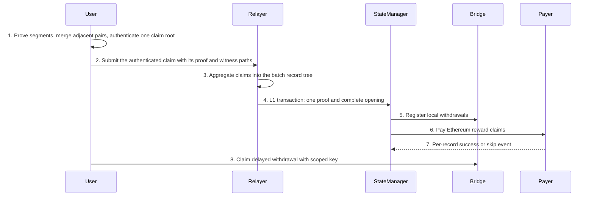

# Bridge Design

## Abstract

This document owns the selected bridge claim relation, generic proof-conversion boundary, deposit design, relayer signing infrastructure, and required negative controls. Reward claims use the pure-circuit route in §26; omitted jobs remain payable in later claims. The full ordered public-input vector reaches Groth16 verification without digest-half substitution.

## Motivation

One document must state one payment and proof contract. Claim authentication, checkpoint authentication, proof conversion, signing authorization, and payment evidence are separate obligations. A source citation describes inspected implementation; a required relation describes acceptance, not completed verification.

## Scope and status

Sections 24–26 retain their numbering so existing references remain usable. Section 25 is the selected deposit relation; its implementation and QA remain deferred under the current milestone scope. Section 26 owns reward and withdrawal semantics. Section 27 describes relayer signing infrastructure; it does not override the claim relation. Appendix A defines negative-control evidence. Unexecuted checks remain PENDING. This technical merge is not a design-review verdict, artifact approval, or deployment authorization.

The configuration hash identifies the encoded network configuration; matching it does not replace proof verification or consumption-state checks. Its current field list is defined by `NetworkConfig` and its encoder (`client_prover/psy_core/psy_data/src/bridge_aggregate.rs:561–625`). Configuration-field removal requires the pending field/consumer migration review; this document does not authorize deletion merely because a field appears redundant.

## Generic proof-conversion contract

**F5, direct public-input form.** The corrected PsyProtocol fork candidate starts from `35fd12a8117e53939703df6d7b98567933e65159`, the node `origin/mainnet-beta` dependency baseline. That baseline's production worker uses Boolean inputs and Keccak packing; its direct-vector example is not the production FFI route. The following is the required candidate contract, not a description of the unchanged baseline. Production `CRVerifierCircuit.PublicInputs` is `[]gl.Variable` with the gnark public tag. There is no `OriginalPublicInputs`. `Define` passes that same vector to `VerifierChip.Verify`. `Proof` stays secret. Retain active `rangeCheckProof` and `plonkChip.Verify`, both disabled in the baseline at `verifier/verifier.go:181,187`; FRI verification remains active. No serialized-R1CS API, `NativeIdentity`, or fixed two-public representation is introduced.

`GenerateProof` requires the proof public-input count to equal `common.NumPublicInputs`, assigns `proofWithPis.PublicInputs` directly, and emits ordered length-N `solidity_public_inputs` from `publicWitness.Vector()`. There is no host bit reconstruction, Keccak, 128-bit packing, or high-low split. `Setup` derives N from `common.NumPublicInputs`. Checks use N+1 R1CS public wires including constant one, `VK.G1.K` length N+1, and witness public length N. Prior packed artifacts are rejected. Existing signatures stay: `GenerateGroth16Proof`, `GenerateGroth16ProofFromJson`, `generate_groth16_proof`, and `generate_groth16_proof_from_json`. No new API, archive, or build change.

Binding remains Poseidon Goldilocks `HashNoPad` (`verifier.go:41-42`), feeding challenges and active PLONK verification. `public_input_gate.go:28-42` locks its four digest parts to the public-input gate. Outer public inputs are the original vector, not that hash. Goldilocks and statement bounds remain caller-side. `rangeCheckProof` checks proof openings and FRI, not public inputs (`verifier.go:120-121`).

Commitment-free output remains eight proof coordinates and N public inputs. In Setup's fresh-compilation branch, require `ccs.GetCommitments()` to be `constraint.Groth16Commitments` with zero entries and zero `CommitmentIndexes()` before setup; after setup require empty `PK.CommitmentKeys` and `VK.PublicAndCommitmentCommitted`. Do not require an empty `VK.CommitmentKey`: the pinned Pedersen setup initializes it even with no bases. After proving and before either serialization, require empty `proof.Commitments` and `proof.CommitmentPok.IsInfinity()`. The zero-count `pedersen.BatchProve` returns the zero affine point, whose infinity predicate is zero X and Y (`pedersen.go:126-129`; `ecc/bn254/g1.go:162-164`). QA must confirm this with a real commitment-free proof and reject populated commitments and nonzero PoK. These guards do not change artifact loading or caches. If retained proof constraints cannot produce that output, report the gate failure; do not remove those constraints.

Owned PI edits are `worker/worker.go` (`CRVerifierCircuit`, `Define`, `GenerateProof`), `worker/types.go`, current verifier tests, and the direct consumer in `psy_plonky2_circuits/src/bridge/circuits/bridge_wrap.rs`: `UncompressedGroth16ProofData.public_inputs`, `SharedGroth16Wrapper::prove_groth16`, and the deposit and withdrawal wrapper constructors and proof methods. The consumer preserves the ordered vector and checks the expected common-driven width; selected constructors register the original inputs without splitting or padding. Both JSON directions remove the fixed 2-or-6 count restriction. `publicWitness.Vector()` contains exactly N public elements and no constant-one element; emit all N without skipping index zero. Existing C and Rust FFI signatures and ownership remain unchanged. Planned checks are non-Boolean value preservation, two common-driven widths, changed or reordered input rejection, width mismatch, old packed-artifact rejection, caller Goldilocks bounds, retained proof-range tamper rejection, commitment-free width N, and an FFI roundtrip of N values. They are not executed. Artifact adoption remains an unresolved delivery gate; this checkpoint PI edit does not modify Setup caching or provenance. L1 opening identity and ABI migration belong to the next business cutover; this generic change does not prove that raw public inputs equal the submitted L1 opening.

Artifact adoption is operational: stop affected consumers, generate the direct-vector circuit and keys in a fresh process through the authorized regeneration path, bind the approved source configuration and generated circuit/key/verifier bytes in the product artifact record, then adopt those exact bytes after restart. The aggregate regeneration path currently selects business-specific constructors and must be migrated at the business-cutover gate before this assurance applies (`psy_cli/psy_relayer_cli/src/bridge/regen_groth16_keystore.rs:112-175`; `psy_plonky2_circuits/src/bridge/circuits/bridge_wrap.rs:303-325`). Prior packed artifacts are excluded from delivery through this regeneration and adoption gate, not through a claimed generic rejection of arbitrary same-path replacements. The native PI edit introduces no cache, locking, preload, or generic provenance mechanism. Generic verifier export alone is not proof of artifact provenance.

Product acceptance requires authentication of each actual finalizer proof under its branch-selected pinned verifier, with negative controls for both `zero_span` values that corrupt authentication while preserving public inputs. [user-ruling: `mem_lo_hi_removed_2026_10_11`] The complete raw width `8316+128*C` is 8444..9340 scalars; actual Solidity compilation, deployed size and verification gas must establish deployability. A static size concern is not measured infeasibility. No smaller statement or alternate verifier architecture is adopted here. Artifact generation and delivery remain unapproved until product binding, candidate review and execution gates pass.

## Deposit authentication requirements

Section 25 is the selected deposit relation. The following are first-class historical alternatives, not parallel implementation contracts. [user-ruling: `mem_d5_selection_recovered_2026_10_11`] D5-S remains selected. No alternative below was rejected by a measured RSS, degree or gas failure.

| Alternative | Historical definition | Disposition |
|---|---|---|
| independent-path | At `ccbcb003`, every one of 32 append slots carries its own ten-level Keccak membership path (`deposit_spiderman_append.rs:94,113,138-140,175-176`). The current `aggregate_commitment.rs:531-540` is a different node helper and is not that historical path function. | Displaced by later architecture; not a measured failure. |
| contiguous-multiproof | Commit `644dfa26` and `8cbe9522:docs/src/dev/bridge-merkle-claim.md:765-842`: one contiguous range under a 1024-leaf Keccak root, with a ten-height left/right boundary witness and the existing 40-field append statement. | Displaced by the one-global-circuit ruling; ancestor sharing was explicitly not a memory bound. |
| reduced-capacity transcript | The 2026-10-09 chain-local page transcript: one page proof, recursive page chaining and a parent commitment. Its rewrite used one K-slot append plus a parent Keccak and a prefix cursor. | Rejected because neither form gives one logical opening over exact raw records; the cursor changes acceptance. No degree measurement is its rejection ground. |
| separate withdrawal-registration | `8cbe9522:docs/src/dev/bridge-merkle-claim.md:1423-1450`: after publication, register each withdrawal through `claimAggregateWithdrawal` before retiring the window, without changing deposit proofs. | Superseded by the pure-circuit claim ruling; section 26 owns withdrawal registration and payment. |

Recursive page/chain proofs and rolling-head storage remain separate rejected forms named by section 25. Section 26 owns the current withdrawal contract.

The deposit binding has two obligations: L1 authenticates each local deposit against its saved leaf hash, and the proof binds the exact field-derived Poseidon leaves to the complete opening accepted by that contract. Membership of an L1 digest alone does not authenticate separately supplied private fields. Adding an honest digest beside altered fields in a Poseidon preimage does not prove their relationship. Section 25 requires the same constrained field targets for leaf hashing, routing and raw public inputs.

### 21.6. Named-circuit foreign-hash budget

Count complete logical message hashes, not absorb-helper calls or permutations. The selected deposit page relation and internal accumulator use Poseidon; the generic proof converter forwards the complete public-input vector without an opening hash. Each implemented circuit must have a source-backed count, and every circuit using a foreign hash must satisfy fewer than ten logical invocations and degree at most 14. Historical counts for removed graphs are not acceptance for the selected graph. Section 26 and the exact candidate review own the remaining named-circuit inventory; an absent count blocks generation.

Resource acceptance requires actual construction, proving and verification evidence for the selected graph. Static hash counts, earlier graphs and wrapper-only measurements do not establish current memory, transaction gas, deployability or payment success. [agent-discretion: retain the inherited bounded measurement envelope for comparable authorized runs, not as a claim of user agreement or demonstrated feasibility.] Use MemoryHigh 56 GiB, MemoryMax 64 GiB, SwapMax 0 and Rayon 1; the historical envelope is recorded in `.pi/plans/2026-10-08-rolling-head/scout-gas.md:109-121`. Increased RAM, swap, different thread counts and unbounded execution are not the selected envelope. No run is authorized by this document alone.

## 24. Delete the redundant identifier and packaging

The user ordered deletion of `window_id`/`windowId` and their packaging, not another decision on whether to delete them. This is part of the coordinated §26 claim cutover. The earlier session authorization, reward-ledger, claim-tree and two-proof layouts are not retained contracts; their offsets, widths and domain substitutions cannot govern the selected pure-circuit relation.

### Required binding

The accepted complete opening must bind every configured start and end, including openings with no deposits or payouts. Delete the redundant identifier and its derivation without replacing it with an end-only identity. The complete raw vector remains the proof interface. Any transport identity must be independently recomputable from its authenticated preimage; a same-width opaque value supplied by a relayer is not authentication. Native, circuit, service, CLI and Solidity consumers must agree on the selected schema and reject superseded schemas rather than maintaining aliases.

Preserve stable reward coordinates and immutable pending requests across retries. A new aggregate or transport identity does not reset consumed jobs. Preserve historical checkpoint authentication, endpoint/root/count continuity, field bounds and exact local deposit authentication. No synthetic origin root, bootstrap state or authorization may hide missing authenticated input. Section 26 owns the claim relation and opening layout.

### Coordinated execution and acceptance

The cutover covers codecs, public inputs, daemon/prover context, service transport, CLI callers, retained artifacts, Solidity interfaces/events and affected domain bytes. Configuration-field removal remains subject to the separate field-level justification and complete consumer migration review. Do not infer authorization to delete a field from its apparent redundancy.

Aggregate generator JSON and genuine loader verification precede the authorized combined regeneration. Circuit registrations, cached common/library pair, recursive fingerprints, Groth16 keys and matching Solidity verifier form one reviewed artifact set. The authorization exists; it is not evidence that generation or loading passed. Deployment and push are not authorized.

Required checks include native/circuit/Solidity encoding agreement; exact widths; superseded-schema rejection; changed starts with zero deposits and payouts; changed order, counts, roots or configuration; cross-context replay; unchanged reward consumption coordinates; immutable retry requests; and actual finalized payment/registration receipts. Review and execution remain PENDING for the combined candidate. Removed-circuit hash counts are not evidence for the selected circuit budget.

## 25. Complete D5 comparison and selected deposit relation

### Decision and scope

Implement D5-S: one global fixed-K Poseidon circuit containing ordinary Spiderman page gadgets, followed by generic proof conversion preserving every raw public input under F5. No page or chain recursive proof remains. K is 32; configured chains number 1 through 8. This selected relation is not a current degree or performance verdict. L1 must bind the complete submitted opening to that same ordered vector; two digest halves are not its replacement. Deposit implementation and QA remain deferred.

In scope: exact deposit/page binding, one deposit bound K, full old-page witnesses, removal of deposit page/chain recursion, retained accumulator seed/fold, complete raw public inputs and authenticated host recovery. Out of scope: dedicated checkpoint deposit-root wiring, deposit/finalization cursor separation, producer alignment, all-chain acknowledgements and deployment. Preserve authenticated finalization endpoint joins under §26. Window deletion follows §24 and the combined artifact gate; this deposit design does not authorize configuration-field deletion.

### Selected relation and rejected alternatives

Use one global circuit with full Spiderman pages, exact raw-field binding and L1 old-state induction. Do not retain per-record append alternatives, page/chain recursion, a foreign-hash parent, or mandatory dedicated checkpoint deposit-root wiring. F5 supersedes every earlier proposal to place the opening Keccak in Go or expose only its digest. The retained page, routing and accumulator constraints below are independent of that rejected proof interface.


### Complete winning constraints
[user-ruling: `mem_d5_selection_recovered_2026_10_11`] The selected topology is ordinary pages inside one global proof with the accumulator retained. [agent-discretion: implement that topology with exact coverage, authenticated recovery and a single fixed statement; independent review remains required.] The detailed choices below are not additional user quotations:

| Clauses | Reason for retained choice | Alternative not selected |
|---|---|---|
| 1–2: K32, C1..8, active prefix, strict order, exact count deltas | One admission bound and contiguous per-row appends expose omissions and prevent wrapped counts | Per-chain limits or sparse arbitrary ordering introduce a different admitted relation |
| 3 and whole-page relation | Full occupied leaves preserve existing deposits; maximal fill derives the pool from K and C | Per-record frontier is displaced by the page ruling; one page cannot cover the declared workload |
| 4,6 and wrapper raw equality | F5 fixes the complete vector; shared targets avoid an independently asserted opening | Digest halves and business-specific Go reconstruction contradict the later PI/genericity rulings |
| 5: fixed graph and zero padding | One setup shape and one inactive encoding | Variable graph sizes need distinct artifacts; unconstrained inactive fields admit multiple encodings |
| 7–8: local leaf checks and endpoint joins | Retain local acceptance while changing proof topology; another chain's proof is not its application receipt | Rolling-head storage, cursor separation and producer restrictions change protocol scope |
| 9: retained occupied leaves and frozen retry references | A frontier alone lacks the leaves required by the full-page witness | Replay on every warm proof repeats history work; trusting unauthenticated cached leaves is not recovery |
| 10: monotone positions and count-sum coverage | N distinct positions in N eligible slots establish exact coverage while hashing raw records once | Sorting networks, inverse scans and repeated raw hashes are unnecessary competing constructions |
| Accumulator and configuration binding | Retain the ruled accumulator without substituting it for raw equality or creating a circular circuit-set hash | Accumulator-only equality and embedding the finalized configuration into its own fingerprint are not selected |
| Product setup, identity and FFI | Keep artifact and business policy in the product while reusing generic conversion | Caller-selected keys, separate opening authority and business-specific generic FFI create extra authorities |


1. One compile-time K bounds the total active records across all chains. Active records form a prefix; N is range-constrained and N<=K. Configured rows occur exactly once, in configured order. Configuration-field deletion remains subject to the separate field/consumer review; this constraint does not authorize it.
2. Active records are strictly ordered by (chain_index, absolute_index). Every record belongs to exactly one configured row. For each row, consecutive absolute indices start at old_count; the number of records equals new_count-old_count. Counts and indices obey their existing u32 representation without field-wrap arithmetic (`deposit_aggregate.rs:88-93`; `frontier_append.rs:48`).
3. Instantiate a fixed pool of plain `SpidermanAppendProofGadget::add_virtual_to` gadgets with five bottom levels and 27 top levels. For a nonempty chain with n appended records and initial offset r=old_count mod32, canonical maximal page filling uses ceil((r+n)/32) pages; an empty chain uses none. For K records and at most C chains the tight capacity is K when K<=2C, otherwise 2C+floor((K-2C)/32); K32/C8 requires 16 pages, not one. Eight chains at offset31 with four records each attain 16. The pool is derived capacity, not a second admission bound. Each active page binds top_index=floor(current_count/32), offset=current_count mod32, and count=min(32-offset, remaining chain records). First/last roots and counts bind the row; consecutive page roots/counts connect; empty rows preserve both. Full old leaves preserve the nonzero occupied prefix; old suffix and new tail are zero, appended hashes are nonzero. No count addition may wrap u32.
4. The leaf's Poseidon inputs and L1's reconstructed opening words derive from the same verified deposit words. Generic conversion forwards the complete vector and does not reconstruct opening bytes. Preserve integer widths, byte order, range checks and Goldilocks root encoding. The absolute index is a position, not an added leaf-content word (`psy_plonky2_common_circuits/src/bridge/aggregate_commitment.rs:126-149`).
5. Inactive records are canonical zero and never advance state. Every allocated page remains in the fixed graph. Inactive pages use zero old/new leaves, zero index and zero top siblings; gate their joins to live chain state. Reuse `DepositSpidermanAppendTarget::new`: it calls `SpidermanAppendProofGadget::add_virtual_to` and treats `leaf_count == 0` as inactive (`deposit_spiderman_append.rs:37-78`). Its zero-page witness is accepted at lines 136-148. Opening bytes exclude inactive records; the public vector retains every allocated slot with constrained zero padding.
6. Generic Groth16 conversion verifies the pinned source conversion proof and exposes its complete ordered public-input vector without hashing, splitting or substitution. Product consumers reconstruct and compare the submitted opening against those exact fields, including inactive padding and all configured endpoints. No separately witnessed opening, row commitment or accumulator may replace that equality. Migrate every coupled product and L1 consumer with the schema; the generic fork contains no deposit relation.
7. L1 keeps indexed local leaf-hash comparisons, pending-count bounds and old root/count continuity. The base is the installed empty root/count; force-set remains an administrative exception, not an authenticated history proof (`Bridge.sol:48-49,209-217,396,574-587`). A shared proof does not certify another chain's application; each chain checks its own accepted state.
8. Preserve authenticated finalization endpoint equality and the accepted-opening retry relation in §26.5. An endpoint requiring more than K deposits remains a bounded-span limitation; zero-deposit checkpoint progress does not authenticate omitted deposits. No cursor rewrite or producer restriction is silently added.
9. Extend existing `VerifiedDepositPrefix` with occupied partial-page hashes, length count mod32. Its root/count/frontier, anchor and event-block fields belong to `guardian/verify_l1.rs:18-28`; incremental event authentication exists at lines 141-175. Persist this same tuple through the daemon's existing `FileReference` and `save_aggregate_file` path, with predecessor/successor references attached to the frozen opening. Write tuple files before atomic state references; advance the retained accepted endpoint only after durable destination completion. A retry uses the frozen predecessor. Warm proving reads retained state and new authenticated events once. Cold recovery reconstructs from authenticated history once and checks the required root/count; absent archival events or corrupt state fails closed. The current full-prefix fetch at `verify_l1.rs:227-238` is recovery, not the normal proving loop. Do not assume the current Bridge exposes the unrelated `getDepositFrontier` interface used by the separate batch-append path.
10. For each active raw record j, constrain a nine-bit physical address a=32*page+position into the 512 page positions; active addresses strictly increase. Select page fields with a 16-way lookup, require a live page and offset<=position<offset+page_count, and connect j=page.first_leaf+position-offset, record.chain_index=page.chain_index and record.absolute_index=page.old_count+position-offset. A four-limb lookup into the flattened new leaves equals that record's one Poseidon hash. The sum of page counts equals N: N distinct addresses into exactly N eligible positions proves exact coverage. Inactive records use address zero with semantic joins gated off. Active pages form a prefix ordered by configured chain ordinal and append order; at most 128 page/row memberships connect row initial/final and successive roots/counts. Row record ranges partition [0,N); page ranges are consecutive within each row and maximally filled except its final page. Structural cost is 128 limb lookups of width512 plus 32 page-field selections of width16 and at most 128 page/row memberships, not a measured gate count. No sorting network, inverse record scan or repeated raw-record hash is built. Fixed bounded circuit multiplexing is disclosed; host recovery has no Cartesian history scan.

### Whole-page correctness and root compatibility

Use full old and new 32-leaf arrays with the ordinary append gadget. Its unchanged nonzero old leaves are preserved, and the added-leaf indicators plus offset/count trichotomy prohibit omissions, overwrites and holes (`full_merkle_tree_append.rs:39-69`). A full old witness is not recoverable from a frontier alone: retain the individual occupied partial-page hashes, at most 31, with that frontier. Do not use `add_virtual_to_allow_existing` or treat an all-zero internal page root as the native empty-tree root; the gadget computes its subtree root from its leaves.

The page gadget directly connects its five-level subtree root to its 27-level top path, without an intervening page-domain hash (`psy_plonky2_common_circuits/src/hash/merkle/gadgets/spiderman_append_proof.rs:28-37`; `full_merkle_tree_append.rs:72-99`). This supports ordinary height-32 equivalence under the same zero conventions, but does not replace an executed regression. Do not change EMPTY_DEPOSIT_ROOT, claim-tree height or DepositInclusion fingerprints merely because the append proof topology changes.

### Structural cost and measured source construction

| Property | Selected D5-S | Per-record frontier candidate |
|---|---|---|
| Append shape | Derived pool of full 32-leaf pages, one global proof | K height-32 append gadgets, one global proof |
| Source-level Merkle work | 62 pair hashes for old/new bottom trees plus 54 for old/new top paths: 116 per page, 1856 at P16 | 128 per record, 4096 at K32 (`frontier_append.rs:59-80`) |
| Shared work | K record hashes, retained accumulator fold, ranges, exact routing and complete raw public-input verification | Same obligations; page routing differs |
| Retained witness | Root/count/frontier plus at most 31 occupied partial-page hashes | Root/count/frontier |
| Emitted gates and padded degree | C1..8 prebuild gates measured below; all degree 14, 16384 padded rows | Unmeasured |

Whole-page sharing is not page recursion. Structural hash counts exclude routing, public-input verification and Groth16 constraints; they establish neither a speedup nor current degree acceptance. Earlier opening-sponge estimates do not apply to F5, which forwards the raw vector without an opening hash.

The next two paragraphs preserve historical measurements only for their named source and output hashes. They do not establish the current candidate's construction, proof validity, performance or gate status.

Measured `DepositAggregateCircuit` construction at K32 reports prebuild gates for C1..8 respectively: **10825, 11000, 11176, 11352, 11528, 11704, 11879, 12055**. These are emitted `builder.num_gates()` values before `build`, not postprocessed unpadded row counts; every built source circuit reports degree bits 14 and 16384 padded rows. The captured serial release command `cargo test --release -p psy_plonky2_circuits --lib bridge::circuits::deposit_aggregate::tests:: -- --test-threads=1 --nocapture` passed three tests. Whole-command wall time was 22.65 seconds and process maximum resident set size was 1208916 KiB; neither number is an individual proof measurement or a Groth16 wrapper measurement. Source `psy_plonky2_circuits/src/bridge/circuits/deposit_aggregate.rs` SHA-256: `3df93dc5117ba8fd9affcf7f2b47c9fc1b5dde9c87e571c98cf52387d693d782`; captured raw output SHA-256: `cd0678be9cc4d24c689c5c1d3014b7702e45c3f7fefa79d5d12ddc300cb6712a`.

The current `deposit_aggregate.rs:440-461` constructs wrapper arguments and asserts `BridgeOpeningWrapper::build(...).is_err()` for the 1411-field deposit source. That assertion is not evidence that a deposit wrapper builds, proves, or verifies. Current wrapper acceptance remains unexecuted.

### Pre-cutover source statement and target schema

The current source statement is pre-cutover. `deposit_aggregate_pi_len` returns `27+17*C+39*32` (`client_prover/psy_core/psy_data/src/bridge_aggregate.rs:15-17`), and construction registers prefix `[2,11,1,0]`, config hash, window identifier, endpoint, count, rows and records (`deposit_aggregate.rs:230-238`). The top projection validates that prefix and reads endpoint fields at offsets 20..27 (`bridge_aggregate.rs:197-210`). This describes current code; it is not the selected cutover target.

[user-ruling: `mem_sprint_scope_freeze_2026_10_11`; agent-discretion: use deposit-child schema version 3 and delete exactly the eight window fields, preserving row, record and page relations.] The target statement is:

| Positions | Fields |
|---|---|
| 0..4 | `[3,11,1,0]`; version 3 with the existing family, variant and level |
| 4..12 | config_hash, eight big-endian u32 words |
| 12..14 | end_checkpoint_id, low/high u32; preserve the high-word-zero check |
| 14..18 | end_checkpoint_root, four native Goldilocks values |
| 18 | N, active deposit count, 0..=32 |
| 19+17*i | configured row: chain index; start id low/high; start root; old root; new root; old/new count |
| 19+17*C+39*j | record: chain index; absolute index; shield address; token address; L2 token identifier; amount; note commitment |

The target width is `19+17*C+39*32 = 1267+17*C`: 1284 at C1 and 1403 at C8. This arithmetic is derived from the selected field list, not a measured construction result. Page roots, paths, old leaves, routing, accumulator state and source-verifier pinning stay private and unchanged. [user-ruling: `mem_lo_hi_removed_2026_10_11`] The external top statement remains version 4, prefix `[4,12,0,0]`, and width `8316+128*C` (`bridge_aggregate.rs:38-42`; `client_prover/psy_core/psy_data/src/bridge_aggregate.rs:2063`). Its complete opening byte length remains `32*(15+16*C+7*D+10*Rw+15*Rr)`. The removed child fields are not currently projected, so the external schema does not shrink.

The native `DepositAggregateOpening` codec currently has no schema version and stores `window_id` (`client_prover/psy_core/psy_data/src/bridge_aggregate.rs:668-779`). Remove that field and `window_id()`, and encode a constant leading W32 value 3. Then encode config hash, end checkpoint, root, start count and starts, transition count and transitions, and deposit count and deposits. Decode only version 3 with exact completion. Require the installed config hash and approved artifact identity. Do not add an old-layout fallback or reinterpret old pending bytes. The sole L1 opening digest remains the complete version-4 opening digest; the changed internal codec digest is not a second accepted identity.

Registration identity `(11,0,1)` remains the same deposit role. Update its width through the helper and regenerate common data, verifier data and `circuit_set_hash`. Product setup identity, outer version and wrapper width stay unchanged; the pinned top verifier binds the revised child. Current sibling `StateManager` still verifies two `uint128` digest halves. That observed mismatch remains the separate F5 cutover; this child migration neither fixes it nor authorizes retaining it.
Integer words keep existing u32/u8 bounds. Root conversion uses canonical integers below the Goldilocks modulus. Leaf hashing, accumulator folding and record public inputs share targets (`aggregate_commitment.rs:126-175`). Reconstruct the existing ABI opening, including separate start/transition arrays, repeated chain indices and count words, from these verified fields; no independent opening witness exists.

The registered source must not embed a full configuration hash that depends cyclically on its circuit-set hash. Product validation and L1 acceptance bind the installed config hash, configured chain order and bootstrap policies after registry finalization. The source constrains row ordering, counts, start<=end and equal-id root equality; product acceptance must additionally check installed order, start>=bootstrap and equal-bootstrap-id root equality. Preserve end-id high-word-zero enforcement. These business checks never move into the generic Go verifier.

`DepositOpeningWrapper` verifies the source with pinned constant verifier data and forwards every original public input unchanged through cross-config conversion. The conversion adapts verifier hash representation, not the public statement. No SHA256 layer, compact substitute or page/chain aggregation may replace the raw vector.

The generic Go circuit follows F5: its public `PublicInputs` vector is exactly the vector passed to proof verification. `Proof` remains private. It neither reconstructs a deposit opening nor calculates an opening Keccak. Product-owned validation and the L1 verifier call bind each opening field and its range to the same complete vector. No `OriginalPublicInputs`, digest-half encoding or deposit-specific Go circuit remains.

Product setup identity binds the raw schema, K, installed configuration and policies, configured chain order, source/common/verifier fingerprints and conversion common/verifier through the existing product identity encoding. Generic FFI retains the F5 setup/prove APIs; no deposit-specific FFI function is added. Product loaders validate identity and exact circuit/key/verifier bytes and reject incompatible artifacts. JSON carries the proof and complete public inputs, not an independent opening or caller-selected verifier.

### File ownership and cutover

| Boundary | Required source changes |
|---|---|
| `deposit_aggregate.rs`, `deposit_spiderman_append.rs`, `chain_aggregate.rs` | Single record set/page pool and routing; remove separately proved deposit page/chain construction and coupled callers; author relation tests |
| `aggregate_config.rs`, client `bridge_aggregate.rs`, `aggregate_circuits.rs`, `config_gen_v2.rs` | One K admission bound, raw schema registration, remove obsolete deposit page/chain registrations and migrate registration consumers |
| `guardian/verify_l1.rs`, `guardian/verify.rs`, relayer `prove_bridge.rs`, `daemon.rs` | Extend retained prefix, extract full old leaves, save frozen predecessor/successor references, consume one global proof |
| `bridge_wrap.rs`, relayer `regen_groth16_keystore.rs`, gnark `worker/worker.go`, `cmd/main.go`, `ffi/src/lib.rs` | Product cross-config conversion and setup identity; generic complete-vector setup/prove/load/export cutover without a business-specific Go relation |
| `TERMINOLOGY.md`, existing affected bridge tests and operations docs | Register changed concepts, remove obsolete interface claims and document executed artifact procedures |

`DepositOpeningWrapper` names product-owned Rust source-proof conversion. Setup identity and configuration policies remain product-owned; no Go deposit circuit or deposit-specific generic FFI API is introduced. Existing `VerifiedDepositPrefix`, `deposit_accumulator_seed`, `deposit_accumulator_fold`, `DepositAggregateCircuit` and `DepositLeafTarget` retain their meanings. Frozen cryptographic labels are governed by TERMINOLOGY.md and change only with their complete affected artifact set.

Shared implementation interfaces: `DepositAggregateCircuit::new(chain_count)` builds the source; `deposit_aggregate_pi_len(chain_count)` returns the schema width; `prove(config, opening, pages)` consumes one flattened slice of existing `DepositSpidermanAppendInputs`. That witness retains only chain_index, old_count, first_leaf, leaf_count and append_proof; derive all other page fields and constrain their arithmetic. Compute the accumulator seed and K folds once, select checkpoints at checked page first_leaf and first_leaf+leaf_count within [0,N], and consume them in consecutive page/row boundary equalities. The exact record/hash routing remains the binding, not accumulator collision resistance. No duplicate host accumulator or page record array remains.

Any authorized removal of `NetworkConfig.max_deposits` must migrate native, circuit and Solidity encoders, configuration builders, CLI arguments and fixtures together. That field decision remains with the separate configuration review. Local relayer scheduling and gas limits are distinct from circuit capacity; their removal is not implied. A configuration change invalidates affected artifacts but authorizes no deployment.

### Verification and readiness

Implementation requires same-revision independent design-reviewer clearance of the relation, exact raw PI/byte layout, routing, retained-prefix owner/recovery, Go/FFI setup identity and coupled configuration codec cutover specified above. Runtime acceptance remains separate and no design verdict counts as executed QA.
After independent static clearance, required QA covers ordinary32 versus 27+5 roots at empty, unaligned and page-crossing counts; zero and maximum K; multiple and empty chains; duplicate, omitted and reordered deposits; changed fields, roots and counts; overflow; inactive padding; corrupt/stale frontiers; complete raw-vector/opening equality; genuine wrapper loading; and retained one-shot finalization semantics. Historical source measurements establish only their named snapshot, not the current candidate. Setup generation, genuine loading and the coordinated artifact set remain separate gates. Regenerate affected registrations, caches, fingerprints, keys and Solidity verifier together.

The earlier consolidation reported a 24478-byte Bridge runtime (98 bytes below EIP-170's 24576-byte limit) for an earlier artifact. That measurement is not evidence for the current full-vector verifier or current sibling contracts. Current deployability requires measured verifier and caller bytecode under the accepted compiler settings, without a size-limit override. Mock-verifier fixtures can establish transaction behavior only; they cannot establish Groth16 validity, setup identity, loader readiness or deployment acceptance.

## 26. Pure-circuit reward claims and checkpoint-authenticated withdrawals

> Revision 8 relation, 2026-10-11. Exact-artifact design and repair verdicts are recorded in the task ledger; they do not approve this edited consolidation or establish current execution. One pure-circuit L1 reward route remains selected. User-side proving cost, complete-candidate proof/payment and artifact acceptance remain PENDING. §25 deposit implementation and QA remain deferred; §24 governs the combined window-removal cutover.

### Abstract

Prove reward entitlements entirely in Poseidon circuits, and prove token withdrawal claims under the finalized checkpoint's user tree. A user aggregates completed jobs into one authenticated claim. Each nonempty `RewardSegmentCircuit` authenticates one source and 1..=`REWARD_LEAF_CAPACITY` jobs; `RewardMergeCircuit` composes ordered segments in a threaded pairwise tree. Within-claim disjointness and the per-user nullifier tree prevent replay; omitted jobs remain payable later. Each segment's amount is bounded by its source checkpoint's fee pool. Independent 32-slot withdrawal and reward Claim proofs feed one top recursion with D5-S and checkpoint finalization. Generic Groth16 conversion preserves its entire raw public-input vector. L1 binds the complete opening to that vector and registers withdrawals or pays claims with per-claim skips. No withdrawal append tree, L2 reward-balance credit, reward claim tree, special client reward prover or separately wrapped deposit/finalization proof is added. Earlier reward-session interfaces do not govern this port.

### Motivation

The selected relation authenticates withdrawals directly against token state and rewards through per-user consumed-job accumulator lineage. It removes the redundant withdrawal-tree authority and per-job L1 reward accounting. §26.2–§26.5 define these requirements; implementation and migration status are separate from this motivation. The accepted opening must bind every selected claim to the complete ordered proof vector before any L1 state transition.

### Table of contents

- [Terminology and naming](#terminology-and-naming)
- [26.1. Flow and authority](#261-flow-and-authority)
- [26.2. Pure-circuit reward claim](#262-pure-circuit-reward-claim)
- [26.3. Direct record relation and IMT prerequisite](#263-direct-record-relation-and-imt-prerequisite)
- [26.4. One proof and exact opening](#264-one-proof-and-exact-opening)
- [26.5. Layer-one application and transition](#265-layer-one-application-and-transition)
- [26.6. Deferred intake and services](#266-deferred-intake-and-services)
- [Data structures and examples](#data-structures-and-examples)
- [Core functions and loops](#core-functions-and-loops)
- [Static cost and foreign-hash budget](#static-cost-and-foreign-hash-budget)
- [Module and file changes](#module-and-file-changes)
- [Rationale and security considerations](#rationale-and-security-considerations)
- [Acceptance and release boundary](#acceptance-and-release-boundary)

### Terminology and naming

L1 means layer one; L2 means the PsyProtocol chain; UPS means user proving session; EndCap is its final proof; GUTA means global user-tree aggregator; CST means coordinator checkpoint state transition; GU, RU, DC and UC denote the GUTA, register-user, deploy-contract and update-contract reward subtrees in the existing CST frame (`docs/src/dev/reward-tree-circuits.md:16-17`). IMT means indexed Merkle tree; PI means public input; ABI means application binary interface; SDK means software development kit; CFC means contract function circuit; FFI means foreign-function interface. ULEAF, UCON, CSTATE and GCON retain their registered meanings, not alternate tree names (`docs/src/dev/TERMINOLOGY.md:109-179,262-287`). `H` below is native Poseidon hash-no-pad over the explicitly listed field sequence, not a byte hash. `P` is Poseidon two-to-one. `W32(x)` is one unsigned big-endian 32-byte word; `Hash4` is four canonical Goldilocks values. The spellings in the table below are the current §26 vocabulary.

| Domain concept | Final spelling and sibling mapping | Disposition |
|---|---|---|
| Reward job aggregation | `RewardSegmentCircuit` / `RewardMergeCircuit` | Segment authenticates one source and 1..=`REWARD_LEAF_CAPACITY` jobs with one height-32 outer nullifier delta; merge lifts a segment or composes two ordered, root-contiguous merge proofs. Business fields and checked sums follow §26.2; recursion follows §28 |
| Authenticated reward claim | `RewardRootStatement` | `RewardRootCircuit`'s 30-field public-input statement: user, recipient, initial/final nullifier roots, consumed-job count, amount and checkpoint-tree anchor. Sibling of `RewardSessionStatement`, carried by `RewardRootTargets`; the statement is currently the unnamed `[F; REWARD_ROOT_STATEMENT_LEN]` array in `reward_chain.rs`, and this cutover names it. Earlier draft spellings `RewardClaimRecord`/`RewardClaimRecordTargets` name no source symbol and are not external exemptions |
| Reward proof root circuit | `RewardRootCircuit` | Binds the final merge proof to in-proof private-key knowledge of the claim user and emits the published claim |
| Reward proof forms | `RewardSegmentProof` / `RewardMergeProof` / `RewardRootProof` | Proof of one segment, of one merge, and of root authentication. `RewardRootProof` already exists as the `reward_chain.rs:217` alias and is the published claim proof; the segment and merge proof forms are named for the circuits that produce them (content-justified, registered in `TERMINOLOGY.md`). The predecessor `RewardChainProof`/`RewardChainWitness` spellings are removed with the predecessor circuit in the same cutover |
| Claims-batch node | `RewardClaimBatchCircuit` / `RewardClaimBatchTargets` / `RewardClaimBatchProof` | Relayer-side three-mode node folding ≤32 claim tips into one root proof; empty mode proves zero claims, leaf mode verifies one tip, pair mode verifies two positive-count batch children. `batch` is the registered batch-node content word, not a process stage; the circuit is workspace-owned and claims no external protection |
| Payer argument | Solidity `RewardClaim` | The payer's six-word ABI tuple `(uint32 userId,bytes32 oldNullifierRoot,bytes32 newNullifierRoot,uint32 count,uint256 amount,address recipient)`, scoped to Solidity. The native row is the separate fifteen-word Rust `RewardClaim` opening record; no `RewardClaimTargets` type exists — the circuit-side representation is `RewardRootTargets` carrying `RewardRootStatement` |
| Per-user consumption accumulator | Solidity `rewardNullifierRoot` | One bytes32 Poseidon root per user over consumed job coordinates `n` (fused absence+insert per job). Accumulator lineage is the sole replay defense |
| Withdrawal consumed mapping | Solidity `claimedWithdrawals` | New keyed-by-`withdrawalKey` consumption mapping; the only consumption state after clean Genesis |
| Applied opening replay | Solidity `appliedOpenings` | New mapping keyed by `opening_digest`; replaces end-checkpoint-only publication exclusion |
| Authenticated job witness | `AuthenticatedJobWitness` | Each segment's job node leaf hashes, tagged-path siblings and tags, tag preimage and source id; host type follows the existing `RewardTagWitness` |
| Scoped pending withdrawal storage | Solidity `scopedPendingWithdrawals`; native `scoped_pending_withdrawals` only for the same storage projection | New mapping, never an alias for historical `pendingWithdrawals` |
| Settlement event | `WithdrawalSettled` | Protected ABI event signature specified in §26.5; namespace 1 identifies the scoped key, and no historical mapping is read |
| Direct withdrawal value | Token burn | Carries sender, token contract, nonce, recipient and amount. Existing `WithdrawalBurnRecord`/`WithdrawalBurnRecordTargets` spellings are workspace-owned naming debt, not external exemptions or a second authority |
| Split claim witnesses | `BridgeWithdrawalClaimWitness` / `BridgeRewardClaimWitness` | The withdrawal witness owns the user/contract/IMT membership chain; the reward witness owns the batch proof and the private statement index |
| Fixed claim proofs | `BridgeWithdrawalClaimCircuit` / `BridgeRewardClaimCircuit` | Two Poseidon-only circuits, 32 slots each; the top recursion verifies both |
| Network-wide raw opening and proof | `BridgeOpening` / `BridgeOpeningTargets`; `BridgeAggregateCircuit` | Opening value versus top-level Plonky2 recursion; Solidity library `BridgeOpening` remains its existing library name |
| Cross-config proof conversion | `BridgeOpeningWrapper` | Replaces deposit-only conversion at the port, not during D5-S |
| Generic proof conversion and product setup binding | `CRVerifierCircuit` / `BridgeOpeningIdentity` | Generic full-vector proof verification versus product-owned configuration and artifact identity; no business-specific Go circuit |
| Applied opening identifier | Existing `opening_digest` / `openingDigest` | Sole complete opening digest; no `window_id`, subset identifier, header digest or claim root |
| Withdrawal consumed key | `withdrawal_key` / `withdrawalKey` | Keccak of sender, token contract identifier and nonce |

Protected occurrences: `claimPendingWithdrawal`, `forceClaimWithdrawal`, `payRewards`, and `claimedNullifiers` retain their names while the ABI and storage behavior specified here changes. `WindowAggregateApplied` is a separate scheduled event-topic cutover and is not renamed in this slice. `applyBridgeWindow` is not protected and is not the current entry point; the current external function is `applyBridgeOpening(uint256[8] proof, bytes opening)`, with no old callable selector or compatibility shim. `REWARD_PER_CLAIM` names the current per-job payer amount; this design deletes that constant with the current payer and does not carry it into the pure-circuit amount. Existing cryptographic labels are not renamed in place. The new opening uses its own versioned label. `canonical` refers only to cryptographic encoding; `context` in existing API/type references and `metadata` in `ContractMetadata` are protected existing APIs, not proposed domain names. Names cited only to identify code this port deletes are evidence of the current source, not aliases of the §26 relation. Reward-session and reward-ledger rows in `docs/src/dev/TERMINOLOGY.md` describe that superseded publication contract; the §26 rows there name this port.

### 26.1. Flow and authority



Authoritative data flow:

```text
tagged job paths -> RewardSegment proofs (one source, <=16 jobs, one outer delta) -> RewardMerge leaf lifts and pair rounds -> RewardRoot authentication -> RewardRootStatement --+
RewardRootStatements (<=32) -> RewardClaimBatch root proof (one verifier instance) -------------------------------------------+
token burn -> sender namespace-6 withdrawal burn --------------------------------> end-checkpoint membership -> withdrawal claim proof --+
authenticated reward claims ---------------------------------------> reward claim proof (one batch root verification + statement binding) --+-> top recursion
authenticated checkpoint transitions --------------------------------+----------------------------------------------------------------------------------------------------------> top recursion
D5-S deposit proof and retained prefixes -----------------------------+----------------------------------------------------------------------------------------------------------> top recursion
top recursion -> raw-PI cross-config conversion -> ONE Groth16 + full raw vector -> opening equality on each configured L1
```

Events are discovery hints, never authority. The relayer reconstructs withdrawal witnesses at the selected end checkpoint; a missing path leaves the record unselected. Every active withdrawal record authenticates against exactly the same end `user_tree_root`. Reward claims authenticate each job in the counted GU prefix of its source checkpoint's complete CST-tagged reward root, and each source against the anchor `checkpoint_tree_root` carried by the claim. The top recursion obtains the withdrawal root from the verified final checkpoint, not a relayer constant. Finalization already owns authenticated checkpoint roots internally (`psy_plonky2_circuits/src/bridge/circuits/bridge_agg_final.rs:138-159`); the port exposes and joins `user_tree_root` instead of inferring it from a withdrawal tree.

### 26.2. Pure-circuit reward claim

The reward relation is one pure-circuit L1 payment route. It uses unbounded aggregation, Poseidon-only circuits, and a per-user consumption accumulator rather than a shared job registry. [user-ruling: `mem_no_duplicate_defense_2026_10_11`] Within one segment, duplicate consumption has exactly one defender: nullifier absence plus per-user root threading. Key order inside a segment is host scheduling and is not a verifier rule. A job omitted from one claim is not consumed and can be included in a later claim. No cross-claim key ordering is imposed. There is no L2 reward-balance credit and no second payment route.

**Job coordinates — proposed admission constraint.** Every eligible completed GUTA job has one injective coordinate `(source_checkpoint_id, height h, path index)`, with `2<=h<=21` measured from the global CST root. Require `0<=index<2^(h-2)`: the two highest active path bits are zero, so the authenticated node is N(2,0), the GU root, or one of its descendants. Fold all h path bits to the complete CST-tagged root stored as `pm_rewards_commitment.gutas_root`; that field is NOT the GU subtree root. The source producer lifts `[GU,[RU,[DC,UC]]]` into CST, but copies only the GU proof count into `gutas_completed` (`checkpoint_state_transition_proofs.rs:90-103`; `psy_plonky2_circuits/src/coordinator/gadgets/verify_agg_user_registration_deploy_guta.rs:109-129,247-251`; `docs/src/dev/reward-tree-circuits.md:178-205`). This admission bound matches the current circuit's zeroing of path bits at positions >=h-2 (`psy_plonky2_circuits/src/bridge/circuits/reward_inclusion.rs:75-82`) and the payer bound (`psy-contracts/src/EthereumRewardPayer.sol:68`); the mining contract's broader index bound is not the proposed domain. Keep `n=2^h-1+index` (`reward_inclusion.rs:60-74`) and `key=source_checkpoint_id*2^22+n`, checked as u54/two u32 limbs. Since `n<2^22`, the source bands do not overlap; the narrower height bands `[2^h-1,2^h+2^(h-2)-2]` are disjoint. Tag ownership remains `tag_preimage[0]=user_id` and `leaf_tag=P(tag_preimage,tag_preimage)` (`reward_inclusion.rs:83-109`): one authenticated job has only one owner, so two users cannot independently consume the same job under different per-user trees.

**Segment relation.** A segment has an active prefix of 1..=`REWARD_LEAF_CAPACITY` (16) jobs. Every active job belongs to one user and one `source_checkpoint_id`. [user-ruling: `mem_no_duplicate_defense_2026_10_11`] The circuit does not require active keys to increase; any host key order is scheduling, not proof validity. Slots `active_len..16` are padded witnesses: their tag preimage, leaf hashes and path siblings remain constrained, but they do not insert a nullifier leaf, advance the inner root or add count/amount. For each active job, enforce the counted-GU coordinate bound, hash `P(P(left,right),tag)` to `get_gutas_root(source)`, and connect that root to the source leaf's `pm_rewards_commitment.gutas_root`. Inactive fold levels are zero (`reward_inclusion.rs:95-108`). Authenticate the source leaf with the height-32 historical Merkle proof beneath checkpoint_tree_root. The segment inserts each active job once through the nullifier transition below.


**Per-checkpoint rate constraint — checked relation.** A nonempty node has exactly one source s. Let n_s be its active job count and a_s its nonnegative token contribution. Authenticate `completed(s)=gutas_completed(s)` and `fees(s)=guta_fees_collected(s)` from the SAME source leaf as its reward root (`psy_plonky2_circuits/src/gadgets/qdata/checkpoint_stats.rs:14-31`). Require `completed(s)>0`, `n_s<=completed(s)` and the unchanged rate `a_s*completed(s)<=n_s*fees(s)`. Reject that active source when its denominator is zero, even if its contribution is zero; a wholly empty reward batch uses §26.3's empty mode, not an active source. This is the aggregate pool rate of `../psy-compiler/psy-precompiles/mining_rewards/src/main.psy:90-108`. Its additional per-job unit cap `<5e9` is not part of this relation (`psy_core/src/constants/protocol.rs:12`). Checkpoint stats `gutas_completed` and `guta_fees_collected` remain; deleting the L2 balance-credit path does not delete them.

**Eligible-node/count correspondence.** The denominator counts GUTA proof nodes, not all tagged nodes and not just terminal leaves. The GU proof header binds its count into its hash and the same public commitment binds that header to its reward root (`psy_plonky2_circuits/src/guta/gadgets/guta_header.rs:84-137`). The producer recurrence counts a base/no-change proof as one (`guta_no_change_gadget.rs:27-73`), a unary proof as child count+1 (`guta_line.rs:21-52`), and a binary proof as both child counts+1 (`guta_linear_transition_gadget.rs:21-98`); EndCap inputs supply zero reward children rather than extra claimable tags (`docs/src/dev/reward-tree-circuits.md:115-123,134-152`). Thus by induction each authentic tagged proof node under GU consumes one counted unit. The RealmFinalize node adds one proof node; its actual-output commitment child is data, not a tagged job (`docs/src/dev/reward-tree-circuits.md:154-176`). Opening that data or a zero child as a tagged job would require a Poseidon preimage/collision, not merely knowing the producer tag. The counted-GU prefix excludes the part-1/CST wrappers, RU/DC/UC branches and their synthetic tagged parents entirely. Distinct coordinates, owner-tag binding and persistent absence+insert then give total successfully paid distinct jobs from s, across users/nodes/claims, at most completed(s). Summing each node's unchanged inequality gives total payout <=fees(s); splitting a source over nodes cannot raise its rate. This argument relies on the authenticated approved producer recurrence and collision/preimage resistance, not on a host assertion that all CST tags are counted.

**Integer representation.** These are circuit range and connect constraints, not properties supplied by the existing raw stats Targets. The source leaf authenticates one field Target for each of completed and fees. Decode each into two range-constrained u32 limbs and connect its authenticated Target to `limb0 + 2^32 * limb1`; separately require that integer reconstruction `<p` (Goldilocks modulus). Both checked products use exactly these connected limbs, never an independent witness amount. Compare as integers; completed is positive. Constrain n_s to the active-slot count, a u32. Represent a_s in the existing eight little-endian u32 amount limbs, connect limbs 2..7 to zero, and require the remaining u64 `<p`. This does not lower the rate: n_s<=completed and the inequality already imply a_s<=fees<p. Form both products by checked u64×u64 multiplication into four u32 limbs (u128), with range-constrained carries, exact integer reconstruction, and no discarded high limb; compare the four-limb results as unsigned integers, never field residues. The node's new_amount equals that one a_s in eight u32 limbs. The running and public amounts retain eight u32 limbs (u256) and use checked carry addition with zero final carry. Node and running counts use checked u32 addition with zero overflow. A nonzero a_s high limb, a noncanonical stat, an overflowing product encoding, or a wrapped sum rejects.

**Segment and merge circuits.** `RewardSegmentCircuit` proves 1..=`REWARD_LEAF_CAPACITY` jobs from exactly one authenticated source without a predecessor. The host prepares ordered source segments and their threaded nullifier paths, then proves segments independently. `RewardMergeCircuit` lifts each segment and reduces adjacent pairs, carrying an odd proof unchanged. Section28 defines the pinned recursion slots and mode constraints. No empty per-user business proof exists; auxiliary cyclic base proofs fill inactive slots only.

[user-ruling: `mem_lo_hi_removed_2026_10_11`] The 22 business fields are: `[0]` user_id; `[1..5)` checkpoint_tree_root; `[5..9)` old_nullifier_root; `[9..13)` new_nullifier_root; `[13]` count; `[14..22)` amount as eight u32 limbs. Segment exposes exactly these fields; merge appends its own cyclic verifier suffix. There is no route-boundary field. The segment's private outer start connects to its public old_nullifier_root.

[user-ruling: `mem_no_duplicate_defense_2026_10_11`, `mem_lo_hi_removed_2026_10_11`] A merge pair requires the same user, the same checkpoint_tree_root, and `left.new_nullifier_root=right.old_nullifier_root`. The parent old root is the left old root and the parent new root is the right new root. Checked addition gives the parent count and amount. The same source may span adjacent segments. A fresh claim may use a lower source or a previously omitted job: cross-claim authority is the stored accumulator root, not key order. Double consumption has exactly two defenders: nullifier absence (old empty leaf to occupied leaf) and this per-user root threading. Fold order is the producer adjacent-pair scheduler only (`psy_cli/psy_relayer_cli/src/bridge/prove_bridge.rs:317-361`). The segment active prefix is 1..=16 and inserts each active job, so a segment's old root differs from its new root; supplying the same proof twice fails that continuity.

Each active job uses one fused height-22 delta path (`DeltaMerkleProofGadget`, `psy_plonky2_common_circuits/src/hash/merkle/gadgets/delta_merkle_proof.rs:62-96`). The node has one height-32 outer delta. Connect all of the following in circuit:

1. Active jobs occupy slots `0..active_len`. For each active inner delta, constrain `index=n`, `old_value=[0,0,0,0]`, and `new_value=[1,0,0,0]`, using the same siblings for both folds. Thread `inner[j+1].old_root=inner[j].new_root` across active jobs. An inactive padded slot keeps a constrained tag and path witness, but its new leaf is zero, it does not insert, and it does not change the inner root, count, or amount.
2. The one outer delta uses `index=source`, `old_value=first_active_inner.old_root`, and `new_value=last_active_inner.new_root`. A source absent from the accumulator has `old_value=INNER_EMPTY_ROOT`. A later node for a source already updated in this chain opens that source's current inner root as `old_value` and does not reset it to empty. Both outer folds use the same siblings and source index.
3. Connect `outer.old_root=node_old_nullifier_root` and `outer.new_root` to the node's public `new_nullifier_root`. The outer update therefore commits the jobs inserted by this node.
4. Section28 replaces predecessor threading with `left.new_nullifier_root=right.old_nullifier_root` at each pair. The parent carries the left input root and right output root; root authentication publishes those complete claim endpoints and L1 checks the input root against stored state.

Inner height22 and outer height32 remain unchanged. Historical sentence, superseded by the user's two-level pairwise ruling: “A balanced two-child merge is not the reward-chain relation.” This records the rejected chain decision, not a current constraint. Section28 replaces predecessor-proof scheduling with threaded pairwise composition; state transitions remain ordered and there is no fixed hierarchy or 1024 bound.

**Root circuit `RewardRootCircuit`.** Verifies the final merge proof and binds the claim by in-proof knowledge of the user's software-defined zk private key. [user-ruling: `mem_lo_hi_removed_2026_10_11`] Its 30 public fields are `[0]` user_id, `[1..9)` recipient, `[9..13)` old_nullifier_root, `[13..17)` new_nullifier_root, `[17]` count, `[18..26)` amount, and `[26..30)` checkpoint_tree_root. [user-ruling: `mem_no_duplicate_defense_2026_10_11`] `RewardRootCircuit`'s `assert_non_zero(count)` is the sole protocol empty-claim defender. The payer does not reject zero count, and the batch does not repeat a job-count positivity check. Derive `public_key_param` with `get_zk_public_key_param` (Poseidon hash-no-pad, `client_prover/psy_circuit/psy_ups_circuit/src/signature/software_defined.rs:419-451`), then require `user.public_key = P(pinned_zk_scheme_identity, public_key_param)`. The zk scheme identity is a compile-time constant included in the verifier identity, never witness-chosen, and the param is not equated directly with `user.public_key` (`psy_plonky2_circuits/src/bridge/circuits/reward_session.rs:654-673,1173-1211`). Authenticate a checkpoint leaf beneath the claim anchor's checkpoint-tree root with the height-32 checkpoint path; hash its complete global-state-roots preimage into the leaf's global-chain root; authenticate the complete user leaf at index=user_id beneath that preimage's GUSR root with a height-32 path. Never connect a checkpoint-tree root directly to a user-tree root (`reward_session.rs:626-673`). The root proof freezes the recipient and connects both nullifier roots and the other claim fields to the verified merge proof. Authentication is paid once per claim, not per job. No secp256k1 gadget or new signature primitive is introduced. The nine-layer reward publication hierarchy is deleted. Generic conversion forwards the complete opening vector and computes no opening hash.

**Immutable-key premise (Defect B).** One user id has one immutable registered leaf public key. UPS start/current equality is constrained in `client_prover/psy_circuit/psy_network_circuit/src/gadgets/qdata/ups_context_input.rs:216-222,241-247`; EndCap copies the current leaf, changes only its nonce, and equates its key to the start key and `P(fingerprint,param)` (`client_prover/psy_circuit/psy_network_circuit/src/ups/gadgets/ups_end_cap.rs:64-93`). Thus an older authenticated anchor cannot preserve a revoked zk key for that same user id: account-leaf key rotation is not supported by this transition relation. Mutable multisig member policy is not rotation of this leaf key. This is a circuit premise, not a UI assumption. The selected zk-only relation requires the immutable key to match the pinned zk identity; it adds no scheme-selection fallback. Anchor authentication remains sufficient and no additional end-checkpoint user path is required. Introducing account-key rotation would invalidate this premise and require a revised end-state authentication relation before release; the existing reward end-checkpoint relation is the precedent, not a silently assumed rotation mechanism.

**Anchor freshness.** A claim's anchor checkpoint can be older than the bridge's finalized end checkpoint. The source-leaf-under-anchor membership reuses the circuit-side `historical_merkle_proof` gadget (height32 membership with `checkpoint_id<=end_checkpoint_id`, `psy_plonky2_circuits/src/bridge/circuits/historical_merkle_proof.rs:23-47`; current reward consumer `reward_chain.rs:462-463`). Binding the anchor root to the end root is the state-upgrade relation (`upgrade_checkpoint_historical_merkle_proof_gadget` / `HistoricalRootMerkleProofGadget`, `docs/src/dev/TERMINOLOGY.md:353`; `compute_historical_and_current_merkle_roots_core_gt` in `psy_data/src/proof_input/guta/agg/verify_end_cap.rs:32-48`). Its host-list anchor-root-binding variant remains a required extension, with private anchor index in `BridgeRewardClaimWitness`. The anchor is frozen in the authenticated claim; its source stats cannot drift. If the relayer cannot authenticate an anchor against the chosen end (forked anchor or unavailable history witness), it rejects that record during preselection and does not build an active record for it. A fresh proof establishing a valid anchor-to-end relation is required before selection; if the claim anchor changes, rebuild its bound user-side claim proofs too. This is NOT an L1 `RewardSkipped` event: every active reward record must already prove the anchor-to-end relation (§26.3), so a submitted invalid-anchor proof rejects batch authentication. No deep history window is required because the relation binds the anchor leaf's own count.

**Accumulator replay rule.** L1 keeps one bytes32 `rewardNullifierRoot[userId]`. A claim pays only when its packed `old_nullifier_root` equals the stored root (storage zero maps to `EMPTY_REWARD_NULLIFIER_ROOT`), then stores packed `new_nullifier_root` atomically with transfer. The per-user tree has exact inner height 22 keyed by n and outer height 32 keyed by source; fused absence+insert and the endpoint equalities above connect the claim to that lineage. A job omitted from the claim is not inserted and remains payable in a later claim. No cross-claim key ordering is required. A stale claim skips with `RewardSkipped(userId,oldNullifierRoot,reason=staleRoot)` and no state change. Another successful claim can already have consumed some of its jobs; retry reconstructs the confirmed tree, removes those consumed coordinates, and re-proves only the remainder. One storage slot per user replaces the current per-job mapping (`psy-contracts/src/EthereumRewardPayer.sol:22,79`). Count and amount are additive circuit outputs. Accumulator lineage is the sole replay defense, through stored-root equality and absence against occupied coordinates. [user-ruling: `mem_lo_hi_removed_2026_10_11`]

**Witness ownership and retry:** the user owns the reconstructible consumed-coordinate witness for this accumulator, including every successfully paid claim's `(source,n)` insertions and resulting tree nodes. Retain pending claim coordinates and proofs until a confirmed configured-Ethereum payment outcome establishes whether their root transition succeeded. A submission, skip, or publication is not consumption. After each confirmed success, apply those coordinates in the confirmed order and require the reconstructed packed root to equal `rewardNullifierRoot[userId]`. Lost local nodes are rebuilt from the retained successful-coordinate history, starting at the canonical empty tree. A stale-root retry first obtains the confirmed current root and that successful-coordinate history, removes consumed jobs, and builds fresh absence and update paths for every remaining job. A bytes32 root alone cannot supply paths; missing witnesses block proving rather than authorizing guessed paths. Concurrent user clients reconcile the same confirmed transitions before retry. This is user-owned proving material for the live accumulator, not a second protocol registry.

**Cross-chain property.** The claim and its opening broadcast identically to every configured chain; only configured Ethereum transfers the reward token, other destinations authenticate the published record.

Cost shape: for each source s with N_s jobs, prepare ceil(N_s/REWARD_LEAF_CAPACITY) segments; m is their sum. Produce m segment proofs, m merge lifts and m-1 pair proofs, followed by one claim authentication. The tagged fold costs ~45 Poseidon pair hashes per job (`reward_inclusion.rs:95-108`), the fused height-22 absence/insertion costs44 per job, and the height-32 outer update costs64 per segment. Source authentication and recursion are additional costs, not included in those hash totals.

### 26.3. Direct record relation and IMT prerequisite

**Positive membership reuse is established, not inferred from the type name.** The complete network IMT leaf implementation is a 13-field preimage `(key[4],value[4],next_key[4],next_index)` hashed with native hash-no-pad (`client_prover/psy_circuit/psy_network_circuit/src/gadgets/qdata/imt_leaf.rs:1-191`; canonical implementation `client_prover/psy_circuit/psy_common_circuit/src/hash/merkle/gadgets/imt_contract_state_update.rs:32-90`). The other-user reader connects GUSR root/index, ULEAF hash, UCON root/index, CSTATE path, full IMT-leaf hash and query-key equality (`client_prover/psy_circuit/psy_dpn_circuit/src/vm/gadgets/state_readers.rs:1062-1122,2222-2256`). Reuse that relation through common primitives, not the entire VM reader or a guessed positional slot.

For each active withdrawal slot:

1. Range-constrain sender to u32 and token contract identifier to 24 bits. Authenticate sender ULEAF at height 32 beneath the end checkpoint's GUSR. Authenticate token CSTATE root at that identifier beneath UCON at height 24. Authenticate the full IMT leaf at a private physical slot beneath height-32 CSTATE. Bind the actual hashes even for zero-balance users; do not use the existing bridge gadget's `balance==0 && default UCON` shortcut as proof of a present user (`psy_plonky2_circuits/src/bridge/gadgets/slot_value_in_contract_state.rs:67-110`).
2. Constrain IMT membership index and nonzero successor index to the approved token map's `[base+1,base+capacity]`; exclude its sentinel. Pin map base/capacity, state height, and approved GCON contract leaf through installed token policy, not witness-provided layout. Prove GCON membership once per configured token at the same end checkpoint or share the authenticated approved-leaf equality in the top recursion. An arbitrary user-deployed contract that writes the same bytes is not a token burn.
3. Derive key `H([6,H(nonce_u32_be[0..8])[0..4]])`. Derive value from exactly 34 fields: sender; eight recipient words; eight token-address words; eight amount words; eight nonce words; destination chain. This is the current producer preimage, including its order (`../psy-compiler/psy-precompiles/token/src/main.psy:213-218,279-302`; namespace hashing `../psy-compiler/psy-std/storage.psy:37-39,354-372`). Contract identifier scopes the path and L1 key; do not silently add it to the existing token hash.
4. Connect leaf key/value to these derived hashes. All recipient/token high padding is zero, amount is positive and below Goldilocks modulus to match the token/L1 amount policy, and destination is a configured u8 chain. The same raw targets become opening fields. Token-address words must equal the configured L1 mapping for `(chain_index,token_contract_id)`; token bytes asserted by a withdrawal call are not mapping authority.

Reward claims use a different circuit than withdrawal claims. A reward claim projects the published claim `(user_id, recipient, old_nullifier_root, new_nullifier_root, count, amount, checkpoint_tree_root)` from §26.2. [user-ruling: `mem_lo_hi_removed_2026_10_11`] User-side proofs establish authentication, rates and job membership; the relayer folds the selected `RewardRoot` proofs into one `RewardClaimBatchCircuit` proof. Its public inputs are a count in `[0,32]` and exactly 32 statement slots of 30 fields, with all fields of every suffix slot constrained zero. [user-ruling: `mem_no_duplicate_defense_2026_10_11`] Reward slots carry no in-circuit order relation; the producer adjacent-pair scheduler is the only fold order. The circuit has exactly three one-hot Boolean modes, not an unchecked verification-enable flag:

1. **Empty:** count is exactly zero and every field of all 32 statement slots is zero. Neither a tip nor a batch child contributes business authority.
2. **Leaf:** count is exactly one; slot 0 equals every field of the verified `RewardRoot` statement, and slots 1..31 are zero. Batch count counts claims, not jobs. [user-ruling: `mem_lo_hi_removed_2026_10_11`] [user-ruling: `mem_no_duplicate_defense_2026_10_11`] The batch does not require the tip's job count at root field 17 to be positive; `RewardRootCircuit` is the sole empty-claim defender. Batch mode and capacity checks remain.
3. **Pair:** verify two real own-type batch children, each with positive count; checked parent count is their sum and is at most 32. Parent slots are exactly the left active prefix followed immediately by the right active prefix, with the remaining suffix zero. [user-ruling: `mem_no_duplicate_defense_2026_10_11`] No join-order constraint is checked in circuit. Dropping, inserting or padding a child statement into the active prefix is forbidden.

[user-ruling: `mem_batch_suffix_binding_2026_10_11`; agent-discretion: retain separate proof targets because common data fixes each target's public-input width.] Use three verification slots (`reward_claim_batch.rs:203-228`): one foreign RewardRoot slot under root_common verifies the pinned real root in leaf mode and the matching auxiliary dummy otherwise; two separate cyclic slots under child_common verify real children in pair mode and matching auxiliary dummies otherwise. Inactive cyclic targets receive cyclic-base assignments satisfying suffix constraints. Register business fields and one verifier-data suffix before both cyclic helpers; both reuse that suffix and common data. One-hot modes gate all business equations; dummies contribute no claim authority. MANDATORY consumer constraint: build_reward must connect every field after REWARD_CLAIM_BATCH_STATEMENT_LEN to the pinned batch verifier's circuit digest followed by every constants/sigmas cap limb, checking the exact suffix width. Verifying the outer batch proof under a constant verifier does not itself bind the internal cyclic verifier suffix; host assignments and host-only cyclic checks cannot replace these circuit equalities. The consumer binding mirrors reward_chain.rs:603-617 and applies in every mode.

`BridgeRewardClaimCircuit` ALWAYS verifies exactly one real proof of the pinned batch circuit, including its empty-mode proof when there are no rewards. Its active-claim count equals the verified batch claim count. Every active claim's private statement index is less than that count, active indices are pairwise distinct, and each indexed statement is bound field-by-field to its opening projection; together these constraints make the indices bijective over the active batch prefix. Each active claim also proves the anchor-to-end relation. With zero rewards all claim words, indices and private paths are zero. The top ALWAYS verifies the real reward-claim proof and the real withdrawal-claim proof, even for zero, withdrawal-only or deposit-only openings; zero reward count is not permission to bypass either proof. L1 alone enforces the published accumulator old-root equality against payment storage; checkpoint anchors and chain tips remain authenticated in-circuit.

The claim adapter keeps inactive external anchor ids, leaves and sibling words zero. Before the historical fold, it selects the level-specific empty-tree sibling for each inactive slot and selects zero for that slot's internal end id; active slots use the supplied path and common end id. The fold roots connect to the authenticated anchor/end roots for active slots and to the computed empty checkpoint-tree root otherwise. Internal empty-tree hashes are not external padding words.

**Shared IMT repair is outside this cutover.** The former `state_readers.rs` nonmembership and sentinel instructions, the insert-only storage API, and the token contains-then-upsert rewrite are not prerequisites and are not authorized here. This exclusion does not judge the current IMT relation sound or unsound. Reward claims and withdrawal records use the existing underlying interfaces. Do not edit unowned IMT or token-storage code in this cutover.

### 26.4. One proof and exact opening

**Circuit graph:** `DepositAggregateCircuit` from §25, one `BridgeWithdrawalClaimCircuit` (32 slots), one `BridgeRewardClaimCircuit` (32 slots), and C configured checkpoint-finalization proofs feed one `BridgeAggregateCircuit`. It verifies pinned real child proofs, connects every end id/root, connects finalization end GUSR/GCON to the claim proofs, and connects each deposit new root/count to that configured finalization endpoint. Finalization no longer reads the deleted withdrawal contract. Keep checkpoint-history recursion; delete withdrawal/reward publication recursion and claim-tree construction. A finalization child for a chain already at the end still proves the end checkpoint under that same authenticated root; no fake identity/dummy business proof is accepted. The existing joins being replaced are `window_finalization.rs:75-157` and `StateManager.sol:222-234`.

**Zero-span finalization is a real relation, not active_len=0 in the current append circuit.** Use two pinned finalization child types with identical endpoint PI schema: the existing positive-span transition relation, and an end-checkpoint membership relation. The top verifies the selected real child, binds its verifier to that Boolean branch, and enforces positive `end_id-start_id` for the first type and zero for the second. The zero-span witness is complete terminal checkpoint leaf, height-32 checkpoint membership path at end_id, its global-state-roots preimage, and the same authenticated deposit endpoint/code extraction witnesses. Constrain start_id=end_id, start_root=end_root=membership.root, leaf hash=membership.value, global roots hash=leaf state root, and old/new deposit roots/counts equal. The already accepted L1 checkpoint root authenticates this statement; do not fabricate a fresh transition proof for a transition that did not occur. Both types expose identical end GUSR/GCON and endpoint targets to top joins. The positive branch retains its existing verified checkpoint transition and cyclic verifier binding. Current positive-only constraints are `bridge_agg_final.rs:250-254,272-325,371-374`; its terminal leaf cannot be recovered by merely setting active_len=0. Test forged terminal leaf/index, wrong unchanged root, changed deposits and mixed zero/positive configured chains.

Both finalization child types expose `18+5*C` Goldilocks public inputs: start checkpoint root at `[0..4)`, end GUSR at `[4..8)`, end GCON at `[8..12)`, end checkpoint root at `[12..16)`, end identifier at 16 and span at 17. Each configured chain contributes its deposit root and absolute count at `18+5*ordinal`. The authenticated terminal leaf's complete global-state-roots preimage binds GUSR/GCON; neither is an independent private witness. This replaces the former global deposit/withdrawal pairs and per-chain withdrawal roots. Both real child verifiers are registered and pinned independently.

Each claim circuit holds 32 slots — 32 withdrawals in `BridgeWithdrawalClaimCircuit` and 32 reward claims in `BridgeRewardClaimCircuit` — independent budgets, never 32 per chain or shared across kinds. Deposit retains its separate D5-S K32 bound. Claim slots form an active prefix per proof. [user-ruling: `mem_no_duplicate_defense_2026_10_11`] Sort active withdrawal claims lexicographically as full unsigned 32-byte words by `(chain_index,user_id,contract_id,reference)`, where the reference is the full nonce. Reward slots carry no in-circuit or payer order relation. The producer and relayer select reward rows in lineage order per user, with users ascending; that selection order is producer scheduling, not a verifier rule. Same-user reward claims in one opening stay distinct because the payer reads the current stored root for each row. `kind` is not a cross-kind dedup field because proofs and L1 consumption state are independent. Reward chain equals the configured Ethereum ordinal. Inactive words and private paths are zero with semantic root equalities gated; active membership cannot be disabled by a free selector. Each circuit allocates all32 slots.

RewardRoot public inputs preserve the current little-endian eight-u32 recipient and amount arrays. The claim projection reverses each array into its big-endian W32. [user-ruling: `mem_lo_hi_removed_2026_10_11`] Root inputs 1 through 8 encode the recipient and inputs 18 through 25 encode the amount; the recipient's last three input limbs are zero. The circuit enforces this recipient layout in `reward_chain.rs:557-560`, and its witness API checks it at `reward_chain.rs:587`. The claim never treats these arrays as field scalars.

**Wire version 4, no window identifier.** Encode the following sequence as 32-byte words; reject trailing bytes, wrong length, noncanonical fields and count overflow. Root limbs are separate W32 values strictly below Goldilocks. All integers occupy their unsigned low bits, addresses occupy low 160 bits, and byte strings retain all 256 bits. No economic-domain word and no `reward_cutover` word exist. The config hash and the payer's immutable token policy carry installation identity, and the per-user accumulator root is the reward replay commitment.

| Order | Complete opening words |
|---|---|
| Header, 15 words | version=4; installed config hash; end checkpoint id (u32); end checkpoint root (4 words); end GUSR root (4 words); configured chain count C; deposit count D; withdrawal record count Rw; reward record count Rr |
| C chain rows, 16 words each | chain index; start checkpoint id; start checkpoint root (4); old deposit root (4); new deposit root (4); old count; new count |
| D deposits, 7 words each | chain index; absolute index; shield address; token address; L2 token contract identifier; amount; note commitment |
| Rw withdrawal records, 10 words each | kind=1; destination chain; user; token contract identifier u24; reference = full withdrawal nonce; three zero words; recipient; amount |
| Rr reward records, 15 words each | kind=2; destination chain; user; contract identifier constant 7; old nullifier root (4 words); new nullifier root (4 words); count; recipient; amount |

Withdrawal records: kind 1, contract identifier is the token contract u24, reference is the FULL nonce — the complete 256-bit `bytes32` nonce in one word, matching the ns6 record preimage's eight nonce words (`../psy-compiler/psy-precompiles/token/src/main.psy:293-303`) and L1's `bytes32` key argument; the three words after the reference are zero, amount is zero-extended positive `<p`, and the token is resolved by the L1 mapping, not serialized. [user-ruling: `mem_lo_hi_removed_2026_10_11`; agent-discretion: a constant-zero word is dead data, and a replacement word would duplicate `old_nullifier_root`, which already identifies one claim attempt in a user lineage.] Reward records: kind 2, contract identifier is constant 7. Old and new nullifier roots each serialize as four separate canonical W32 limbs, not a packed single opening word. Count is the claim's merged job count, and amount is its token sum using all 256 bits. Opening length is exactly `32*(15+16*C+7*D+10*Rw+15*Rr)` bytes. Checkpoint finalization spans are derived as `end-start`; proof witnesses are not separately serialized authority. End GCON and approved-code membership are private but joined through the same verified checkpoint relation. Preserve six-root checkpoint hashing; stop using its withdrawal-related field as payout authority without inventing a root-7 schema.

**Exact top-level raw PI format:** four field prefix `[4,12,0,0]`, then eight big-endian u32 fields for every opening word, allocating C rows, 32 deposits, 32 withdrawal records and 32 reward records. Counts select actual byte length; all unselected words are constrained zero. [user-ruling: `mem_lo_hi_removed_2026_10_11`] Width is `4+8*(15+16*C+7*32+10*32+15*32)`, equal to 9340 fields at C8. Root words require their upper six u32 chunks zero and their remaining 64-bit integer `<p`; do not reduce arbitrary 256-bit integers into field targets. Header/rows/records are connected to verified child targets, not independently witnessed reconstructions. The deposit child's existing raw schema is projected field-by-field; its window word becomes private/dead only when the already-required window consumer/JSON/loader cutover is complete. Never retain it as a second accepted external identifier.

**D5-S field mapping:** define `U(x)=[0,0,0,0,0,0,0,x]` for bounded u32; `U64(lo,hi)=[0,0,0,0,0,0,hi,lo]`; and `F(x)=U64(x mod 2^32,floor(x/2^32))` with range checks and integer reconstruction x<p. Use the child positions in §25's raw-public-input table. Config words copy directly. End id maps through U64 with high=0; end-root limbs individually map through F; D maps through U. Each row maps its chain through U, start id through U64 with high=0, twelve root limbs through F, and counts through U. Each deposit maps chain/index through U, copies shield words, expands token words to `[0,0,0,t0,t1,t2,t3,t4]`, and copies token-id, amount and note words in codec-defined big-endian order without field reduction. The token-id high bits obey its u24 bound. Check the child prefix. Remove its window words with every coupled consumer under §24 rather than retaining an external identifier. Top-header GUSR comes from verified finalization joins; C is the compiled chain count, Rw/Rr the verified active counts, and version is constant4. There is no economic-domain header word.

The fixed raw PI buffers and variable opening bytes are distinct. Product encoding emits the 15-word header, all C rows, first D deposits, first Rw withdrawals, then first Rr rewards. Withdrawal bytes immediately follow selected deposits; reward bytes immediately follow selected withdrawals. Product and L1 validation must check these counts, all selected words and zero inactive slots against the complete fixed public vector. [user-ruling: `mem_lo_hi_removed_2026_10_11`] At C8/D32/Rw32/Rr32 the opening is 1167 words or 37344 bytes. This arithmetic is not measured proving cost. The generic Go verifier neither compacts this opening nor hashes it.

Generic conversion follows F5 and forwards the entire ordered raw vector. Product and L1 consumers must establish opening equality, ranges and exact vector length; generic conversion alone does not establish that binding. No digest decomposition, packed substitute or business-specific verifier in the generic fork is accepted.

`BridgeOpeningIdentity` remains product-owned and binds version, config hash, configured chains, token policies, capacities and source/wrapper/child/top fingerprints. Existing generic proof JSON crosses FFI; no serialized-R1CS API is introduced. A product-owned Go implementation is not prohibited by repository ownership, but it cannot replace the selected generic full-vector relation or weaken opening equality. Configured Ethereum remains the sole reward payer; keep `gutas_completed` and `guta_fees_collected` while removing L2 payout.

Acceptance requires zero task-introduced business symbols in the generic fork, the retained generic consumer API, completed product migration, independent static clearance and authorized execution. Historical wrong-location opening files are not delivery inputs. Cleanup reports and file absence do not establish artifact loading, proof validity or L1 payment.

### 26.5. Layer-one application and transition

**ABI:** retain `applyBridgeOpening(uint256[8] proof, bytes opening)` without an old selector or compatibility shim. Before state changes, decode the exact version4 opening, reconstruct its complete ordered fixed public vector under §26.4, and verify that vector with the installed generic verifier. An opening digest identifies accepted retries; it is not the verifier's public-input substitute. Check local checkpoint/deposit continuity and apply the selected deposit relation. Dispatch authenticated withdrawals to Bridge and authenticated rewards only to the configured Ethereum payer. [user-ruling: `mem_lo_hi_removed_2026_10_11`] Each reward argument is exactly `(userId,oldNullifierRoot,newNullifierRoot,count,amount,recipient)`. Token-policy, proof, encoding and continuity failures reject the transaction. A valid but unpayable individual claim follows the bounded skip rules below rather than reverting successful peers. Event-name migration remains part of the coordinated §24 consumer cutover.

**Withdrawal mapping and key:** install an authorized mapping `(local chain,token_contract_id)->(L1 token,approved L2 contract leaf,map base,capacity,height)`. The L1 projection resolves the token from `(chain_index, token_contract_id)`; no token-address word is serialized in the record, because the circuit already binds the record's contract state to the approved token leaf (§26.3) and the payer only ever handles its own configured token. The wrapper pins the full projection/code policy. Changes activate only with a reviewed installation that preserves outstanding token mapping or drains its pending withdrawals first. Native-asset address zero retains Bridge's WETH unwrap behavior, not an arbitrary token alias (`psy-contracts/src/Bridge.sol:659`).

The same installed token policy constructs the withdrawal record verifier and its exported opening verifier. The latter exposes `withdrawalTokenPolicyHash(chainIndex,contractId)`, computed as `keccak256(abi.encode(uint8(chain),uint32(contract),address(token),bytes32(fullLeafHash),uint32(mapBase),uint32(capacity),uint8(height)))`; `mapBase` is the physical sentinel slot, and `fullLeafHash` hashes the complete approved contract leaf. Installation checks this value against the installed verifier, requires the contract identifier to fit u24, height32, positive capacity and `mapBase+capacity<2^32`, and stores only the token projection and its policy hash. An unknown policy fails closed. Application checks the current verifier still binds that installed hash; replacing a verifier cannot silently change a pending withdrawal's token. The policy is an input to setup, not an appended token registry in `NetworkConfig`.

`withdrawalKey = keccak256(abi.encode(uint32(sender_user_id),uint32(token_contract_id),bytes32(nonce)))`.

All three key arguments are ABI-padded 32-byte words, not packed integers. The scoped mappings `claimedWithdrawals[withdrawalKey]` and `scopedPendingWithdrawals[withdrawalKey]` are the only withdrawal consumption and pending state; the clean-Genesis network installs them as the initial storage layout. Registration checks `claimedWithdrawals[withdrawalKey]` and pending state, skipping an already-consumed key. Scoped consumption is set only after successful delayed registration; failures emit `WithdrawalSkipped(withdrawalKey,reason)` without state changes. Force keeps executor/pause checks and bypasses time only (`psy-contracts/src/Bridge.sol:640-652`). Preserve current delay and total-cap policy.

Change user methods to `claimPendingWithdrawal(uint32 senderUserId,uint32 tokenContractId,bytes32 nonce)` and `forceClaimWithdrawal(uint32 senderUserId,uint32 tokenContractId,bytes32 nonce)`. Both resolve the scoped key, load only `scopedPendingWithdrawals[key]`, transfer only to that record's stored recipient and delete only that same mapping entry. Force keeps executor/pause checks and bypasses time only. Emit `WithdrawalSettled(uint8 namespace,bytes32 storageKey,address recipient,uint256 amount)` with namespace1 for the scoped key.

**Nonce front-running assessment:** the current burn key is per token contract — the ns6 record key is `withdrawal_record_key(nonce)` inside each token contract's own state map, with no sender component (`token/src/main.psy:293-303`); the scoped L1 key binds sender, token and nonce, so the new key removes cross-user and cross-token preemption. Same-scope duplicates identify the same immutable burn.

**Reward payer:** `payRewards(RewardClaim[] claims)` accepts only its StateManager and configured Ethereum chain, at most32 entries. [user-ruling: `mem_lo_hi_removed_2026_10_11`] The Solidity argument type `RewardClaim` is exactly the six-word tuple `(uint32 userId,bytes32 oldNullifierRoot,bytes32 newNullifierRoot,uint32 count,uint256 amount,address recipient)`, scoped to Solidity. It is not the native row: the native fifteen-word `RewardClaim` opening record registered in `TERMINOLOGY.md` is the distinct Rust representation these six fields project from, and no `RewardClaimTargets` circuit type exists — the circuit-side representation is the `RewardRootStatement` carried by `RewardRootTargets`. These are six ABI words per claim. For the 15-word opening record indexed from zero, project userId from word2, oldNullifierRoot from words4..7, newNullifierRoot from words8..11, count from word12, amount from word14 and recipient from word13. Pack each root by the canonical conversion below; never hash or truncate it. The authenticated `RewardRootStatement` owns all six fields, never the caller. Economic domain policy (reward token identity) remains immutable payer configuration. Consume one bytes32 accumulator root per user:

`rewardNullifierRoot[uint256(userId)]`.

The claim pays only if `oldNullifierRoot == (stored == 0 ? EMPTY_REWARD_NULLIFIER_ROOT : rewardNullifierRoot[userId])`; then `rewardNullifierRoot[userId] = newNullifierRoot` inside the same isolated operation as the transfer. Range-check the recipient — the statement's eight-word recipient must have its high 96 bits zero, constrained in `RewardRootCircuit` so the Rust/Go/Solidity `address` projections agree — and require `amount == circuit-bound claim amount` by construction (the opening carries it; the payer does not recompute it). [user-ruling: `mem_lo_hi_removed_2026_10_11`] [user-ruling: `mem_no_duplicate_defense_2026_10_11`] Stale-root mismatch, invalid, reserve-short or failed-transfer entries emit `RewardSkipped(userId,oldNullifierRoot,reason)` and leave the stored root unchanged; a failed unconsumed entry leaves the lineage untouched, and a stale-root skip is retryable only after the user re-proves against the current public root — a different skip class from reserve-short entries, which the same opening's replay can re-dispatch. The payer does not reject zero count. `RewardRootCircuit`'s `assert_non_zero(count)` is the sole protocol empty-claim defender; the consumer's batch count range and capacity checks remain untrusted-boundary input validation, not a second empty-claim defender. Positive amount is marked and transferred inside the self-only isolated operation; token failure or exact balance/supply mismatch reverts that operation, restoring the stored root. Preserve exact-receipt checks (`EthereumRewardPayer.sol:84-94`); no fee-on-transfer partial payment. One slot per user replaces the per-job `spentRewards` mapping (`EthereumRewardPayer.sol:22,79`).

**Root encoding and initialization:** for `Hash4=[limb0,limb1,limb2,limb3]`, require every limb to be a canonical u64 below the Goldilocks modulus and set `rootbytes = bytes32((limb0 << 192) | (limb1 << 128) | (limb2 << 64) | limb3)` using 256-bit integer shifts. Thus limb0 is the most-significant 64 bits. Decoding is the inverse and rejects noncanonical limbs. The opening still transports four separate W32 values per root, each with its upper 192 bits zero; packed rootbytes is only the payer/storage projection. The accumulator's empty leaf is exactly `Hash4=[0,0,0,0]` and occupied leaf exactly `[1,0,0,0]`. Starting from that empty leaf, repeat `x=P(x,x)` exactly 22 times to obtain `INNER_EMPTY_ROOT`; starting from that inner root, repeat exactly 32 more times to obtain the outer empty Hash4, then pack it by this conversion to obtain `EMPTY_REWARD_NULLIFIER_ROOT`. Storage bytes32 zero means uninitialized and maps to this computed root, never to a zero tree root. The inner height22 is exact because `n<=2^22-2`; it is not a tunable capacity or measurement fallback.

**Bounded reward calls:** outer `payRewards` checks StateManager authority, configured chain, at most32 claims and reentrancy before dispatch. Each `payReward` checks self-caller before any token call, rejects zero amount, zero/self recipient and noncanonical packed root limbs, then reads the current stored user root inside that call. [user-ruling: `mem_no_duplicate_defense_2026_10_11`] It does not reject zero count. Earlier successful rows are therefore visible; no pre-batch root snapshot is used. [user-ruling: `mem_lo_hi_removed_2026_10_11`] Same-user claims in one opening remain payable because each row reads that current stored root. Check payer token balance against the claim amount, preserve payer/recipient balance and total-supply exactness, then write the new root and emit `RewardPaid(uint32 indexed userId,bytes32 indexed oldNullifierRoot,bytes32 newNullifierRoot,uint32 count,uint256 amount,address indexed recipient)`. No external call follows receipt checks. Reverting this frame restores both payment and root.

[user-ruling: `mem_lo_hi_removed_2026_10_11`] Prepare one 196-byte self-call buffer and four-byte return slot before the loop: 4 selector bytes plus six ABI words of 32 bytes, the same formula that gave 228 bytes for seven words. Use low-level CALL with output size zero and copy at most four return bytes; do not use `catch(bytes)` or allocate arbitrary returndata. Closed `RewardSkipped(uint32 indexed userId,bytes32 indexed oldNullifierRoot,uint8 reason)` reasons are 1 StaleRoot, 2 InvalidClaim, 3 InsufficientReserve, 4 TransferFailed, 5 InsufficientGas. Only the three known inner error selectors map to reasons1..3; missing, short or unknown returndata maps to4, including indistinguishable empty revert and child gas exhaustion. Reason5 comes only from the outer pre-call gas guard. [user-ruling: `mem_no_duplicate_defense_2026_10_11`] StateManager does not reject a repeated user in one opening; its opening digest binds the payer's per-row logs to that call. Receipt matching keys on `(userId, packed oldNullifierRoot)`.

For remaining row count `r`, inner stipend `S`, parent attempted-row ceiling `H`, per-skip ceiling `L` and finish ceiling `F`, take the gas snapshot after patching the fixed call buffer. `H` bounds all parent work until the next snapshot: guard arithmetic, CALL setup and warm-call charge, bounded returndata handling, failure classification and its event, loop advancement and next-row buffer patching; it excludes the child stipend. `L` includes each tail row's calldata reads, skip event and loop advancement; `F` includes guard release and return. Attempt CALL only if `gasleft() >= H + S + floor(S/63) + 1 + r*L + F`. Otherwise emit InsufficientGas for every remaining row and return without reverting prior successes. These are exact-artifact measurement obligations, not guessed constants: QA must measure solc0.8.24 via-IR optimizer200 parent costs, complete exact-receipt token calls and full-stipend failure at32 rows. Protocol floors are warm CALL100, RewardSkipped1756 and RewardPaid2899 gas; compiler costs increase them. An outer transaction entering below the remaining-log budget can still revert entirely; transaction sizing is required. Proof/config failures are never converted into record skips. Withdrawal self-call containment retains its own authority and exact-transfer requirements; this reward budget is not a measured withdrawal budget.

`rewardCallGasCap` supplies `S` as a constructor-set immutable deployment policy limit, not a measured promise about arbitrary token execution. A token call path above this cap reverts only its row and becomes TransferFailed; an unaffordable cap produces outer InsufficientGas skips. `H`, `L` and `F` are finite source constants derived conservatively from the compiled parent opcode paths, never deployer-controlled values. Construction may compile and inspect those paths before review; no runtime measurement runs before independent implementation clearance. After clearance, QA must prove the configured token's successful exact-receipt path fits the chosen cap and the final compiled parent stays within its bounds. No bytecode patching, symbolic placeholder constants or refund subtraction supplies those bounds.

**Replay and retries:** replace end-checkpoint-only publication exclusion with `appliedOpenings[opening_digest]`. On the first opening, check local start equals current checkpoint; apply deposits/finalization and save acceptance before dispatch, under reentrancy protection. A repeat of the same accepted opening skips deposit/finalization advancement and re-dispatches its records after digest/encoding equality; new per-record consumed keys make successes no-ops and allow previously skipped records to finish. A different opening at the same end is allowed only with local start=end and unchanged local deposits; its record proof still binds that end. Thus more than 32 records can be serviced without forging checkpoint progress, and a reserve shortage does not forfeit a submitted claim. Freeze complete opening bytes and witness references until each destination has accepted it and every selected record has a success or retained retry disposition; publication alone is not payment. No separate pull claim-tree path remains.

**Single reward route:** configured Ethereum `payRewards` is the only reward payment. Delete the L2 balance-credit payout: `claim_pow_rewards` in `../psy-compiler/psy-precompiles/token/src/main.psy:492-515` and every caller of `claim_guta_rewards_1/2/5/10` (`../psy-compiler/psy-precompiles/mining_rewards/src/main.psy:167-313`, `client_prover/psy_prover/src/session/utils.rs:44-121`, and `psy-dapp/apps/ide/src/platform/claimMiningRewards.ts:696-746`). Keep checkpoint stats `gutas_completed` and `guta_fees_collected`; §26.2 reads them for the rate. Do not install `reward_cutover`, an L2 source guard, a proof-frame inventory, a consumed-key inventory, a claim deadline, or a forfeiture ledger. The accumulator starts at `EMPTY_REWARD_NULLIFIER_ROOT` for a user with no stored root. No second route pays the same job.

#### Token storage after payout removal

This clean-Genesis design candidate removes both unused storage Felts from each token. Independent review and execution remain pending. Reorder existing fields in both token contracts as `note_root`, `last_path`, `balance`, `other_user_info`, `note_count`, `state_map`; add no field and change no general compiler alignment rule. Current fields and private-claim slot assertion are in `../psy-compiler/psy-precompiles/token/src/main.psy:99-113,660`.

| Field | Felt offset | Merkle location |
|---|---:|---|
| `note_root` | 0 | Leaf 0, four limbs |
| `last_path` | 4 | Leaves 1 through 20 |
| `balance` | 84 | Leaf 21, limb 0 |
| `other_user_info` | 85 | Two Felts per user |
| `note_count` | 8589934677 | Leaf 2147483669, limb 1 |
| `state_map` | 8589934678 | Ceiling division by four gives base leaf 2147483670 |

Moving the root and frontier together preserves one complete Merkle leaf per Hash. This intentionally changes external storage addresses: migrate balance readers, sent/claimed array arithmetic, private append count reads, root defaults, and activity classification together. Note writes occupy Felt offsets `[0,84)` or exactly `8589934677`; classifying every offset above zero as private would misclassify public transfers. Change both private-claim root-slot assertions to zero while retaining full membership authentication. Regenerate token bytecode, ABI consumers and authorized clean Genesis only after the applicable gates. No live-state migration or deployment is authorized by this layout decision.

Remove the host-only prohibition on root slot zero in `../psy-sdk/psy-rust-sdk/src/private_note_checkpoint.rs:70-72` and `../psy-sdk/psy-rust-sdk/src/wasm/mod.rs:2242-2244`; keep all index-height, path-range overflow, membership and checkpoint coherence checks. The root at index zero remains authenticated, not exempted. Read note count from leaf `2147483669`, limb `1`, in node CLI private transfer, MCP wallet and SDK WASM; delete the preceding-root-leaf derivation and limb-3 assumption (`../psy-sdk/psy-rust-sdk/src/wasm/mod.rs:2326-2347`). Preserve MCP settled-count subtraction. Author root-zero valid-proof acceptance and wrong-path/checkpoint rejection tests before execution clearance.

Acceptance requires generated ABI offsets matching this table, balance/public-claim round trips, first and subsequent private append/claim, root-zero acceptance, wrong-slot and duplicate-nullifier rejection, and public/private activity classification. Circuit fingerprints change only when their actual circuit inputs change; moving a virtual slot witness is not itself a circuit redesign.

#### Repeated reward claims

The authoritative payer is the sibling contracts repository: `../psy-contracts/src/EthereumRewardPayer.sol:125-151` authenticates and advances a per-user root. Nested contract gitlinks still carry a different payout implementation and are not source authority for this cutover. The client must not initialize an already-paid user's tree from empty (`client_prover/psy_prover/src/local/bridge_aggregate.rs:306-307`).

Use one caller-selected reward state file, outside keystore storage, containing config hash, Ethereum chain and payer identity, user identifier, confirmed occupied coordinates grouped by source checkpoint, and at most one pending addition set. Coordinates are occupancy witnesses, not fresh payable jobs. Reconstruct each inner tree and the outer tree from sorted unique coordinates; reject invalid coordinates and duplicate new jobs. The recomputed tree, not a mirrored cached root, owns local consumption state.

Read chain identity and `rewardNullifierRoot(userId)` from the configured Ethereum RPC at one fixed block. Decode roots with the existing reward claim bytes32 codec; normalize only zero storage to the circuit's empty root. If the chain root equals the confirmed tree, retain pending additions as unconfirmed. If it equals the tree including pending additions, commit those coordinates and clear pending. Otherwise fail with missing consumption history; never reset to empty. While pending is unconfirmed, do not replace its additions with another claim. Store the pending claim request and added coordinates before submission so a retry can resubmit the same request after a failed HTTP exchange. Do not treat admission or an included opening as payment. Advancing local consumption from the authenticated payer root proves the consumed set, not the recipient's payment receipt; E2E separately requires the matching `RewardPaid` event and balance transfer.

Retry the stored request only while its admission context remains admissible. When the context changes, keep pending coordinates immutable and rebuild their proof against the fresh authenticated context only if the payer root still equals the confirmed tree. Replace only the pending request after saving it atomically; never select different jobs or discard pending consumption while replacing an expired admission request. Retain the original pending job identifiers needed to reload their authenticated witnesses. A later old-request payment advances the same occupied-coordinate set and is recognized by its root, regardless of which admission request reached payment.

Pass the reconstructed prior maps into `prove_reward`, preserve inner maps across chunks and sources, freeze the initial root for the claim statement, and advance the running root only through checked insertions. Write the one state file atomically under exclusive access so concurrent CLI invocations cannot overwrite each other's pending claim. Do not add an onchain history structure or a general persistence framework. Acceptance covers two paid claims for one user, more than sixteen jobs in one source, prior consumption in a reused source, duplicate rejection, stale local history, skipped payout, interrupted submission and exact-request retry.

### 26.6. Reward intake and services

The permissionless `POST /api/v1/bridge/aggregation/claims` carries exactly `{version:2,contextId,kind:"reward",proof,anchor}`. `contextId` is the configured bridge context digest as lowercase `0x` plus 64 hex digits; `proof` is canonical standard base64 of `RewardRootProof::to_bytes`; `anchor` is canonical standard base64 of the fixed 2696-byte public witness below. Reject unknown fields, noncanonical encodings, trailing bytes, other versions and wrong context. Do not accept caller-provided record fields, a separate anchor checkpoint identifier, private keys, source jobs or proving-session state. The configured genuine Root verifier is mandatory; a fingerprint supplied by the caller is not authority. This replaces the reward `record`/`transition` body consumed by `../psy-services/src/api/handlers/bridge.rs:4742-4751`; the route remains owned by `../psy-services/src/api/server.rs:85-99`.

The version-4 admission context keeps the existing config hash, end checkpoint identifier and end checkpoint root fields, with `maxRecords=32` and the existing 16 MiB proof limit. Its `claim_context_id` is `Keccak256(Keccak256(ASCII("PsyBridge/ClaimContext/4")) || config_hash || W32(end_checkpoint_id) || H4(end_checkpoint_root))`, where H4 emits four canonical W32 limbs. Context publication authenticates the endpoint before admission. This digest scopes queue admission before record selection; it is neither a window identifier nor payment authority. Inclusion and receipt validation separately authenticate the complete version-4 `opening_digest`; no final opening is required to compute admission context.

Every anchor scalar is an eight-byte little-endian canonical Goldilocks element strictly below `p`; indices additionally satisfy their circuit widths. Hash4 means four such scalars in field order. The fixed codec is independent of Rust layout and serde. Encode these fields in order:

| Byte interval | Public witness |
|---|---|
| 0..8 | Anchor checkpoint identifier |
| 8..40 | Checkpoint `global_chain_root` |
| 40..80 | Fees and counts: GUTA fees, DA fees, user operations, total transactions, modified slots |
| 80..104 | Completed deploy-contract, register-user and GUTA counts |
| 104..144 | Block time followed by random seed Hash4 |
| 144..240 | Register-user, GUTA and deploy-contract reward roots |
| 240..352 | Fourteen DA challenge values |
| 352..544 | Global contract, deposit, user, withdrawal, user-registration and validator roots |
| 544..1568 | Thirty-two checkpoint siblings, Hash4 each |
| 1568..1672 | User leaf: public key4, user state root4, balance, nonce, last checkpoint, event index, user identifier |
| 1672..2696 | Thirty-two user siblings, Hash4 each |

Keep `publish_context`, `list_queued` and `apply_dispositions` behind `authorize` in `../psy-services/src/api/handlers/bridge.rs:4486-4491,4725-4732,4798-4805,4871-4874`: authentication must be enabled, the validated subject must equal the configured publisher and carry the admin role. Permissionless proof admission does not call that administration guard. No admission fee, refund, reward deduction, per-user quota or invented economic incentive is introduced. Existing transport resource limits remain applicable. A caller cannot choose a trusted verifier, bridge context or authoritative end checkpoint.

[agent-discretion: producer selection order is lineage order per user with users ascending, and it is not a verifier rule.] Select admitted reward claims in that order, with one row per `(chain,user,old_nullifier_root)` per opening and an independent reward capacity of 32. Do not collapse distinct root transitions into one row per user. [user-ruling: `mem_lo_hi_removed_2026_10_11`] Store the derived 480-byte reward record and `proof_bytes = anchor_bytes || root_proof_bytes`; the fixed 2696-byte prefix makes the split unique. Retain the existing reward receipt construction at `../psy-services/src/api/handlers/bridge.rs:4415-4418`: Keccak of `domain_hash(LeafCommit) || config_hash || W32(3) || record_bytes || Keccak(proof_bytes)`. Set the queue key to Keccak of `W32(chain) || W32(user) || W32(contract) || packed old_nullifier_root`, scoped by the repository's config hash and reward kind; a user id alone is not a claim identity. Conflicting tuples cannot overwrite admitted bytes. Identical content returns its existing receipt; changed proof or anchor bytes require verification and cannot replace a conflicting active tuple. Preserve the existing seven-day queued/refresh-required admission expiry and non-expiring included state (`../psy-services/src/repositories/bridge_aggregation.rs:143-146,183-228,316-324,472-479`); applied rows use the existing updated-at expiry, not a new retention rule. Queue expiry never invalidates L1 payment.

The field order follows `psy_data/src/v1/qdata/checkpoint.rs:275-284,453-463,574-580`, `pm_jobs_completed_stats.rs:101-108`, `pm_rewards_commitment.rs:108-115`, and `user.rs:104-124`; the DA width is `psy_core/src/constants/protocol.rs:49`. This codec fixes both checkpoint and user paths at production height32. Intake checks exact lengths before decoding, validates the anchor leaf and user path against the Root proof's checkpoint root and user, and verifies the genuine Root proof once before admission. [user-ruling: `mem_lo_hi_removed_2026_10_11`] Derive the record solely from the verified 30 public inputs: amount fields18..25 are eight little-endian u32 limbs, so the W32 amount is their sum weighted by `2^(32*i)` and serialized big-endian. Recipient uses the same LE8-to-BE8 projection. Stored anchor witnesses do not authenticate a future end checkpoint; the record circuit proves that extension against its selected end checkpoint.

Successful aggregate delivery is not reward payment. Verify a finalized successful transaction to the configured StateManager, its `RewardAggregateApplied` event for the accepted opening digest, and a `RewardPaid` event from the configured payer in that same receipt whose six fields exactly match the derived record before marking a claim applied. The aggregate event's digest topic is checked by the existing `validate_family_log` boundary (`../psy-services/src/api/handlers/bridge.rs:4624-4646`); `RewardPaid` itself has no digest field. [user-ruling: `mem_lo_hi_removed_2026_10_11`] Replace the old `spentRewards` lookup in that reward path with payment-event evidence, not merely the current user root, which can advance again. A stale-root skip requires a fresh proof against the current user root; reserve, transfer and gas skips keep the same opening eligible for retry. Store skipped reasons through the payer's closed enum rather than parsing revert prose. Included claims remain non-expiring. Receipt identity, row tuple and opening identity remain distinct. Receipt matching keys on `(userId, packed oldNullifierRoot)`.

For reward receipt evidence, `log_index` identifies the exact `RewardPaid` or `RewardSkipped` event; the handler also authenticates the matching aggregate-opening digest event in the same finalized receipt. Withdrawal receipt indexing is unchanged. A reward skipped disposition stores its typed reason and transaction/log identity. Authenticated `StaleRoot` for the row's own opening applies the existing release state effect: queued or refresh-required according to context, with its opening association cleared and its skip evidence retained as terminal for that opening. The other four reasons retain non-expiring included state and the same opening association; they remain nonterminal so later payment can mark the row applied. Stale evidence permits scheduling a fresh proof, not an inference of lifetime nonpayment: a repeated delivery can stale-skip a row paid in an earlier receipt. An already applied row cannot be overwritten by a skip. Replay prevention remains the circuit's positive nullifier insertions and the payer's live-root equality, not queue state. Conflicting admission continues to obey the existing queue expiry; no new retention period is introduced.

Acceptance requires canonical codec round-trips and rejection of malformed, noncanonical and trailing bytes; genuine proof admission; wrong-context and altered-anchor rejection; tuple collision rejection; ordered 32-row selection; readmission after queue expiry; and exact paid/skipped event indexing with retry. User-to-services-to-relayer delivery and L1 payment remain pending until these scenarios execute against the complete candidate.

### Data structures and examples

All new structures are specified above and completed here; no optional authority fields exist:

| Structure | Complete fields and owner |
|---|---|
| Reward segment contribution | One source's authenticated jobs, count and amount, with old/new nullifier roots; pair composition checks the shared user and anchor, root continuity, and checked count and amount sums |
| `RewardRootStatement` | user u32, recipient `[u32;8]`, old_nullifier_root Hash4, new_nullifier_root Hash4, count u32, amount u256, checkpoint_tree_root Hash4; root authentication additionally binds the final merge proof |
| `BridgeWithdrawalClaimWitness` | Ten opening words including kind: complete user leaf, user siblings `[Hash4;32]`, contract siblings `[Hash4;24]`, IMT physical index u32, full member leaf, CSTATE siblings `[Hash4;32]`, map sentinel preimage and CSTATE path authenticating count. No caller-selected root. Code proofs are shared batch witnesses |
| `BridgeRewardClaimWitness` | Fifteen opening words including kind: one `RewardClaimBatchCircuit` root proof, a private anchor index, and a private batch-PI statement index |
| `BridgeOpening` | exact 15-word version-4 header, C exact chain rows, D seven-word deposits, Rw ten-word withdrawals, Rr fifteen-word rewards in §26.4; native constructor owns encoding, Solidity reads, generic Go preserves the ordered public-input vector without opening reconstruction [agent-discretion: product codecs own business encoding] |
| Token policy | chain u8, contract u24, token address, approved complete contract leaf, state height=32, map base u32, capacity u32; installation owns it, circuits/L1 read their projections |

Example: user 65536 proves 100 eligible GU jobs, 60 from source 100 and 40 from source 101. The host places source 100 in successive nodes of at most 16 jobs, then source 101 in later nodes. Each node authenticates only its own source, checks `a_s*completed(s) <= n_s*fees(s)`, and applies one outer delta. The chain ends at `count = 100` and `amount = a_100+a_101`. [user-ruling: `mem_no_duplicate_defense_2026_10_11`] Returning to source 100 inside this claim is a host schedule, not a proof-validity rule; the proof remains valid when the coordinates are absent and the nullifier transition is continuous. A fresh claim can use an omitted coordinate when it is still absent. [user-ruling: `mem_lo_hi_removed_2026_10_11`] L1 checks the lineage, pays `amount`, and stores `rewardNullifierRoot[65536] = new_nullifier_root`. These numbers are examples, not production configuration.

Example withdrawal: user 65536, contract 4, destination 1, nonce bytes32 value 9 and amount 100. The ten opening words are `[1,1,65536,4,9,0,0,0,recipient,100]`; its key is Keccak of three ABI words `[65536,4,9]`. Contract 0 or user 65537 with nonce 9 produces a different key. The IMT physical index is private and unrelated to numeric nonce 9.

```text
BridgeOpening 1 ---- C chain rows
              1 ---- D deposit records
              1 ---- Rw withdrawal records + Rr reward records ---- 1 kind-specific witness each
Reward claim  1 ---- independent RewardSegment proofs (<=16 jobs per source segment)
                    ---- RewardMerge leaf lifts -> adjacent pair rounds -> RewardRoot authentication
Multiple claims ---- existing cross-user pair rounds -> unchanged bridge claim binding
```

### Core functions and loops

The following are proposed signatures, not claims of existing implementation:

```text
prove segment witnesses independently, preserving their prepared nullifier paths
lift each segment proof, then merge adjacent proofs in rounds with odd carry
authenticate the final merge proof once with RewardRootCircuit
build_bridge_withdrawal_claim_proof(end_checkpoint_id: u32, withdrawal_claims: &[BridgeWithdrawalClaimWitness]) -> Proof
build_bridge_reward_claim_proof(end_checkpoint_id: u32, reward_claims: &[BridgeRewardClaimWitness]) -> Proof
build_bridge_aggregate_proof(deposit: Proof, withdrawal_claim: Proof, reward_claim: Proof, finalizations: &[Proof]) -> Proof
applyBridgeOpening(proof: uint256[8], opening: bytes) -> ()
applyWithdrawals(withdrawals: WithdrawalBurnRecord[]) -> ()
payRewards(claims: RewardClaim[]) -> ()
claimPendingWithdrawal(senderUserId: uint32, tokenContractId: uint32, nonce: bytes32) -> ()
forceClaimWithdrawal(senderUserId: uint32, tokenContractId: uint32, nonce: bytes32) -> ()
```

`Proof` here is `ProofWithPublicInputs<GoldilocksField,C,D>` at the pinned verifier. Segment proving, merge lifts, adjacent-pair reduction and root authentication are user-side proving. There is no L2 reward call. Record and aggregate builders prove §26.3 and §26.4; host checks never replace circuit connections.

User loop: split each source into ordered segments, prepare their nullifier paths once, prove segments independently, merge adjacent pairs with odd carry and authenticate the root. Retain pending coordinates and submit. Confirm payment before advancing the reconstructible nullifier tree. A stale-root skip requires the confirmed tree before remaining jobs are re-proved; paid jobs are omitted. Invalid anchors reject during preselection. Separate claims have no key-order restriction. Omitted jobs stay payable.

Relayer loop: on checkpoint/event availability, load an authenticated end checkpoint; collect unconsumed withdrawals and submitted claims; select independently at most32 withdrawals and at most32 rewards in each kind's strict order, plus the separate D5-S deposit budget; load paths/code at that checkpoint; build D5-S with retained authenticated predecessor; build finalization and both real record proofs (including the real empty reward batch when Rr=0); build top proof and one Groth16; atomically retain opening/proof/references; send identical proof/opening to each configured destination; record per-chain acceptance and per-record outcomes; keep skipped records eligible for retry under the same accepted opening or a subsequent checkpoint opening. On missing witness, select no such record; on proof/encoding failure stop that batch before transmission; on destination failure retain exact bytes. Shutdown ends the loop without dropping retained accepted or unpaid records. No repeated full deposit-history reconstruction is added to D5-S.

L1 loop: authenticate complete opening once; enter reentrancy guard; apply local continuity exactly once; for each local record invoke the isolated self-only operation; catch failure and emit the keyed reason; continue; clear guard. Successful withdrawal registration only creates a delayed pending record. Successful reward payment stores the claim's `new_nullifier_root` as the user's accumulator root inside the same isolated operation as the transfer. Token transfer failure rolls back only that record's root store and transfer, not a preceding record or checkpoint acceptance.

### Static cost and foreign-hash budget

Counts below are source-level structural work, not generated rows. The withdrawal storage path uses 32+24+32=88 Merkle parent hashes per active record, plus one user-leaf hash and one 13-field IMT-leaf hash. A withdrawal adds nonce hash, namespace hash and 34-field record hash — three Poseidon invocations, so 32 slots cost at most 96 record/key invocations. At 32 slots this is 2816 Merkle parents plus 64 user/IMT hash invocations and at most 96 record/key invocations, excluding shared checkpoint, approved-code reads, range constraints and recursion. Each reward record adds one anchor-to-end historical path (~32 hashes, up to 32 records) inside `BridgeRewardClaimCircuit`; the batch nodes add one or two child verifications each. Multi-block Poseidon invocations are not equated with one permutation or one circuit row. The structural dimensions come from the read relations at `state_readers.rs:1062-1122,2222-2245`, leaf layout at `imt_leaf.rs:42-63`, and contract tree height at `client_prover/psy_core/psy_config/src/network_constants.rs:8-18`.

Reward user-side cost: the tagged fold is ~45 Poseidon pair hashes per job; fused height-22 absence/insertion adds44 per job; each source segment adds64 for its height-32 outer update plus source-checkpoint membership and rate arithmetic. For N jobs in m actual source segments, that subtotal is `45N+44N+64m`, excluding authentication and recursion. The segment/merge tree adds `3m-1` proofs and `2+ceil(log2(m))` proof layers before one root authentication; fixed dummy slots still contribute verifier work. These are structural counts, not measured rows or latency (`I-REWARD-USER-SIDE-COST-UNMEASURED`). All reward Plonky2 circuits remain Poseidon-only.

| Named circuit in selected graph | Logical foreign hashes added by this relation | Row/degree requirement and measured evidence |
|---|---:|---|
| `RewardSegmentCircuit` | 0 | Tagged fold, accumulator absence/insertion, source membership, rate products and range checks; no predecessor verification; rows/degree PENDING |
| `RewardMergeCircuit` | 0 | One separate segment slot and two cyclic merge slots, mode-gated endpoint composition and checked arithmetic; degree16 construction target, actual common-data equality and measurements PENDING |
| `RewardClaimBatchCircuit` (three-mode) | 0 | Poseidon; empty mode proves count0/all statements0, leaf mode verifies one `RewardRoot` tip, pair mode verifies two positive-count batch children; pinned mode-selected recursion slots; rows/degree PENDING |
| `RewardRootCircuit` | 0 | Poseidon claim authentication (in-proof private-key knowledge, §26.2) and statement binding; rows/degree PENDING |
| `BridgeWithdrawalClaimCircuit` | 0 | 32 fixed membership chains plus shared authority; rows/degree PENDING |
| `BridgeRewardClaimCircuit` | 0 | 32 statement bindings plus one batch root proof verification; rows/degree PENDING |
| `DepositAggregateCircuit` D5-S | 0 | §25 unchanged; rows/degree PENDING |
| `BridgeAggChainCircuit`, `BridgeAggFinalCircuit` port | 0 | Poseidon checkpoint recursion/endpoint extraction; rows/degree PENDING |
| `BridgeAggregateCircuit` | 0 | Verifies C finalizations plus deposit and claim children; rows/degree PENDING |
| `BridgeOpeningWrapper` | 0 | Poseidon cross-config verification; rows/degree PENDING |
| Generic `CRVerifierCircuit` Go/Groth16 | 0 opening foreign hashes | Complete-vector verification under F5; Groth16 constraints/time/memory PENDING |
| Existing UPS signature circuits used by ordinary EndCaps | No new invocation or new reward-specific circuit | Existing authentication is retained, not certified by this draft; any affected foreign-hash Plonky2 circuit must have its full own budget and degree <=14 before implementation approval |

Every Plonky2 circuit that invokes a foreign hash must stay strictly below ten logical invocations and at degree <=14. There is no exception for recursive children, padding or setup hashing performed inside such a circuit (`AGENTS.md:95-104`). The obsolete `claim_reward_l1` 32-user Keccak measurement is DROPPED because that family is deleted; it is not a pending measurement or approval prerequisite. Poseidon-only segment/merge degree estimates are paper-only, never feasibility evidence. Removed reward/withdrawal Keccak trees have no selected-graph budget row because they are deleted, not hidden behind a wrapper. No speedup, memory fit, actual degree, proof time or gas number is claimed.

### Module and file changes

The table specifies required cutover scope, not completion status. Some implementation slices have landed in the working candidate; each requires its own exact-artifact review and execution evidence. Coupled tests, generated outputs and terminology migrate together. Setup generation and deployment retain their separate gates.

| File or owned file family | Planned hunk and reason |
|---|---|
| `psy_plonky2_circuits/src/bridge/circuits/reward_chain.rs` | Replace the predecessor circuit with `RewardSegmentCircuit` and `RewardMergeCircuit`; retain `RewardRootCircuit` authentication bound to the final merge proof. [user-ruling: `mem_lo_hi_removed_2026_10_11`] Hard PI checks: segment22, merge22 plus its cyclic verifier suffix (90 at cap height 4), root30. Remove predecessor witness fields and callers in the same cutover |
| `psy_plonky2_circuits/src/bridge/circuits/reward_claim_batch.rs` | One writer owns this entire file, production circuit and inline tests together. `+ RewardClaimBatchCircuit` three-mode node: exact empty relation, leaf slot0 binding, positive-child pair concatenation, pinned verification selectors and zero suffix; folds ≤32 claims into one real root proof for §26.3. Production changes in place: batch statement slots migrate to the 30-field `RewardRootStatement` (root width), the tip count offset moves to root field 17 (count offset), and the in-circuit statement order relation is deleted because fold order is the host scheduler only (order removal). [user-ruling: `mem_lo_hi_removed_2026_10_11`] Business statement `1+32*30=961`; cyclic public inputs 1029 at cap height 4. [user-ruling: `mem_no_duplicate_defense_2026_10_11`] The leaf does not recheck job-count positivity at root field 17 |
| `../psy-compiler/psy-precompiles/token/src/main.psy:492-515`, `../psy-compiler/psy-precompiles/mining_rewards/src/main.psy:167-313`, `client_prover/psy_prover/src/session/utils.rs:44-121`, `psy-dapp/apps/ide/src/platform/claimMiningRewards.ts:696-746` | Delete `claim_pow_rewards` and the `claim_guta_rewards_1/2/5/10` balance-credit callers. Keep `gutas_completed` and `guta_fees_collected`. Add no `reward_cutover` guard |
| New circuit-side historical checkpoint path gadget | `+ anchor-to-end-root membership/update gadget` reusing the historical→current relation (`verify_end_cap.rs:32-42`); required by §26.2 anchor freshness |
| `psy_plonky2_circuits/src/bridge/circuits/reward_session.rs`, `reward_session_witness.rs`, `reward_ledger.rs`, `reward_inclusion.rs`, `aggregate.rs` | Delete the session, ledger, and claim-tree reward graph after the tagged fold used by `reward_chain.rs` has a home there |
| `client_prover/psy_circuit/psy_dpn_circuit/src/vm/gadgets/state_readers.rs:1803-2167,2258-2335` | Outside this cutover. No nonmembership, sentinel, or insert-only repair is authorized here. |
| `../psy-compiler/psy-std/storage.psy:326-417` | Outside this cutover. No insert-only map API is added by this design. |
| `../psy-compiler/psy-precompiles/precompiles.json:21-63,89-97` and registry generator owning explicit IDs | Remove withdrawal_tree methods and preserve vacant id 3. No reward_session contract is added. |
| `../psy-compiler/psy-precompiles/withdrawal_tree/src/main.psy:245-311` and its package | Delete the obsolete append/root contract. Token records remain the existing authority. |
| `../psy-compiler/psy-precompiles/token/src/main.psy:300-302` and equivalent usdt withdrawal method | Outside this cutover. No contains-then-upsert rewrite or record-preimage change is authorized here. |
| `client_prover/psy_prover/src/local/bridge_aggregate.rs` reward paths and `psy_user_cli` claim construction | Local segment/merge/root proving and claim delivery; adapt circuit arguments while preserving command behavior and retry inputs. The worker tag-preimage flow (`basic_job_fetcher.rs:84-102`) is unchanged proof material |
| `psy_cli/psy_relayer_cli/src/bridge/daemon.rs:716-762,1141-1156,1464-1481,1575-1579` | `- withdrawal append and reward ledger state/proving; + checkpoint-pinned record selection, one proof, accepted-opening replay and per-record outcomes`; retain D5-S prefix recovery |
| `psy_cli/psy_relayer_cli/src/bridge/propose_withdrawals.rs:533-547,631-635`, `claim_withdrawals.rs`, `l1_client.rs` | `- append plan/call path; + direct record witnesses and scoped pending-claim ABI`; events remain discovery only |
| `psy-contracts/src/StateManager.sol:211-244`, `psy_cli/psy_relayer_cli/src/bridge/finalize_bridge.rs`, `l1_client.rs`, `daemon.rs`, and the Hardhat `BridgeOpeningCall` / `buildBridgeOpeningCall` helper | Rename the entry point to `applyBridgeOpening(uint256[8] proof, bytes opening)` with no old selector. The Rust and Hardhat proof/opening value is `BridgeOpeningCall`; the builder is `buildBridgeOpeningCall`. Preserve proof and opening bytes. `WindowAggregateApplied` stays until its scheduled event cutover. The earlier two-proof body at `StateManager.sol:211-255` is not the current function |
| `psy-contracts/src/Bridge.sol:591-695` | `- new claim-header/path route; + direct record registration, scoped keys, failure isolation and changed claim/force ABI`; preserve storage slots/delay/pause policy |
| `psy-contracts/src/EthereumRewardPayer.sol:13-95`, `IEthereumRewardPayer.sol:10` | `- per-job ABI/key/reserve-all-or-revert; + per-user accumulator root, lineage-checked full-amount payment and per-record skip with stale-root versus reserve skip classes` |
| `../psy-contracts/src/BridgeOpening.sol` and `IAggregateBridge.sol` | Exact version4 decoding and direct claim ABI; reconstruct the complete fixed public vector, including zero inactive slots, from the opening and reject every other length/layout. An opening digest identifies retries, not a replacement proof input |
| `psy_plonky2_circuits/src/bridge/circuits/bridge_wrap.rs`, relayer `regen_groth16_keystore.rs`, native dependency wrapper/worker/FFI files | One product-owned `BridgeOpeningIdentity` and generic complete-vector conversion; migrate setup/prove/load/export consumers together, with no opening sponge or digest-half substitution |
| Circuit managers, `config_gen_v2.rs`, paired cached circuit files, compiler `Makefile:221-247`, Genesis contracts/ABIs, affected SDK/services ABI and prover consumers | `- retired registrations/interfaces; + new code/layout/fingerprint set and compiler provenance`; update inclusion relationships and regenerate only after authorization |
| `docs/src/dev/TERMINOLOGY.md:291-374,459-558` and affected bridge operation/test files | `- superseded live vocabulary; + naming table and executed artifact procedures`; no historical protected-label rename by substring |
| Cross-repo reward consumers | `../psy-contracts/src/EthereumRewardPayer.sol`, `../psy-contracts/src/IEthereumRewardPayer.sol`, `../psy-contracts/src/BridgeOpening.sol:222-242` record reader, `client_prover/psy_core/psy_data/src/bridge_aggregate.rs:264-334` native decoder and `:546-549` ordering, `../psy-services/src/api/handlers/bridge.rs:4686-4687` reward log validation and `:5151` ordering, `psy_cli/psy_relayer_cli/src/bridge/daemon.rs:1138` and `:1588-1598` | [user-ruling: `mem_lo_hi_removed_2026_10_11`] Solidity six-word `RewardClaim` argument, native fifteen-word `RewardClaim` record, 480-byte record, 196-byte self-call buffer, receipt topics `(userId, packed oldNullifierRoot)`, and deletion of the host tuple checks that ordered rewards by user and minimum coordinate. [agent-discretion: the fork does not decode the opening.] `../gnark-plonky2-verifier/worker/worker.go:78-122` forwards the raw public-input vector; the named `worker/bridge_opening.go` is absent and is not a reconstruction requirement. |

Hunk notation above is a semantic plan, not an executable patch. The reward circuit module is `reward_chain.rs`; the batch module is `reward_claim_batch.rs`; claim proofs live in `bridge_claim.rs`. The obsolete multi-source accumulator API is deleted from `gadgets/reward_nullifier.rs` with its orphaned harness, retaining the source targets/witness and root codecs. Do not add a second `reward_claim.rs`, a precompile directory, a second reward ledger, or a ticket registry.

### Rationale and security considerations

1. **One authority per payout.** Token code owns burn records; the user's claim authentication (in-proof private-key knowledge) owns each reward claim; authenticated checkpoints own both state paths; L1 consumed state owns actual payment. Event storage and host caches do not become authority. Membership still requires approved contract semantics, not just a correctly hashed arbitrary contract state (§26.3).
2. **Accumulator lineage is the replay defense.** [user-ruling: `mem_no_duplicate_defense_2026_10_11`] The load-bearing check is the per-user accumulator: a consumed coordinate fails absence, and a job omitted from a claim is not consumed (§26.2). Root threading is the second and last defender.
3. **Existing membership interfaces remain unchanged.** This cutover does not repair `state_readers.rs` or token storage. Any IMT defect remains separate work and is not a prerequisite or an authorization to edit those files.
4. **One fee pool.** `a_s * completed(s) <= n_s * fees(s)` binds each node's amount to `gutas_completed` and `guta_fees_collected` on that node's source leaf (`../psy-compiler/psy-precompiles/mining_rewards/src/main.psy:90-108`). No payer constant can raise it. The accumulator prevents a second payment (§26.2, §26.5).
5. **Full payment and independent failure.** Insufficient reserves leave a retryable unpaid claim, never a partially consumed one. Scoped withdrawal registration retains recipient and delay. Reentrancy, malicious token returndata and child-call gas cannot be left to an unbounded loop (§26.5).
6. **User-side proving replaces the L2 balance credit.** The structural cost is ~45 tagged-fold hashes and 44 inner hashes per job, plus 64 outer hashes per node. That cost is unmeasured (`I-REWARD-USER-SIDE-COST-UNMEASURED`). The L2 methods `claim_pow_rewards` and `claim_guta_rewards_*` are deleted rather than guarded.
7. **One scoped withdrawal state.** Sender/token/nonce scoped keys are the only withdrawal consumption and pending state; there is no historical exclusion mapping or migration relation in this design.
8. **Single wrapper means single authentication boundary.** Wrapper bytes come from verified raw PIs, including every chain, record and amount. A separately supplied opening witness, caller-selected verifier or unbound config defeats the design. One proof is broadcast network-wide; acceptance on one chain is not proof another chain applied it.
9. **No inherited route verdict.** The selected direct record route replaces claim-tree-root publication. Prior review findings are evidence leads only. No review of the old claim-tree relation approves this relation; no existing operational hold is lifted.

### Acceptance and release boundary

Implementation acceptance covers the reward and withdrawal claim relation, opening schema, suffix binding, and registry cutover. It does not require new real-gadget cases for the excluded IMT repair. Existing membership behavior is exercised only through the interfaces already used by the claim circuits.

L1 cases include same nonce across users/tokens under scoped keys, duplicate consumed-key skip, native asset mapping, pause/delay/force rules, duplicate accepted opening, a second record batch at the same checkpoint, reserve shortage followed by successful retry, fee-on-transfer/reverting/reentrant token, bounded malicious returndata, mixed successes/skips without reverting prior success, and rejection of version-3 openings and the revision-4 10-word reward layout. Verify one actual Groth16 verification per apply, identical bytes on all chains, exact Rust/Go/Solidity opening/digest equality, genuine wrapper setup/load, and rejection of old two-proof/34-field/claim-path interfaces. Retest D5-S routing/prefix recovery without changing §25's selected relation.

Revision 8 acceptance requires the following. Authored checks remain PENDING until executed after the implementation review gate:

- **Distinct claims:** distinct `(source,n)` coordinates produce distinct nullifier leaves. A later claim with a smaller key pays when its coordinates are absent. [user-ruling: `mem_lo_hi_removed_2026_10_11`]
- **Empty and selector soundness:** real all-zero, withdrawal-only and deposit-only openings with Rr=0 verify an empty batch AND both real record proofs; singleton binds exactly slot0; mixed pair trees cover counts1..32; reject empty-mode active statements, nonzero suffixes, leaf count not1, positive pair with an empty child, sum>32, unpinned verifiers, altered mode selectors, dummy proofs used as business proofs, count mismatch, duplicate indices and omitted active statements.
- **Product compaction:** Rust and Solidity bytes and digest agree at C1 and C8 for `(D,Rw,Rr)=(0,0,0),(1,0,0),(0,1,0),(0,0,1),(1,2,3),(31,1,17),(2,31,1),(32,32,32)`. [user-ruling: `mem_lo_hi_removed_2026_10_11`] Check exact offsets `15+16*C`, then `+7*D`, then `+10*Rw`, total `15+16*C+7*D+10*Rw+15*Rr`; no inactive allocation bytes enter the digest. Reject old version/identity and trailing bytes. Generic Go acceptance checks exact ordered public-input-vector preservation, not business decoding. [agent-discretion: product codecs own opening reconstruction]
- **Root vectors:** agree across Rust and Solidity on distinct-limb packing/unpacking, zero and occupied Hash4 leaves, all 22 inner empty levels, all32 outer empty levels, packed `EMPTY_REWARD_NULLIFIER_ROOT`, first insertion and first payment from uninitialized storage. Reject limb=p, reversed limb order, nonzero W32 high padding and treating bytes32 zero as the actual empty tree root. These are required vectors, not claimed generated results. [agent-discretion: root encoding belongs to product-owned Rust and Solidity tests, not the generic Go verifier]
- **One source, active prefix, and one route:** two sources in one node fail. The host, not the circuit, splits a multi-source job set into successive one-source nodes before proving; that host split is an implementation acceptance case, not a claim that host delivery is complete. A node accepts an active prefix of 1..=16 jobs. Slots after `active_len` keep constrained tag and path witnesses, insert no accumulator leaf, and add zero count and zero amount. [user-ruling: `mem_no_duplicate_defense_2026_10_11`] Source and key order are host schedule, not proof validity. A decreasing coordinate remains valid when its nullifier is absent and the root transition is continuous. A fresh claim may use an omitted coordinate when it is absent. [user-ruling: `mem_lo_hi_removed_2026_10_11`] Chain length is 22 and root length is 30, with no `reward_cutover` field. `claim_pow_rewards` and `claim_guta_rewards_1/2/5/10` balance-credit callers are deleted. `gutas_completed` and `guta_fees_collected` remain. A lost accumulator is rebuilt from confirmed coordinates; missing witnesses fail closed. Authored circuit tests are not execution evidence.
- **Authentication:** reject a raw zk param equated directly with the leaf key, wrong pinned scheme identity, wrong user id or user path, fabricated global-state-roots preimage, checkpoint-root/GUSR substitution and unauthenticated checkpoint leaf. Preserve the immutable same-user public-key equality in UPS/EndCap; the root's anchor-based authentication relies on it. No executed regression is claimed.
- **Counted-GU domain:** construct the actual four-child tagged part-1 tree and CST lift with a known producer tag. Supply fully root-authenticated synthetic N(2,1), h=2/index=1/n=4, and N(3,3), h=3/index=3/n=10. Both MUST fail the GU-prefix bound despite valid tag ownership and full fold equality. Likewise reject RU/DC/UC nodes; accept eligible GU N(2,0) and valid descendants through h=21, and reject index=2^(h-2) at each allowed height. These are negative cases for the proposed relation, not claims of an executed exploit.
- **Denominator and integer boundaries:** an active source with completed=0 rejects for both a_s=1 and a_s=0. Reject a limb split that does not reconstruct the authenticated completed or fees Target, a product disconnected from that split, nonzero a_s limbs2..7, completed or fees>=p, n_s>completed, a dropped product high limb, and wrapped count or amount. With completed=1 and n_s=1, accept a_s=fees and reject a_s=fees+1, including products above p compared as integers. A merged amount above u64 is not rejected merely because its high limbs are nonzero.
- **Endpoint connects:** reject an inner old value other than zero, an inner new value other than one, wrong n or source, broken inner-root threading, outer old value detached from the first active inner root, outer new value detached from the last active inner root, a second source inside one segment, a pair with left.new_nullifier_root unequal to right.old_nullifier_root, and a published endpoint detached from the final merge proof. [user-ruling: `mem_no_duplicate_defense_2026_10_11`] Accept one source split across adjacent segments, including a decreasing-coordinate seam, when absence and nullifier continuity hold. Key order is not the rejection condition.
- **Invalid-anchor outcome:** preselection rejects a forked anchor or missing anchor-to-end witness without constructing an active record or emitting an L1 reward-skip outcome. Forcing that record into the batch fails its mandatory record proof; a fresh proof with a valid authenticated anchor-to-end relation is required before selection. Rebuild bound claim proofs when changing the anchor. An old but authentically extendable anchor remains valid.

After implementation, test authoring and independent static clearance, actual-artifact measurements may report rows, degree, proving time, peak memory and Go constraints. Unexecuted measurements remain PENDING; the removed claim_reward_l1 Keccak measurement remains DROPPED. Segment/merge padding is a construction target, not measured feasibility. Do not silently reduce REWARD_LEAF_CAPACITY or the settled32 cross-user capacity. Gate4 includes the affected registry and fingerprint regeneration under the applicability and artifact rules; it does not authorize unrelated EndCap/Genesis regeneration, deployment or push. Preserve ordinary GUTA reward-tree modes and offsets. No generation, runtime, build or test was executed for this design revision.

Review order: revision 8 is a draft, not an approval. Prior-version evidence does not approve the changed relation. Unexecuted checks remain PENDING. `I-REWARD-USER-SIDE-COST-UNMEASURED` and `I-REWARD-CLAIM-INTAKE-UNSPECIFIED` stay open. Section28's clean design, distinct design-reviewer verdict and final user approval precede fixture-first circuit implementation. Daemon claim intake, services and end-to-end reward delivery also require the intake contract in §26.6. The anchor-to-end membership extension and L1 deployability remain delivery acceptance; deferred D5-S implementation is not a prerequisite to reward topology authoring. The superseded shared IMT/Genesis repair is excluded by §26.3. No build, test, proof, setup, generation, deployment or push is authorized by this design handoff.

### First-review finding dispositions and focused revision

The 2026-10-09 frozen draft received GLM **PASS**, Grok **CHANGES**, and GPT **non-approving consistency findings**. These dispositions apply verbatim to the withdrawal half and topology, which revision 2 carries unchanged in intent; the reward half they refer to (native session contract) is superseded by the §26.2 redesign and these findings no longer describe it. GPT remains the prior drafting model family. Parent-led deliberation and different-model focused review must resolve outstanding findings before the design gate.

| Finding | Disposition in this revision |
|---|---|
| GPT C1 / Grok8 | Accepted: distinct scoped pending mappings, exact precedence and events; the historical-nonce collision regression is dropped with the historical state it exercised |
| GPT C2,C5 / Grok2 | Accepted: authenticated sentinel count, complete root-chain/witness/scope relation with one scoped storage state; no host cursor authority |
| GPT C3 / Grok7 | Accepted zero-span gap: real pinned endpoint-membership child, not dummy transition. Checkpoint acceptance remains independent of payment; retained outcomes/retry stay required |
| GPT C4 | Accepted: distinct payout ABI (then `RewardPayout`; revision 2 renames it `RewardClaim` with different fields); record-hash intent carried by the authenticated claim statement |
| Grok1 | Counted GU prefix retained: `2<=h<=21`, `index<2^(h-2)`, `n=2^h-1+index`. No proof-frame inventory is an activation prerequisite |
| Grok3 | Layout clarification accepted. Height objection rejected: GUSR32 from `psy-genesis/config.json:6,82,158`, token/USDT32 from `psy-genesis/genesis_abi/abi_list.json:9,37`, UCON24 from `client_prover/psy_core/psy_config/src/network_constants.rs:9`. Reward physical base16 is intentionally not token base2147483670 |
| Grok4 | Separate parent-tag proof rejected: `mining_rewards/src/main.psy:55-83` hashes each active tag into the path whose root must equal authenticated get_gutas_root; tags are witness preimages, not unauthenticated outputs. Alteration requires breaking the hash commitment |
| Grok5 | Exact raw projection/variable-length compaction clarified; fixed-padded external encoding is unnecessary and not adopted |
| Grok6 | Retained exact config bytes/hash/domain with explicit loader ownership and fail-closed checks; source registry precedes downstream Go/setup and activation. No economic preimage/fingerprint exclusion change; independent focused closure required |
| Grok9 | Accepted exact four-field low/high endpoint encoding; no extra zero word |
| Grok10 | Sponge explicitly Go-only; no foreign-hash Plonky2 circuit invented |
| GPT minor / Grok naming | Consumption remains unchanged on stale-root skipped entry; activation CFC listed; kind counted once; payout type clarified |

Additional prerequisite implementation surfaces are `cmd_processor.rs:165-223` witnesses and serialized commands, `state_readers.rs:403-435` cache identities, execution overlays and map layout/compiler artifacts. The finalizer plan now includes both real child types and new authenticated membership witnesses, not merely replacement of withdrawal-root reads. Static cost must additionally include per-record sentinel membership (up to32 extra CSTATE parents each) and insertion's three deltas; previous 2816 is only the member-path component, not total work. No generated measurements or source changes accompany these corrections.

### Revision-7 finding dispositions

| Prior gap | Draft disposition and normative location |
|---|---|
| Nullifier lineage | §26.2 and §26.5 bind old and new nullifier roots through the segment, merge, root and payer projection; a later smaller-key claim pays when its coordinates are absent |
| Missing real empty batch | §26.3 specifies empty/leaf/pair relations, one-hot pinned verifier selection, exact zero suffixes and record-count/index bijection; both real record proofs remain mandatory at the top |
| Accumulator root conversion | §26.5 defines canonical four-u64 packing and inverse, unchanged four-W32 transport, exact zero/occupied leaves and 22+32 empty-root construction |
| Version/schema and partial-count drift | §26.4 fixes version4 setup identity, 15-word header and independent D/Rw/Rr compaction; §26.5 gives the six-field ABI, and the relayer retains independent32+32 selection; acceptance includes mixed partial counts |
| Overlapping L2 payment | Closed by deleting `claim_pow_rewards` and the `claim_guta_rewards_*` balance-credit callers. No source guard and no route inventory |
| Defect B: anchor-time key authority | §26.2 records the circuit-enforced immutable-key premise and authenticates checkpoint leaf→global roots→GUSR→user leaf; public key is P(pinned zk identity, derived param), not raw param; no extra end-user path is required |
| Exact accumulator height and witness availability | §26.2 and §26.5 pin inner22 by n<=2^22-2 and assign reconstructible successful-coordinate history to the user; stale-root retries require confirmed-tree paths, not a new protocol store |
| Counted-GU domain and fee-pool cardinality | §26.2 binds global coordinates to index<2^(h-2), distinguishes the complete CST root from GU and justifies counted proof nodes by the producer recurrence; negative acceptance includes synthetic N(2,1) and N(3,3) |
| Zero denominator and unspecified amount limbs | §26.2 rejects completed=0 for every active source, binds canonical u64 stats and per-source amounts, checks full u128 products and retains checked u256 total sums without changing the rate; explicit boundary cases above |
| Incomplete accumulator threading | §26.2 enumerates zero/one leaf, inner-to-outer value, inter-source, inter-node and public endpoint connects; disconnection acceptance covers every join |
| Invalid-anchor L1 skip contradiction | §26.2 and the user loop reject during preselection and require a fresh authenticated proof; mandatory active-record authentication is unchanged, so forced invalid inclusion fails the batch proof |
| Replay without a second route | Accumulator lineage is the only replay rule. Omitted jobs stay payable. No cutover inventory |

These are historical author dispositions, not independent approval of the current candidate. All unexecuted acceptance checks remain PENDING. Implementation slices and their narrow reviews are recorded separately in the task ledger; current complete-candidate clearance and execution are still required.
## 27. Relayer multisig and guardian signing service

> Absorbed from `bridge-relayer-multisig.md` (now bridge-design.md), dated 2026-10-05. The historical source revision was `0341409b15017b31276620e2df31564e96d4ac27`; its citations are not current verification. Retained signing requirements must be checked against current owning functions before this consolidation freezes. Aggregate acceptance is governed by §26, not a separate companion design.

## Terminology & Abbreviations

[TERMINOLOGY.md](TERMINOLOGY.md):238-282 defines the existing multisig and guardian vocabulary. Stored fields, derived policy commitment, initial identity, runtime configuration and signing authorization have distinct owners.

| Term | Meaning |
|---|---|
| Guardian signer | One of exactly three Psy-operated services, each holding one different secp256k1 key. Not the L1 pause guardian. |
| L1 / L2 | External chain (L1) / Psy network. |
| UPS / EndCap | User proving session / its final proof. |
| CSTATE / UCON | Per-user per-contract state / per-user contract tree. |
| IMT | Indexed Merkle tree. |
| PI | Circuit public input. |
| ABI | Application binary interface. |
| RPC / HTTP / TLS | Remote procedure call / Hypertext Transfer Protocol / Transport Layer Security. |
| JSON / SQL | JavaScript Object Notation / Structured Query Language. |
| SDK / CLI | Software development kit / command-line interface. |
| ECDSA / SEC1 | Elliptic Curve Digital Signature Algorithm / compressed public-key encoding standard. |
| SHA-256 | Secure Hash Algorithm with 256-bit output. |
| GuardianAuthorization | Approved network, contract and initial enrollment identities; never the current-member authority. |
| GuardianSession | Authenticated canonical account session, whether this guardian signed it or learned it. |
| GuardianSigned | This key's own irreversible nonce reservation/signature record. |
| Aggregate proof | The single proof and complete opening defined by §26; not a substitute for guardian signing authorization. |

## Abstract

The bridge account uses **exactly three Psy-operated member commitments and two external signatures**, with mutable policy stored by precompile6 and immutable enrollment bound to **user524288**. Guardians independently reconstruct deposit custody, authenticate committed withdrawal records, replay the entire pinned session and durably reserve its nonce before signing the existing UPS message. Current members come from authenticated state, never an operator member list. This document retains normative version14 while distinguishing implemented signing behavior, operational assumptions and planned acceptance. Companion aggregate proof code already exists in the current source; it does not replace guardian authorization or make aggregate no-op transitions valid guardian deposit anchors. No shared master key or secret-wallet fallback is part of the guardian submission path.

## Motivation

The relayer constructs a public multisig wallet and checks the registered key maps exactly to user524288 (`psy_cli/psy_relayer_cli/src/bridge/daemon.rs:2498-2505`). It rebuilds deposit setter roots from independently verified custody instead of trusting caller roots (`psy_cli/psy_relayer_cli/src/bridge/daemon.rs:2556-2571`). Signature validity alone does not establish custody: the guardian derives the complete authorized call list before comparing the replayed trace (`psy_cli/psy_relayer_cli/src/guardian/verify.rs:336-363`).

The implemented circuit reads all four policy slots on both sides and verifies exactly two selected member signatures (`client_prover/psy_circuit/psy_ups_circuit/src/signature/multisig.rs:207-269`). The policy precompile stores individual commitments and checks expected prior fields before mutation (`../psy-compiler/psy-precompiles/multisig_policy/src/main.psy:59-82`). These are current implementation facts, not instructions to reintroduce the removed commitment-only design.

## 27.0 Specification

## Specification

### 27.1. Scope, revisions and sequence

**In scope:** real policy precompile; three stored canonical member commitments; fixed two-of-three precompile/circuit enforcement; exact account524288 registration; authenticated policy reads and rotation; guardian service, custody/burn checks, pinned replay, durable decisions and learned history; clean relayer/CLI/provider cutover; required ABI/artifact applicability plan.

**Out of scope:** implementing Spiderman, changing final Groth16 artifact count, rewards migration, changing L1 proposer/pause roles, another signature scheme, shared master key, automatic environment purge, deployment, generation or publication. No secret-wallet fallback or old commitment-only multisig path remains after implementation. Unrelated local work is preserved.

Signing authorization and aggregate proof verification have distinct owners but share the accepted opening. Breaking source-change authorization does not authorize data deletion, Genesis regeneration, deployment or push; occupied local state must not be overwritten automatically.

**Aggregate boundary:** §26 defines the aggregate proof and opening accepted by this signing service. The guardian path cannot substitute a signature quorum for proof, deposit or checkpoint authentication. There is no separate companion redesign authority.

| Repository | Starting state | Read revision |
|---|---|---|
| psy-node | mainnet-beta | `0341409b15017b31276620e2df31564e96d4ac27` |
| psy-compiler | mainnet-beta | `8bf63cfe1f0fe8db6d53178c7784d0a5e87281d4` |
| psy-sdk | mainnet-beta | `a34d5fc84580b8ef88d77c7d72fdcc515c467a3a` |
| psy-contracts | detached | `46feb516102e5b19e28aa73b20a149ca480adae3` |

These revisions identify the design's starting source, not a clean current working tree. External specification reconciliation is complete against [the canonical psy-node specification directory](https://github.com/PsyProtocol/psy-memory/tree/f9dff5bb7a1eb495f462eac37fece95c8b5e9fcf/src/repositories/psy-node/specs) at psy-memory revision `f9dff5bb7a1eb495f462eac37fece95c8b5e9fcf`, inspected through authenticated repository access and confirmed by the design reviewer. Existing bridge/aggregation, multichain and access-control designs were checked; no duplicate guardian two-of-three service specification or separate publication/lifecycle requirement was found. No external files were written. `PIPELINE.md:19-38` continues to govern implementation and execution gates.

### 27.2. Authorities and flow

```mermaid
sequenceDiagram
    participant Relayer
    participant Guardian as Psy guardian x3
    participant Nodes as Verified nodes
    participant Journal
    participant Realm
    Relayer->>Guardian: 1. Mutual-TLS exact session request
    activate Guardian
    Guardian->>Nodes: 2. Policy fields, custody, burn and contract proofs
    Nodes-->>Guardian: 3. Evidence at pinned canonical checkpoints
    Guardian->>Guardian: 4. Catch up history and replay exact session
    Guardian->>Journal: 5. Commit nonce reservation, sign, commit signature
    Journal-->>Guardian: 6. Durable decision
    Guardian-->>Relayer: 7. Existing UPS signature
    deactivate Guardian
    Relayer->>Relayer: 8. Verify two members and prove exact trace
    Relayer->>Realm: 9. Submit EndCap
    Realm-->>Relayer: 10. Admission; observe canonical inclusion separately
    Relayer->>Guardian: 11. Retain canonical session for catch-up
    Guardian->>Nodes: 12. Authenticate inclusion, never trust relayer receipt
```

```text
on-chain policy fields ----+                 one separate Psy key
current L1 custody --------+                         ^
committed burn/code paths -+--> replay --> durable nonce decision --> signature
canonical history --------+                         |
relayer <-- two signatures --> exact EndCap --> canonical inclusion
                            
                             current L1 proof/sender path (separate authority)
```

| Authority | Owner | Not conferred |
|---|---|---|
| Current members/version | User524288 policy precompile CSTATE fields | Configuration cannot replace them. |
| Initial identity | Registered multisig fingerprint plus initial-policy parameter | Not current membership after rotation. |
| Signing keys | Three separate Psy key instances/journals | No common master seed; not three independent institutions. |
| Signing decision | Each guardian key's journal | Relayer cannot release a nonce reservation. |
| Included history | Canonical checkpoints/account transitions | Relayer archive is untrusted availability storage. |
| L1 custody | Finalized configured Bridge receipts/state | Services are discovery only. |
| Proposer/sender/pause | Existing L1 contracts and separately held transaction keys | UPS signatures do not grant these roles. |
| Proof validity | Pinned current verifier set | Guardian approval never bypasses it. |

The implemented ordering is `handle_request` → `observe` → `verify_guardian_session` → `GuardianSigner::sign_verified` (`psy_cli/psy_relayer_cli/src/guardian/service.rs:372-414`). History recovery precedes request replay; the request cannot supply the observation root. Signature bytes are serialized under `GuardianDb::authorize_response`, which requires Active state and an exact signed reservation before committing (`psy_cli/psy_relayer_cli/src/guardian/db.rs:215-225`). Relayer publication is an availability action after independently verified inclusion, not an assertion accepted on trust (`psy_cli/psy_relayer_cli/src/bridge/daemon.rs:2671-2680`).

`psy-contracts/src/StateManager.sol:103-108,211` gates `applyBridgeOpening` with proposer permission; guardian UPS signatures confer no such role. Bridge guardian pause remains a separate contract authority. Realm admission checks starting leaf, historical checkpoint root, public inputs, state consistency and EndCap proof (`psy_node_common/src/realm/edge/handler.rs:737-862`), not L1 custody truth. Admission is not inclusion.

### 27.3. Policy precompile and account authentication

#### Authoritative registry and storage

The registry contains `multisig_policy` immediately after faucet, with `MultisigPolicyContractRef`, `get_policy`, `set_policy` and declared height4 (`../psy-compiler/psy-precompiles/precompiles.json:89-98`). Registry enumeration emits identifier6 (`../psy-compiler/psy-precompiles/build.rs:226-227`); it is not operator-selectable. Existing identifiers0..5 retain their positions.

`ContractConfig.declared_state_tree_height: Option<u8>` exists at `client_prover/psy_core/psy_config/src/lib.rs:139-140`. Build compares inferred height to declared height and rejects inferred>declared or declared>32 (`../psy-compiler/psy-precompiles/build.rs:83-87`). Policy uses the declared height4 rather than dummy mutable slots. Artifact consumers require artifact and ABI heights to agree.

| Slot | Exact Hash value | Owner/validation |
|---|---|---|
| 0 | `[version,2,3,0]` | u32 version>0 after initialization; threshold/member count are constants checked by precompile and circuit. |
| 1 | member commitment0 | Nonzero canonical four limbs. |
| 2 | member commitment1 | Nonzero and lexicographically greater than slot1. |
| 3 | member commitment2 | Nonzero and lexicographically greater than slot2. |

Only slots0..3 store policy. The initial commitment encodes the header and three members with five zero padding entries; padding is not membership. Selected compressed SEC1 keys are hashed and compared against authenticated current members (`client_prover/psy_circuit/psy_ups_circuit/src/signature/multisig.rs:303-311`). No separately stored whole-policy hash is an authority.

`get_policy() -> (Hash,[Hash;3])` returns header and members; no off-chain authority. Policy mutation is the precompile call `set_policy(expected_header:Hash,expected_members:[Hash;3],next_members:[Hash;3])` (`../psy-compiler/psy-precompiles/multisig_policy/src/main.psy`), not an RPC setter. It compares all four current slots, validates next keys' canonical nonzero strict order, and writes all four slots atomically. Uninitialized all-four-zero state installs header `[1,2,3,0]`. Otherwise require header shape, checked version increment and at least one changed member, then write `[version+1,2,3,0]`. No caller can set threshold1/3, member count2/4, arbitrary version, zero member or duplicate. The local wallet has no policy RPC: `register_multisig_user` and `add_multisig_user` enroll the public account, and `psy_set_multisig_policy` is not a method (`client_prover/psy_prover/src/local/native/mod.rs:50-55,489-490`). Precompile execution alone cannot authorize an account session: the account authentication circuit supplies current-member authorization and strict bootstrap identity below.

#### Circuit/host cutover

Extend existing `MultisigSignatureCircuit`, do not fork an alternate signature scheme. Replace its slot0 commitment readers with authenticated reads of slots0..3 at starting and ending self state, each bound to the same account/user/checkpoint context. `StateReaderGadget::get_self_user_current_contract_state_slot_hash` creates one UCON proof plus one CSTATE slot proof per call (`client_prover/psy_circuit/psy_ups_circuit/src/signature/state_reader.rs:98-137`). The circuit calls it four times on each reader (`multisig.rs:220-222`), so each start/end reader carries exactly **eight membership proofs**, ordered `(UCON,slot0,UCON,slot1,UCON,slot2,UCON,slot3)`, and repeated UCON anchors are connected (`:224-232`). These eight proofs are not signatures. The same circuit adds exactly **two** `Secp256K1Gadget` instances (`:193,247-255`); `prove` rejects any other signature count (`:284`). Host witness construction makes the same four slot reads per side (`client_prover/psy_prover/src/session/session.rs:2916-2948`), and `prove` rejects a side whose `merkel_proofs.len()` is not 8 (`multisig.rs:290-297`). Do not describe the eight proofs as two ECDSA signatures, or the two signatures as eight proofs.

Derive current and ending policy from authenticated fields. Signature witness contains account, start/end state proofs, signature data, sign context, starting user leaf and nonce; current and ending policies are derived, not caller-supplied preimages. The local wallet does not install current policy. Initial policy remains immutable enrollment data for `MultisigAccount.public_key_param`, a distinct identity role. The circuit pins threshold2/count3 and exactly two selected distinct increasing indices for every session, not merely guardian policy. It recomputes current/ending commitment and retains exact message/identity PI semantics (`multisig.rs:57-94,234-243`).

Registered identity is `PoseidonHash::two_to_one(fingerprint, public_key_param)` (`multisig.rs:300-301`; `client_prover/psy_prover/src/wallet/memory_wallet.rs:626-632`). The fingerprint is the host hash of the revised circuit's verifier data (`multisig.rs:350-351`; `client_prover/psy_circuit/psy_common_circuit/src/proof_minifier/pm_core.rs:19-38`). It is not a public input: the circuit registers only `H(sighash, public_key_param)` (`multisig.rs:242-243`). A fingerprint chosen inside the proof could not authenticate the verifier that checks that proof, so the circuit does not embed or recompute it. The host constructs the local circuit, requires the trace fingerprint to equal `circuit.get_fingerprint()`, and requires the saved verifier bytes to equal that circuit (`client_prover/psy_prover/src/session/session.rs:2903-2911`). Guardian verification repeats the approved-fingerprint check (`psy_cli/psy_relayer_cli/src/guardian/verify.rs:290-293`). A caller-supplied fingerprint or verifier is not authority.

Bootstrap is allowed only when all four starting slots are zero **and** authenticated starting account nonce is zero **and** its user-state root is the default/pristine root **and** the registered public key equals `two_to_one(host fingerprint, initial parameter)`. Ending version must be1 and ending members equal immutable initial members; initial two signatures authorize it. An existing nonpristine account with zero policy fields is rejected. Nonbootstrap ending fields are either exactly unchanged, or changed members with version exactly+1; current fields authorize every operation. Restoring earlier members still increments version. Clearing header/members or resetting bootstrap is impossible.

The circuit accepts any policy transition that satisfies those field rules. It does not restrict which contract calls surround that transition. Guardian and daemon code do. For `Bootstrap` or `ReplacePolicy`, the daemon refuses bridge calls and builds exactly one contract6 `set_policy` (`psy_cli/psy_relayer_cli/src/bridge/daemon.rs:2449-2451,2583-2597`). `verify_guardian_session` does the same: bridge requires an unchanged policy and independently derived deposit/withdrawal calls; bootstrap or replacement requires the single derived `set_policy` (`psy_cli/psy_relayer_cli/src/guardian/verify.rs:301-308,336-357`). A non-bridge request carrying deposit anchors or withdrawal records is `UnsupportedCall` (`protocol.rs:354`). That call grammar is a host authorization boundary, not a circuit constraint.

The circuit fingerprint changes when this layout changes. Regenerate dependent EndCap metadata and circuit artifacts at their authorized stage, and update consumers atomically under `AGENTS.md:55-69`; do not claim current artifacts already validate the new policy layout. No new signature message domain or master-key DPN/Plonky2 software-defined substitute is introduced.

### 27.4. Registration and identity propagation

`WalletSession::register_bridge_multisig_user(&mut self, account: MultisigAccount, exclusive_registration_intake: bool) -> anyhow::Result<QHashOut<F>>` implements exact enrollment (`client_prover/psy_prover/src/session/session.rs:1831-1866`). It first requires exclusive drained intake and checks both Strategy5 directions, registration2↔user524288. It derives the public account locally; an exact existing key returns only when its resolved identifier list is exactly `[524288]`. An occupied slot, wrong next index or prior registration elsewhere stops before submission.

For an empty slot, the method submits once, waits for checkpoint advancement and rechecks slot2 and the resolved identifier list. Submission errors explicitly report an unknown outcome and forbid automatic resubmission; an observed race returns a conflict without rollback (`client_prover/psy_prover/src/session/session.rs:1847-1863`). This source uses `get_coordinator_latest_block_state` for registration polling, unlike guardian signing's committed-head observation. Exclusive intake is an operator assertion, not enforced network-wide by this client. Source arithmetic is not evidence that registration has executed.

#### Public-only Genesis enrollment source

**Implemented generator:** required `--relayer-multisig-account` and `--multisig-policy-artifact` inputs are declared at `psy_cli/psy_dev_cli/src/subcommand/generate_genesis.rs:78-84`. The strict public-account decoder accepts only `contract_id` and the full initial policy, then invokes `public_key_param()` for policy validation (`psy_cli/psy_dev_cli/src/subcommand/generate_genesis.rs:171-197`). The generator checks the approved policy artifact before constructing the actual local circuit, seeds the four policy slots plus fee balance, and exports `None` at registration2 (`psy_cli/psy_dev_cli/src/subcommand/generate_genesis.rs:207-272,425-438,479-488`). The remaining enrollment requirements below describe the operator and consumer contract; they are not instructions to replace this implemented generator again.

Both generation entry points require two public paths: `PSY_RELAYER_MULTISIG_ACCOUNT` and `PSY_MULTISIG_POLICY_ARTIFACT`. The Makefile forwards quoted explicit arguments and removes the six obsolete secret environment aliases from the generator child only (`Makefile:107-112`). `planGenesisGeneration` validates public account/artifact files, resolves paths and returns argv plus a copied child environment (`dev/locSetupV4.ts:2746-2795`). L1 signing credentials remain a separate operational authority; public Genesis enrollment requires no guardian private keys or live signing service.

The generator derives fingerprint from `MultisigSignatureCircuit::new()` and parameter from the validated public account. `initialized_multisig_user` sets nonce/balance/checkpoint/event index to zero, contract0 fee slot to `[initial_fee_balance,0,0,0]`, and contract6 slots0..3 to `[1,2,3,0]` and the initial members (`psy_cli/psy_dev_cli/src/subcommand/generate_genesis.rs:207-229,479-488`). Fee balance must be nonzero and canonical. This is an **initialized-policy Genesis account**, not pristine bootstrap: first ordinary nonce1 uses stored initial members. A genuinely empty registered account retains section3 bootstrap semantics.

Private export is dense `Vec<Option<Hash>>`; registration2 is `None`, not omitted or a dummy secret. Validator/faucet indices remain aligned (`psy_cli/psy_dev_cli/src/subcommand/generate_genesis.rs:425-472`). Faucet export explicitly requires `Some` at its selected slot (`psy_cli/psy_dev_cli/src/subcommand/generate_genesis.rs:566-570`). Launcher reads `(string|null)[]` (`dev/locSetupV4.ts:1326`); phase1 verification requires real values for indices0/1 (`client_prover/psy_prover/examples/phase1_verify.rs:24-26`). No guardian secret enters this export.

**Planned acceptance, not executed here:** authenticate generated policy/fee slots through actual account/UCON/CSTATE roots and prove initialized-policy nonce1; exercise invalid public account/artifact rejection and child-only secret filtering; retain the same Genesis/deployment/checkpoint during separately authorized no-relayer setup and full startup. Existing lifecycle documentation owns state-preserving operations. This paragraph grants no generation, startup, purge or deployment permission.

#### Uniform approved compiler-artifact authority

Keep existing Genesis transport: `PsyGenesisBlockSetupData.contracts` remains `Vec<PQBCDeployContract<Hash>>` (`psy_data/src/genesis/genesis_block_setup.rs:32-38`); exported named deployment objects retain existing flat fields/name. No new Genesis wrapper, layout metadata, full-private ABI manifest, canonical type-DAG producer or stamp schema is required for multisig. Existing CLV2 leaf fields/domain/FFS and unrelated deploy/layout work remain unchanged. Public-only multisig Genesis, initialized member slots plus fee state, dense null2 export and required caller forwarding above remain mandatory.

One model applies to every contract regardless of layout-root value: authenticate the **entire expected current contract leaf** under the approved Coordinator checkpoint, and interpret execution using an explicitly approved **complete compiler artifact**. Artifact contains state_tree_height, all circuit_definitions and existing ABI2.0.0 bytes; exact bytes/digest are retained in historical approval. Rebuild deployment code_definition/code_root/function_whitelist with existing `gen_contract_deploy_and_circuits_for_functions` and compute function-tree root at existing network height. Require roots/methods/height equal expected leaf and ABI height equal artifact height. This identifies the current approved executable; it does not prove an arbitrary ABI is committed on chain. Operator approval binds ABI interpretation to those definitions. No special verification branch for zero layout root or Genesis; missing artifact fails closed.

The artifact predicate requires one visible `state_map` with exact `Map<Hash,Hash,1048576>` shape, value size4, alignment4, aligned offset and checked felt size (`psy_cli/psy_relayer_cli/src/guardian/verify.rs:167-178`). The offset is the approved absolute compiler offset, not field ordinal or a sum of visible predecessors. It is cross-checked against the compiled withdraw method; private-field descriptions are unnecessary. Policy interpretation uses its approved direct slots0..3.

At approval activation/startup, validate each complete artifact once and cache `ApprovedTokenMap {subslot_base:u64,capacity:u64}` after validating the approved ABI field name is exactly state_map. This is a derived immutable descriptor, not another operator-configured authority. Include all callable definitions in code/function-root reconstruction; approval covers their full semantics, not only withdraw. Verify the withdraw namespace6 command's resolved base/capacity against the visible field, retaining the actual absolute compiler offset despite private predecessors. Cache keyed by artifact digest plus exact expected leaf; invalidate on approval/artifact/leaf change. Per-record checks authenticate current leaf equality and use that verified descriptor, not rebuild/prove every function for every burn. No remote ABI substitution or full-private reconstruction is performed.

`verify_withdraw_map_constants` builds a typed-wire constant map, rejects duplicate identities, permits canonical literal Constant/ConstantU32 and Boolean constants, and requires each relevant map operand definition to precede its command-resolution boundary (`psy_cli/psy_relayer_cli/src/guardian/verify.rs:181-218`). It requires exactly one map write and at least one map read/contains operation, with matching base/capacity. It does not perform arithmetic folding, execute the program or analyze key/value-wire semantics. Namespace6, debit correctness and historical writer safety remain approval assumptions for the complete executable, not properties established by this helper alone.

Namespace6 burn semantics and safe historical token upgrades are explicit Psy operational approval assumptions. Neither current code membership nor layout-root membership proves every historical writer was safe. The approved canonical network must permit only approved safe upgrades; if that assumption cannot be established, signing is unavailable until an approved historical artifact/network disposition exists. Do not add an unrequested chain scanner or claim current membership independently proves lineage.

Keep ABI2.0.0 public state/types unchanged. Build emits complete existing ABI with definitions for guardian-approved contracts; uniform existing-ABI emission for all precompiles is acceptable, but introduces no state_layout/storage_types schema. Required approved artifact output failures remain fatal. Existing provenance format can remain; no new Genesis stamp/wrapper protocol or root-layout-derived metadata is mandated. Compiler/SDK/services retain original Genesis deployment parsing. No new root psy_node_data/parth_core dependency is needed solely for removed layout derivation.

The implemented guardian artifact predicate consumes complete existing ABI bytes and does not derive a new Genesis wrapper or private-layout authority (`psy_cli/psy_relayer_cli/src/guardian/verify.rs:148-219`). Unrelated deployment/layout work is outside this document's write scope. No source deletion, parser migration or collaborator-file reset is authorized by this implementation inventory.

Acceptance (unexecuted): actual approved artifact reproduces current authenticated code/function roots/height; wrong digest, missing definitions/map, mismatched ABI offset or executable constant/capacity reject. Current token artifacts succeed without new Genesis layout roots, using the same checks for any approved layout-field values. Preserve actual initialized policy/fee roots and flat bundle consumers. No arbitrary ABI matching text substitutes artifact approval, and no test claims historical writer safety from current leaf membership.

| Consumer | Clean cutover contract |
|---|---|
| Relayer account submission | Public multisig enrollment checks exactly user524288 and reconstructs contract2 deposit setters before signing (`psy_cli/psy_relayer_cli/src/bridge/daemon.rs:2498-2505,2556-2571`). |
| Existing bridge proof circuits | Numeric account 524288 and deposit contract 2 remain signing identities. Withdrawal contract 3 and its append/batch calls are retired by section 26. Current aggregate construction remains separately owned (`psy_cli/psy_relayer_cli/src/bridge/prove_bridge.rs:100-232`). |
| Token and USDT interpretation | Every selected token mapping requires approved complete artifact and historical whole-leaf membership (`psy_cli/psy_relayer_cli/src/guardian/verify.rs:226-244`). |
| Policy precompile/ABI/config | Registry owns id6 and height4; complete approved artifact reproduces Genesis code/function roots and direct four-slot policy storage. No new on-chain layout metadata or Dargo-example deployment fallback. |
| Genesis/registration inputs | One enrollment record derives fingerprint/initial parameter/public key and required registration index2; no independently hand-copied member policy authority. Changed precompile bundle is a Genesis applicability input, not authorization to execute generation. |
| L1 StateManager/Bridge | Current verifier/role/frontier semantics remain; account constants agree with524288. No force-set/recovery mechanism added. |
| SDK, services, DApp, claim CLI, prove proxy and L1 wallet callers | Continue numeric524288 and existing bridge formats; consume revised account/EndCap artifact metadata where applicable, remove old commitment-only multisig witness callers. Browser guardian signing API is unnecessary. |

SDK, services, DApp, claim and proof callers do not become guardian membership authorities. Numeric account identity and artifact applicability remain the contract; this revision makes no claim of downstream release validation. L1 custody evidence is independently established as specified in section5.

### 27.5. Current custody and burn verification

#### Deposits

Pin one finalized block number/hash per changed chain through each guardian's own configured verified nodes. Check chain id/genesis, Bridge/code/implementation and authorized token mapping. A request cannot define finality. A chain lacking a verified adapter is unavailable, not accepted after arbitrary block counting.

The guardian custody implementation is `psy_cli/psy_relayer_cli/src/guardian/verify_l1.rs:137-175`, not the relayer discovery log helper. It pins the requested block hash with `requireCanonical`, verifies deployment identities and pending count, and reconstructs from genesis or a reauthenticated cached prefix. The cache is keyed by the chain-authorization digest and endpoint URL; a contradictory saved anchor returns `FinalityConflict`. Logs are fetched in inclusive blocks of at most5000, checked against canonical blocks and successful transaction receipts, and their recomputed leaf is compared to pinned `depositLeafHashes` (`psy_cli/psy_relayer_cli/src/guardian/verify_l1.rs:178-222`). Missing indices return unavailable; malformed, duplicated or mismatched evidence returns mismatch.

`DepositAnchor` strictly requires `old_count<new_count` (`psy_cli/psy_relayer_cli/src/guardian/protocol.rs:356-357`). The daemon skips equal counts before creating an anchor and independently reconstructs every requested setter root (`psy_cli/psy_relayer_cli/src/bridge/daemon.rs:2556-2571`). Guardian call equality permits only these deposit `set_chain_root` calls, not raw append methods (`psy_cli/psy_relayer_cli/src/guardian/verify.rs:336-357`). Separately, aggregate `DepositTransition` permits zero count delta only with equal roots (`client_prover/psy_core/psy_data/src/bridge_aggregate.rs:359-366`); `build_deposit_spiderman_inputs` requires an empty prefix for that no-op chain (`psy_cli/psy_relayer_cli/src/bridge/prove_bridge.rs:100-114`). Aggregate identity does not relax guardian custody authorization, and guardian signing itself requires no Spiderman witness.

#### Burns, code and map location

Discovery starts at service offset0 for every selected chain; supplied chain offsets are reduced to chain selection and both checkpoint arguments remain unused (`psy_cli/psy_relayer_cli/src/bridge/propose_withdrawals.rs:421-455`). A service leaf-hash mismatch is logged and skipped, not accepted; selected records are sorted, deduplicated by `(sender,token_contract,nonce[8])`, and conflicting duplicate payloads reject (`psy_cli/psy_relayer_cli/src/bridge/propose_withdrawals.rs:470-523`). Guardian membership verification remains mandatory for every selected record. Missing service records delay discovery; they cannot establish enumeration completeness.

The approved token withdraw debits balance and inserts the namespace6 record (`../psy-compiler/psy-precompiles/token/src/main.psy:245-286`). Guardian `amount_u64` decodes only the low two big-endian words and requires high six words zero plus `0<amount<0xffffffff00000001`; it never reduces an out-of-range amount modulo the field (`psy_cli/psy_relayer_cli/src/guardian/protocol.rs:324-328`). Network magic is likewise canonical and nonzero.

The34-field leaf preimage is sender, recipient8, token8, amount8, nonce8 and destination chain; record key derives from nonce, while token contract identifies the authenticated location (`../psy-compiler/psy-precompiles/token/src/main.psy:273-286`; `psy_cli/psy_relayer_cli/src/guardian/verify.rs:116-133`). Full leaf preimage/key/value/next pointers and CSTATE/UCON/user/checkpoint paths are authenticated.

Token and recipient upper96 bits must be zero, recipient nonzero; destination/token/L2-contract must match exactly one approved mapping (`psy_cli/psy_relayer_cli/src/guardian/protocol.rs:330-340`; `psy_cli/psy_relayer_cli/src/guardian/verify.rs:226-243`). A zero-address native token is accepted only through that exact mapping. The caller-chosen token address in the token contract is not itself evidence of asset equivalence.

**Program identity and interpretation:** `verify_withdrawal_burn` authenticates the entire expected contract leaf, global-contract path, sender leaf, UCON path and scoped record membership (`psy_cli/psy_relayer_cli/src/guardian/verify.rs:226-244`). `validate_approved_contract` reconstructs deployment roots and derives the visible token-map offset from approved complete artifact bytes (`psy_cli/psy_relayer_cli/src/guardian/verify.rs:148-219`). Operator approval supplies semantic interpretation; current membership does not prove safe historical writers. There is no Genesis/zero-layout bypass.

The contract leaf digest is explicitly `PoseidonHash::hash_no_pad([0x434c5632] || leaf.to_qfelts())`: the domain element followed by all19 fields in `client_prover/psy_core/psy_data/src/qdata/contract.rs:39-61` order, including deployer, function root, code root, state height and layout fields. Compare this20-field hash with the global-contract path value before verifying that path. Do not hash only the19 fields or omit the domain (`contract.rs:84-107`).

Approved token-map offsets must be divisible by4; the actual reader uses `b=subslot_base/4`, not an independently configured location (`psy_cli/psy_relayer_cli/src/guardian/verify.rs:174-178,234-241`). `QIMTMembershipProofRPCRequest` carries checkpoint, user, contract, key, state-slot base and capacity; its checked inclusive range is `[b+1,b+capacity]`, including every nonzero successor and excluding the sentinel (`client_prover/psy_provider/src/request.rs:1213-1227`). The guardian repeats these checks before accepting membership. A root-equal proof outside the approved map is rejected.

#### Ordering

**Ordering.** Because the system is unlaunched and breaking change is authorized, select new burns in deterministic order. For each destination chain sort by `(sender_user_id, token_contract_id, nonce[0], ..., nonce[7])`; concatenate chains in ascending order. Do not replay withdrawal-tree append or batch calls. Section 26 owns direct record witnesses and scoped pending-claim calls. Previously included account history remains account history. Reject a repeated burn identity. Every relayer entry point uses this selector.

#### Exhaustive authorized call grammar and fee

The guardian constructs `ContractCallData::new(calls)` and compares the entire parsed call data before replay (`psy_cli/psy_relayer_cli/src/guardian/verify.rs:336-357`). Bridge calls begin with one deposit setter per sorted changed chain. They do not continue with `build_withdrawal_batch_calls` or withdrawal-tree append calls. Direct withdrawal records use the section-26 scoped claim path. Policy operations contain exactly one derived `set_policy` and no deposit or withdrawal arrays. Empty bridge requests are `UnsupportedCall` (`psy_cli/psy_relayer_cli/src/guardian/protocol.rs:354-355`).

No other requested top-level calls are permitted: in particular no withdrawal `set_chain_root`, raw withdrawal `append_leaf`, arbitrary token call, caller-supplied fee call, extra policy call, deferred invocation or free-standing inline invocation. Internally generated inline/deferred steps are accepted **only** when deterministically generated by replaying this independently derived list through the approved pinned contract definitions; full typed trace equality binds every such step. Replaying arbitrary supplied calls faithfully is not business authorization.

The guardian obtains the replay builder's required fee, rejects a value at or above the field modulus or above `authorization.max_fee`, finalizes the replay, and compares the complete traces. It then requires exactly one `BurnFee` step with contract 0, `TOKEN_BURN_METHOD_ID`, and method name `burn` (`psy_cli/psy_relayer_cli/src/guardian/verify.rs:369–379`). Caller-supplied extra calls fail the independently constructed call-data comparison.

### 27.6. Exact message, encoding and replay

The circuit computes the existing UPS sighash, converts its four limbs to reversed canonical message bytes, and binds both ECDSA gadgets to that message (`client_prover/psy_circuit/psy_ups_circuit/src/signature/multisig.rs:206,244-269`). Host verification requires `Hash256::from(sighash)`, exactly two strictly increasing indices0..2, selected compressed-key commitment and low-S scalars (`client_prover/psy_circuit/psy_ups_circuit/src/signature/multisig.rs:279-312`). Service signs the raw reserved prehash (`psy_cli/psy_relayer_cli/src/guardian/service.rs:456-459`), not JSON, a personal-sign prefix or request-id SHA-256. Immutable identity binds the initial-policy parameter; current policy authorizes the signatures.

Pinned replay calls `begin_trace_build_at_checkpoint` with the independently authenticated checkpoint-tree root, account identity, checkpoint and expected nonce (`client_prover/psy_prover/src/session/session.rs:2189-2229`). Zero authenticated user-tree value selects nonce1; otherwise `next_session_nonce` performs checked addition and requires a canonical field value (`client_prover/psy_prover/src/session/session.rs:2200-2208,2232-2235`). Checkpoint, global roots, account membership and first-session registration membership are checked before returning the builder. Neither request JSON nor a later head can replace this anchor.

Supplied and replayed `TxTrace` values are compared through complete `serde_json::to_value` equality, with no excluded fields (`psy_cli/psy_relayer_cli/src/guardian/protocol.rs:411-412`). Envelope decoding checks account/network/nonce, hash strings, `steps.len()` and unsigned proof absence before replay (`psy_cli/psy_relayer_cli/src/guardian/protocol.rs:367-379`). The independently derived call data is compared separately. Equal independent traces remain an acceptance requirement, not execution evidence here.

Imported JSON uses recursive duplicate rejection and the source-type round trip `serialize(deserialize(parsed)) == parsed` (`psy_cli/psy_relayer_cli/src/guardian/protocol.rs:76-118`). Source-defined optional omissions are accepted only when serialization preserves them; unknown or noncanonical keys fail. Original nested text is retained for request-byte identity, independently of typed replay equality.

Canonical request bytes start ASCII `PSYGS001`, then request fields in table order. Primitive encoding:

| Type | Bytes |
|---|---|
| u8/u16/u32/u64/u256 | unsigned little-endian1/2/4/8/32, overflow rejected |
| enum | one u8, declared discriminant only |
| Hex20/32/33/64 | decoded raw fixed-width bytes, no prefix or length |
| Hash4 | four canonical field u64 little-endian limbs |
| fixed array | elements in order, no count |
| Vec<T> | u64 little-endian element count then elements |
| String/JsonText | u64 UTF-8 byte count then exact bytes, no normalization |
| Option<T> | 0 absent, 1 thenT present |
| struct | declared field order, no names/padding |

`request_id=SHA256(bytes)` is journal identity only. Exact nested JsonText whitespace is intentionally included: semantically equal reformatted retries at a reserved nonce conflict. Replay equality is typed/semantic, journal equality byte-exact. Example Vec<u8>[2,3] is `02 00 00 00 00 00 00 00 02 03`; bridge enum00; u32(1)=`01 00 00 00`.

### 27.7. Catch-up, reservation and halt

**Separate meanings, not parallel authorities:** `GuardianSigned` records what this key reserved/signed; `GuardianSession` records what canonical chain included. A guardian that did not sign has no fabricated local signature/decision. All accepted append history is derived exclusively from GuardianSession records, never from the local decision log or services offsets.

Relayer retains full request, two signatures, EndCap bytes and observed inclusion before discarding pending work. It serves mutual-TLS `GET /v1/sessions?after_nonce=N&limit=L`, L1..64, records in increasing nonce, each at most64MiB, streamed one record per response page; response `{sessions:[GuardianSessionRecord],next_after_nonce:u64,has_more:bool}`. Limit bounds record count, transport caps each response64MiB and stops before exceeding it; if one record alone exceeds the cap reject its creation before signing. `next_after_nonce` is last returned nonce or N for empty. An empty/omitted page is unavailable evidence, not proof of completeness. Relayer and any guardian can serve their same retained canonical envelopes; endpoints are discovery/availability only. History endpoint addresses live in runtime config, not signing request.

Before reservation, conservatively serialize the complete future envelope/page using exact request and EndCap nonproof input already known from the trace, maximum-width decimal context fields, two maximum-width signature representations, and a hex string sized to the approved verifier's maximum serialized EndCap proof bytes. Measure JSON serialization including nested-string escaping and page wrapper; reject if it exceeds64MiB. The maximum proof size is a required approved artifact-derived bound (`max_endcap_proof_bytes` below), not guessed from request size. After actual proving, enforce both proof byte bound and exact serialized envelope/page bound again before submission. A violating generated proof is an artifact/implementation error: do not submit or alter the reserved request. The history server emits only pages whose actual serialized size is within the cap.

The service authenticates saved anchors before catch-up, then replays retained and fetched next-nonce sessions through `verify_session`; insertion and cursor advancement are atomic (`psy_cli/psy_relayer_cli/src/guardian/service.rs:168-202`; `psy_cli/psy_relayer_cli/src/guardian/db.rs:258-314`). Missing pages or incomplete history return `HistoryUnavailable`. **Observed distinction:** `verify_chain_state` count/root mismatch returns `StateMismatch`, converted to `GuardianAccountError::Unavailable`, rejecting signing without durable halt (`psy_cli/psy_relayer_cli/src/guardian/verify.rs:281-288,560-562`). Durable `AppendHistoryMismatch` instead covers import-time duplicate/index/history failures (`psy_cli/psy_relayer_cli/src/guardian/db.rs:301-305`). Not every rejected state comparison halts the account.

Historical import resolves authorization from the immutable **local Psy approval archive**, independently of own GuardianSigned. Runtime configuration supplies archive directory and a locally approved version/digest index. Each version has exactly one UTF-8 GuardianAuthorization file; SHA-256 of its exact bytes must match its indexed digest and its embedded version. Files/index are provisioned through the existing authenticated Psy operator configuration channel, owner-only writable, immutable once approved, and retained for the entire account history. A replacement guardian receives this archive and index before catch-up. Peer history envelopes can name a version but cannot approve or replace its bytes. Missing approved historical version returns HistoryUnavailable; digest/version conflict refuses startup or import. New signing uses only the active version; exact old retries retain section7 restrictions. Historical import is a distinct read-only verification mode that accepts its locally approved archived version without requiring this key's prior decision or current-policy membership. It uses that version's token mappings, ABI/code pins, fee parameters and proof bound at the original checkpoint, never substitutes active-version policy. Canonical inclusion/threshold signatures remain independently verified.

If C was offline while A+B signed, C imports the same canonical session without own GuardianSigned, then can sign with A while B is offline. Replacement key enrollment uses identical catch-up. A local Reserved row whose exact request is included by the other two remains Reserved/unanswered, linked to GuardianSession; it never gains a fabricated own signature. No further signing at consumed nonce occurs. If a cached local signature does exist, retain it. A different canonically included request consuming a local Reserved/Signed nonce is a permanent conflict. Mere lack of this guardian's signature is not evidence of corruption: two other signers can validly include it. An archive lacking threshold signatures/trace/proof cannot be reconstructed or trusted and yields HistoryUnavailable.

Own decision key `(network_magic,user_id,nonce)` excludes checkpoint/version. Commit Reserved full bytes before key use; deterministic raw signing; commit Signed before release. Timeout/cancellation does not delete or replace a reservation. Full bytes are compared inside one redb write transaction. Exact cached response still runs current observation/history/evidence checks. Storage failure returns no signature. One Psy key instance exclusively owns one redb file plus an external `complete_journal`/`exclusive_key_use` signing authorization; a file lock cannot detect another database clone. Immediate durable commits precede signature release and terminal-halt errors. Missing signing authorization disables startup; revocation halts. No automatic unhalt or nonce release.

`GuardianAccount` Active→Halted is durable. Precise contradiction predicates:

1. For each saved L2 checkpoint `(id,leaf_hash)`, verify current provider Merkle path at that id against locally verified canonical checkpoint-tree root. Hash mismatch under a valid path proves contradiction. Missing path/root is unavailable, not rollback.
2. For each GuardianSession, verify user leaf membership at its included checkpoint/global user root; require exact ending leaf and public key/nonce. Check historical checkpoint, not latest leaf after later valid sessions.
3. For each saved finalized L1 block, verify canonical block hash at its height and ancestry to locally verified finalized head. A verified different canonical hash is conflict; inaccessible node is unavailable.
4. Reconstructed count/root mismatch rejects request verification with `StateMismatch`; import-time append-history contradiction commits `AppendHistoryMismatch`. Behind/incomplete history is not contradiction.
5. Canonical different session consumes local reserved nonce, or the retained signing authorization has readable changed bytes, `revoked=true`, `exclusive_key_use=false`, or `complete_journal=false`: halt. Missing, unreadable, expired, or not-yet-valid approval stays unavailable and does not halt.

Startup authenticates Genesis and database shape; full saved-history observation runs in the observer and before each cached/new response (`psy_cli/psy_relayer_cli/src/guardian/service.rs:269-323,380-402`). Old-version retries require exact existing request bytes. Consumed nonces additionally require an already-saved signature and reconstruct history strictly before that nonce; consumed unsigned reservations are not signed (`psy_cli/psy_relayer_cli/src/guardian/service.rs:381-401`). Unresolved decisions block authorization-version changes (`psy_cli/psy_relayer_cli/src/guardian/db.rs:251-253`). Completed observations do not promise instantaneous reorg awareness.

### 27.8. Operational head authority and protected runtime inputs

This section defines precisely what earlier references to a locally verified L2 canonical root mean: **an independently queried, explicitly Psy-approved Coordinator/full-node operational authority**, authenticated as below. Merkle checks bind historical state to that authority's committed head; they do not independently prove consensus finality or implement a recursive light client. Compromise of one guardian's authority can cause that guardian to mis-sign. Three keys sharing one compromised upstream are not independent evidence. Each guardian operator must approve its own authority and document upstream isolation. L1 finality requirements remain unchanged.

`load_network` reads one protected strict `NetworkConfigGoldilocks`, checks compiled magic/dimensions/fees, requires empty `prove_proxy_url`, and pins `l2_rpc_url` to the first URL of Coordinator0 (`psy_cli/psy_relayer_cli/src/guardian/runtime.rs:205-218`). After exact route/pin coverage it constructs `RpcProvider::new_with_endpoint_clients`; service then calls `WalletSession::new_with_provider` (`psy_cli/psy_relayer_cli/src/guardian/runtime.rs:220-250`; `psy_cli/psy_relayer_cli/src/guardian/service.rs:276-278`). These runtime fields and constructor injection are implemented. Requests cannot override them.

Preserve existing Coordinator/Realm route topology and URL order. `L2RpcEndpointPin {role:Coordinator|Realm,config_id:u64,rpc_url:String,tls_certificate_sha256:Option<Hex32>}` uses role discriminants0/1 and the source configuration entry's id. Require exact one-to-one correspondence between protected locally approved pin records and every `(role,config_id,url)` occurrence in coordinator_configs/realm_configs. Reject missing/extra pins, duplicate route tuples, empty groups and duplicate ids within a role. Same-origin different paths are distinct endpoints; approval for one realm is not approval for another. Existing provider role/realm selection dispatches each RPC to its original configured route. No common routing proxy or new protocol is assumed. Validate realm coverage, users_per_realm and tree/group heights against compiled constants, magic against GuardianAuthorization and fees against approved constants. All retry/fallback URLs need matching approval, not only first URLs. Other network URL fields are unused by guardian replay/signing; any path requiring them rejects instead of using an unapproved fallback. Install approved transports for every provider client before network operations.

Approved clients are installed before wallet construction. Marker/root/recheck use the selected URL without mid-observation failover; historical paths retain configured role/realm routes and authenticate to that root (`psy_cli/psy_relayer_cli/src/guardian/service.rs:21-43,149-209`). `PinnedCertificate` checks both normal TLS validation and exact leaf digest; endpoint clients disable proxies/redirects (`psy_cli/psy_relayer_cli/src/guardian/runtime.rs:166-202`).

For each HTTPS route require normal certificate-chain/hostname validation and SHA-256 of its exact DER leaf certificate equal that endpoint's tls_certificate_sha256, checked during TLS authentication before application data. No redirects, environment proxies, URL credentials, queries or fragments. Normalize scheme/host/default port with existing URL parser, preserve full path, reject dot-segment/encoded-path aliases. Certificate renewal requires explicit protected configuration change and restart. HTTP is allowed only numeric127.0.0.1 or[::1], with null pin; hostname localhost, other127/8 and nonloopback HTTP reject. Loopback authentication relies on Psy-controlled OS user/network namespace and approved local node process, not TLS. HTTPS requires nonnull pin; HTTP null. Approval binds role/config_id/full URL; TLS authenticates origin certificate, request routing enforces path. Responses cannot select routes.

For L2 only, `GuardianAuthorization.genesis_hash` means the 32 bytes `Hash256::from(checkpoint_zero_leaf.qfhash::<PoseidonHash>())`, rendered Hex32 using the existing reversed canonical-limb conversion. It is not a file checksum, an L1 block hash, or an unspecified network-id RPC value. On startup fetch checkpoint0 leaf and global-root preimage, hash both with existing checkpoint types, and verify checkpoint0 membership under the selected committed head. Require the resulting leaf bytes equal approved genesis_hash. Read explicit checkpoint-tree root at height0 and verify the same leaf/path there; retain that root as derived observation, not a second configurable genesis authority. Require network magic and compiled/configured dimensions independently agree; a claimed network name alone establishes nothing.

`load_guardian_committed_head(provider: &RpcProvider, url: &str) -> Result<GuardianCommittedHead, GuardianSignError>` reads durable identifier C then explicit root(C), validating canonical fields (`psy_cli/psy_relayer_cli/src/guardian/service.rs:38-43`). `verify_genesis` authenticates checkpoint0 under that head and explicit root0 and compares approved genesis bytes (`psy_cli/psy_relayer_cli/src/guardian/service.rs:46-54`). Observation checks saved ancestry, imports to the authenticated account nonce, rereads marker and original root(C), and halts on regression/root contradiction (`psy_cli/psy_relayer_cli/src/guardian/service.rs:149-215`). Persistence stores checkpoint identifier and leaf hash, not a separately persisted root authority. Missing evidence is unavailable.

Signing observation never uses the latest-block singleton or an implicit latest root as committed authority: the implemented reader obtains an identifier first and explicitly requests its root (`psy_cli/psy_relayer_cli/src/guardian/service.rs:38-43`). Merkle verification binds historical paths to that selected root; request/archive data cannot override it. Registration polling's different latest-singleton boundary is explicitly recorded in section4, not silently described as the signing path.

Protected-file grammar: resolve runtime/config-relative paths beneath an operator-approved directory handle using fd-relative `openat` and `O_NOFOLLOW` for **each** component; reject symlinks, traversal (`..`), nonregular final files and ownership/mode violations. Ancestors are owned by root or effective service uid and not group/other writable; secret/config/approval/database files are owned by effective uid with mode0600. Hold the verified file descriptor for each read/use; do not validate a path then reopen it unchecked. Immutable inputs compare descriptor metadata before/after read and fail on modification. Configuration/approval JSON uses the strict duplicate/unknown-key grammar already specified, maximum64MiB; encrypted key maximum1MiB; password1..4096 bytes valid UTF-8 with no NUL, CR or LF, no BOM and no trimming. The mutable database is opened read/write without creation by normal service startup; it has no content digest or connection secret. Empty, missing, unreadable or invalid databases disable startup. No stdin, environment, raw-key or default-keystore fallback.

`load_signing_key` holds the protected key descriptor and passes `/proc/self/fd/<fd>` with a borrowed zeroizing password to `Wallet::load_encrypted_keystore` (`psy_cli/psy_relayer_cli/src/guardian/runtime.rs:146-157`). Immutable reads check size, device, inode, mode, owner and timestamps before/after reading (`psy_cli/psy_relayer_cli/src/guardian/runtime.rs:56-68`). Buffers erase on return/error; opaque library internals are outside that promise. `SigningAuthorizationFile` retains approval bytes and database device/inode, not a mutable-content digest (`psy_cli/psy_relayer_cli/src/guardian/runtime.rs:113-142`).

`SigningAuthorization` is protected local JSON with exactly `network_magic:u64,user_id:u64,public_key:Hex33,db_path:String,not_before_unix:u64,expires_at_unix:u64,exclusive_key_use:bool,complete_journal:bool,revoked:bool`. It is an authenticated operator-file assertion, not a threshold signature or on-chain policy. Require exact canonical network/user/key match to authorization and the database's immutable33-byte key singleton, exact relative `db_path` match to runtime configuration, true exclusive/complete, false revoked, and `not_before<=trusted_OS_unix_time<expires_at` with not_before<expires_at. Capture device/inode from the held database descriptor. Before each signature response and observer iteration, reopen the configured path through protected-file rules and require the same device/inode; a missing or replaced file stops release without switching the live database. Do not hash evolving database contents or compare mutable size/timestamps. No random database identity or incarnation mechanism is introduced: cloned databases/configurations and stale restored state remain external key-use risks despite matching key/path. The removed PostgreSQL connection-secret field and old `exclusive_custody` key are rejected, not aliased.

`SigningAuthorizationFile::check` compares retained bytes, flags, validity interval and process-local clock, then reopens the database path and compares device/inode (`psy_cli/psy_relayer_cli/src/guardian/runtime.rs:128-142`). Missing/unreadable/expired approval prevents release without automatically halting. Readable changed bytes or invalid exclusive/complete/revoked flags trigger `SigningAuthorizationInvalid` through the service's durable halt transaction. Renewal requires stopping, replacing approved inputs and restarting; it never clears Halted or proves clone absence. The observer continues attempting history observation when approval is merely unavailable; successful history import still writes canonical rows and cursors, but never signs. A durable Halted account rejects observation immediately. Revocation after the final response check remains an operational race, not instantaneous detection.

Amendment acceptance (unexecuted): explicit durable C/rootC rejects singleton/MAX mixes; advancing marker with unchanged rootC succeeds, historical contradiction halts, missing data is unavailable; wrong DER pin/genesis/magic/config route fails before replay; request URL override is impossible; symlink/mode/traversal/changed-descriptor/password-newline files reject; wrong database path/inode/key, expiry, missing approval, live approval mutation/revocation and terminal-halt restart obey the exact rules above. Normal database writes do not invalidate the signing authorization. English-only documentation and existing policy/business predicates are unchanged.

`psy_relayer_cli guardian-create-db --runtime-config PATH` is the sole database initializer. It validates protected configuration, approvals, key and authenticated Genesis before exclusive `O_CREAT|O_EXCL` creation, commits four typed tables plus signer and initial account atomically, then syncs the parent directory. Parents must already exist. Existing files, including empty files, are never overwritten; a failed initialization retains its partial file for operator investigation. The command does not sign or start a listener. `guardian-service` only reopens existing state, requires its signer and account, and never recreates missing tables or clears Halted. redb engine crash recovery can write engine metadata before application validation; it does not authorize application repair or state reset.

Creation is only for a genuinely new signing key without prior reservations/signatures, including a new replacement key that subsequently authenticates canonical history. Existing PostgreSQL journal evidence remains untouched. No PostgreSQL-to-redb importer is supplied: an already-used key must not receive a fresh redb database, even at chain nonce zero, because uncommitted reservations/signatures are not recoverable from canonical history. Existing-key migration and deployment require separate authorization and an evidence-preserving migration procedure. Stop/drain the exclusive owner before offline inspection or backup; never operate a signing clone or restore stale bytes as ordinary restart. The unrelated Envio/indexer PostgreSQL dependency remains.

## Data Structures

### Policy and approval types

Policy definitions at `client_prover/psy_vm/src/ups/multisig.rs:23-28,69-72,89-116` are `MultisigPolicy {version:u32,threshold:u8,member_count:u8,member_hashes:[Hash4;8]}`, `MultisigAccount {contract_id:u32,initial_policy:MultisigPolicy}`, `MultisigSignatures {member_indices:Vec<u8>,signatures:Vec<PsyCompressedSecp256K1Signature>}`, `StoredMultisigPolicy {header:Hash4,members:[Hash4;3]}` and `MultisigSignatureInput {witness:MultisigSignatureWitness,signatures:MultisigSignatures}`. Witness fields are `account:MultisigAccount`, `start_state/end_state:StateReaderResults<GoldilocksField>`, `sig_data:PsyUserProvingSessionSignatureDataCompact<GoldilocksField>`, `sign_context:SignContext<GoldilocksField>`, `start_session_user_leaf:PsyUserLeaf<GoldilocksField>`, `nonce:GoldilocksField`. Existing serde types own serialization; current/ending policies are derived. Precompile owns storage, wallet builds witnesses, circuit verifies. Header `[1,2,3,0]` and indices `[0,2]` illustrate initialized version1 and two selected members; cryptographic bytes must come from real enrolled keys. Sections3 and6 define validation.

`ApprovedContract` fields are `contract_id:u32`, `contract_leaf_json:JsonText<PsyContractLeaf<GoldilocksField>>`, `compiler_artifact_json:JsonText<CompilerArtifact>`, `compiler_artifact_sha256:Hex32`. `CompilerArtifact` fields are `state_tree_height:u16`, `circuit_definitions:Vec<DPNFunctionCircuitDefinition>`, `abi:serde_json::Value`, not a Rust `Abi` type (`psy_cli/psy_relayer_cli/src/guardian/protocol.rs:152-164`). The operator archive owns exact artifact text/digest; verification derives roots and optional `ApprovedTokenMap {subslot_base:u64,capacity:u64}`. Policy example: height4, methods `get_policy`/`set_policy`. Token-map capacity is1048576 with artifact-defined aligned offset. Validation compares schema, methods, roots and executable map constants (`psy_cli/psy_relayer_cli/src/guardian/verify.rs:148-219`); ABI semantics remain approved interpretation, not a new layout commitment.

`GuardianAuthorization` fields in order: `version:u32`, `network_magic:u64`, `genesis_hash:Hex32`, `user_id:u64`, `account_json:JsonText<MultisigAccount>`, `account_public_key:Hash4`, `multisig_fingerprint:Hash4`, `deposit_contract_id:u32`, `withdrawal_contract_id:u32`, `fee_contract_id:u32`, `guta_fee:u64`, `da_fee:u64`, `max_fee:u64`, `max_endcap_proof_bytes:u32`, `approved_contracts:Vec<ApprovedContract>`, `chains:Vec<ChainAuthorization>`. Require version>0, canonical0<magic<p, user524288, policy contract6, deposit2/withdrawal3, fee contract0, guta_fee/da_fee equal pinned network artifact constants, max_endcap_proof_bytes positive and equal the approved verifier serialization bound, exact derived registered key, approved contracts unique sorted id covering policy/deposit/withdrawal/fee and every token mapping. Initial-policy identity is not a current membership cache.

`ChainAuthorization` fields: `chain_index:u8`, `chain_id:u256`, `genesis_hash:Hex32`, `bridge:Hex20`, `state_manager:Hex20`, `bridge_code_hash:Hex32`, `bridge_implementation:Hex20`, `bridge_implementation_code_hash:Hex32`, `state_manager_code_hash:Hex32`, `state_manager_implementation:Hex20`, `state_manager_implementation_code_hash:Hex32`, `deployment_block:u64`, `token_mappings:Vec<TokenMapping>`. Nonzero pinned identities,1..256 sorted unique chains. Nonproxy implementation=contract. `TokenMapping {token:Hex20,l2_contract_id:u32}` sorted unique token,1..65536 entries, each id approved. Unlike event bytes32 input, typed L2 id is u32 and event value must encode that id canonically.

### Runtime and signing wire

`GuardianRuntimeConfig` fields: `authorization_path:String`, `authorization_archive_path:String`, `authorization_index_path:String`, `rpc_config_path:String`, `listen_address:String`, `tls_certificate_path:String`, `tls_private_key_path:String`, `client_ca_path:String`, `allowed_client_certificate_sha256:Vec<Hex32>`, `db_path:String`, `signing_key_secret_path:String`, `signing_key_password_secret_path:String`, `signing_authorization_path:String`, `l2_rpc_url:String`, `l2_rpc_endpoint_pins:Vec<L2RpcEndpointPin>`, `l1_rpc_urls:Vec<ChainEndpoint>`, `history_urls:Vec<String>`. `ChainEndpoint {chain_index:u8,rpc_url:String}` exactly covers chains; history_urls1..4 pinned mutual-TLS origins; caller pins1..16 distinct. Section8 defines L2RpcEndpointPin and exact protected-file/route/network/approval validation. Paths are nonempty config-relative, secrets owner-only, no environment key fallback. Example fixture listen127.0.0.1:9443, db_path guardian.redb, authorization version1/magic90101/user524288; actual role/realm URLs are retained from approved NetworkConfig and individually pinned. Old `custody_attestation_path` is rejected.

The archive directory and index paths are config-relative and locally Psy-approved. `GuardianAuthorizationIndex {active_version:u32,versions:Vec<GuardianAuthorizationVersion>}` contains strictly increasing positive versions, with `GuardianAuthorizationVersion {version:u32,sha256:Hex32}` and active_version present. Filename is decimal version plus `.json`; `authorization_path` names the active archive file, not an independently editable copy. Example active2 retains approved files1 and2 with their actual digests. Archive loading verifies SHA-256 of each file's exact bytes and its embedded version, then retains both parsed authorization and original bytes (`psy_cli/psy_relayer_cli/src/guardian/runtime.rs:87-96`; `psy_cli/psy_relayer_cli/src/guardian/protocol.rs:472-476`). During service observation, each `GuardianSigned.authorization_bytes` must equal the retained archive bytes for the request's authorization version before the saved-anchor verifier is called (`psy_cli/psy_relayer_cli/src/guardian/service.rs:100-113`). Separately, `verify_guardian_saved_anchors` parses the saved bytes, selects an approved authorization by the parsed version and compares their serialized JSON values before validating the request and anchors; that helper does not itself compare file digests or exact text (`psy_cli/psy_relayer_cli/src/guardian/verify.rs:539-545`). Neither path permits a saved decision or peer envelope to introduce a new approved version or replace on-chain member authority.

`POST /v1/sign-session`, mutual TLS, maximum64MiB. Strict fields in canonical byte order:

| Field | Type | Validation |
|---|---|---|
| schema_version | u32 | 1 |
| authorization_version | u32 | signing: active or exact archived retry; historical import: locally approved archive version |
| network_magic | u64 | authorized canonical field value |
| genesis_hash | Hex32 | exact configured identity |
| user_id | u64 | 524288 |
| session_nonce | u64 | pinned replay-derived nonce |
| operation | enum u8 | bridge0/bootstrap1/replace_policy2 |
| trace_json | JsonText<GeneratedTxTraceJson> | full unsigned typed equality |
| deposit_anchors | Vec<DepositAnchor> | <=256, sorted changed chains |
| withdrawal_records | Vec<WithdrawalBurnRecord> | <=1024, exact selected per-chain order |

No current/ending policy preimage request fields: replay reads authoritative state and derives ending policy from the precompile call. `DepositAnchor {chain_index:u8,block_number:u64,block_hash:Hex32,old_count:u32,new_count:u32}`; example old7/new9 selects7,8. `WithdrawalBurnRecord {sender_user_id:u32,token_contract_id:u32,destination_chain_index:u8,token:[u32;8],amount:[u32;8],recipient:[u32;8],nonce:[u32;8]}` with big-endian word semantics. Require high amount limbs zero and0<amount<p. Fixture sender1000/token4/chain0/amount100/nonce7; recipient/token are actual fixture addresses. Policy-only requests have empty evidence arrays.

Use the existing typed, process-local `psy_provider::lps::WithdrawalBurnProof` (`client_prover/psy_provider/src/lps.rs:24-39`), with `F=GoldilocksField`: `checkpoint_id:u64`, `checkpoint_leaf:PsyCheckpointLeaf<F>`, `global_roots:PsyCheckpointGlobalStateRoots<F>`, `checkpoint_path:MerkleProofCore<QHashOut<F>>`, `user_leaf:PsyUserLeaf<F>`, `user_path:MerkleProofCore<QHashOut<F>>`, `contract_path:MerkleProofCore<QHashOut<F>>`, `contract_leaf:PsyContractLeaf<F>`, `global_contract_path:MerkleProofCore<QHashOut<F>>`, `record_membership:IMTMembershipProof<F>`. The provider assembles this evidence and the verifier authenticates it to the approved committed checkpoint root and expected whole contract leaf/artifact. UCON contract_path and global_contract_path are distinct; neither substitutes the other. This is not a signing-request field or network evidence envelope. Do not retain a duplicate guardian protocol JSON/JsonText wrapper for it; authority and membership checks are unchanged.

`GuardianSignResponse {request_id:Hex32,network_magic:u64,user_id:u64,session_nonce:u64,policy_commitment:Hash4,member_index:u8,message:Hex32,public_key:Hex33,signature:Hex64}`. Commitment is derived, not stored authority. Verify exact context, selected on-chain member, low-S/raw message. Example nonce8/member1; bytes computed from exact request.

`GuardianSignErrorResponse {request_id:Option<Hex32>,code:GuardianSignError,retry_after_ms:u32}`. Exhaustive codes: MalformedRequest, UnauthorizedCaller, AccountIdentityConflict, AuthorizationMismatch, EvidenceUnavailable, EvidenceMismatch, StateMismatch, UnsupportedCall, PolicyMismatch, NonceConflict, WithdrawalNonceConflict, HistoryUnavailable, JournalUnavailable, KeyUnavailable, AccountHalted. HTTP400 malformed;401 caller;403 identity/policy/call/evidence;409 authorization/state/nonce;503 unavailable/halted. Retry1000ms only unavailable evidence/history/journal/key, zero otherwise. No error releases reservations; null id only before canonical parse.

### Durable rows and history envelope

`GuardianSigned`: `network_magic:u64,user_id:u64,nonce:u64` unique key; `request_bytes:Vec<u8>,authorization_bytes:Vec<u8>,starting_leaf_hash:Hash4,ending_leaf_hash:Hash4,message:[u8;32],signature:Option<[u8;64]>`. A signature marks Signed; its absence marks Reserved. `request_id` is `sha256(request_bytes)`. `public_key` is the signer identity row. `member_index` is recomputed by locating that key's commitment in the exact retained request session's historically reverified starting policy, using retained `request_bytes` and approved `authorization_bytes`; never the later live policy or the session's ending policy. Example nonce8 Reserved remains Reserved if other two include its exact request; no signature is synthesized.

`GuardianSessionRecord`: `request_json:JsonText<GuardianSignRequest>,signatures_json:JsonText<MultisigSignatures>,endcap_input_json:JsonText<SubmitUserEndCapNonProofInput>,endcap_proof_hex:String,included_checkpoint_id:u64,included_checkpoint_hash:Hash4`. Proof hex is lowercase0x even-length raw bytes, bounded by overall64MiB. Exact original request retained. Two signatures satisfy revised current policy; EndCap inputs/proof and checkpoint inclusion are authenticated. Example missed nonce8 signed members0/1 is imported by member2.

`GuardianSession`: `network_magic:u64,user_id:u64,nonce:u64` unique canonical key; `record:GuardianSessionRecord,starting_leaf_hash:Hash4,ending_leaf_hash:Hash4,withdrawal_appends:Vec<WithdrawalAppendRecord>`. `WithdrawalAppendRecord {chain_index:u8,append_index:u32,burn:WithdrawalBurnRecord}`. Deltas are deterministically derived from verified replay, not trusted archive fields. This table alone derives accepted append history; request-bearing envelope is sufficient to recreate delta, stored delta must compare equal on recovery. No mutable parallel history store.

`GuardianAccount {network_magic:u64,user_id:u64,state:Active|Halted,last_checkpoint_id:u64,last_checkpoint_hash:Hash4,imported_nonce:Option<u64>,authorization_version:u32,halt_reason:Option<HaltReason>}`. HaltReason: FinalityConflict, CheckpointConflict, NonceConsumedDifferently, IncludedTransitionMissing, AppendHistoryMismatch, SigningAuthorizationInvalid. The last variant is fixed-integer bincode ordinal 5. Active has no reason; Halted has one. Imported nonce advances only with GuardianSession insertion in the same Immediate redb transaction. Four typed tables retain signer, account, decisions and canonical sessions. Account/session/decision values use complete-struct fixed-integer bincode encoding with trailing-byte rejection and table-key identity checks; fixed widths and existing domain validation remain enforced. Backups are encrypted and restricted. Catch-up inserts never overwrite local decisions.

Process-local types at `psy_cli/psy_relayer_cli/src/guardian/verify.rs:17-46`: `GuardianVerificationContext<'a>` contains `wallet:&'a WalletSession`, `provider:&'a RpcProvider`, `verified_checkpoint_id:u64`, `verified_checkpoint_tree_root:Hash4`, `l1_endpoints:&'a [ChainEndpoint]`, `history:&'a GuardianHistory`. `VerifiedGuardianSession` owns `trace:TxTrace`, `current_policy/ending_policy:MultisigPolicy`, `starting_leaf_hash/ending_leaf_hash:Hash4`, `message:[u8;32]`, `withdrawal_appends:Vec<WithdrawalAppendRecord>`. Neither is serialized request authority. For example, nonce8 verification receives a service-acquired checkpoint root and returns derived message/append records only after full replay; key access remains in `GuardianSigner`.

## Core Functions

These are implemented signatures, not proposed aliases. `F` is `GoldilocksField`; the verification context supplies the independently acquired operational root.

### Pinned builder

```rust
pub async fn begin_trace_build_at_checkpoint(
    &self, public_key: QHashOut<F>, user_id: u64, checkpoint_id: u64,
    expected_nonce: u64, verified_checkpoint_tree_root: QHashOut<F>,
) -> anyhow::Result<TraceBuildSession<'_>>;
```

Owner `client_prover/psy_prover/src/session/session.rs:2189-2229`; callers `psy_cli/psy_relayer_cli/src/guardian/verify.rs:320` and `psy_cli/psy_relayer_cli/src/bridge/daemon.rs:2601`. Flow: range-check location → fetch user membership → derive nonce/event index → compare expected nonce → `PsyLocalProvingSessionStore::new_at` → `build_trace_session` → authenticate checkpoint/global roots/user/registration proofs → return unsigned builder. Any mismatch returns an error before business calls. Caller runs each derived `trace_call`, checks `required_fee`, then invokes `finalize_tx_trace`. No reservation or key use occurs here.

### Evidence and session verification

```rust
pub async fn get_withdrawal_burn_proof(
    context: &GuardianVerificationContext<'_>, authorization: &GuardianAuthorization,
    checkpoint_id: u64, record: &WithdrawalBurnRecord,
) -> Result<psy_provider::lps::WithdrawalBurnProof, GuardianSignError>;
pub fn verify_withdrawal_burn(
    history: &GuardianHistory, authorization: &GuardianAuthorization,
    record: &WithdrawalBurnRecord, proof: &psy_provider::lps::WithdrawalBurnProof,
    verified_checkpoint_root: Hash4,
) -> Result<(), GuardianSignError>;
pub async fn verify_guardian_session(
    context: &GuardianVerificationContext<'_>, authorization: &GuardianAuthorization,
    request: &GuardianSignRequest,
) -> Result<VerifiedGuardianSession, GuardianAccountError>;
```

Owners `psy_cli/psy_relayer_cli/src/guardian/verify.rs:226-255,311-372`. Burn retrieval rejects future checkpoints, loads the approved map, calls the scoped provider method, replaces its checkpoint path with one under the selected head, then verifies amount, asset mapping, whole contract leaf and every membership path. Provider composition is at `client_prover/psy_provider/src/lps.rs:73-93`; its contract-leaf reply is unversioned and becomes authoritative only after equality and historical global-contract membership checks. Missing historical metadata after an upgrade cannot be replaced with unrelated current metadata.

`verify_guardian_session` is called by service preparation, historical `verify_session` and daemon preflight. Its complete control flow is:

1. Validate authorization/request/envelope; reject future start checkpoint; authenticate checkpoint membership; construct the pinned builder.
2. Derive current/ending policy using `trace_policy` and `witness.policies()`. Require history nonce+1 and prior ending-leaf continuity. Iterate authorized chains and authenticate deposit/withdrawal counts and roots through `verify_chain_state`.
3. For Bridge, require unchanged policy. Iterate sorted deposit anchors through `verify_deposit_anchor`, authenticate old state, and append the derived setter. Iterate sorted burns and reject repeated identities. Do not assign withdrawal-tree append indices or call `build_withdrawal_batch_calls`; section 26 owns the direct scoped claim path. Otherwise derive exactly one `policy_call`.
4. Require whole call-data equality. Execute each `trace_call`, reject noncanonical/excessive fee, finalize, and require complete typed trace equality.
5. `verify_trace_contracts` checks approved code/leaf/function membership. Require one approved generated fee step, derive final policies/message/ending leaf, check future envelope bound, return `VerifiedGuardianSession` without signing.

`GuardianSignError` converts to `GuardianAccountError::Unavailable`; only explicit `Conflict(HaltReason)` causes `save_guardian_account_result` to commit a halt (`psy_cli/psy_relayer_cli/src/guardian/service.rs:220-228`). This distinction includes nonretryable malformed/state errors; the enum name does not make all wrapped errors retryable.

### Historical verification and durable import

```rust
pub async fn verify_session(
    context: &GuardianVerificationContext<'_>, authorization: &GuardianAuthorization,
    record: GuardianSessionRecord,
) -> Result<GuardianSession, GuardianAccountError>;
pub async fn import_session(&mut self, value: &GuardianSession)
    -> Result<GuardianSession, GuardianSignError>;
```

Owners `psy_cli/psy_relayer_cli/src/guardian/verify.rs:479-499` and `psy_cli/psy_relayer_cli/src/guardian/db.rs:258-314`. Service resolves the local archived authorization before invoking them (`psy_cli/psy_relayer_cli/src/guardian/service.rs:189-200`). Verify replay, two starting-policy signatures, exact EndCap input, bounded canonical proof bytes, public inputs and approved verifier; authenticate ending leaf at included checkpoint. Then import checks row/request identity, derived appends, Active state, next nonce, previous ending leaf and any own reservation. Identical records are idempotent; conflicting retained records or reservation consumption commit halt. Insert and imported cursor advance share one transaction. Import never creates an own signature.

### Durable signing

```rust
async fn sign_verified(
    &mut self, request: &GuardianSignRequest, authorization_bytes: &[u8],
    verified: &VerifiedGuardianSession,
    signing_authorization_file: &mut SigningAuthorizationFile,
    active_authorization: &GuardianAuthorization,
) -> Result<Vec<u8>, GuardianSignError>;
pub async fn reserve_guardian_nonce(&mut self, value: &GuardianSigned)
    -> Result<GuardianSigned, GuardianSignError>;
pub async fn save_guardian_signature(
    &mut self, network: u64, user: u64, nonce: u64,
    request_bytes: &[u8], signature: [u8; 64],
) -> Result<GuardianSigned, GuardianSignError>;
pub async fn authorize_response<T, F>(
    &mut self, network: u64, user: u64, nonce: u64,
    request_bytes: &[u8], serialize: F,
) -> Result<T, GuardianSignError>
where F: FnOnce(&GuardianSigned) -> Result<T, GuardianSignError>;
```

Owners `GuardianSigner` at `psy_cli/psy_relayer_cli/src/guardian/service.rs:434-475`, `GuardianDb` at `psy_cli/psy_relayer_cli/src/guardian/db.rs:173-225`. After request observation/replay, locate this key in the starting policy; construct full reservation bytes; commit reservation. If unsigned, call `sign_prehash_raw` only for its saved message and commit the signature; otherwise reuse the saved signature. Recheck signing authorization; readable invalidation commits halt. `authorize_response` checks signer, Active state and exact signed request under a write transaction, serializes without network activity and withholds bytes until commit. Consumed unsigned reservations fail `NonceConflict`; storage failure fails `JournalUnavailable` without release.

### Relayer collection and proof

```rust
pub async fn collect(
    &self, request_json: &JsonText<GuardianSignRequest>,
    policy: &MultisigPolicy, sighash: QHashOut<GoldilocksField>,
) -> anyhow::Result<MultisigSignatures>;
pub(crate) async fn prove_pending_request(
    wallet: &mut WalletSession, client: &GuardianClient, archive: &RelayerArchive,
    authorization: &GuardianAuthorization, request_json: &JsonText<GuardianSignRequest>,
) -> anyhow::Result<Vec<u8>>;
```

Owner `psy_cli/psy_relayer_cli/src/bridge/guardian_client.rs:100-147,305-351`. Send identical retained text concurrently to three HTTPS origins; bound responses and check identity/policy/message. Ignore failed/invalid responses and validate sorted distinct pairs until two succeed; exhaustion is `EvidenceUnavailable`. Proving first validates future envelope size and saves the immutable request, then loads or collects/saves signatures, validates them and injects them into the public wallet. Return a bounded saved proof or execute UPS-start, every scheduled contract-function job, signature and EndCap jobs for that exact trace; save proof before return. No submission occurs in this function.

Caller `submit_guardian_operation` retries only quorum `EvidenceUnavailable` after one second (`psy_cli/psy_relayer_cli/src/bridge/daemon.rs:2634-2643`). Before submission and after a submission error, `recover_guardian_inclusion` compares the committed account leaf and calls full `verify_session` before publishing (`psy_cli/psy_relayer_cli/src/bridge/daemon.rs:2647-2708`). Normal submission waits for inclusion and verifies the same envelope. Admission never clears pending work.

## Core Loops

1. **Startup/request** (`psy_cli/psy_relayer_cli/src/guardian/service.rs:269-340,342-425`): load protected configuration/archive, install approved clients, enroll public identity, load key/approval, open retained database, authenticate Genesis and artifacts, then bind TLS. Full catch-up occurs in `observe` before every signature, not before listener binding. Body reading has30s timeout and64MiB bound. Four permits limit parsed signing tasks, not all HTTP connections. Mutex wait and read-only preparation each have separate120s deadlines. Spawned signing survives requester cancellation. Shutdown stops the observer and drains all permits and the mutex.
2. **Observer** (`psy_cli/psy_relayer_cli/src/guardian/service.rs:83-216,310-326`): one-second interval, missed ticks skipped, stop on watch notification. Lock service, check signing authorization, then call `observe` with30s timeout even if that check failed. Scan saved sessions/decisions one row at a time; reauthenticate and apply retained sessions; fetch exactly next nonce while imported<head nonce. Every successful import advances the cursor. Recheck marker and original root before saving observation. The first error exits the scan without signing.
3. **Observed diagnostics:** the observer retains a process-local `warned: Option<GuardianSignError>` across ticks and passes `Some(error)` for failed signing-authorization checks or `None` for success (`psy_cli/psy_relayer_cli/src/guardian/service.rs:313-323`). `warn_observer_authorization` resets that state without warning on success or `KeyUnavailable`, suppresses a repeated identical error, and otherwise records the error and emits a structured warning with its actual `code`, including `JournalUnavailable` (`psy_cli/psy_relayer_cli/src/guardian/service.rs:479-485`). A different error warns immediately; the same error warns again after success or `KeyUnavailable` resets the state. This diagnostic state neither changes durable halt/signature rules nor persists across restarts. The separate30s timeout and `observe` results are still discarded. These are static source facts, not executed diagnostic-test evidence.
4. **Relayer** (`psy_cli/psy_relayer_cli/src/bridge/daemon.rs:2484-2682`): hold archive lock, refresh canonical history, recover exact pending request or derive new plan. Policy retries require matching intent/members; aggregate-owned requests require matching producing owner and capacity counts. Empty calls return current checkpoint without signing. Persist producing ownership, retain request through quorum retries, prove, recover inclusion before resubmission, then verify and publish inclusion. Other errors retain pending evidence and return; no replacement-request fallback exists.
5. **Rotation** (`psy_cli/psy_relayer_cli/src/bridge/daemon.rs:2449-2468,2583-2597`): policy command uses the same lock/history server, reads four starting slots, requires initialized replacement state, builds one `set_policy`, then uses ordinary signing/proving/inclusion. Quiescence and replacement-key provisioning are operator actions, not an automatic distributed orchestrator. Current indices come from authenticated starting policy; quorum loss has no master bypass.

## Module Changes

Policy precompile owns stored members/version; circuit owns authenticated field/signature constraints; session owns pinned execution. Protocol owns canonical wire types, verifier owns evidence predicates and derived history, runtime owns protected inputs/transports, database owns durable decisions/imports, service owns ordering/key release. Relayer owns availability and submission, not history truth. `GuardianHistory` caches are derived from approved artifacts and verified sessions, not additional durable authorities (`psy_cli/psy_relayer_cli/src/guardian/verify.rs:37-100`). Current aggregate code is separately owned and is not re-specified here.

## File Changes

**This section absorbed the former `bridge-relayer-multisig.md`; the inventory below keeps its original per-revision scope statement.** The following is an implementation inventory, not a source patch queue. Existing code must not be recreated from conceptual hunks.

| Implemented source | Current responsibility and inspected location |
|---|---|
| `../psy-compiler/psy-precompiles/multisig_policy/src/main.psy:3-83` | Four slots, ordered canonical members, compare-before-write `set_policy`. |
| `../psy-compiler/psy-precompiles/precompiles.json:89-98` | Seventh registry entry, methods and height4. |
| `../psy-compiler/psy-precompiles/build.rs:83-87,226-227` | Declared-height validation and positional identifiers. |
| `client_prover/psy_core/psy_config/src/lib.rs:139-140` | Optional declared height. |
| `client_prover/psy_vm/src/ups/multisig.rs:23-175` | Policy/account/signature/witness definitions, authenticated field decoding and transitions. |
| `client_prover/psy_circuit/psy_ups_circuit/src/signature/multisig.rs:199-313` | Four reads per side, two signature gadgets, fixed policy and identity checks. |
| `client_prover/psy_prover/src/session/session.rs:1831-1878,2189-2229,2903-2948` | Exact registration, pinned replay, signature injection and saved verifier binding. |
| `client_prover/psy_provider/src/request.rs:1213-1227` | Scoped membership request and checked map range. |
| `client_prover/psy_provider/src/lps.rs:28-93` | Typed burn evidence and scoped proof composition. |
| `psy_cli/psy_relayer_cli/src/guardian/protocol.rs:152-313,349-412` | Wire/approval/durable types, strict request checks, byte identity and typed equality. |
| `psy_cli/psy_relayer_cli/src/guardian/verify.rs:148-255,311-400,479-558` | Artifact interpretation, burn authorization, replay, imported session and saved-anchor verification. |
| `psy_cli/psy_relayer_cli/src/guardian/verify_l1.rs:105-222` | Finalized custody anchors, receipt-backed reconstruction and reauthenticated prefix cache. |
| `psy_cli/psy_relayer_cli/src/guardian/runtime.rs:10-251` | Protected file descriptors, archive, signing authorization, key loading and endpoint clients. |
| `psy_cli/psy_relayer_cli/src/guardian/db.rs:18-27,72-325` | Four redb tables, fixed-integer codec, retained-state open, reservation/signature/import/halt transactions. |
| `psy_cli/psy_relayer_cli/src/guardian/service.rs:239-485` | Separate database creation, service startup, request/observer ordering, deduplicated authorization warnings and final response gate. |
| `psy_cli/psy_relayer_cli/src/bridge/guardian_client.rs:100-351` | Two-signature collection, immutable request/signature/proof/inclusion archive and exact trace proving. |
| `psy_cli/psy_relayer_cli/src/bridge/daemon.rs:2445-2709` | Public account submission, capacity ownership, policy-only construction and inclusion recovery. |
| `psy_cli/psy_relayer_cli/src/bridge/propose_withdrawals.rs:421-523` | Offset0 discovery, deterministic sort and conflicting duplicate rejection. |
| `psy_cli/psy_relayer_cli/src/bridge/prove_bridge.rs:100-232` | Existing companion aggregate construction; equal-count chains require empty append input. |
| `psy_cli/psy_dev_cli/src/subcommand/generate_genesis.rs:78-84,207-272,425-438,479-488` | Public input/artifact requirements, initialized policy+fee, actual fingerprint and null relayer private export. |
| `Makefile:107-112` | Both public paths forwarded with obsolete child secret variables removed. |
| `dev/locSetupV4.ts:1326,2746-2795` | Nullable private export and validated public account/artifact forwarding. |
| `client_prover/psy_prover/examples/phase1_verify.rs:24-26` | Explicit optional private-key selection for registrations0/1. |
| `docs/src/dev/TERMINOLOGY.md:238-282` | Existing shared multisig/guardian names; unchanged by this revision. |
| `psy_cli/psy_relayer_cli/tests/guardian_acceptance.rs:677-678` | Existing ignored real-fixture acceptance entry; not executed here. |

**Planned / not established by this documentation revision:** full real-network acceptance, artifact applicability/promotion and downstream release-cohort validation. Generated identifiers, fingerprints, EndCap metadata and circuit-library/common-data outputs must be treated as one authorized cohort; source presence does not prove the checked-in or deployed artifacts match. No generator, migration, deployment or publication is authorized. [Module and file changes](#module-and-file-changes) owns aggregate source changes; this inventory does not redesign them.

There are no proposed source hunks in this documentation-only revision. Source discrepancies are reported separately for owner review rather than represented as implemented fixes or silently changed protocol requirements.

## Rationale

Four member slots/fixed2of3 satisfy policy without hash mirror; initial identity/prehash avoid a new signature scheme. Current authenticated executable plus uniformly approved complete artifact gives the existing visible token-map interpretation, and scoped paths prevent wrong-map acceptance. GuardianSession differs from own decisions and permits offline catch-up. Exact business-call derivation, trace equality and irreversible reservations retain safety. A global Genesis layout transport/full-private ABI producer is unnecessary for these approved visible bridge fields and is excluded rather than bypassed.

## Security Considerations

Two compromised Psy keys can approve false business evidence despite valid account proof; fixed2/3 constraints do not prove custody. Shared Psy administration is not institutional independence. Per-key journals do not provide Byzantine consensus: two conflicting threshold certificates can exist with a malicious intersection member, but canonical account nonce permits only one canonical history. A stale reservation can stall a key; no master reset exists.

Bootstrap requires pristine registered initial identity; initialized policy Genesis uses ordinary nonce1. Approved executable/ABI changes need new historical artifact approval and current-leaf verification. Psy's canonical network/safe-upgrade approval establishes historical writer safety; neither current code nor layout membership independently proves lineage. Amount/network aliases reject before conversion. Missing RPC/archive evidence is unavailable, not canonical completeness. No automatic purge at occupied index2. Current L1 proofs/roles remain mandatory and artifact approval grants no bypass.

## Future Acceptance

Planned acceptance is unexecuted by this documentation revision. The operator procedure is [Real-network guardian acceptance](#real-network-guardian-acceptance). After the required gates, the release command is `cargo test --release -p psy_relayer_cli --test guardian_acceptance -- --ignored --exact guardian_acceptance`. Existing function `guardian_acceptance` is ignored and requires `GUARDIAN_ACCEPTANCE_FIXTURE` (`psy_cli/psy_relayer_cli/tests/guardian_acceptance.rs:1-8,676-681`). Source presence and fixture requirements do not establish a pass. Companion aggregate acceptance is owned outside this runbook; see [Aggregate acceptance ownership](#aggregate-acceptance-ownership).

| Case | Executable scenario and required observation |
|---|---|
| Real precompile | Registry generates id6, ABI methods/height4; bootstrap writes header+three members, no policy-hash mirror; read proofs agree with storage. |
| Fixed policy | Mutate header threshold/count, duplicate/zero/order, version skip/overflow; precompile and revised circuit reject even with valid signatures for another policy shape. |
| Bootstrap/reset | Correct registered pristine initial identity succeeds; all-zero fields on nonpristine account, wrong initial members or cleared/reset ending state fail. |
| Rotation | Current two authorize exactly version+1 and three stored members atomically; old keys fail; mixed bridge operation rejected. |
| Registration524288 | Source strategy maps index2; register exact public-only multisig key at available slot, verify inclusion/key; occupied/different/ raced index aborts with no overwrite, alternate id or purge. |
| Current custody | Real current Bridge deposits and tree reconstruction produce included setter and current L1 proofs; fake/missing/duplicate/nonfinal receipt/equal-count root rewrite fail. |
| Burn semantics | Expected current whole leaf/global-contract path matches complete approved artifact; visible map ABI and executable IMT constants agree, scoped paths prove namespace6 record. Wrong code/digest/incomplete artifact/base/capacity or unsupported safe-upgrade assumption rejects, with no new layout-root requirement or zero-layout branch. |
| Asset substitution | Authentic committed burn from approved token contract A carries another configured L1 asset B; proof/replay remain valid. Guardian rejects destination/token/contract mapping mismatch; high address bits and zero recipient reject; an explicitly authorized zero-address native-token mapping remains valid. |
| Call grammar and fee | Faithfully replay extra token transfer, withdrawal setter/raw append, second policy call, caller fee call, changed batch layout, generated fee above max_fee or overflow. Reject before reservation; exact independently derived list plus one correct generated fee succeeds. |
| Integer boundary | p-1 passes policy amount bound;0,p,p+1/high limbs fail, including an authentic committed p+1 record. Magic>=p rejected; no modular aliases. |
| Selection/history | Reordered discovery pages yield same sorted selected per-chain plan; omitted records delay; duplicate burn/destination nonce fails; all relayer entry points use selector. |
| Independent replay | Two independent service processes build byte-equivalent typed unsigned traces at same checkpoint/nonce; mutate every major field and observe rejection. Canonical omitted proof=None accepted, unknown/duplicate nested keys rejected. |
| Wire identity | Cross-language primitive/full-request vectors agree; raw hex/vector counts/enum widths exact; reformatted nested JSON conflicts after reservation. |
| Offline signer | C misses A+B inclusion, imports retained threshold-signed/proved session without creating C signature, then C+A signs next session with B offline. Replacement key uses same path. |
| Historical approval | C misses version1 session, active approval advances to2, and replacement C has no own version1 decision. Locally provisioned immutable version1 archive permits authenticated import; peer-supplied/unapproved/replaced version bytes fail. Catch-up never applies version2 mappings/ABI to version1. |
| Reserved inclusion | Other two include exact C-reserved request; C imports, retains unsigned own Reserved row and never signs consumed nonce. Different canonical request at same reserved nonce halts. Missing archive signature is unavailable, never synthesized. |
| Ancestry/halt | Valid current checkpoint-tree path contradicts saved leaf, historical user ending leaf differs, or finalized L1 ancestor changes: durable halt. Missing data/behind imported cursor instead stays unavailable and catches up. |
| Crash/retry | Crash after reservation/key use/Signed commit; only reserved message and committed signature returned. Cached/old-config retry rechecks canonical evidence and halt lock. |
| Signing journal | Shared-journal duplicate lock denied; missing signing authorization disables service. No false autonomous isolated-clone detection claim. |
| Role separation | Guardian key without proposer/pause role cannot use those L1 privileges; bad UPS domain/low-S/member index fails. |

The revised authentication circuit needs focused field-proof/initial-identity mutants and dependent artifact validation at QA. Performance, independent trace determinism and current-runtime registration were not executed or claimed successful here.

## Real-network guardian acceptance

This is the G1 runbook. The only entry is the ignored test `guardian_acceptance`. No `psy_relayer_cli` subcommand wraps it. The test builds `psy_relayer_cli` from `psy_cli/psy_relayer_cli/src/main.rs` and discards every child stdout and stderr (`psy_cli/psy_relayer_cli/tests/guardian_acceptance.rs:85,256-259`). A log line from a child is not a pass signal.

Run the command from the `psy-node` workspace root. Do not start or stop the shared devnet. The test does not provision a network, does not purge one, and does not call `guardian-policy --intent bootstrap` or `propose-withdrawals` (`psy_cli/psy_relayer_cli/tests/guardian_acceptance.rs:12-14,44-45,57-59`).

### Network and artifacts already present

Provide a disposable network before constructing the fixture. User 524288 must already have the public-only initialized Genesis policy, account nonce zero, and a positive fee balance. No other process may submit for that account. The network must already contain at least one genuine unconsumed indexed withdrawal, real Plonky2 aggregate artifacts, and L1 custody for the chains in the guardian authorization. This runbook does not generate Genesis, Groth16 keys, or those artifacts.

The guardian RPC file named by each runtime `rpc_config_path` must have an empty `prove_proxy_url`. `load_network` rejects a nonempty list (`psy_cli/psy_relayer_cli/src/guardian/runtime.rs:205-218`). That file is not the devnet `psy-genesis/config.json` when that file contains a prove-proxy URL.

### Fixture directory

`GUARDIAN_ACCEPTANCE_FIXTURE` is the absolute path of one directory. The effective uid must own it, its mode must be `0700`, and it must not be a symlink. Every ancestor must be a directory owned by that uid or by root and must not be group-writable or other-writable. `/tmp` fails that ancestor check. The loader rejects a missing variable with `GUARDIAN_ACCEPTANCE_FIXTURE is required` and a relative path with `fixture must be absolute` (`psy_cli/psy_relayer_cli/tests/guardian_acceptance.rs:100-109,186-189`).

`manifest.json` in that directory must be mode `0600`, owned by the same uid, and not a symlink. Its JSON must contain:

| Field | Required value |
|---|---|
| `disposable` | `true` |
| `network_magic` | integer greater than 0 and less than `0xffffffff00000001` |
| `relayer_rpc_config`, `relayer_guardian_config`, `relayer_daemon_config`, `relayer_archive`, `next_members` | one fixture-relative path each |
| `guardians`, `db_files`, `guardian_listen_addresses` | three entries each |
| `relayer_history_listen_address` | one listener |
| `timeouts.service_ready_secs`, `timeouts.session_secs` | optional; each integer from 1 through 7200. Defaults are 120 and 600 |

A present `journal_database_files` key fails with `PostgreSQL journal files are not part of this fixture`. Every manifest path is relative to the fixture root and may contain only normal path components (`psy_cli/psy_relayer_cli/tests/guardian_acceptance.rs:15-38,191-247`).

`relayer_archive` must already exist, be an empty mode-`0700` directory, and stay empty until the test writes it. A nonempty archive fails with `archive must be empty`. Each `db_files` entry must not exist, even as an empty file. Its parent directory must already exist and pass the same directory checks. The test creates each database once with `guardian-create-db`. Creating a database first fails with `database path already exists`.

The four listeners are numeric socket addresses. Each address must be loopback, use a nonzero port, and be distinct. A TCP connect to each address must fail. An occupied port fails with `fixture listener already occupied or unavailable` (`psy_cli/psy_relayer_cli/tests/guardian_acceptance.rs:532-538`).

### Relayer client config

`relayer_guardian_config` is JSON decoded as `GuardianClientConfig` with unknown fields rejected (`psy_cli/psy_relayer_cli/src/bridge/guardian_client.rs:14-31`). Paths inside it are relative to that file's parent (`:41-44`). Required keys:

`authorization_path`, `archive_path`, `endpoints`, `tls_identity_path`, `server_ca_path`, `authorization_archive_path`, `authorization_index_path`, `l1_endpoints`, `listen_address`, `history_tls_certificate_path`, `history_tls_private_key_path`, `history_client_ca_path`, `allowed_client_certificate_sha256`.

`endpoints` has length 3. Each value is an `https` origin with path `/` and no user, password, query, or fragment (`psy_cli/psy_relayer_cli/src/bridge/guardian_client.rs:86-91`). `listen_address` must equal `relayer_history_listen_address`. The parent of the client file joined with `archive_path` must equal the manifest archive (`psy_cli/psy_relayer_cli/tests/guardian_acceptance.rs:219-224`).

### Three guardian runtime configs

`guardians` names three JSON files, one per signing key, decoded as `GuardianRuntimeConfig` with unknown fields rejected (`psy_cli/psy_relayer_cli/src/guardian/protocol.rs:201-211`). A `postgres_connection_secret_path` key fails the fixture check. Paths inside each file are relative to that file's parent. The parent joined with `db_path` must equal `db_files` at the same index. `listen_address` must equal `guardian_listen_addresses` at the same index (`psy_cli/psy_relayer_cli/tests/guardian_acceptance.rs:231-238`).

Each runtime file also contains `authorization_path`, `authorization_archive_path`, `authorization_index_path`, `rpc_config_path`, `tls_certificate_path`, `tls_private_key_path`, `client_ca_path`, `allowed_client_certificate_sha256`, `signing_key_secret_path`, `signing_key_password_secret_path`, `signing_authorization_path`, `l2_rpc_url`, `l2_rpc_endpoint_pins`, `l1_rpc_urls`, and `history_urls`. `history_urls` has length 1 through 4 and must include the relayer history origin and the other guardians' origins so a stopped guardian can import retained history (`psy_cli/psy_relayer_cli/src/guardian/protocol.rs:501-529`; `psy_cli/psy_relayer_cli/tests/guardian_acceptance.rs:31-33`). `tls_private_key_path` and `signing_key_secret_path` must differ. `allowed_client_certificate_sha256` has length 1 through 16, all distinct.

There is no guardian keystore flag. `signing_key_secret_path` is the encrypted key file and `signing_key_password_secret_path` is the password file. Both are mode `0600`. The password file is at most 4096 bytes, UTF-8, without NUL, CR, LF, or a leading BOM. The key file is at most 1 MiB. `load_signing_key` reads those files and does not consult `WALLET_PASSWORD`, `KEYSTORE_PATH`, or stdin (`psy_cli/psy_relayer_cli/src/guardian/runtime.rs:75-79,146-157`). Do not put a guardian password in the environment.

`signing_authorization_path` is JSON with exactly `network_magic`, `user_id` (`524288`), `public_key`, `db_path`, `not_before_unix`, `expires_at_unix`, `exclusive_key_use` (`true`), `complete_journal` (`true`), and `revoked` (`false`) (`psy_cli/psy_relayer_cli/src/guardian/protocol.rs:223-229`). The recorded `db_path` must equal the runtime `db_path`.

`next_members` is canonical JSON for `[Hash4; 3]`, the value `guardian-policy --intent replace` parses (`psy_cli/psy_relayer_cli/src/main.rs:217-223`). At least one member must differ from the Genesis initial members.

### Daemon config

`relayer_daemon_config` is TOML. `rpc_config` and `guardian_config` are paths relative to the fixture root, because the test sets the child current directory to that root (`psy_cli/psy_relayer_cli/tests/guardian_acceptance.rs:225-230,256-271`). Joining either value to the fixture root must produce the matching manifest path.

`BridgeProposeDaemonConfig` also requires `services_url`, `withdraw_method_id`, `aggregate_setup_config`, `aggregate_artifact_dir`, `aggregation_token_file`, and `aggregate_limits` (`psy_cli/psy_relayer_cli/src/bridge/daemon.rs:62-89`). `aggregate_limits` requires `max_deposits`, `reserved_withdrawals`, `reserved_rewards`, `max_window_calldata_bytes`, and `chains` (`:92-110`). Set `proof_dir` to a directory inside the fixture. The unset value is `/tmp/psy_bridge_proofs` (`psy_cli/psy_relayer_cli/src/bridge/daemon.rs:38,898-919`), which is not fixture-local. The proof directory must not already contain `daemon_state_multichain.toml` from another network. The scan that this daemon will perform must contain one unconsumed withdrawal and no later incoming work.

`[finalize]` and `[[chains]]` may contain `keystore_path` and `password_env`. That keystore is the L1 proposer key decrypted by `password_env`, or by `WALLET_PASSWORD` when `password_env` is absent (`psy_cli/psy_relayer_cli/src/bridge/l1_signer.rs:10-30`). It is not a guardian signing key. Leave it unset unless this disposable network's daemon must sign an L1 transaction. Do not point it at the shared devnet bridge-relayer keystore. The test passes no `--keystore-path`.

### Command

```bash
GUARDIAN_ACCEPTANCE_FIXTURE=/absolute/path/to/the/fixture \
  cargo test --release -p psy_relayer_cli --test guardian_acceptance -- --ignored --exact guardian_acceptance
```

Replace the fixture path. The package and test target are `psy_relayer_cli` and `guardian_acceptance` (`psy_cli/psy_relayer_cli/Cargo.toml:2-8`; `psy_cli/psy_relayer_cli/tests/guardian_acceptance.rs`). The test header omits `--release`; this runbook keeps it because release mode is the required Rust test invocation. `--ignored` is required. Without it, Cargo reports the test ignored and exits 0, which is not a pass. `--exact guardian_acceptance` selects that one function.

The test, not the operator, runs:

| Child | Arguments |
|---|---|
| `psy_relayer_cli guardian-create-db` | `--runtime-config` set to each `guardians` entry |
| `psy_relayer_cli guardian-service` | `--runtime-config` set to each `guardians` entry |
| `psy_relayer_cli` | `--config` set to `relayer_daemon_config`, no subcommand |
| `psy_relayer_cli guardian-policy` | `--rpc-config`, `--guardian-config`, `--intent replace`, `--next-members-json` set to the trimmed `next_members` bytes |

Those flags are declared at `psy_cli/psy_relayer_cli/src/main.rs:28-59`. The default `--config` value `./psy_cli/psy_relayer_cli/config/local.toml` is not used, because the test always passes `--config`.

### Pass

Cargo exits 0 and prints `test guardian_acceptance ... ok`. The same output must not contain `ignored`. The test also panics on a cleanup failure after the scenario, so a pass means the scenario returned and every child the test spawned was reaped (`psy_cli/psy_relayer_cli/tests/guardian_acceptance.rs:676-691`).

A pass leaves the three redb files and the archive, including nonce-1 and nonce-2 receipts. Those files are the retained evidence. Child logs are not available.

### Fail

Any of these is a failure. The panic text is the signal, because child output is discarded.

| Signal | Meaning |
|---|---|
| `test guardian_acceptance ... ignored`, exit 0 | `--ignored` was omitted |
| `GUARDIAN_ACCEPTANCE_FIXTURE is required` or `guardian fixture rejected` | The fixture failed a check in `Fixture::load` before any child started |
| `fixture listener already occupied or unavailable` | A listed port already accepts TCP |
| `database path already exists` | A `db_files` path was created before the test |
| `archive must be empty` | The archive was reused |
| `CLI exited before required condition` or `CLI listener readiness timed out` | `guardian-create-db`, `guardian-service`, or the daemon exited or never accepted its port. The bound is `service_ready_secs` |
| `policy CLI failed` or `policy CLI timed out` | `guardian-policy --intent replace` failed. The bound is `session_secs` |
| `lone guardian durable signature timed out` | One guardian did not produce a nonce-1 decision within `session_secs` |
| `one guardian unexpectedly obtained quorum` | Nonce 1 gained signatures or an inclusion receipt while two guardians were stopped |
| `fixture produced extra work` or `recovery advanced account instead of recovering nonce one` | A nonce-2 request appeared before rotation |
| `crash recovery changed archived request/signatures/proof` or `crash recovery changed durable decision/signature` | Daemon restart did not reproduce the original nonce-1 bytes |
| `offline guardian acquired a signing decision` or `catch-up fabricated an own decision` | Guardian C signed or stored nonce 1 before its own restart |
| `rotation did not change members` or `offline B signed rotation` | Replacement did not change the stored members, or the stopped guardian signed nonce 2 |
| `guardian acceptance overall deadline exceeded` | The scenario exceeded twelve times `session_secs` |
| `could not reap an owned acceptance child` | A child the test spawned did not exit within 15 seconds of being killed |

### Cleanup

The test deletes only `relayer_archive/acceptance-original-pending.json` and kills the children it spawned (`psy_cli/psy_relayer_cli/tests/guardian_acceptance.rs:305-311,330-333,682-686`). It does not delete the databases, the archive receipts, or the fixture, on success or failure.

1. Leave the three `db_files` paths and the archive in place. Do not replace them and do not run the test again on this fixture. A second run requires a new fixture whose database paths are absent and whose archive is empty.
2. If Cargo itself is killed before the test reaps its children, stop only `psy_relayer_cli` processes whose arguments contain this fixture's `--runtime-config` or `--config` path. Do not run `make shutdown` or `make run-all`, and do not stop the shared devnet.
3. Do not delete a halted redb file to make a retry pass. `guardian-service` does not clear a halted account, and `guardian-create-db` refuses an existing path (§27.8).

## Aggregate acceptance ownership

`guardian_acceptance` does not accept an aggregate proof. A G1 pass is not aggregate acceptance.

Aggregate acceptance is defined by §26 and [Appendix A](#appendix-a-claim-authentication-ablation), with the resource requirements under [the named-circuit budget](#216-named-circuit-foreign-hash-budget). Guardian signing acceptance is a separate contract and cannot establish proof validity, L1 opening equality or payment. Required aggregate execution remains PENDING.

The claim CLI surface is two subcommands of `psy_relayer_cli`. Neither is invoked by `guardian_acceptance`.

| Command | Declaration | Dispatch |
|---|---|---|
| `prove-bridge-agg` | `ProveBridgeAgg` at `psy_cli/psy_relayer_cli/src/main.rs:72-85` | `psy_cli/psy_relayer_cli/src/main.rs:256-274` |
| `finalize-bridge-agg` | `FinalizeBridgeAgg` at `psy_cli/psy_relayer_cli/src/main.rs:86-87`; arguments at `psy_cli/psy_relayer_cli/src/bridge/finalize_bridge.rs:63-81` | `psy_cli/psy_relayer_cli/src/main.rs:275` |

`prove-bridge-agg` requires `--from-checkpoint`, `--to-checkpoint`, `--aggregate-config`, and `--out`. `--rpc-config` defaults to `config.json`. `--deployments-network` defaults to `localhost` (`psy_cli/psy_relayer_cli/src/bridge/constants.rs:2`). `finalize-bridge-agg` requires `--window-json`, `--config`, `--chain-index`, and `--aggregate-limits`.

Neither CLI invocation nor guardian-service acceptance substitutes for the aggregate proof, opening-binding and payment checks in §26 and Appendix A.

## External Prerequisites

Actual Psy signing keys, signing authorization, TLS, target network canonical magic/genesis, available registration slot2 or exact already-registered key, approved compiler ABI/code/layout outputs, chain/deployment/finality identities and L1 role credentials are operating inputs. The design fixes id524288/precompile6/three members/two signatures; it does not defer those choices. An occupied local slot blocks that registration action until the user authorizes an environment action; it does not create a production migration requirement or permit deletion. L1 deposit custody inputs remain separate.

This signing section is a design requirement, not an approval or execution report. Real three-guardian acceptance, artifact compatibility and final delivery gates require independent evidence for the exact candidate. Generation, environment changes, deployment and push retain separate authorization boundaries. Aggregate and reward acceptance are governed by §26 of this document.
## Appendix A. Claim authentication ablation

This appendix specifies negative controls for the relation in §26. It does not report executed verification. Test execution remains prohibited until independent static review clears the exact candidate.

### Scope

The §26 route authenticates claims through recursive proofs and pays from the complete opening. It does not use a claim-tree membership path, segment header, or per-claim Groth16 proof (§26.4–§26.5). Experiments on those removed mechanisms are not acceptance evidence for this route.

The existing host claim-tree helpers are not a proof of necessity for that mechanism. `build_claim_tree` hashes occupied and empty nodes with different preimage layouts (`client_prover/psy_core/psy_data/src/bridge_aggregate.rs:1866–1894`). Removing a domain tag does not by itself establish an occupied/empty collision. `fold_claim_path` selects left and right children from the ordinal at every level (`client_prover/psy_core/psy_data/src/bridge_aggregate.rs:1910–1924`); equal leaf hashes at two ordinals therefore do not establish that one path verifies at every ordinal. Leaf-hash comparisons alone do not prove a replay attack.

### Required negative controls

| Relation | Mutation | Required observation | Authority |
|---|---|---|---|
| Historical checkpoint authentication | Change the anchor root, end root, leaf, path, or checkpoint index independently | The changed witness cannot prove against the unchanged authenticated endpoints | §26.1–§26.3 |
| Withdrawal authentication | Change the token policy, sender, nonce, recipient, or amount independently | The changed claim cannot prove against the original token state and installed policy | §26.3 |
| Reward consumption | Reuse consumed job coordinates while retaining the accepted accumulator root | The claim cannot authorize a second payment | §26.2, §26.5 |
| Complete opening binding | Change one public word while retaining the proof | Verification rejects the changed opening; no digest-only substitute is accepted | §26.4 |
| Cross-chain interpretation | Change the chain or destination configuration without changing the proof | The receiver rejects the mismatched authenticated configuration | §26.4–§26.5 |

A necessity experiment removes only the named constraint in a test-only construction and compares it with the unchanged construction using the same malicious witness. A passing rejection test alone establishes rejection, not which individual constraint is necessary. A mutation that remains rejected does not establish that the removed constraint was necessary.

### Evidence contract

Every executed check must identify the exact source snapshot, command, input mutation, observed outcome, and date. Rust commands use `cargo test --release`. Real proof, payment, and proving-cost evidence remain separate requirements under §26; static cost estimates and source review do not satisfy them. No current execution result is recorded in this appendix.

## 28. Two-level pairwise folding

### 28.1. Required relation

[user-ruling: `mem_pairwise_minimal_delta_naming_2026_10_11`, `mem_pairwise_scope_both_levels_2026_10_11`] Use `RewardSegmentCircuit` and `RewardMergeCircuit` at the per-user level and retain the existing cross-user pair scheduler. No predecessor proof chain remains.

Retain job coordinates, owner tags, historical source authentication, positive denominator, checked rate products, inner absence-and-insert paths, one outer update per source segment, u32 counts, u256 sums, registered-user authentication, claim endpoint encoding, L1 stored-root equality, atomic payment, historical anchor-to-end authentication, immutable pending coordinates and original retry inputs.

[user-ruling: `mem_lo_hi_removed_2026_10_11`] A segment proves one nonempty source containing 1 through `REWARD_LEAF_CAPACITY` jobs for one user. It exposes user, anchor, old/new nullifier roots, count and amount. Keys belonging to other users, and keys omitted from this segment, are not consumed. Replay protection is the nullifier tree. Its initial root is its own authenticated transition input.

[user-ruling: `mem_no_duplicate_defense_2026_10_11`, `mem_lo_hi_removed_2026_10_11`] A merge parent verifies two children of the same user and enforces the same anchor, nullifier continuity `left.new_nullifier_root = right.old_nullifier_root`, parent old root from the left child, parent new root from the right child, and checked count and amount sums. The segment active prefix is 1..=16 and inserts each active job, so a segment's old root differs from its new root; the same proof supplied twice fails that continuity. No count, endpoint, or child-order guard is added. Cross-user aggregation checks anchor equality and each user's stored nullifier-root transition.

### 28.2. Circuit construction

[agent-discretion: separate source authentication from composition.] `RewardSegmentCircuit` keeps the source, decoding, rate, prefix and nullifier constraints. [user-ruling: `mem_no_duplicate_defense_2026_10_11`] It does not keep an in-circuit active-key order constraint; within-segment duplicate defense is nullifier absence plus root threading only, and key order is host-only. The inherited order citation at `reward_chain.rs:406-474` is not part of this contract. It has no predecessor proof, base selector, cyclic verifier or verifier suffix.

`RewardMergeCircuit` has leaf and pair modes. Leaf mode verifies one pinned segment and connects all 22 fields. Pair mode verifies two own-type cyclic children and applies the parent equations. Allocate one foreign segment slot and two cyclic merge slots. Inactive slots use matching auxiliary dummy proofs. The mode selectors sum to one and gate every business constraint.

[user-ruling: `mem_lo_hi_removed_2026_10_11`] Register the 22 merge fields and call `add_verifier_data_public_inputs` once before either cyclic helper. Both helpers share that suffix and common data. Seed the segment verifier, both cyclic verifiers and merge arithmetic, pad at degree 16, and require exact common-data equality. These Poseidon-only circuits add no logical foreign hash.

[agent-discretion: derive cyclic common data from the real verification gates.] The initial seed registers the required gates and verifies one segment proof. Stage 2 verifies a proof against stage 1 common data. Stage 3 verifies a proof against stage 2 common data, pads at degree 16, and builds. Clone stage 3 common data, set its public-input count to 22 plus the verifier suffix, and use it as merge common data.

For m nonempty segments, produce m segment proofs, m leaf lifts and m-1 pair proofs: `3m-1` proofs before root authentication. Depth is `2+ceil(log2(m))`. A one-segment claim costs two proofs before authentication. Prepare nullifier witnesses in order; prove independent segments in parallel and reduce proofs pairwise.

[agent-discretion: bind the final merge before authentication.] `RewardRootCircuit` verifies only the final merge proof, connects that child's complete verifier suffix internally to the pinned merge verifier, and retains user, checkpoint and private-key authentication. [user-ruling: `mem_lo_hi_removed_2026_10_11`] Registry row `(15,0,0,30)` is the root's total public-input width: the 30 business fields only. The noncyclic root verifies and binds the child's 68-limb suffix inside the proof and does not append a root suffix. The cyclic merge exports `22+68=90` because `add_verifier_data_public_inputs` appends its own suffix. Current `build_root` in `reward_chain.rs:603-671` still publishes the predecessor layout: it reads the child suffix at `:606-617` and registers its own statement at `:652-662`. That root migration, and the other code migrations named in the file table, remain pending; this registry text is the reduced contract, not a claim that those files already implement it. |

[user-ruling: `mem_lo_hi_removed_2026_10_11`; agent-discretion: gate4 regenerates hashes, so the table states the target widths.] The ten registry rows are `(11,0,1,0), (14,0,0,90), (14,0,1,22), (15,0,0,30), (16,0,0,1029), (17,0,0,2574), (18,0,0,3846), (19,0,1,0), (19,0,2,0), (20,0,0)`. A zero width marker uses the configured-chain helper. `RewardMergeCircuit` is `(14,0,0,90)`: 22 business fields plus the cap-height-4 suffix `4+4*16=68`. `RewardSegmentCircuit` is `(14,0,1,22)`. `RewardRootCircuit` is `(15,0,0,30)`, the total public-input width; it binds the child's 68-limb suffix internally and exports no root suffix. Family 16 is `1+32*30=961` business fields plus that same suffix, 1029. Family 18 is the reduced contract `BRIDGE_REWARD_CLAIM_STATEMENT_LEN = 6+32*15*8 = 3846`, from the prefix plus capacity, the 15-word record and eight limbs. `bridge_claim.rs` now states that width. The root circuit and the other code migrations listed in the file table do not yet implement this reduced contract. Family 20 is `8316+128*C` from `bridge_aggregate.rs:38-42`. Update the table, width helper, both builders, cardinality checks and codec fixtures. Retain wire version 2. The measured checks at `aggregate_circuits.rs:202-216` move with these widths. |

### 28.3. Cross-user consumer

[user-ruling: `mem_pairwise_scope_both_levels_2026_10_11`; user-ruling: `mem_no_duplicate_defense_2026_10_11`] Retain empty, leaf and pair modes, the 32-slot active prefix, exact statement concatenation, checked claim count, zero suffixes and pinned child verification. Reward slots carry no in-circuit order relation. Fold order is the adjacent-pair scheduler at `psy_cli/psy_relayer_cli/src/bridge/prove_bridge.rs:317-361` only.

[user-ruling: `mem_no_duplicate_defense_2026_10_11`; agent-discretion: distinguish ordering from selection identity using `bridge_claim.rs:549-552`.] Statement less-than comparisons and pair-seam sorting are producer-only scheduling, not batch constraints. The consumer retains in-circuit duplicate statement-index rejection: each active batch slot is selected once. This is index equality, not full-statement equality; different slots may contain identical claim fields. The payer processes rows against the current stored per-user nullifier root, so a repeated transition after a successful payment is stale. No full-statement duplicate comparator is introduced or inferred from the index check.

[user-ruling: `mem_batch_suffix_binding_2026_10_11`] `build_reward` verifies the batch proof and connects every public input after `REWARD_CLAIM_BATCH_STATEMENT_LEN` to the pinned batch verifier digest and every constants/sigmas cap limb. Check the suffix width. The binding applies in every mode.

The regression uses a same-family decoy verifier with matching common data. The genuine batch verifier accepts its proof, while the reward consumer rejects the unbound suffix. Include a pinned-suffix positive control and separate digest and cap cases. The equalities change `BridgeRewardClaimCircuit` and dependent fingerprints.

### 28.4. Names, ownership and acceptance

[agent-discretion: retain the current source fields and replace only the proof arguments.] `RewardSegmentWitness` carries user, anchor, checkpoint root, old nullifier root and one source. `RewardMergeWitness` is `Leaf { segment }` or `Pair { left, right }`. `RewardRootWitness` carries the final merge proof and the existing authentication fields. `prove_reward` receives segment and merge circuits before the root circuit.

Fixture authoring precedes production edits. Transfer `reward_chain.rs` to Circuit, `claim_rewards.rs` to Producer, and `bridge_claim.rs` to Integration before those owners edit.

| Owner | Files | Contract |
|---|---|---|
| Circuit | `psy_plonky2_circuits/src/bridge/circuits/reward_chain.rs`, `psy_plonky2_circuits/src/bridge/circuits/reward_claim_batch.rs`, `psy_plonky2_circuits/src/bridge/circuits/mod.rs` | Segment, merge, root and batch-node adaptation — including the batch file's production changes (root width, count offset, order removal) — and transferred inline tests; one writer owns each entire file |
| Producer | `client_prover/psy_prover/src/local/bridge_aggregate.rs`, `client_prover/psy_cli/psy_user_cli/src/subcommand/claim_rewards.rs` | Ordered preparation, segment proofs, pair rounds and call arguments |
| Integration | `psy_plonky2_circuits/src/bridge/aggregate_circuits.rs`, `client_prover/psy_core/psy_data/src/bridge_aggregate.rs`, `psy_plonky2_circuits/examples/config_gen_v2.rs`, `psy_cli/psy_dev_cli/examples/aggregate_setup_config.rs`, `psy_plonky2_circuits/src/bridge/circuits/bridge_claim.rs` | Registry, widths, suffix binding and transferred consumer tests |
| Fixture | `psy_plonky2_circuits/tests/bridge_claim_fixtures.rs`, `psy_plonky2_circuits/src/bridge/circuits/bridge_aggregate.rs` | Test-only constructors and assertions |

The version-3 deposit cutover also owns `psy_plonky2_circuits/src/bridge/circuits/bridge_aggregate.rs`, where the top projection currently reads child offsets 20..27. That deposit implementation remains deferred and does not overlap this reward handoff.

[user-ruling: `mem_threaded_pair_delivery_gates_2026_10_11`] Static review precedes test execution. Gate 4 regenerates the ten-row registry, fingerprints, common/verifier data and `circuit_set_hash`, including the changed reward-consumer fingerprint.

[user-ruling: `mem_lo_hi_removed_2026_10_11`, `mem_no_duplicate_defense_2026_10_11`] Required passing cases are singleton lift, odd and even counts, one source split across segments, multiple sources, omitted-job payability, nonmonotone unconsumed jobs, a decreasing-coordinate seam, reversed cross-user order, and two parenthesizations with equal business fields. Required failing cases are the same proof twice, mismatched user or anchor, broken continuity, absence failure, and unpinned verifiers. The same-family decoy-suffix proof must verify under the genuine batch verifier and fail in the reward consumer. Omitted jobs and later smaller-key claims remain payable.

### 28.5. Provenance

| Choice | Provenance |
|---|---|
| Pairwise segment/merge topology | [user-ruling: `mem_pairwise_minimal_delta_naming_2026_10_11`] |
| Root continuity | [user-ruling: `mem_no_duplicate_defense_2026_10_11`] Same user, same anchor, and `left.new_nullifier_root = right.old_nullifier_root`. The same proof twice fails because a segment inserts at least one leaf. |
| `3m-1` proofs and `2+ceil(log2(m))` depth | [agent-discretion: count segment proofs, leaf lifts and pair proofs separately.] |
| Full raw public inputs | [user-ruling: `mem_ruling_2026_10_11_upstream_pi_form`] The generic converter forwards the vector and computes no opening hash. |
| Foreign-hash budget | [agent-discretion: retain fewer than ten logical hashes and degree at most 14 for hash-using circuits.] |
| Resource envelope | [agent-discretion: retain 56/64 GiB, no swap and Rayon 1 from `.pi/plans/2026-10-08-rolling-head/scout-gas.md:109-121`.] |
| Window deletion and version-3 child schema | [user-ruling: `mem_sprint_scope_freeze_2026_10_11`] Current prefix `[2,11,1,0]` is pre-cutover. |
| D5-S and named alternatives | [user-ruling: `mem_d5_selection_recovered_2026_10_11`] Definitions are in Deposit authentication requirements. |
| Consumer suffix binding | [user-ruling: `mem_batch_suffix_binding_2026_10_11`] |
| Guardian signing policy | [agent-discretion: retain the specified three-member, two-signature policy and current artifact-validation checks.] Source citations describe current behavior; they do not add a separate user ruling. |

The required files, registry rows and acceptance cases above are the implementation contract.
