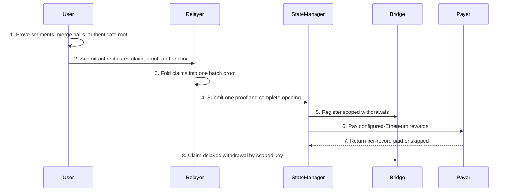

# Bridge Design

> The only complete bridge design. Feature directories
> `bridge-proof-aggregation`, `l1-reward`, and `bridge-multisig` may keep only
> their own slice; they do not copy this document or another feature's
> implementation.

## Abstract

One version-4 opening and one Groth16 proof authenticate deposits, withdrawals,
and rewards on every configured chain. Deposits use one global D5-S Poseidon
circuit. Withdrawals authenticate namespace-6 token burns under the finalized
checkpoint. Rewards use pairwise Poseidon claims and a per-user nullifier
accumulator; omitted jobs stay payable. Generic conversion forwards the complete
raw public-input vector. A separate three-member, two-signature guardian signs
the relayer session and is not proof or payment authority.

## Terminology

Terms are defined in [TERMINOLOGY.md](TERMINOLOGY.md). Abbreviations used here:

| Term | Meaning |
|---|---|
| L1 / L2 | External chain / PsyProtocol chain. |
| PI | Circuit public input. |
| ABI | Application binary interface. |
| IMT | Indexed Merkle tree. |
| ULEAF / UCON / CSTATE / GCON | User leaf, per-user contract tree, contract state, global contract tree. |
| GUSR | Global user tree root. |
| UPS / EndCap | User proving session and its final proof. |
| GUTA / CST | Global user-tree aggregator and coordinator checkpoint state transition. |
| GU / RU / DC / UC | GUTA, register-user, deploy-contract, and update-contract reward subtrees. |
| FFS | Fast-forward synchronization. |
| FFI | Foreign-function interface. |
| W32 | One unsigned 32-byte word. |
| Hash4 | Four canonical Goldilocks field elements. |
| CLV3 | Contract-leaf version-3 hash domain `0x434c5633`. |

`H` and `P` mean native Poseidon hash-no-pad. `K` is Keccak-256. A citation is
inspected source. A required relation is acceptance, not executed verification.
Unexecuted checks stay unexecuted. Configuration-field removal requires its own
field and consumer review; redundancy is not deletion authority.

## Module boundary

| Module | Owns | Does not own |
|---|---|---|
| Deposit, §1 | D5-S page relation, version-3 deposit-child schema, retained prefix | Finalization, reward payment, guardian authorization |
| Claim, §2 | Reward segment/merge/root/batch, withdrawal record, top opening, L1 application, intake | Generic Go business logic, signing quorum, IMT repair |
| Conversion, §3 | Direct public-input Groth16 boundary and product setup identity | Deposit, withdrawal, or reward relations |
| Signing, §4 | Policy, replay, nonce reservation, transport, protected inputs | Aggregate validity, L1 payment, proposer or pause roles |
| Acceptance, §5 | Invariants and negative controls | A test procedure; executable steps stay in [bridge-common-operations.md](bridge-common-operations.md) |

```text
D5-S deposit proof --------------+
withdrawal claim proof ----------+
reward segment -> merge -> root -> reward batch -> reward claim proof --+
C finalization proofs -----------+--------------------------------------+
                                                                        v
                              top proof -> direct-vector Groth16 -> one opening on every L1
guardian signatures -> exact EndCap -> canonical inclusion
```

## 1. Deposit

### 1.1 Selected relation

D5-S is one global fixed-K Poseidon circuit of ordinary Spiderman pages,
followed by generic conversion that preserves every raw public input. K is 32.
Configured chains number 1 through 8. No page or chain recursion remains. L1
binds the complete opening to that ordered vector; two digest halves are not a
replacement.

In scope: exact deposit and page binding, one K bound, full old-page witnesses,
removal of deposit page and chain recursion, retained accumulator seed and fold,
complete raw public inputs, and authenticated host recovery. Out of scope:
dedicated checkpoint deposit-root wiring, deposit and finalization cursor
separation, producer alignment, all-chain acknowledgements, and deployment.

The selected choices are K32 with one active prefix and strict per-row order;
full occupied pages rather than a per-record frontier; raw-vector equality
rather than digest halves; one fixed graph with zero padding; local leaf checks
plus finalization endpoint joins; retained occupied leaves for retry; monotone
positions with count-sum coverage; and product-owned setup identity over the
generic converter. The accumulator does not replace raw equality and is not a
circular circuit-set hash.

### 1.2 Constraints

1. One compile-time K bounds all active records. Active records form a prefix;
   N is range-constrained and `N<=K`. Configured rows occur once, in configured
   order.
2. Active records are strictly ordered by `(chain_index, absolute_index)`. Each
   belongs to one configured row. Consecutive absolute indices start at
   `old_count`, and their number equals `new_count-old_count`, using the
   existing u32 representation without field-wrap arithmetic
   (`deposit_aggregate.rs:88-93`; `frontier_append.rs:48`).
3. Instantiate a fixed pool of `SpidermanAppendProofGadget::add_virtual_to`
   gadgets with five bottom levels and 27 top levels. For nonempty chain `n`
   and `r=old_count mod 32`, page count is `ceil((r+n)/32)`; an empty chain uses
   none. Capacity is `K` when `K<=2C`, otherwise `2C+floor((K-2C)/32)`. K32 and
   C8 require 16 pages. Each active page binds
   `top_index=floor(current_count/32)`, `offset=current_count mod 32`, and
   `count=min(32-offset, remaining)`. First and last roots and counts bind the
   row; consecutive pages connect.
4. Poseidon leaf inputs and L1 opening words derive from the same verified
   deposit words. The absolute index is a position, not a leaf-content word
   (`psy_plonky2_common_circuits/src/bridge/aggregate_commitment.rs:126-149`).
5. Inactive records are canonical zero and never advance state. Inactive pages
   use zero leaves, index, and top siblings, and their joins are gated off.
   Reuse `DepositSpidermanAppendTarget::new`
   (`deposit_spiderman_append.rs:37-78,136-148`). Opening bytes exclude inactive
   records; the public vector retains constrained zero padding.
6. Generic conversion exposes the pinned source's complete ordered vector
   without hashing, splitting, or substitution. No separate opening witness,
   row commitment, or accumulator replaces that equality.
7. L1 keeps indexed local leaf-hash comparisons, pending-count bounds, and old
   root and count continuity. The installed empty root and count are the base;
   force-set is administrative, not a history proof
   (`Bridge.sol:48-49,209-217,396,574-587`). Each chain checks its own state.
8. Finalization endpoint equality and accepted-opening retry follow §2.5. More
   than K deposits in one endpoint is a bounded-span limit. Zero-deposit
   progress does not authenticate omitted deposits.
9. Extend `VerifiedDepositPrefix` with occupied partial-page hashes of length
   `count mod 32`. Root, count, frontier, anchor, and event block belong to
   `guardian/verify_l1.rs:18-28`; incremental authentication is at lines
   141-175. Persist that tuple through the daemon's existing `FileReference`
   and `save_aggregate_file`, with predecessor and successor references on the
   frozen opening. Write files before atomic state references. Advance the
   accepted endpoint only after durable destination completion. Retry uses the
   frozen predecessor. Cold recovery reconstructs authenticated history once and
   checks root and count.
10. For active raw record `j`, constrain nine-bit address
    `a=32*page+position` into 512 positions; active addresses strictly increase.
    A 16-way lookup requires a live page and
    `offset<=position<offset+page_count`, then connects
    `j=page.first_leaf+position-offset`, the chain, and
    `absolute_index=page.old_count+position-offset`. A four-limb lookup equals
    that record's Poseidon hash. The sum of page counts equals N. Inactive
    records use address zero with gated joins. Active pages form a prefix of at
    most 128 page and row memberships.

Use full old and new 32-leaf arrays. Unchanged nonzero old leaves are
preserved, and added-leaf indicators plus the offset and count trichotomy
prohibit omissions, overwrites, and holes (`full_merkle_tree_append.rs:39-69`).
A frontier alone does not recover a full old page: retain at most 31 occupied
hashes. Do not use `add_virtual_to_allow_existing` or treat an all-zero internal
page root as the native empty root. The page gadget connects its five-level
subtree directly to its 27-level path
(`spiderman_append_proof.rs:28-37`; `full_merkle_tree_append.rs:72-99`). Do not
change `EMPTY_DEPOSIT_ROOT`, claim-tree height, or `DepositInclusion`
fingerprints because append topology changes.

### 1.3 Schemas

`deposit_aggregate_pi_len` currently returns `27+17*C+39*32`
(`client_prover/psy_core/psy_data/src/bridge_aggregate.rs:15-17`). The current
deposit statement registers prefix `[2,11,1,0]`, including the window identifier
(`deposit_aggregate.rs:230-238`). The deposit-child contract deletes exactly
those eight window fields:

| Positions | Fields |
|---|---|
| 0..4 | `[3,11,1,0]` |
| 4..12 | `config_hash`, eight big-endian u32 words |
| 12..14 | `end_checkpoint_id`, low/high u32; high word remains zero |
| 14..18 | `end_checkpoint_root`, four native Goldilocks values |
| 18 | N, active deposit count, 0..=32 |
| 19+17*i | chain; start id low/high; start root; old root; new root; old/new count |
| 19+17*C+39*j | chain; absolute index; shield address; token address; L2 token id; amount; note commitment |

Target width is `19+17*C+39*32=1267+17*C`: 1284 at C1 and 1403 at C8. This is
field arithmetic, not a measured construction. Page roots, paths, old leaves,
routing, accumulator state, and source-verifier pinning stay private.

The external top statement is version 4, prefix `[4,12,0,0]`, width `8316+128*C`
(`bridge_aggregate.rs:38-42`; `bridge_aggregate.rs:2063` in
`client_prover/psy_core/psy_data/src`). Its opening byte length remains
`32*(15+16*C+7*D+10*Rw+15*Rr)`. Removing unprojected child fields does not
shrink the external schema.

```text
[3,11,1,0] config_hash end_id end_root N  C rows of 17  32 records of 39
0..4       4..12      12..14 14..18   18 19+17*i       19+17*C+39*j
```

At K32/C8 with every nonempty chain at offset 31 and four records, each chain
uses two pages and the pool uses 16. An empty chain uses zero pages and keeps
old root equal to new root.

### 1.4 Deposit algorithm

Inputs are verified contiguous deposit records and the authenticated old page
state. The output is one global proof. Page filling is capacity arithmetic, not
a second admission bound.

```text
prove_deposits(config, records[0..=K], prefixes) -> DepositProof | NoProgress:
  require records to form one verified contiguous prefix per configured chain
  order each row by absolute index from old_count through new_count-1
  on a gap, duplicate, unknown chain, or N>K: return NoProgress
  for each nonempty chain, fill existing 32-leaf pages maximally:
    pages = ceil((old_count mod 32 + n) / 32); an empty chain uses none
  bind each page to the retained occupied leaves, root, and count
  fold the accumulator once across the ordered records
  on a root, count, or accumulator mismatch: return NoProgress
  prove one global DepositAggregateCircuit and return its ordered public inputs
```

### 1.5 Codec and identity

`DepositAggregateOpening` currently stores `window_id`
(`client_prover/psy_core/psy_data/src/bridge_aggregate.rs:668-779`). Remove that
field and `window_id()`, encode leading W32 value 3, then config hash, end
checkpoint, root, starts, transitions, and deposits. Decode only version 3 to
exact completion. Require the installed config hash and approved artifact
identity. No old-layout fallback exists. The sole L1 opening digest is the
complete version-4 digest; the internal codec digest is not a second identity.

Registration role `(11,0,1)` stays. Its width changes through the helper, with
regenerated common data, verifier data, and `circuit_set_hash`. Product setup
identity, outer version, and wrapper width stay unchanged. Current sibling
`StateManager` verifies two `uint128` digest halves; that F5 mismatch is
separate. This child schema neither fixes nor retains it.

Integer words keep existing u32 and u8 bounds. Roots are canonical integers
below the Goldilocks modulus. Leaf hashing, accumulator folding, and record
public inputs share targets (`aggregate_commitment.rs:126-175`). Reconstruct the
ABI opening, including separate start and transition arrays, from verified
fields. The source does not embed a configuration hash that depends cyclically
on its circuit-set hash. Product and L1 acceptance bind installed order,
`start>=bootstrap`, and equal-bootstrap-id root equality after registry
finalization. The source constrains row order, counts, `start<=end`, and
equal-id root equality. These checks do not move into generic Go.

`DepositOpeningWrapper` verifies pinned source verifier data and forwards every
original public input through cross-config conversion. No SHA-256 layer, compact
substitute, or page aggregation replaces the raw vector.
`DepositAggregateCircuit::new(chain_count)` builds the source.
`deposit_aggregate_pi_len(chain_count)` returns schema width.
`prove(config, opening, pages)` consumes one flattened slice of
`DepositSpidermanAppendInputs` retaining chain index, old count, first leaf,
leaf count, and append proof. Derive and constrain every other page field.
Compute the accumulator seed and K folds once. No duplicate host accumulator or
page-record array remains. `VerifiedDepositPrefix`, `deposit_accumulator_seed`,
`deposit_accumulator_fold`, `DepositAggregateCircuit`, and `DepositLeafTarget`
retain their meanings. Frozen labels change only with their complete artifact
set.

Any removal of `NetworkConfig.max_deposits` migrates native, circuit, and
Solidity encoders, builders, CLI arguments, and fixtures together. Local
scheduling and gas limits are not circuit capacity.

### 1.6 Structural work

One page costs 62 old and new bottom pair hashes plus 54 old and new top hashes,
116 total; 16 pages cost 1856. The per-record alternative costs 128 per record
and 4096 at K32. Both still hash K records, fold the accumulator, check ranges
and routing, and verify raw public inputs. These counts exclude routing,
public-input, and Groth16 work and establish neither speed nor degree.

Deployability requires measured verifier and caller bytecode without a
size-limit override.

## 2. Claim

### 2.1 Flow




Events are discovery, not authority. The relayer reconstructs withdrawal
witnesses at the selected end; a missing path leaves the record unselected.
Every active withdrawal authenticates the same end user-tree root. Reward jobs
authenticate in the counted GU prefix of their source CST-tagged root, and each
source authenticates under the claim's anchor. The top obtains the withdrawal
root from the verified final checkpoint
(`psy_plonky2_circuits/src/bridge/circuits/bridge_agg_final.rs:138-159`).

### 2.2 Reward relation

One pure-circuit route uses unbounded pairwise aggregation and a per-user
accumulator. There is no L2 reward balance and no second payment route. Within
one segment, duplicate consumption has one defender: nullifier absence plus
per-user root threading. Key order is host scheduling, not a verifier
requirement. A job omitted from a claim stays payable.

Every eligible completed GUTA job has injective coordinate
`(source_checkpoint_id, height h, path index)`, with `2<=h<=21` measured from
the global CST root. Require `0<=index<2^(h-2)`, so the node is N(2,0), the GU
root, or its descendant. Fold all path bits to the complete CST-tagged root in
`pm_rewards_commitment.gutas_root`; that field is not the GU subtree root. The
producer lifts `[GU,[RU,[DC,UC]]]` into CST but copies only the GU proof count
into `gutas_completed` (`checkpoint_state_transition_proofs.rs:90-103`;
`verify_agg_user_registration_deploy_guta.rs:109-129,247-259`).

The persisted nullifier index is `n=2^h-1+path_index`
(`reward_chain.rs:88-93`; `local/bridge_aggregate.rs:236-241`). The source is
u32; the inner nullifier tree has height 22 and the outer source tree height
32.

A segment has an active prefix of 1..=`REWARD_LEAF_CAPACITY` (16) jobs for one
user and one source. Slots `active_len..16` keep constrained tag, leaf, and
path witnesses but insert nothing and add zero count and amount. Each active job
enforces the counted-GU bound, hashes `P(P(left,right),tag)` to the source's
`get_gutas_root`, and connects it to `pm_rewards_commitment.gutas_root`
(`reward_inclusion.rs:95-108`).

A nonempty node has one source `s`, active count `n_s`, and nonnegative amount
`a_s`. Authenticate `completed(s)=gutas_completed(s)` and
`fees(s)=guta_fees_collected(s)` from that same source leaf
(`checkpoint_stats.rs:14-31`). Require `completed(s)>0`, `n_s<=completed(s)`,
and `a_s*completed(s)<=n_s*fees(s)`. A zero denominator rejects the active
source even when its contribution is zero. This is the pool rate at
`../psy-compiler/psy-precompiles/mining_rewards/src/main.psy:90-108`. Its
additional per-job user cap is not added here.

The denominator counts GUTA proof nodes. The GU header binds its count, and the
same commitment binds that header to its reward root
(`guta_header.rs:84-137`). A base or no-change proof counts one
(`guta_no_change_gadget.rs:27-73`), a unary proof counts child+1
(`guta_line.rs:21-52`), and a binary proof counts both children+1
(`guta_linear_transition_gadget.rs:21-98`). EndCap inputs supply zero reward
children (`docs/src/dev/reward-tree-circuits.md:115-123,134-152`).

Decode authenticated completed and fees Targets into two range-constrained u32
limbs and connect each Target to `limb0+2^32*limb1`, with reconstruction below
the Goldilocks modulus `p`. Both products use those connected limbs. Constrain
`n_s` to the active-slot count. Represent `a_s` in eight little-endian u32
limbs, connect limbs 2..7 to zero, and require the remaining u64 below `p`;
this scoping is per source segment. Merge and root totals keep all eight u32
limbs under checked addition and may exceed u64 (`reward_chain.rs:614-620`).
Compare the full products as integers.

`RewardSegmentCircuit` proves one source without a predecessor.
`RewardMergeCircuit` lifts each segment and reduces adjacent pairs, carrying an
odd proof unchanged. No empty per-user business proof exists; auxiliary cyclic
proofs fill inactive slots only.

The 22 business fields are user, checkpoint-tree root, old nullifier root, new
nullifier root, count, and eight amount limbs. Segment exposes exactly these
fields. Merge appends its cyclic suffix. The segment's private outer start
connects to its public old root.

A merge pair requires the same user, same anchor, and
`left.new_nullifier_root=right.old_nullifier_root`. Parent old root is the left
old root and parent new root is the right new root. Checked addition gives
parent count and amount. One source may span adjacent segments. Cross-claim
authority is the stored accumulator root, not key order. Double consumption has
exactly two defenders: nullifier absence and this root threading. Fold order is
the producer scheduler only (`prove_bridge.rs:317-361`).

`RewardMergeCircuit` has exclusive one-hot leaf and pair modes, one pinned
segment slot with its matching inactive dummy, and two own-type cyclic child
slots. Leaf mode verifies the pinned segment and copies all 22 fields. Pair
mode verifies two real own-type children, adds counts with checked u32
arithmetic, and adds amounts with checked eight-limb arithmetic. Register the
22 business fields and one shared merge-verifier suffix before both cyclic
helpers (`reward_chain.rs:547-631`).

Each active job uses one fused height-22 delta
(`delta_merkle_proof.rs:62-96`). The node has one height-32 outer delta:

1. Active inner deltas use `index=n`, `old_value=[0,0,0,0]`, and
   `new_value=[1,0,0,0]`, with the same siblings for both folds. Thread
   `inner[j+1].old_root=inner[j].new_root`. An inactive slot does not insert or
   change inner root, count, or amount.
2. The outer delta uses `index=source`, old value equal to the first active
   inner root, and new value equal to the last. A source absent from the
   accumulator starts at `INNER_EMPTY_ROOT`. A later node for a source already
   updated in this chain opens its current inner root.
3. Connect outer old and new roots to the node's public endpoints.
4. Pair continuity replaces predecessor threading. L1 checks the published input
   root against stored state.

`RewardRootCircuit` verifies the final merge and binds the claim to in-proof
knowledge of the user's software-defined zk private key. Its 30 public fields
are user, recipient `[1..9)`, old root `[9..13)`, new root `[13..17)`, count
`[17]`, amount `[18..26)`, and checkpoint-tree root `[26..30)`. Source
construction is `build_root` at `reward_chain.rs:765-825`: it verifies the merge,
binds the child's 68-limb suffix internally, checks nonzero count, and registers
exactly 30 fields. `assert_non_zero(count)` is the sole protocol empty-claim
defender. The payer does not reject zero count, and the batch does not repeat
job-count positivity. Derive `public_key_param` with `get_zk_public_key_param`
(`psy_ups_circuit/src/signature/software_defined.rs`).


**Immutable-key premise.** One user id has one immutable registered leaf public
key. UPS start and current equality is constrained at
`ups_context_input.rs:216-222,241-247`. EndCap changes only nonce and equates
the key to the start key and `P(fingerprint,param)`
(`ups_end_cap.rs:64-93`). Account-leaf key rotation is outside this relation.
Mutable multisig member policy is not rotation of this leaf key.

**Anchor freshness.** The anchor checkpoint can be older than the finalized end.
Reuse `historical_merkle_proof` (`historical_merkle_proof.rs:23-47`; reward
consumer `reward_chain.rs:462-463`). Binding the anchor root to the end root is
the state-upgrade relation (`TERMINOLOGY.md:393`;
`verify_end_cap.rs:32-48`). Its host-list anchor-root-binding variant remains a
separate requirement, not a substitute.

**Accumulator replay.** L1 stores one `bytes32 rewardNullifierRoot[userId]`.
Payment equality, the zero-storage empty root, and the atomic new-root write
are §2.5. The inner tree is height 22 keyed by `n`; the outer tree is height
32 keyed by source. A stale claim emits
`RewardSkipped(userId,oldNullifierRoot,reason=staleRoot)` and changes nothing.

The user owns the reconstructible consumed-coordinate witness, including every
successfully paid `(source,n)` insertion. Retain pending coordinates and proofs
until a confirmed configured-Ethereum payment outcome establishes whether the
root transition succeeded. Submission, skip, and publication are not
consumption. After confirmed success, apply coordinates in confirmed order and
require the reconstructed packed root to equal `rewardNullifierRoot[userId]`.
Lost nodes rebuild from retained successful history, starting at the canonical
empty tree. A stale retry obtains the confirmed current root and successful
history before reproving omitted jobs.

The claim broadcasts identically to every configured chain. Only configured
Ethereum transfers the reward token.

### 2.3 Withdrawal and batch

The network IMT leaf is a 13-field preimage
`(key[4],value[4],next_key[4],next_index)`, hashed with native hash-no-pad
(`imt_leaf.rs:1-191`; canonical implementation
`imt_contract_state_update.rs:32-90`). The other-user reader connects GUSR,
ULEAF, UCON, CSTATE, the full IMT-leaf hash, and query-key equality
(`state_readers.rs:1062-1122,2222-2256`). Reuse that relation through common
primitives, not the entire VM reader.

For each active withdrawal slot:

1. Range-constrain sender to u32 and token contract identifier to 24 bits.
   Authenticate sender ULEAF at height 32 beneath end GUSR. Authenticate the
   token CSTATE root beneath UCON at height 24. Authenticate the full IMT leaf
   at a private physical slot beneath height-32 CSTATE. Bind actual hashes even
   for zero-balance users; do not use the `balance==0 && default UCON` shortcut
   (`slot_value_in_contract_state.rs:67-110`).
2. Constrain IMT membership and nonzero successor index to
   `[base+1,base+capacity]`; exclude the sentinel. Pin map base, capacity,
   height, and approved GCON leaf through installed token policy. Prove GCON
   membership once per configured token at the same end, or share authenticated
   approved-leaf equality in top recursion. A user-deployed contract with the
   same bytes is not a token burn.
3. Derive key `H([6,H(nonce_u32_be[0..8])[0..4]])`. Derive value from exactly 34
   fields: sender, eight recipient words, eight token-address words, eight
   amount words, eight nonce words, and destination chain
   (`../psy-compiler/psy-precompiles/token/src/main.psy:213-218,279-302`;
   namespace hashing `../psy-compiler/psy-std/storage.psy:37-39,354-372`). Do
   not add the contract identifier to the existing token hash.
4. Connect leaf key and value to these hashes. Recipient and token high padding
   are zero, amount is positive and below `p`, and destination is a configured
   u8. The same raw targets become opening fields. Token-address words equal the
   configured L1 mapping for `(chain_index,token_contract_id)`.

The reward batch projects `(user, recipient, old root, new root, count, amount,
checkpoint-tree root)` from §2.2. Its public inputs are a count in `[0,32]` and
exactly 32 slots of 30 fields. Suffix slots are constrained zero. Reward slots
have no in-circuit order. The three one-hot modes are:

1. **Empty:** count and every statement field are zero. Neither tip nor child
   contributes business authority.
2. **Leaf:** count is one; slot 0 equals the verified root statement and slots
   1..31 are zero. Batch count counts claims, not jobs. The batch does not
   require root field 17 to be positive.
3. **Pair:** verify two real own-type children, each with positive count. Parent
   count is their checked sum and is at most 32. Parent slots are the left
   active prefix immediately followed by the right active prefix, then zero
   suffix. No join-order constraint exists. Dropping, inserting, or padding a
   child statement is forbidden.

Common data fixes each target's public-input width, so verification targets
stay separate. Use three
slots (`reward_claim_batch.rs:185,195-198`): one foreign root slot verifies the
pinned root in leaf mode and a matching dummy otherwise; two cyclic slots verify
real children in pair mode and matching dummies otherwise. Register business
fields and one verifier-data suffix before both cyclic helpers. One-hot modes
gate all business equations.

`BridgeRewardClaimCircuit` always verifies exactly one real pinned batch proof,
including empty mode. Its statement length is
`6+32*15*8=3846` (`bridge_claim.rs:54-60`). `build_reward` constructs that
statement, asserts the length, and registers it (`bridge_claim.rs:614-620`).
The aggregate constructor checks the resulting `num_public_inputs`
(`aggregate_circuits.rs:215-216`). Active private statement indices are below
the batch count, pairwise distinct, and bound field-by-field to the opening
projection, making them bijective over the active prefix. Each active claim
proves anchor-to-end. Zero rewards force all claim words, indices, and private
paths to zero. The top always verifies both real claim proofs, including zero,
withdrawal-only, and deposit-only openings.

`BridgeRewardClaimCircuit` connects every suffix digest and cap limb
(`4+4*cap`) of its pinned batch proof to the pinned batch verifier and checks
the suffix width in every mode; the same-family decoy-suffix control must be
rejected and the pinned positive control accepted (`bridge_claim.rs:519-546`,
`bridge_claim.rs:1160-1192`).

The claim adapter keeps inactive external anchor identifiers, leaves, and
sibling words zero. Before the historical fold, inactive slots select the
level-specific empty sibling and zero internal end id. Active slots use the
supplied path and common end id. Fold roots connect to authenticated roots for
active slots and to the computed empty checkpoint-tree root otherwise.

The former `state_readers.rs` nonmembership and sentinel instructions, the
insert-only storage API, and the token contains-then-upsert rewrite are outside
this design. This exclusion does not judge the current IMT relation. Do not edit
those unowned surfaces here.

### 2.4 Opening and graph

`DepositAggregateCircuit`, one 32-slot `BridgeWithdrawalClaimCircuit`, one
32-slot `BridgeRewardClaimCircuit`, and C checkpoint-finalization proofs feed
one `BridgeAggregateCircuit`. It verifies pinned real children, connects every
end identifier and root, connects finalization end GUSR and GCON to the claims,
and connects each deposit new root and count to its configured finalization
endpoint. Keep checkpoint-history recursion. Delete withdrawal and reward
publication recursion and claim-tree construction. A chain already at the end
still proves that end under the same authenticated root; no fake business proof
is accepted.

Zero-span finalization is a real relation, not `active_len=0` in the append
circuit. Two pinned child types share the endpoint PI schema: positive-span
transition and end-checkpoint membership. The top verifies the selected real
child, binds its verifier to that Boolean branch, and enforces positive
`end_id-start_id` for the first and zero for the second. The zero-span witness
is the complete terminal checkpoint leaf, height-32 membership path at `end_id`,
global-state-roots preimage, and the same authenticated deposit endpoint and
code extraction witnesses. Constrain `start_id=end_id`,
`start_root=end_root=membership.root`, leaf hash equal to membership value, and
global-roots hash equal to the leaf state root.

Both finalization children expose `18+5*C` public inputs: start root `[0..4)`,
end GUSR `[4..8)`, end GCON `[8..12)`, end root `[12..16)`, end identifier 16,
and span 17. Each configured chain contributes deposit root and absolute count
at `18+5*ordinal`. The terminal leaf's global-state-roots preimage binds GUSR
and GCON. Both real verifiers are pinned independently.

Claim capacities are independent 32-slot budgets, not 32 per chain and not
shared across kinds. Deposit keeps its separate K32 bound. Active withdrawal
claims sort lexicographically as full unsigned 32-byte words by
`(chain_index,user_id,contract_id,nonce)`. Reward slots have no verifier order.
The producer and relayer select rewards in lineage order per user, users
ascending; that is scheduling only.

Root inputs 1 through 8 encode the little-endian recipient and inputs 18 through
25 encode the little-endian amount. The recipient's last three limbs are zero.
The circuit enforces that layout at `reward_chain.rs:801-804`, and the witness
API checks it at `reward_chain.rs:831`. The claim projection reverses each array
into big-endian W32 and never treats the arrays as field scalars.

**Wire version 4, no window identifier.** Encode this sequence as 32-byte words.
Reject trailing bytes, wrong length, noncanonical fields, and count overflow.
Root limbs are separate W32 values below the Goldilocks modulus. No
economic-domain word and no `reward_cutover` word exist.

| Order | Words |
|---|---|
| Header, 15 | version 4; config hash; end checkpoint id; end root (4); end GUSR (4); C; D; Rw; Rr |
| C rows, 16 each | chain; start id; start root (4); old deposit root (4); new deposit root (4); old count; new count |
| D deposits, 7 each | chain; absolute index; shield address; token address; L2 token id; amount; note commitment |
| Rw withdrawals, 10 each | kind 1; destination; user; token contract u24; full nonce; three zero words; recipient; amount |
| Rr rewards, 15 each | kind 2; destination; user; contract constant 7; old root (4); new root (4); count; recipient; amount |

The withdrawal reference is the complete 256-bit nonce, matching the namespace-6
preimage (`token/src/main.psy:293-303`). Amount is positive and below `p`. The
token is resolved by L1 mapping and is not serialized. Reward contract
identifier is constant 7. A constant-zero word is not added to identify a claim
attempt; `old_nullifier_root` already does that.

The fixed raw vector is prefix `[4,12,0,0]`, then eight big-endian u32 fields
for every opening word, allocating C rows, 32 deposits, 32 withdrawals, and 32
rewards. Counts select actual byte length; unselected words are constrained
zero. Width is `4+8*(15+16*C+7*32+10*32+15*32)`, equal to 9340 at C8. The
constructor and source test pin the same dynamic formula:
`bridge_aggregate_pi_len(C)=8316+128*C`
(`bridge_aggregate.rs:38-42,443-447`). Root words require their upper six u32
chunks zero and their remaining 64-bit integer below `p`. Header, rows, and
records connect to verified child targets. The deposit child's raw schema is
projected field-by-field; its window word becomes private only in the version-3
child cutover.

Define `U(x)=[0,0,0,0,0,0,0,x]` for bounded u32 and
`F(x)=[0,0,0,0,0,0,floor(x/2^32),x mod 2^32]`, with range checks and
reconstruction below `p`. Copy config words directly. End id uses `F` with high
zero; end-root limbs use `F`; D uses `U`. Rows map chain and counts through `U`,
start id through `F` with high zero, and twelve root limbs through `F`. Deposits
map chain and index through `U`, copy shield words, expand token words to
`[0,0,0,t0,t1,t2,t3,t4]`, and copy token id, amount, and note words in
codec-defined big-endian order. Token id obeys its u24 bound.

Product encoding emits the 15-word header, all C rows, first D deposits, first
Rw withdrawals, then first Rr rewards, in that order. At C8/D32/Rw32/Rr32 the
opening is 1167 words, 37344 bytes. This is not proving cost. Generic conversion
neither compacts nor hashes the opening.

`BridgeOpeningIdentity` binds version, config hash, configured chains, token
policies, capacities, and source, wrapper, child, and top fingerprints. Existing
generic proof JSON crosses FFI. No serialized-R1CS API is introduced. A
product-owned Go implementation cannot replace full-vector equality. Configured
Ethereum is the sole reward payer. Keep `gutas_completed` and
`guta_fees_collected` while removing L2 payout.

The ten registry rows are `(11,0,1,deposit width)`, `(14,0,0,90)`,
`(14,0,1,22)`, `(15,0,0,30)`, `(16,0,0,1029)`, `(17,0,0,2574)`,
`(18,0,0,3846)`, `(19,0,1,18+5*C)`, `(19,0,2,18+5*C)`, and
`(20,0,0,8316+128*C)`. Family 18 is the reward-claim statement: 6 fields plus
32 slots of 15 words packed as eight u32 limbs. Family 20's zero static marker
uses `bridge_aggregate_pi_len(C)`. `RewardMergeCircuit` exports 22 plus suffix
`4+4*16=68`, totaling 90. `RewardRootCircuit` exports 30 and binds the child
suffix internally. Family 16 exports `1+32*30=961` business fields and 1029
cyclic public inputs. The registry constructor records these rows at
`aggregate_circuits.rs:119-146`.

### 2.5 Layer one

Retain `applyBridgeOpening(uint256[8] proof, bytes opening)`
(`psy-contracts/src/StateManager.sol:211-244`). Before state changes, decode the
exact version-4 opening, reconstruct its complete fixed public vector, and
verify that vector with the installed generic verifier. The opening digest
identifies retries; it is not the verifier input. Check local checkpoint and
deposit continuity, apply the selected deposit relation, dispatch withdrawals to
Bridge, and dispatch rewards only to the configured Ethereum payer. Each reward
argument is `(userId,oldNullifierRoot,newNullifierRoot,count,amount,recipient)`.

Install `(local chain, token_contract_id) -> (L1 token, approved L2 contract
leaf, map base, capacity, height)`. The circuit binds contract state to the
approved leaf; the payer handles only its configured token. Mapping changes
activate only through a reviewed installation that preserves outstanding token
mapping or drains pending withdrawals first. Native-asset address zero retains
Bridge's WETH unwrap behavior (`Bridge.sol:659`).

The same token policy constructs the withdrawal verifier and exported opening
verifier. `withdrawalTokenPolicyHash(chainIndex,contractId)` is Keccak of
ABI-padded chain u8, contract u32, token address, complete approved leaf hash,
physical map base u32, capacity u32, and height u8. Installation requires u24
contract id, height 32, positive capacity, and `mapBase+capacity<2^32`. Unknown
policy fails closed.

`withdrawalKey=keccak256(abi.encode(uint32(sender),uint32(tokenContract),bytes32(nonce)))`.
All three arguments are ABI-padded 32-byte words.
`claimedWithdrawals[key]` and `scopedPendingWithdrawals[key]` are the only
withdrawal consumption and pending state. Clean Genesis installs them as the
initial layout. Registration skips an already-consumed key. Scoped consumption
is set only after successful delayed registration. Failures emit
`WithdrawalSkipped(key,reason)` without state changes. Force keeps executor and
pause checks and bypasses time only (`Bridge.sol:640-652`). Preserve current
delay and total-cap policy.

User methods are `claimPendingWithdrawal(uint32 sender,uint32 token,bytes32
nonce)` and `forceClaimWithdrawal` with the same arguments. Both resolve the
scoped key, load only `scopedPendingWithdrawals[key]`, transfer only to its
stored recipient, and delete only that entry. Emit
`WithdrawalSettled(uint8 namespace,bytes32 storageKey,address recipient,uint256
amount)` with namespace 1.

The current namespace-6 burn key has no sender component
(`token/src/main.psy:293-303`). The scoped L1 key binds sender, token, and nonce.
Same-scope duplicates identify the same immutable burn.

`payRewards(RewardClaim[] claims)` accepts only its StateManager and configured
Ethereum chain, at most 32 entries. Solidity `RewardClaim` is the six-word ABI
tuple above. It is not the native fifteen-word `RewardClaim`, whose byte length
is 480. No `RewardClaimTargets` type exists; the circuit representation is
`RewardRootStatement` carried by `RewardRootTargets`. The authoritative payer is
`../psy-contracts/src/EthereumRewardPayer.sol:125-151`. Nested contract gitlinks
are not authority. The client must not initialize an already-paid user's tree
from empty (`client_prover/psy_prover/src/local/bridge_aggregate.rs:243-256`).

Payment requires
`oldNullifierRoot == (stored == 0 ? EMPTY_REWARD_NULLIFIER_ROOT : stored root)`,
then stores `newNullifierRoot` in the same isolated operation as transfer. The
eight-word recipient has its high 96 bits zero, constrained in the root circuit.
Amount equals the circuit-bound claim amount by construction. Stale, invalid,
reserve-short, or failed-transfer entries emit
`RewardSkipped(userId,oldNullifierRoot,reason)` and leave prior successes intact.
The payer does not reject zero count. Same-user rows in one opening remain
payable because each row reads the current stored root.

For `Hash4=[limb0,limb1,limb2,limb3]`, every limb is a canonical u64 below `p`
and `rootbytes=bytes32((limb0<<192)|(limb1<<128)|(limb2<<64)|limb3)`. Decoding
is inverse and rejects noncanonical limbs. The opening transports four W32
values with upper 192 bits zero; packed bytes are only the storage projection.
The empty leaf is `[0,0,0,0]` and occupied leaf is `[1,0,0,0]`. Repeat `x=P(x,x)`
22 times from the empty leaf for `INNER_EMPTY_ROOT`, then 32 more times for
`EMPTY_REWARD_NULLIFIER_ROOT`.

Outer `payRewards` checks authority, chain, count, and reentrancy before
dispatch. Each `payReward` checks self-caller, rejects zero amount, zero or self
recipient, and noncanonical packed limbs, then reads the current root. Check
payer balance against the claim amount and preserve payer, recipient, and
total-supply exactness before writing the root and transferring.

Prepare one 196-byte self-call buffer and one four-byte return slot before the
loop: 4 selector bytes plus six ABI words. Use low-level CALL with output size
zero and copy at most four return bytes. Do not use `catch(bytes)`.
`RewardSkipped(uint32 indexed userId,bytes32 indexed oldNullifierRoot,uint8
reason)` reasons are 1 StaleRoot, 2 InvalidClaim, 3 InsufficientReserve, 4
TransferFailed, and 5 InsufficientGas. Only the three known inner selectors map
to reasons 1..3. Missing, short, or unknown returndata maps to 4. Reason 5 comes
only from the outer gas check.

For remaining rows `r`, inner stipend `S`, parent ceiling `H`, per-skip ceiling
`L`, and finish ceiling `F`, snapshot gas after patching the fixed buffer.
Attempt CALL only when `gasleft() >= H+S+floor(S/63)+1+r*L+F`. Otherwise emit
InsufficientGas for every remaining row and return without reverting prior
success. `rewardCallGasCap` supplies immutable deployment limit `S`. `H`, `L`,
and `F` are finite compiled source constants, never deployer-controlled values.
No runtime measurement runs before independent implementation clearance. After
clearance, verification must show that the configured token's successful path
fits the cap and the compiled parent stays within its bounds.

Replace end-checkpoint-only publication exclusion with
`appliedOpenings[opening_digest]`. On first acceptance, check local start
equals current checkpoint, apply deposits and finalization, and save acceptance
before dispatch under reentrancy protection. A repeat skips deposit and
finalization advancement and re-dispatches records after digest and encoding
equality. New consumed keys make successes no-ops and allow skipped records to
finish. A different opening at the same end is allowed only with local start
equal to end and unchanged local deposits. More than 32 records can thus be
serviced without forged checkpoint progress.

Delete the L2 balance-credit payout: `claim_pow_rewards`
(`token/src/main.psy:492-515`) and every caller of `claim_guta_rewards_1/2/5/10`
(`mining_rewards/src/main.psy:167-313`;
`claimMiningRewards.ts:696-746`). Keep the checkpoint stats. Do not install a
cutover guard, source guard, proof-frame inventory, consumed-key inventory,
claim deadline, or forfeiture ledger. No second route pays the same job.

#### Token storage after payout removal

This clean-Genesis candidate removes both unused storage Felts from each token.
Independent review and execution remain separate. Reorder fields as
`note_root`, `last_path`, `balance`, `other_user_info`, `note_count`, and
`state_map`; add no field and change no general compiler alignment rule.
Current fields and the private-claim slot assertion are at
`token/src/main.psy:99-113,660`.

| Field | Felt offset | Merkle location |
|---|---:|---|
| `note_root` | 0 | Leaf 0, four limbs |
| `last_path` | 4 | Leaves 1 through 20 |
| `balance` | 84 | Leaf 21, limb 0 |
| `other_user_info` | 85 | Two Felts per user |
| `note_count` | 8589934677 | Leaf 2147483669, limb 1 |
| `state_map` | 8589934678 | Ceiling division by four gives base leaf 2147483670 |

Moving the root and frontier together preserves one complete Merkle leaf per
Hash. This changes external storage addresses: migrate balance readers,
sent and claimed array arithmetic, private append count reads, root defaults,
and activity classification together. Note writes occupy offsets `[0,84)` or
exactly `8589934677`. Change both private-claim root-slot assertions to zero
while retaining full membership authentication. Remove the host-only prohibition
on root slot zero (`private_note_checkpoint.rs:70-72`;
`psy-sdk/psy-rust-sdk/src/wasm/mod.rs:2242-2244`) and keep index, path,
membership, and checkpoint checks. Read note count from leaf 2147483669, limb 1
(`wasm/mod.rs:2326-2347`). Circuit fingerprints change only when actual circuit
inputs change.

#### Local reward state

Use one caller-selected reward state file outside keystore storage. It contains
config hash, Ethereum chain and payer identity, user identifier, confirmed
occupied coordinates grouped by source, and at most one pending addition set.
Coordinates are occupancy witnesses. Reconstruct both trees from sorted unique
coordinates. The recomputed tree owns local consumption state.

Read chain identity and `rewardNullifierRoot(userId)` at one fixed block. Decode
with the reward-claim bytes32 codec and normalize only zero storage to the empty
root. If the chain root equals the confirmed tree, retain pending additions as
unconfirmed. If it equals the tree including pending additions, commit them and
clear pending. Otherwise fail with missing history; never reset to empty. While
pending is unconfirmed, do not replace its additions. Store the pending request
and coordinates before submission. Do not treat admission or inclusion as
payment.

Retry the stored request only while its admission context remains admissible.
When context changes, keep pending coordinates immutable and rebuild their proof
only if the payer root still equals the confirmed tree. Replace only the pending
request after saving it atomically. A later payment of an old request advances
the same coordinate set and is recognized by its root.

Pass reconstructed prior maps into `prove_reward`, preserve inner maps across
chunks and sources, freeze the initial root, and advance the running root only
through checked insertions. Write the state file atomically under exclusive
access. Do not add an on-chain history structure.

### 2.6 Intake

Permissionless `POST /api/v1/bridge/aggregation/claims` carries exactly
`{version:2,contextId,kind:"reward",proof,anchor}`. `contextId` is lowercase
`0x` plus 64 hex digits. `proof` is canonical standard base64 of
`RewardRootProof::to_bytes`. `anchor` is canonical standard base64 of the fixed
2696-byte public witness. Reject unknown fields, noncanonical encodings,
trailing bytes, other versions, and wrong context. Do not accept caller-provided
record fields, a separate anchor checkpoint identifier, private keys, source
jobs, session state, or a caller fingerprint.

The production owner is `pub mod aggregation` in
`../psy-services/src/api/handlers/bridge.rs`, starting at line 4266. The
`bridge_aggregate` import and aggregation context types are at lines 4270-4275.
Lines 344-352 of that file are the indexer `EnvioWithdrawalClaimRow`, not this
owner. The version-2 reward receipt is `reward_claim_id` at lines 4459-4462:
Keccak of `domain_hash(LeafCommit)`, config hash, W32 family 3, record bytes,
and Keccak of proof bytes.

Version-4 admission context keeps config hash, end checkpoint identifier, and
end root, with `maxRecords=32` and the existing 16 MiB proof limit.
`claim_context_id` is Keccak of the Keccak domain `PsyBridge/ClaimContext/4`,
config hash, W32 end identifier, and four canonical W32 end-root limbs. It scopes
queue admission and is neither a window identifier nor payment authority.
Inclusion and receipt validation separately authenticate `opening_digest`.

Every anchor scalar is an eight-byte little-endian Goldilocks element below `p`;
indices also satisfy their circuit widths. Encode, in order:

| Bytes | Field |
|---|---|
| 0..8 | Anchor checkpoint identifier |
| 8..40 | Checkpoint `global_chain_root` |
| 40..80 | GUTA fees, DA fees, user operations, total transactions, modified slots |
| 80..104 | Completed deploy-contract, register-user, and GUTA counts |
| 104..144 | Block time, then random-seed Hash4 |
| 144..240 | Register-user, GUTA, and deploy-contract reward roots |
| 240..352 | Fourteen DA challenge values |
| 352..544 | Global contract, deposit, user, withdrawal, user-registration, and validator roots |
| 544..1568 | Thirty-two checkpoint siblings |
| 1568..1672 | User leaf: public key, user-state root, balance, nonce, last checkpoint, event index, user id |
| 1672..2696 | Thirty-two user siblings |

Field order follows `psy_data/src/v1/qdata/checkpoint.rs:275-284,453-463,574-580`,
`pm_jobs_completed_stats.rs:101-108`, `pm_rewards_commitment.rs:108-115`, and
`user.rs:104-124`; DA width is `psy_core/src/constants/protocol.rs:49`. Both
paths are fixed at production height 32. Intake checks lengths, validates anchor
leaf and user path against the root proof, and verifies that proof once before
admission. Amount fields 18..25 are eight little-endian u32 limbs; the W32 amount
is their weighted sum serialized big-endian. Recipient uses the same reversal.

`publish_context`, `list_queued`, and `apply_dispositions` stay behind
`authorize` (`bridge.rs:4537`; call sites 5007, 5088, and 5169). Permissionless
admission does not call that guard. No admission fee, refund, quota, or new
incentive is introduced. A caller cannot choose verifier, bridge context, or
authoritative end checkpoint.

Select admitted rewards in lineage order per user, users ascending, with one row
per `(chain,user,old_nullifier_root)` and independent capacity 32. Store the
derived 480-byte record and `proof_bytes=anchor_bytes||root_proof_bytes`; the
fixed 2696-byte prefix makes the split unique.

Successful aggregate delivery is not payment. Verify a finalized successful
transaction to the configured StateManager, its `RewardAggregateApplied` event
for the accepted digest, and a same-receipt `RewardPaid` event whose six fields
match the derived record before marking the claim applied. The aggregate digest
boundary is `validate_family_log` (`bridge.rs:4669-4679`). `RewardPaid` has no
digest field. Replace the old `spentRewards` lookup in that path with
payment-event evidence; the current user root can advance again. `spentRewards`
is a protected historical citation, not a current name.

For reward receipts, `log_index` identifies the exact `RewardPaid` or
`RewardSkipped` event, and the handler also authenticates the aggregate digest
event. Withdrawal receipt indexing is unchanged. Authenticated `StaleRoot`
applies the existing release effect: queued or refresh-required according to
context, with its opening association cleared and skip evidence terminal for
that opening. The other four reasons retain non-expiring included state and the
same association. Stale evidence permits scheduling a fresh proof.

### 2.7 Data and loops

| Structure | Owner and fields |
|---|---|
| Segment contribution | One source's jobs, count, amount, and old/new roots. Pair checks user, anchor, continuity, and sums. |
| `RewardRootStatement` | user u32, recipient `[u32;8]`, old root, new root, count u32, amount u256, anchor Hash4. |
| `BridgeWithdrawalClaimWitness` | Ten opening words, user leaf, 32 user siblings, 24 contract siblings, IMT index, member leaf, 32 CSTATE siblings, sentinel preimage and path. Code proofs are shared. |
| `BridgeRewardClaimWitness` | Fifteen opening words, one batch proof, private anchor index, and private statement index. |
| `BridgeOpening` | Version-4 header, C rows, D deposits, Rw withdrawals, Rr rewards. Native code encodes, Solidity reads, generic Go preserves the vector. |
| Token policy | chain u8, contract u24, token address, approved leaf, height 32, map base, capacity. Installation owns it. |

Example: user 65536 proves 100 eligible jobs, 60 from source 100 and 40 from
source 101. The host splits source 100 into successive nodes of at most 16, then
source 101. Each node checks its own rate and applies one outer delta. The chain
ends at count 100 and amount `a_100+a_101`. Returning to source 100 is valid
when coordinates are absent and continuity holds. L1 checks lineage, pays the
amount, and stores the new root.

Example withdrawal: user 65536, contract 4, destination 1, nonce 9, amount 100.
Opening words are `[1,1,65536,4,9,0,0,0,recipient,100]`. The key is Keccak of
ABI words `[65536,4,9]`. Contract 0 or user 65537 with nonce 9 is a different
key. The IMT index is private and unrelated to nonce 9.

### 2.8 Reward algorithm

This algorithm folds authenticated reward claims. It is not guardian signature
collection. Producer ordering is scheduling only; the verifier checks statement
binding, not that order.

```text
reward_aggregate(jobs, confirmed_roots) -> (RewardRootProof, local_root) | NoProgress:
  require exactly one user and one anchor across all jobs
  if the anchor is forked or its anchor-to-end witness is absent:
    return NoProgress before record or proof construction
  group jobs by source; split each source into segments of 1..=16
  initialize a temporary inner/outer nullifier tree pair from confirmed_roots
  for each source in order, for each segment of that source in order:
    prepare the segment's nullifier witnesses against the temporary trees and
    advance them: inner threads within the source, one outer delta per segment
    on a consumed coordinate, rate failure, or absent witness: return NoProgress
  prove each prepared segment witness independently
  lift every proven segment to a RewardMergeCircuit leaf
  while more than one merge proof remains:
    pair adjacent proofs; carry the odd proof unchanged
    require same user, same anchor, and left.new = right.old
    on mismatch: return NoProgress
  authenticate the final merge with RewardRootCircuit
  return the 30-field proof and its new root; confirmed and local state are
  unchanged until payment commits

reward_batch(root_proofs[0..=32]) -> RewardClaimBatchProof | NoProgress:
  on zero root statements: prove the real Empty-mode batch proof
  otherwise prove one leaf per root statement
  fold adjacent batch pairs with odd carry until one proof remains
  reject a count outside 0..=32, a gap, or an unbound suffix
  the consumer binds every suffix limb to the pinned batch verifier

pay(stored_root, old_root, new_root, amount) -> Paid | Skipped:
  expected = EMPTY_REWARD_NULLIFIER_ROOT if stored_root = 0 else stored_root
  if old_root != expected: return Skipped(StaleRoot) with no write
  if reserve or transfer fails: return Skipped with no root write
  otherwise store new_root in the same operation as the transfer and return Paid
```

A confirmed `Paid` outcome is the only event that commits the new root to local
reward state. A skip, admission, or inclusion leaves that state unchanged.

### 2.9 Cost, security, and acceptance

A withdrawal uses 32+24+32=88 Merkle parents, one user-leaf hash, one 13-field
IMT hash, and three Poseidon invocations for nonce, namespace, and 34-field
record hash. At 32 slots this is 2816 parents, 64 user and IMT hashes, and at
most 96 record and key hashes, excluding shared checkpoint, code, range, and
recursion work. Sentinel membership can add up to 32 more CSTATE parents, and
insertion has three deltas; 2816 is only the member-path component. Each reward
record adds one anchor-to-end path of about 32 hashes. For N jobs in m segments,
the reward subtotal is `45N+44N+64m`, plus `3m-1` proofs at depth
`2+ceil(log2(m))` before root authentication.

| Circuit | Foreign hashes | Requirement |
|---|---:|---|
| `RewardSegmentCircuit` | 0 | One source, no predecessor; degree unmeasured |
| `RewardMergeCircuit` | 0 | One segment slot, two cyclic slots, degree-16 construction target |
| `RewardClaimBatchCircuit` | 0 | Empty, leaf, and pair modes |
| `RewardRootCircuit` | 0 | Final merge, private-key knowledge, 30 fields |
| `BridgeWithdrawalClaimCircuit` | 0 | 32 fixed membership chains |
| `BridgeRewardClaimCircuit` | 0 | 32 bindings and one batch proof; width 3846 |
| `DepositAggregateCircuit` | 0 | §1 unchanged |
| `BridgeAggChainCircuit`, `BridgeAggFinalCircuit` | 0 | Checkpoint recursion and endpoint extraction |
| `BridgeAggregateCircuit` | 0 | C finalizations plus deposit and both claims |
| `BridgeOpeningWrapper` | 0 | Cross-config verification |
| Generic `CRVerifierCircuit` | 0 | Complete-vector verification under §3 |
| Existing UPS signature circuits | No new invocation | Existing authentication is retained, not certified here |

Every Plonky2 circuit that invokes a foreign hash must stay strictly below ten
logical invocations and at degree at most 14 (`AGENTS.md:95-104`). The obsolete
`claim_reward_l1` Keccak measurement is dropped with that deleted family. No
speed, memory fit, degree, proof time, or gas figure is claimed. Do not silently
reduce `REWARD_LEAF_CAPACITY` or the 32-claim capacity.

Security constraints:

1. Token code owns burn records. In-proof private-key knowledge owns each reward
   claim. Authenticated checkpoints own both state paths. L1 consumed state owns
   payment. Membership requires approved contract semantics.
2. Accumulator absence and root threading are the only replay defenders.
3. This design does not repair `state_readers.rs` or token storage.
4. `a_s*completed(s)<=n_s*fees(s)` binds each node's amount to its source leaf.
   No payer constant can raise it.
5. Insufficient reserves leave a retryable unpaid claim, never a partial
   consumption. Scoped registration retains recipient and delay.
6. User-side proving replaces the L2 balance credit. The deleted methods are not
   guarded.
7. Sender, token, and nonce are the only withdrawal consumption and pending
   identity. No historical migration relation is included.
8. Wrapper bytes come from verified raw public inputs. A separate opening
   witness, caller-selected verifier, or unbound config defeats the design.
   Acceptance on one chain does not prove application on another.
9. The direct record route replaces claim-tree publication. No review of the old
   relation approves this relation.

Required cases cover distinct `(source,n)` leaves; later smaller-key payment
when absent; real empty, withdrawal-only, and deposit-only openings; singleton
slot 0; mixed pair counts 1..32; rejection of active empty mode, nonzero suffix,
leaf count other than one, empty pair child, sum above 32, unpinned verifier,
altered selector, dummy business proof, count mismatch, duplicate index, and
omitted active statement. Product codecs agree at C1 and C8 for
`(D,Rw,Rr)=(0,0,0),(1,0,0),(0,1,0),(0,0,1),(1,2,3),(31,1,17),(2,31,1),(32,32,32)`.
Offsets are `15+16*C`, then `+7*D`, then `+10*Rw`, totaling
`15+16*C+7*D+10*Rw+15*Rr`. No inactive allocation enters the digest.

Root vectors agree on distinct-limb packing, zero and occupied leaves, all 22
inner and 32 outer empty levels, packed empty root, first insertion, and first
payment from uninitialized storage. Reject limb equal to `p`, reversed limbs,
nonzero W32 high padding, and treating bytes32 zero as the empty tree.

Reject two sources in one node, inner old value other than zero, inner new value
other than one, wrong `n` or source, broken inner threading, detached outer
values, broken pair continuity, and a published endpoint detached from the final
merge. Accept one source split across adjacent segments, including a decreasing
seam, when absence and continuity hold. The host split is an acceptance case,
not evidence that host delivery is complete.

Reject raw zk parameter equated with the leaf key, wrong scheme identity, wrong
user or path, fabricated global roots, checkpoint-root substitution, and an
unauthenticated checkpoint leaf. Preserve UPS and EndCap public-key equality.

Construct the actual four-child tagged tree and CST lift. Synthetic N(2,1) at
`h=2,index=1,n=4` and N(3,3) at `h=3,index=3,n=10` must fail the GU bound despite
valid ownership and fold equality. Reject RU, DC, and UC nodes. Accept GU N(2,0)
and descendants through h=21. Reject `index=2^(h-2)`.

Reject completed zero for both zero and nonzero contribution, disconnected limb
splits and products, nonzero amount limbs 2..7 in a source-segment amount,
completed or fees at or above `p`, `n_s>completed`, dropped product high limb,
and wrapped count or amount. A checked merged total may exceed u64.
With completed 1 and `n_s=1`, accept `a_s=fees` and reject `a_s=fees+1`.

Preselection rejects a forked anchor or missing anchor-to-end witness without an
active record or L1 skip. Forcing it into the batch fails the mandatory proof.
An old but authentically extendable anchor remains valid.

L1 cases include the same nonce across users and tokens, duplicate consumed-key
skip, native-asset mapping, pause, delay, force, duplicate accepted opening, a
second batch at the same checkpoint, reserve shortage then retry, fee-on-transfer,
reverting and reentrant tokens, bounded malicious returndata, mixed success
without reverting prior success, and rejection of version-3 openings and the
revision-4 ten-word reward layout. Verify one Groth16 verification per apply,
identical bytes on all chains, exact Rust, Go, and Solidity opening equality,
genuine wrapper setup and load, and rejection of old two-proof, 34-field, and
claim-path interfaces.

No generation, runtime, build, or test is authorized by this section.

## 3. Generic conversion

Node dependency `35fd12a8117e53939703df6d7b98567933e65159` is the verifier
baseline. `VerifierChip.Verify` hashes public inputs and derives challenges.
Both `rangeCheckProof` (lines 117-174; call commented at line 181) and
`plonkChip.Verify` (line 187) are commented. `rangeCheckProof` checks proof
openings and FRI, not public inputs (lines 120-121). FRI verification at lines
196-202 stays active. Poseidon Goldilocks `HashNoPad` binds the hash (lines
41-42). `public_input_gate.go:28-42` locks its four digest parts to the
public-input gate. In the required full-vector target below, outer public
inputs are the original vector, not that hash.

Feature copies `bridge-proof-aggregation`, `l1-reward`, and `bridge-multisig`
differ from that baseline only by uncommenting `plonkChip.Verify`
(`gnark-plonky2-verifier/verifier/verifier.go:181-187`). `rangeCheckProof` stays
commented. Their `worker/worker.go` is byte-identical to the baseline: secret
`OriginalPublicInputs`, two public inputs, high and low Keccak halves, and
`Verify` on the original vector (`worker.go:81-145`). A separate worker that
passes the original vector as `PublicInputs` is not a feature worker and is not
adopted. No replacement aggregate is adopted.

The selected verifier change activates only `plonkChip.Verify` over the original vector.
The required full-vector target uses `CRVerifierCircuit.PublicInputs` as
`[]gl.Variable` with the gnark public tag and no `OriginalPublicInputs`.
`Define` passes that vector to
`VerifierChip.Verify`; `Proof` stays secret. `GenerateProof` requires the proof
public-input count to equal `common.NumPublicInputs`, assigns
`proofWithPis.PublicInputs` directly, and emits ordered length-N
`solidity_public_inputs` from `publicWitness.Vector()`. There is no host bit
reconstruction, Keccak, 128-bit packing, or high-low split. `Setup` derives N
from `common.NumPublicInputs`. Checks use N+1 R1CS public wires including
constant one, `VK.G1.K` length N+1, and witness public length N. Prior packed
artifacts are outside this boundary. Existing signatures stay:
`GenerateGroth16Proof`, `GenerateGroth16ProofFromJson`,
`generate_groth16_proof`, and `generate_groth16_proof_from_json`.
[user-ruling: `mem_ruling_2026_10_11_upstream_pi_form`]

Goldilocks and statement bounds remain caller-side. Commitment-free output is
eight proof coordinates and N public inputs. In Setup's fresh-compilation branch,
require `ccs.GetCommitments()` to be `constraint.Groth16Commitments` with zero
entries and zero `CommitmentIndexes()` before setup. After setup require empty
`PK.CommitmentKeys` and `VK.PublicAndCommitmentCommitted`. Do not require empty
`VK.CommitmentKey`: pinned Pedersen setup initializes it with no bases. After
proving and before either serialization, require empty `proof.Commitments` and
`proof.CommitmentPok.IsInfinity()`. The zero-count `pedersen.BatchProve` returns
the zero affine point, whose infinity predicate is zero X and Y
(`pedersen.go:126-129`; `ecc/bn254/g1.go:162-164`). This predicate still requires
a real commitment-free proof before acceptance.

Owned public-input edits are `worker/worker.go`, `worker/types.go`, current
verifier tests, and the direct consumer in
`psy_plonky2_circuits/src/bridge/circuits/bridge_wrap.rs`:
`UncompressedGroth16ProofData.public_inputs`,
`SharedGroth16Wrapper::prove_groth16`, and the deposit and withdrawal wrapper
constructors and proof methods. The consumer preserves the ordered vector and
checks common-driven width. Selected constructors register original inputs
without splitting or padding. Both JSON directions remove the fixed 2-or-6 count
restriction. `publicWitness.Vector()` contains exactly N elements and no
constant one; emit all N without skipping index zero.

Artifact adoption stops affected consumers, generates the direct-vector circuit
and keys in a fresh process, binds the approved source configuration and
generated bytes in the product artifact record, and adopts those exact bytes
after restart. The current aggregate regeneration path selects business-specific
constructors and must be aligned before this assurance applies
(`regen_groth16_keystore.rs:112-175`; `bridge_wrap.rs:303-325`). Prior packed
artifacts are excluded by that regeneration and adoption boundary, not by a
claimed generic rejection of arbitrary bytes.

Product acceptance authenticates each actual finalizer proof under its
branch-selected pinned verifier, with negative controls for both `zero_span`
values that corrupt authentication while preserving public inputs. The complete
raw width `8316+128*C` is 8444 through 9340 scalars. Actual Solidity compilation,
deployed size, and verification gas must establish deployability. No smaller
statement or alternate verifier architecture is adopted.

## 4. Signing

### 4.0 Software-defined multisig account

The bridge account is a software-defined multisig account. Its circuit-defined
identity is `P(circuit_fingerprint, initial_policy_parameter)`. The parameter
binds contract 6, state height 4, and the immutable initial policy. Member
replacement changes slots 1..3 and increments the version in slot 0; it does not
change this identity or user 524288. Current slots authorize the two SEC1
signatures. This is `TraceSignCircuitSource::Multisig`, specified in
[Signature Schemes](../sdkeys/signature-schemes.md), not the separate `sd-key`
delegated or session-key circuit.

The account uses exactly three member commitments and two external signatures.
Guardians independently reconstruct deposit custody, authenticate committed
withdrawal records, replay the pinned session, and durably reserve its nonce
before signing the existing UPS message. Current members come from authenticated
state, never an operator list. Signature collection below is not proof
aggregation. Aggregate acceptance is §2, not a quorum substitute.

The relayer checks the registered key maps exactly to user 524288
(`daemon.rs:2776-2777`). It rebuilds deposit setter roots from independently
verified custody (`daemon.rs:2506-2528`). Signature validity alone does not
establish custody (`guardian/verify.rs:336-363`). The circuit reads all four
policy slots on both sides and verifies exactly two selected signatures
(`multisig.rs:207-269`). The precompile checks expected prior fields before
mutation (`../psy-compiler/psy-precompiles/multisig_policy/src/main.psy:59-82`).

Signing and aggregate verification share the accepted opening but have distinct
owners. A signing-source change does not authorize data deletion, Genesis
regeneration, deployment, or push. Occupied local state is not overwritten
automatically.

### 4.1 Guardian algorithm

This pseudocode describes the unified §2 route; the unchanged bridge-multisig
feature grammar is distinguished below.

```text
sign_bridge_session(request, committed_head) -> (signature[2], inclusion) | NoProgress:
  observe committed_head and catch up every missing canonical session
  on unavailable history or a contradictory root: return NoProgress; contradiction halts
  derive the exact deposit-setter or single policy calls from authenticated evidence
  if derived calls differ from request calls: return NoProgress
  replay the trace at the pinned checkpoint, account, and nonce
  on mismatch: return NoProgress without reserving a new nonce
  durably reserve the next nonce and its exact request bytes
  collect two SEC1 signatures from two distinct current members
  on fewer than two or a repeated member: return NoProgress and retain the reservation
  prove the exact EndCap and submit it
  verify canonical inclusion independently
  on missing inclusion: return NoProgress; admission is not inclusion
  return the two signatures and the included checkpoint
```

**Claim-route boundary.** The unified claim route is §2: withdrawal payment
authorizes through §2 claims, and the latest bridge-session grammar derives
authenticated deposit setters or the single policy operation. The
`bridge-multisig` feature keeps its own slice and retains the current mainnet
withdrawal-tree append grammar: contract 3 verification, `WithdrawalAppendRecord`
append indices, and withdrawal batch calls (`guardian/verify.rs:342-366`).
`withdrawal_contract_id=3` and `withdrawal_appends` are that feature's
pre-cutover implementation facts, not this design's target; this design neither
retires nor renumbers them, and the policy contract identifier remains 6.

### 4.2 Flow and authority

```text
Relayer archive ---- POST /v1/sign-session ---- Guardian 1 own redb
                 ---- POST /v1/sign-session ---- Guardian 2 own redb
                 ---- POST /v1/sign-session ---- Guardian 3 own redb
Guardian 1 ------ GET /v1/sessions ----------- Relayer archive
Guardian 2 ------ GET /v1/sessions ----------- Relayer archive
Guardian 3 ------ GET /v1/sessions ----------- Guardian 1
```

Transport protection is not one uniform pin. The guardian client trusts its
configured private server CA and presents its client certificate; it does not
pin the server leaf (`guardian_client.rs:92-96`). The guardian server and relayer
history server require a client certificate from `client_ca_path`, then accept
only an exact leaf whose SHA-256 is in `allowed_client_certificate_sha256` of
length 1..=16 (`service.rs:534-552,555-581,605-618`). L2 HTTPS is separate:
WebPKI plus the configured private CA, followed by an exact server-leaf pin
(`runtime.rs:166-202`). No ablation of these protections is authorized, and none
has been executed. Loopback HTTP remains only numeric 127.0.0.1 or `[::1]`, with
a null pin; hostname `localhost`, other 127/8 addresses, and nonloopback HTTP are
rejected.

```text
on-chain policy fields ----+
current L1 custody --------+
committed burn/code paths --+--> replay --> durable nonce decision --> signature
canonical history ----------+
relayer <-- two signatures --> exact EndCap --> canonical inclusion
```

| Authority | Owner | Not conferred |
|---|---|---|
| Current members and version | User 524288 policy CSTATE | Runtime configuration |
| Initial identity | Registered fingerprint plus initial-policy parameter | Current membership after rotation |
| Signing keys | Three separate Psy journals | A common master seed or three institutions |
| Signing decision | Each key's journal | Relayer release of a reservation |
| Included history | Canonical checkpoints and account transitions | Relayer archive as trusted truth |
| L1 custody | Finalized configured Bridge receipts and state | Services discovery |
| Proposer, sender, pause | Existing L1 contracts and separate transaction keys | UPS signatures |
| Proof validity | Pinned verifier set | Guardian approval |

Implemented order is `handle_request`, `observe`, `verify_guardian_session`, then
`GuardianSigner::sign_verified` (`service.rs:342-414`). History recovery precedes
request replay. `authorize_response` requires Active state and an exact signed
reservation before commit (`db.rs:215-225`). Relayer publication follows
independently verified inclusion (`daemon.rs:2978-2979`).
`StateManager.sol:103-108,211` gates `applyBridgeOpening` with proposer
permission. Realm admission checks starting leaf, historical checkpoint root,
public inputs, state consistency, and EndCap proof
(`psy_node_common/src/realm/edge/handler.rs:737-862`). Admission is not
inclusion.

### 4.3 Policy and circuit

**Registry conflict.** The normative account uses precompile contract identifier
6 (`client_prover/psy_vm/src/ups/multisig.rs:20`). The current audit compiler
registry has six rows and emits identifier 5 for `multisig_policy` because
`build.rs:223-225` assigns the enumeration index
(`../psy-compiler/psy-precompiles/precompiles.json:75-83`). The sibling
`bridge-multisig` registry has seven rows: token, mining rewards, deposit tree,
withdrawal tree, USDT, faucet, then `multisig_policy`, so that enumeration emits
identifier 6 and declares height 4
(`bridge-multisig/psy-compiler/psy-precompiles/precompiles.json:89-97`). These
registries are different sources. Do not describe the current five-id registry as
the sibling six-id registry. The account contract identifier remains 6; aligning
the current registry is a source change, not a documentation substitution.

`ContractConfig.declared_state_tree_height: Option<u8>` exists at
`client_prover/psy_core/psy_config/src/lib.rs:154`. Normatively, a declared
height is mandatory for the policy precompile and must equal its constructed
height. Current compiler source does not enforce that comparison:
`compute_state_tree_height` supplies the artifact height directly
(`../psy-compiler/psy-precompiles/build.rs:93-107`), and neither the current
compiler nor the sibling compiler adds a maximum-height guard at that call. Do
not claim that source enforces the requirement. The policy relation itself uses
height 4: four stored slots and CSTATE proofs of height 4
(`multisig.rs:207-233`; `psy_vm/src/ups/multisig.rs:132-145`). Artifact and ABI
heights must agree.

| Slot | Value | Validation |
|---|---|---|
| 0 | `[version,2,3,0]` | Version >0 after initialization. Threshold and count are constants. |
| 1 | member commitment 0 | Nonzero canonical four limbs. |
| 2 | member commitment 1 | Nonzero and strictly greater than slot 1. |
| 3 | member commitment 2 | Nonzero and strictly greater than slot 2. |

Only slots 0..3 store policy. The initial commitment encodes the header, three
members, and five zero padding entries. Padding is not membership. Selected
compressed SEC1 keys are hashed and compared with authenticated current members
(`multisig.rs:303-311`). No separately stored whole-policy hash is authority.

`get_policy()` returns header and three members. `set_policy(expected_header,
expected_members, next_members)` compares all four current slots, validates the
next canonical nonzero strict order, and writes all four atomically.
Uninitialized all-zero state installs `[1,2,3,0]`. Otherwise require header
shape, checked version increment, and at least one changed member. Threshold,
member count, arbitrary version, zero member, and duplicates cannot be set. The
local wallet has no policy RPC.

Extend `MultisigSignatureCircuit`; do not fork another scheme. Read slots 0..3
at start and end, each bound to the same account, user, and checkpoint context.
`get_self_user_current_contract_state_slot_hash` creates one UCON proof and one
CSTATE proof per call (`state_reader.rs:98-137`). Four calls per reader produce
eight proofs ordered `(UCON,slot0,UCON,slot1,UCON,slot2,UCON,slot3)`, with
repeated UCON anchors connected (`multisig.rs:220-232`). These proofs are not
signatures.

Current and ending policies are derived from authenticated fields. The witness
contains account, start and end state proofs, signature data, sign context,
starting user leaf, and nonce. The circuit pins threshold 2, count 3, and exactly
two distinct increasing indices. Registered identity is
`PoseidonHash::two_to_one(fingerprint, public_key_param)`
(`multisig.rs:300-301`; `memory_wallet.rs:626-632`). The fingerprint is the host
hash of verifier data (`multisig.rs:350-351`; `pm_core.rs:19-38`) and is not a
public input. The circuit registers only `H(sighash, public_key_param)`
(`multisig.rs:242-243`). The host requires the trace fingerprint and saved
verifier bytes to equal the local circuit.

Bootstrap is allowed only when all four starting slots are zero, starting nonce
is zero, the user-state root is pristine, and the registered key equals
`two_to_one(host fingerprint, initial parameter)`. Ending version is 1 and ending
members equal immutable initial members. An existing nonpristine account with
zero policy fields is rejected. Nonbootstrap ending fields are unchanged, or
changed members with version exactly plus one. Restoring earlier members still
increments version.

The circuit accepts any policy transition satisfying those field rules. Host
code restricts calls. For `Bootstrap` or `ReplacePolicy`, the daemon refuses
bridge calls and builds exactly one contract-6 `set_policy`
(`daemon.rs:2449-2451,2583-2597`). `verify_guardian_session` requires unchanged
policy for bridge calls and the single derived `set_policy` otherwise
(`verify.rs:301-308,336-367`). A non-bridge request carrying deposit anchors or
withdrawal records is `UnsupportedCall` (`protocol.rs:354`). The fingerprint
changes when this layout changes. No new signature-message domain or master-key
substitute is introduced.

### 4.4 Registration and message

`WalletSession::register_bridge_multisig_user(&mut self, account,
exclusive_registration_intake)` implements enrollment
(`session.rs:3058-3093`). It requires exclusive drained intake and checks both
registration-2 and user-524288 directions. An exact existing key returns only
when its resolved identifiers are exactly `[524288]`. An occupied slot, wrong
next index, or prior registration stops before submission. Submission errors
report an unknown outcome and forbid automatic resubmission. Registration polling
uses `get_coordinator_latest_block_state`; that is not the signing observation
path. Exclusive intake is an operator assertion, not a network-wide enforcement
by this client.

The public Genesis generator requires `--relayer-multisig-account` and
`--multisig-policy-artifact` (`generate_genesis.rs:78-84`). Its decoder accepts
only `contract_id` and the full initial policy, invokes `public_key_param()`
(`generate_genesis.rs:171-197`), checks the approved artifact, seeds four policy
slots and fee balance, and exports `None` at registration 2
(`generate_genesis.rs:207-272,425-438,479-488`).

`PsyGenesisBlockSetupData.contracts` remains
`Vec<PQBCDeployContract<Hash>>` (`genesis_block_setup.rs:32-38`). No new Genesis
wrapper or stamp schema is required. Existing CLV3 leaf fields, domain, and FFS
remain unchanged.

The CLV3 contract leaf has 16 field elements. Its hash preimage has
17 elements: domain `0x434c5633` followed by those 16
(`client_prover/psy_core/psy_data/src/qdata/contract.rs:14-22,34-59,81-102`).
The circuit gadget matches that preimage (`contract.rs:35-38,106-108`). The 16
fields are deployer, function-tree root, code root, state height,
state-layout root, state-layout field count, and state-layout slot count.

Every contract authenticates its entire expected current leaf under the approved
checkpoint and interprets execution with an explicitly approved complete compiler
artifact. The artifact contains state height, all circuit definitions, and ABI
2.0.0 bytes. Rebuild deployment code definition, code root, and function
whitelist with the existing generator. Do not replace the complete artifact with
a layout-root digest.

The circuit computes the existing UPS sighash, converts its four limbs to
reversed canonical bytes, and binds both ECDSA gadgets to that message
(`multisig.rs:206,244-269`). Host verification requires `Hash256::from(sighash)`,
two strictly increasing indices, selected compressed-key commitment, and low-S
scalars (`multisig.rs:279-312`). The service signs the raw reserved prehash
(`service.rs:456-459`), not JSON, a personal-sign prefix, or request-id SHA-256.

Pinned replay calls `begin_trace_build_at_checkpoint`
(`session.rs:3416-3457`). A zero user-tree value selects nonce 1; otherwise
`next_session_nonce` adds one and requires a canonical field
(`session.rs:3459-3463`). Checkpoint, global roots, account membership, and
first-session registration membership are checked before return. Supplied and
replayed traces compare through complete `serde_json::to_value` equality
(`protocol.rs:411-412`). Envelope decoding checks account, network, nonce, hash
strings, step count, and unsigned-proof absence (`protocol.rs:367-379`).
Imported JSON uses recursive duplicate rejection and
`serialize(deserialize(parsed))==parsed` (`protocol.rs:76-118`).

Canonical request bytes start with ASCII `PSYGS001`, then fields in declared
order. Integers are unsigned little-endian; enums are one u8; fixed hex values
have no prefix or length; Hash4 is four canonical little-endian u64 limbs; a
vector carries a little-endian u64 count; strings carry a little-endian u64
UTF-8 byte length followed by the exact bytes, nested JSON whitespace included
(`protocol.rs:321,389`);
options use 0 or 1; structs use declared order. `request_id=SHA-256(bytes)` is
journal identity only. Example `Vec<u8>[2,3]` is
`02 00 00 00 00 00 00 00 02 03`; bridge enum is 0; u32 1 is `01 00 00 00`.

### 4.5 State and observation

`GuardianSigned` records what this key reserved or signed. `GuardianSession`
records what canonical chain included. A guardian that did not sign stores no
fabricated signature. Accepted append history derives only from
`GuardianSession` records.

```text
guardian_signer   file-to-key binding
guardian_account  Active/Halted, halt reason, monotone checkpoint, imported nonce
guardian_signed   own decisions, key (network_magic,user_id,nonce)
guardian_session  canonical included sessions
reserve: nonce == imported_nonce+1; same content is idempotent; else NonceConflict
save signature: exact request bytes; one signature per nonce
authorize response: Active; serialization withheld until commit
import: session insertion and imported_nonce advance in one redb transaction
```

The relayer retains the full request, two signatures, EndCap bytes, and observed
inclusion before discarding pending work. It serves
`GET /v1/sessions?after_nonce=N&limit=L`, with L in 1..=64 and increasing nonces.
The complete serialized response page, including its wrapper and nested JSON
escaping, is at most 64 MiB. An empty page is unavailable evidence, not proof
of completeness. Before reservation, size a one-record response page using
the exact request and nonproof input, maximum-width context and signatures,
and `max_endcap_proof_bytes`. Reject an oversized page; after proving enforce
both the proof-byte bound and complete page bound. A violating proof is not
submitted or signed.

The service authenticates saved anchors, then replays next-nonce sessions
through `verify_session`; insertion and cursor advancement are atomic
(`service.rs:168-202`; `db.rs:258-314`). Missing history returns
`HistoryUnavailable`. `verify_chain_state` count or root mismatch returns
`StateMismatch`, converted to unavailable, without durable halt
(`verify.rs:281-288,560-562`). Durable `AppendHistoryMismatch` covers import-time
duplicate, index, or history failure (`db.rs:301-305`).

Historical authorization resolves from the immutable local approval archive.
Each version has exactly one UTF-8 file whose SHA-256 and embedded version match
its index. Peer envelopes can name a version but cannot approve its bytes. If C
was offline while A and B signed, C imports that session without its own
`GuardianSigned`, then can sign with A while B is offline. A local Reserved row
whose exact request was included remains Reserved and unanswered. A different
included request consuming a local reserved nonce is a permanent conflict. Lack
of this guardian's signature is not corruption: the other two signers can validly
include it.

The decision key excludes checkpoint and version. Commit Reserved full bytes
before key use, sign deterministically, and commit Signed before release.
Timeout does not delete a reservation. Exact cached responses still rerun current
observation and evidence checks. One Psy key exclusively owns one redb file plus
an external `complete_journal` and `exclusive_key_use` authorization. A file lock
cannot detect another database clone. Missing authorization disables startup;
revocation halts. There is no automatic unhalt.

`GuardianAccount` Active to Halted is durable. Halt reasons are
`FinalityConflict`, `CheckpointConflict`, `NonceConsumedDifferently`,
`IncludedTransitionMissing`, `AppendHistoryMismatch`, and
`SigningAuthorizationInvalid`, the last at fixed bincode ordinal 5.

1. For each saved checkpoint `(id,leaf_hash)`, verify the current provider path
   under the locally verified root. Hash mismatch under a valid path is conflict.
   Missing evidence is unavailable.
2. For each session, verify user-leaf membership at its included checkpoint and
   require the exact ending leaf, key, and nonce.
3. For each saved finalized L1 block, verify canonical hash and ancestry. A
   different verified hash conflicts; an inaccessible node is unavailable.
4. Reconstructed count or root mismatch rejects with `StateMismatch`. Import-time
   contradiction commits `AppendHistoryMismatch`. Being behind is not
   contradiction.
5. A canonical different session consuming a local reserved nonce, or readable
   changed approval bytes, `revoked`, `!exclusive_key_use`, or
   `!complete_journal`, halts. Missing, unreadable, expired, or not-yet-valid
   approval stays unavailable.

Startup authenticates Genesis and database shape. Full saved-history observation
runs in the observer and before each cached or new response
(`service.rs:269-323,380-402`). Old-version retries require exact request bytes.
Unresolved decisions block authorization-version changes (`db.rs:251-253`).

### 4.6 Protected inputs

An operational L2 root is an independently queried, explicitly approved
Coordinator or full-node authority. Merkle checks bind historical state to that
authority's committed head. They do not prove consensus finality or implement a
recursive light client. Three keys sharing one compromised upstream are not
independent evidence.

`load_network` reads one strict `NetworkConfigGoldilocks`, checks compiled magic,
dimensions, and fees, requires empty `prove_proxy_url`, and pins `l2_rpc_url` to
the first URL of Coordinator 0 (`runtime.rs:205-218`). It then constructs
`RpcProvider::new_with_endpoint_clients` and the service calls
`WalletSession::new_with_provider` (`runtime.rs:220-250`; `service.rs:276-278`).
Requests cannot override these fields.

`L2RpcEndpointPin` carries role `Coordinator|Realm`, `config_id`, `rpc_url`, and
optional `tls_certificate_sha256`, with role discriminants 0 and 1. Require exact
one-to-one correspondence with every configured route. Reject missing, extra,
duplicate, empty, or cross-role approvals. Same-origin paths are distinct
endpoints. No common routing proxy is assumed.

Approved clients are installed before wallet construction. Marker, root, and
recheck use the selected URL without mid-observation failover
(`service.rs:21-43,149-209`). HTTPS requires normal chain and hostname validation
and SHA-256 of the exact DER leaf equal to that endpoint's pin, checked before
application data. No redirects, proxies, URL credentials, queries, fragments, or
dot-segment aliases are accepted. Certificate renewal requires a protected
configuration change and restart.

`GuardianAuthorization.genesis_hash` is
`Hash256::from(checkpoint_zero_leaf.qfhash::<PoseidonHash>())`, rendered with the
existing reversed canonical-limb conversion. It is not a file checksum, L1 block
hash, or network-id RPC value. Startup fetches checkpoint 0 leaf and global-root
preimage, verifies membership under the selected head, and compares approved
bytes. Read the explicit checkpoint-tree root at height 0 and retain it as
derived observation, not a second configurable authority.

`load_guardian_committed_head` reads durable identifier C and then explicit root
C (`service.rs:38-43`). `verify_genesis` authenticates checkpoint 0 under that
head and explicit root 0 (`service.rs:46-54`). Observation checks ancestry,
imports to the authenticated nonce, rereads marker and original root, and halts
on regression or contradiction (`service.rs:149-215`). Persistence stores
identifier and leaf hash, not a separate root authority. Signing never uses an
implicit latest root as committed authority.

Protected paths resolve beneath an approved directory using fd-relative `openat`
and `O_NOFOLLOW` for every component. Reject symlinks, `..`, nonregular finals,
and ownership or mode violations. Ancestors are owned by root or the service uid
and are not group or other writable. Secret, config, approval, and database
files are mode 0600. Hold the verified descriptor and compare metadata before and
after immutable reads. Configuration and approval JSON use the strict grammar,
maximum 64 MiB; encrypted key maximum is 1 MiB; password length is 1..=4096
bytes without a trailing newline.

`load_signing_key` passes `/proc/self/fd/<fd>` and a borrowed zeroizing password
to `Wallet::load_encrypted_keystore` (`runtime.rs:146-157`). Immutable reads
check size, device, inode, mode, owner, and timestamps (`runtime.rs:56-68`).
`SigningAuthorizationFile` retains approval bytes and database device and inode
(`runtime.rs:113-142`).

`SigningAuthorization` contains exactly `network_magic`, `user_id`, `public_key`,
`db_path`, `not_before_unix`, `expires_at_unix`, `exclusive_key_use`,
`complete_journal`, and `revoked`. It is an operator-file assertion, not a
threshold signature or on-chain policy. Require exact network, user, key, and
relative database path, both exclusive and complete true, revoked false, and
`not_before<=trusted time<expires_at`. Reopen the path before each response and
observer iteration. Missing, unreadable, or expired approval prevents release
without halting. Readable changed bytes or invalid flags trigger
`SigningAuthorizationInvalid`. Renewal never clears Halted. The observer may
import history while approval is unavailable, but it never signs.

`guardian-create-db --runtime-config PATH` is the sole initializer. It validates
configuration, approvals, key, and Genesis before exclusive creation, commits
four typed tables plus signer and account atomically, and syncs the parent.
Existing files are never overwritten. It does not sign or listen.
`guardian-service` only reopens existing state and never clears Halted. Creation
is only for a genuinely new key without prior reservations, including a
replacement key that then authenticates canonical history. No PostgreSQL-to-redb
importer exists. An already-used key must not receive a fresh database, even at
chain nonce zero. Stop and drain the exclusive owner before offline inspection.
Never operate a signing clone or restore stale bytes as an ordinary restart.

### 4.7 Types and functions

Policy types at `client_prover/psy_vm/src/ups/multisig.rs:23-116` are
`MultisigPolicy`, `MultisigAccount`, `MultisigSignatures`,
`StoredMultisigPolicy`, `MultisigSignatureInput`, and
`MultisigSignatureWitness`. `ApprovedContract` carries contract id, leaf JSON,
compiler artifact JSON, and artifact SHA-256. `CompilerArtifact` carries
`state_tree_height:u16`, circuit definitions, and ABI JSON
(`protocol.rs:152-164`). Token-map capacity is 1048576 with the artifact-defined
aligned offset.

`GuardianAuthorization`, in order, contains version, network magic, genesis
hash, user id, account JSON, account public key, multisig fingerprint, deposit
contract id, withdrawal contract id, fee contract id, GUTA fee, DA fee, max fee,
`max_endcap_proof_bytes`, approved contracts, and chains. Require positive
version, canonical magic, user 524288, policy contract 6, deposit 2, withdrawal
3 (current multisig-feature append grammar, not a §2 target), fee contract 0,
fees equal to pinned constants, positive proof bound, exact
derived key, and unique sorted approved contracts.

`ChainAuthorization` contains chain index, chain id, genesis hash, bridge,
state manager, code hashes, implementations, deployment block, and token
mappings. Chains number 1..=256 and are unique and sorted. Nonproxy
implementation equals its contract. `TokenMapping` entries number 1..=65536,
with unique tokens and approved L2 ids. Typed L2 id is u32 and event bytes must
encode it canonically.

`GuardianRuntimeConfig` contains authorization, archive, index, RPC config,
listen address, TLS certificate and key, client CA, allowed client leaf hashes,
database, signing key and password, signing authorization, L2 URL and pins, L1
endpoints, and history URLs. `ChainEndpoint` covers every authorized chain.
History URLs number 1..=4. Caller pins number 1..=16.

`GuardianAuthorizationIndex` contains `active_version` and strictly increasing
positive versions with SHA-256 digests. Filename is decimal version plus
`.json`. `authorization_path` names the active archive file, not an independent
copy (`runtime.rs:87-96`; `protocol.rs`).

`POST /v1/sign-session` fields, in canonical order, are schema version 1,
authorization version, network magic, genesis hash, user 524288, session nonce,
operation (`bridge=0`, `bootstrap=1`, `replace_policy=2`), trace JSON, at most
256 sorted deposit anchors, and at most 1024 withdrawal records. No current or
ending policy preimage is supplied. `DepositAnchor` is chain, block number, block
hash, and old and new counts. `WithdrawalBurnRecord` is sender, token contract,
destination, token, amount, recipient, and nonce, all with the existing word
semantics. Amount high limbs are zero and amount is positive and below `p`.
Policy-only requests have empty evidence arrays.

`psy_provider::lps::WithdrawalBurnProof` (`lps.rs:24-39`) carries checkpoint id,
checkpoint leaf, global roots, checkpoint path, user leaf, user path, contract
path, contract leaf, global-contract path, and IMT membership. The provider
assembles it. The verifier authenticates it to the approved committed root and
expected whole leaf and artifact. UCON path and global-contract path are
distinct.

`GuardianSignResponse` returns request id, network, user, nonce, derived policy
commitment, member index, message, compressed public key, and signature.
`GuardianSignErrorResponse` returns optional request id, code, and
`retry_after_ms`. Codes are `MalformedRequest`, `UnauthorizedCaller`,
`AccountIdentityConflict`, `AuthorizationMismatch`, `EvidenceUnavailable`,
`EvidenceMismatch`, `StateMismatch`, `UnsupportedCall`, `PolicyMismatch`,
`NonceConflict`, `WithdrawalNonceConflict`, `HistoryUnavailable`,
`JournalUnavailable`, `KeyUnavailable`, and `AccountHalted`. HTTP 400 is
malformed, 401 caller, 403 identity or evidence, 409 authorization or nonce, and
503 unavailable or halted. Retry is 1000 ms only for unavailable evidence,
history, journal, or key. No error releases a reservation.

`GuardianSigned` stores network, user, nonce, request bytes, authorization
bytes, starting and ending leaf hashes, message, and optional signature. Absence
of a signature means Reserved. `member_index` is recomputed from retained request
bytes and historically reverified starting policy, never later live policy.

`GuardianSessionRecord` stores request JSON, signatures JSON, EndCap nonproof
input, proof hex, included checkpoint id, and included checkpoint hash. Proof
hex is lowercase `0x` even-length raw bytes inside the 64 MiB bound.
`GuardianSession` adds starting and ending leaf hashes and
`withdrawal_appends` (pre-cutover multisig-feature fact, retained in that
feature). `WithdrawalAppendRecord` is chain, append index, and burn.
Deltas derive from verified replay and compare equal on recovery.

`GuardianAccount` stores network, user, state, last checkpoint id and hash,
imported nonce, authorization version, and optional halt reason. Active has no
reason. Halted has one. Account, session, and decision values use complete-struct
fixed-integer bincode with trailing-byte rejection.

Process-local `GuardianVerificationContext` and `VerifiedGuardianSession` are
defined at `verify.rs:17-46`. Neither is serialized request authority.

```text
begin_trace_build_at_checkpoint(public_key,user_id,checkpoint_id,
    expected_nonce,verified_checkpoint_tree_root) -> TraceBuildSession
get_withdrawal_burn_proof(context,authorization,checkpoint_id,record)
    -> WithdrawalBurnProof
verify_withdrawal_burn(history,authorization,record,proof,verified_root)
verify_guardian_session(context,authorization,request) -> VerifiedGuardianSession
verify_session(context,authorization,record) -> GuardianSession
import_session(value) -> GuardianSession
```

`begin_trace_build_at_checkpoint` is owned at `session.rs:3416-3457`, with
callers `verify.rs:332` and `daemon.rs:2873`. It range-checks location, fetches
membership, derives nonce and event index, compares nonce, builds the trace
session, authenticates checkpoint, global roots, user, and registration, and
returns an unsigned builder. Burn retrieval rejects future checkpoints, loads the
approved map, replaces the checkpoint path with one under the selected head, and
verifies amount, mapping, whole leaf, and every path (`verify.rs:226-255`).
Provider composition is `lps.rs:73-93`; its unversioned contract-leaf reply
becomes authoritative only after equality and historical membership checks.

`verify_guardian_session` (`verify.rs:323-372`) validates authorization and
envelope, rejects a future start, authenticates checkpoint membership, constructs
the pinned builder, derives policies, requires history nonce plus one and prior
ending-leaf continuity, authenticates chain counts and roots, derives bridge or
policy calls, requires whole call-data equality, executes each call, checks fee,
finalizes, requires typed trace equality, checks approved code and function
membership, derives message and ending leaf, checks the future envelope bound,
and returns without signing. `GuardianSignError` becomes unavailable. Only
explicit `Conflict(HaltReason)` commits a halt (`service.rs:220-228`).

`verify_session` reverifies a retained envelope under the same evidence rules and
returns a canonical session. `import_session` inserts that session and advances
`imported_nonce` in one transaction, or commits the applicable durable conflict.

### 4.8 Signing acceptance

Required unexecuted cases are explicit durable C and root C rejecting singleton
and maximum-value mixes; unchanged root with advancing marker succeeding;
historical contradiction halting; missing data staying unavailable; wrong DER
pin, genesis, magic, or route failing before replay; request URL override being
impossible; symlink, mode, traversal, changed descriptor, and newline password
rejecting; and wrong database path, inode, key, expiry, missing approval, live
mutation, revocation, and terminal restart obeying the rules above. Normal
database writes do not invalidate signing authorization.

`prove-bridge-agg` is declared at `psy_cli/psy_relayer_cli/src/main.rs:72-85`
and dispatched at lines 256-274. `finalize-bridge-agg` is declared at lines
86-87, with arguments at `finalize_bridge.rs:63-81`, and dispatched at line
275. Neither invocation nor guardian acceptance substitutes for §2 or §5. The
executable local procedure remains
[bridge-common-operations.md](bridge-common-operations.md).

Actual keys, authorization, TLS material, canonical magic and genesis, an
available registration slot or exact already-registered key, approved compiler
artifacts, deployment identities, and L1 role credentials are operating inputs.
The design fixes user 524288, contract 6, three members, and two signatures. An
occupied local slot blocks that registration action until the operator authorizes
an environment action. It does not create a production migration requirement or
permit deletion.

## 5. Acceptance

### 5.1 Negative controls

These controls test §2. They do not establish that a removed claim-tree mechanism
is necessary. `build_claim_tree` hashes occupied and empty nodes with different
preimages (`client_prover/psy_core/psy_data/src/bridge_aggregate.rs:1866-1894`).
Removing a domain tag does not establish an occupied and empty collision.
`fold_claim_path` selects children from the ordinal
(`bridge_aggregate.rs:1910-1924`); equal leaf hashes do not establish that one
path verifies at every ordinal.

| Relation | Mutation | Required observation |
|---|---|---|
| Historical checkpoint | Change anchor root, end root, leaf, path, or index independently | Changed witness fails against unchanged endpoints |
| Withdrawal | Change token policy, sender, nonce, recipient, or amount independently | Changed claim fails against original token state and policy |
| Reward consumption | Reuse consumed coordinates while retaining the accepted root | No second payment is authorized |
| Opening binding | Change one public word while retaining the proof | Verification rejects it; no digest-only substitute is accepted |
| Cross-chain interpretation | Change chain or destination configuration without changing the proof | Receiver rejects the mismatched configuration |

A necessity experiment removes only the named constraint in a test-only
construction and compares it with the unchanged construction using the same
malicious witness. Rejection alone does not identify which constraint was
necessary. Every executed check identifies source snapshot, command, mutation,
outcome, and date. Rust commands use `cargo test --release`. No current
execution result is recorded here.

### 5.2 Provenance

| Invariant | Annotation |
|---|---|
| D5-S global page relation | [user-ruling: `mem_d5_selection_recovered_2026_10_11`] |
| Version-3 deposit child; version-4 opening | [user-ruling: `mem_sprint_scope_freeze_2026_10_11`] |
| Full raw public-input vector | [user-ruling: `mem_lo_hi_removed_2026_10_11`] |
| One `plonkChip.Verify` over that vector | [user-ruling: `mem_ruling_2026_10_11_upstream_pi_form`] |
| Accumulator continuity is the replay rule | [user-ruling: `mem_no_duplicate_defense_2026_10_11`] |
| Pairwise segment and merge topology | [user-ruling: `mem_pairwise_minimal_delta_naming_2026_10_11`] |
| Batch suffix binding | [user-ruling: `mem_batch_suffix_binding_2026_10_11`] |
| Foreign-hash bound: fewer than ten logical hashes, degree at most 14 | [agent-discretion: hash-using Plonky2 circuits] |
| Comparable resource envelope: 56 GiB high, 64 GiB max, no swap, Rayon 1 | [agent-discretion: `.pi/plans/2026-10-08-rolling-head/scout-gas.md:109-121`] |

The contracts, layouts, registry rows, and acceptance cases above are the
complete design. Feature directories retain only their own slice and link here
for cross-feature behavior.
