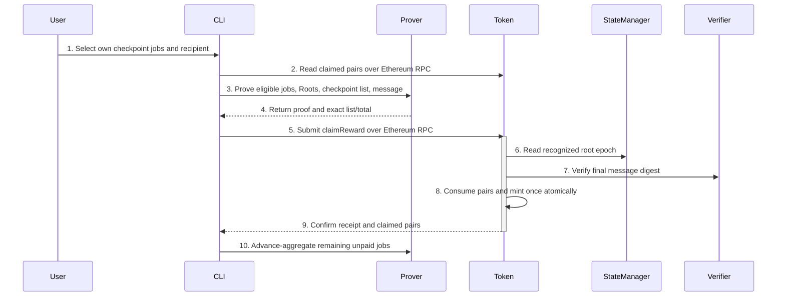
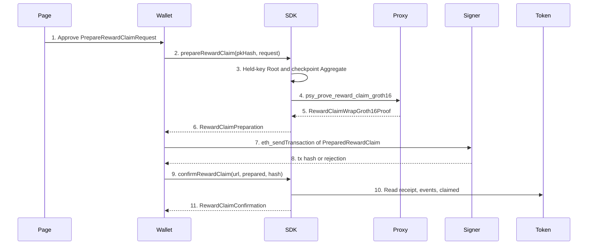

# Checkpoint Reward Claim Cutover

> Draft: 2026-10-14. Status: **Draft — awaiting independent review; implementation stopped**.
> Author: TokenRewardSpecGpt. Independent review: not yet completed.
> The claim-rewards CLI is implemented and wired (`client_prover/psy_cli/psy_user_cli/src/subcommand/claim_rewards.rs:41-53`) and the token-side claim entry point is implemented (`psy-contracts/src/PsyToken.sol:67-104`). The operational procedure is `docs/src/dev/reward-claim-operations.md`. This document remains the design specification, not the runbook.

## Abstract

One user proves selected owned jobs within each checkpoint, combines independently calculated checkpoint rewards using a second binary recursive layer, and calls the Ethereum PSY token to mint the proved sum. Every checkpoint ID is public, including fixed-capacity zero padding; there is no per-node Keccak or opaque payout-list commitment. StateManager authenticates finalized roots; the token owns proof verification and the authoritative claimed-pair mapping. This is the sole owning design document. It specifies a proposed interface, not an approved proof ABI or deployed artifact. K=64 is the single sizing recommendation and measurement hypothesis, not a measured supported capacity. No implementation, builds, tests, artifact generation or deployment are authorized by this draft.

## Motivation

`Historical recorded user instruction` (not a current source file): preserve selected-job ownership, duplicate rejection, historical membership, independent checkpoint arithmetic, self-claiming, payout-first ordering and advance aggregation. Replace the reserve-funded payer with token-owned minting; prohibit mandatory user L2 claims and cross-user settlement. The inherited 32-user transport cap is not a checkpoint protocol limit. A finite measured transaction resource bound is distinct from a lifetime eligibility cap.

`source-fact`: current `build_root` (`psy_plonky2_circuits/src/bridge/circuits/user_reward_tree.rs:569-613`) binds source history, exact payout, and recipient. It does not authenticate `user_tree_root`. Registration membership is in `RewardClaimWrapCircuit::new` (`psy_plonky2_circuits/src/bridge/circuits/reward_claim_wrap.rs:301-311`). Current StateManager sends claims to a payer (`../psy-contracts/src/StateManager.sol:241-290`); current PsyToken has only initial and owner minting (`../psy-contracts/src/PsyToken.sol:7-18`). These are cutover targets, not evidence that the new claim works.

## Terminology & Abbreviations

PI means public input; ABI means application binary interface; EVM means Ethereum Virtual Machine; L1 means Ethereum settlement; L2 means the Psy execution layer; GUTA means global user-tree aggregator; CLI means command-line interface; E2E means end-to-end. SHA and Keccak name distinct cryptographic hashes. `K` is the one fixed checkpoint-list capacity of an artifact set. `recipient` is the **160-bit EVM address** chosen by the authenticated user as the mint destination. The conversational word `psyout` denotes that same address here, but is not an existing source symbol. The recipient address is separate from the registration key, key fingerprint and public-key hash; this design does not derive it from those values. Use `recipient` in code, not a new `psyout` alias. TERMINOLOGY.md owns names; this document alone owns the relation and encoding.
SDK means the browser-facing Psy software development kit. JSON names JavaScript Object Notation. RPC names a remote procedure call. `PsyJSON` is the existing lossless integer codec at `psy-sdk/psy-ts-sdk/packages/psy-sdk/src/utils/json.ts:1-31`.

## Table of Contents

- [Abstract](#abstract)
- [Motivation](#motivation)
- [Terminology & Abbreviations](#terminology--abbreviations)
- [Specification](#specification)
  - [1. Flow overview and provenance](#1-flow-overview-and-provenance)
  - [2. First layer: jobs, history and registration authorization](#2-first-layer-jobs-history-and-registration-authorization)
  - [3. Second layer: complete checkpoint list](#3-second-layer-complete-checkpoint-list)
  - [4. Message and final hash](#4-message-and-final-hash)
  - [5. Token claim and root authority](#5-token-claim-and-root-authority)
  - [6. SDK prepare and confirm](#6-sdk-prepare-and-confirm)
- [Data Structures](#data-structures)
- [Core Functions](#core-functions)
- [Core Loops](#core-loops)
- [Module Changes and File Ownership](#module-changes-and-file-ownership)
- [File Changes](#file-changes)
- [Rationale](#rationale)
- [Security Considerations and Review Gates](#security-considerations-and-review-gates)
- [Observed local claim evidence](#observed-local-claim-evidence)

## Specification

### 1. Flow overview and provenance



Authoritative data flow:

```text
owned jobs -> Leaf -> binary job Aggregate -> registration-aware Root (one checkpoint)
                                                   |
                      binary checkpoint Aggregate: full padded IDs + sum
                                                   |
                   RewardClaimWrapCircuit -> SharedGroth16Wrapper -> Gnark
                                                   |
                   PsyToken.claimReward -> claimed[userId][id] + one _mint
                            |
                   StateManager recognized-root epoch
```

Normative provenance applies to every rule in the referenced section:

| Section | Authority and selection basis |
|---|---|
| 2 | `user-ruling`: historical recorded instruction, not a current source file: selected-job ownership, duplicate rejection, and historical membership. `agent-discretion`: retain existing job arithmetic/layout, replace redundant user-leaf authorization with registration membership plus the existing basic-key ownership relation. Source anchors follow below. |
| 3 | `user-ruling`: historical recorded instruction, not a current source file: independent checkpoint arithmetic. `agent-discretion`: CheckpointAggregateGpt's binary `83+K` full-list relation, power-of-two routing width and one measured capacity. Not a user-approved numerical K. |
| 4 | `user-ruling`: hash the complete statement in the final reward wrapper and export only its compact commitment; retain complete IDs in the checkpoint aggregate and token calldata. `agent-discretion`: legacy Keccak over the unchanged token-domain message, with the unchanged generic Gnark path hashing that commitment again and PsyToken computing the identical double hash, using a new coherent artifact set. |
| 5 | `user-ruling`: historical recorded instruction, not a current source file: token-owned minting. `agent-discretion`: provider-only constructor and runtime address resolution following existing provider consumers; boolean pair mapping replaces payer results/cursor. |
| Data Structures / Core Functions | `agent-discretion`: proposed minimal implementation contract derived from sections 2–5, not claims of existing APIs unless explicitly identified. |
| Core Loops | `user-ruling`: historical recorded instruction, not a current source file: payout-first ordering. `agent-discretion`: cache validation, batching and transaction confirmation boundaries. |
| Module / File Changes | `user-ruling`: historical recorded instruction, not a current source file: clean token cutover and policy slot replacement. `agent-discretion`: exclusive file ownership and existing generator/wrapper reuse. |
| Review Gates | `user-ruling`: historical recorded instruction, not a current source file: real proof, exact mint, and replay acceptance. This is not a recorded pass. `agent-discretion`: negative cases, measurement and independent-review stop gate. |

### 2. First layer: jobs, history and registration authorization

One Leaf proves exactly one selected GUTA job's tag ownership and authenticated reward-tree coordinates. Keep accepted height `2 <= h <= 21` and `0 <= p < 2^(h-2)` from `user_reward_tree.rs:35,68,74-88`. Derive the claim-local insertion index **inside the circuit** as `(1 << (h-2)) - 1 + p`; use a height-20 positional tree with EMPTY `[0,0,0,0]`, OCCUPIED `[1,0,0,0]`, and an empty root obtained by twenty Poseidon levels. The delta gadget must bind its entire index, not truncated low bits. Each selected coordinate is one empty-to-occupied transition. Never use a sequential insertion counter as the uniqueness proof.

Each binary job Aggregate lifts one pinned Leaf or verifies exactly two cyclic children. Common user, source checkpoint and complete source-leaf hash must agree; left end nullifier root equals right start root. Expose outer endpoints and checked u32 sum of job counts. Singleton lift and odd host carry do not add jobs. Keep verifier suffix propagation and terminal pinning (`user_reward_tree.rs:424,533-541`).

Root verifies the job Aggregate and suffix, requires the empty starting nullifier root, and authenticates the complete source checkpoint leaf through `historical_merkle_proof` under the common finalized checkpoint-tree root. Source checkpoint is at or below the authorization anchor; both source and anchor have actual inclusion paths. Authenticate the anchor global roots by hashing them to the included anchor leaf. No per-job historical path, no assumed membership from numeric ordering, no source-equals-finalized-end requirement.

Derive `checkpoint_fees = source.stats.guta_fees_collected` and `checkpoint_jobs_completed = source.stats.pm_jobs_completed.gutas_completed`, not free witnesses. Require positive denominator and `0 < job_count <= checkpoint_jobs_completed`. Prove

`job_count * checkpoint_fees = amount * checkpoint_jobs_completed + remainder`

with carry-safe integer multiplication/addition, `0 <= remainder < checkpoint_jobs_completed`, u64 fee/count/amount and u128 products. Thus `amount = floor(job_count * checkpoint_fees / checkpoint_jobs_completed)`; never divide combined checkpoint statistics. Existing implementation is `exact_payout` at `user_reward_tree.rs:543-566`. A positive amount is required at checkpoint-aggregate admission; zero payouts consume nothing.

**Registration authorization replaces the current user-tree authorization, not source membership.** The registration leaf value is `Poseidon(fingerprint, public_key_param)` (`psy_data/src/v1/qdata/public_key.rs:16-38`; registration append hashes the 64-byte pair at `psy_node_common/src/coordinator/processor/gatherers/register_user_gatherer.rs:372-391`). `RewardClaimWrapCircuit::new` pins the existing `PsyBasicZKSignatureCircuit` fingerprint and derives `public_key_param` from the private key using `get_zk_public_key_param` (`reward_claim_wrap.rs:302-306`). Current `build_root` does not do this at `user_reward_tree.rs:627-631`; those lines assign the payout amount. Connect their Poseidon combination to the nonzero registration leaf. Do not accept a witness-selected fingerprint: it would change which key relation is authenticated. This preserves the current basic-key support; it does not silently promise arbitrary registered signature schemes.

Registration index is **not** userId. Reuse `psy_crypto::common::user_id::circuit_user_registration_tree_index_bits_to_user_id` and its host inverse `get_registration_id_from_user_id`; exports select `UserIdBitsStrategy5` at `client_prover/psy_core/psy_crypto/src/common/user_id.rs:329-348`. For registration-index little-endian bits split as `[realm_index (G), user_index (R), group_id (C-G)]`, mapped userId bits are `[reverse(user_index), reverse(realm_index), group_id]`, where G/R/C are the existing configured group/realm/coordinator heights (`:220-303`). Decompose and recombine the entire registration index to its Merkle path index before calling the helper: its implementation ignores the separate index argument and consumes the supplied bits. Bind resulting userId to the job Aggregate userId. The membership root is the authenticated anchor's `user_registration_tree_root`. Existing registration gadget precedent is `client_prover/psy_circuit/psy_network_circuit/src/ups/gadgets/ups_start_register_user.rs:126-148`.

The private-key holder chooses nonzero `recipient`; the Root proof binds that choice, and both aggregation layers/final message preserve it. Do **not** equate a 256-bit Poseidon registration value to a 160-bit address. No `msg.sender == recipient` restriction: anyone can forward an unchanged proof without redirecting minting. A Root proof's recipient is a separate eight-limb PI, five u32 limbs plus three zero limbs (`user_reward_tree.rs:591-595,620,634`).

### 3. Second layer: complete checkpoint list

Use one `UserRewardCheckpointAggregateCircuit` with `UserRewardCheckpointAggregateWitness::{Root, Pair}`. `K = 2^k`, `2 <= K <= 2^31`, is construction-time, not a caller-selected verifier capacity. The compiled K=64 retains business width 79, total width 147 and 384 routing selectors. The full message remains 2304 bytes / 18432 bits, but RewardClaimWrapCircuit exports only its 256-bit Keccak commitment. Selector count is not full circuit gate count and no gas/proving cost is asserted as measured. No capacity ladder or deployed family. More than 64 eligible checkpoints require multiple transactions using the same artifact; never split one checkpoint's desired jobs across successful transactions. Singleton uses the same proof and token entry. Artifact freeze still requires the real proof and cross-language gates below.

Exact half-open PI layout:

| PI range | Value | Constraints |
|---|---|---|
| 0 | user_id | u32, same authenticated identity throughout |
| 1..6 | recipient | five numeric low-first u32 limbs; nonzero |
| 6..10 | checkpoint_tree_root | four canonical Goldilocks fields |
| 10 | checkpoint_count | u32, `1 <= count <= K` |
| 11..15 | total_amount | four numeric low-first u32 limbs, checked u128 |
| 15..15+K | checkpoint_ids | K u32 values; active prefix strictly increasing; inactive suffix zero |
| 15+K..19+K | cyclic verifier digest | four fields |
| 19+K..83+K | cyclic verifier cap | height 4, sixteen four-field hashes |

Assert business width `15+K`, suffix width 68, total width `83+K`; do not retain a 94-PI assumption. Activity is `i < checkpoint_count`, **never ID != 0**. Checkpoint zero is a valid active value.

Root branch verifies one independently pinned registration-aware Root23. Copy user, five recipient limbs, historical root and exact amount; check upper recipient three and amount six limbs are zero, positive job_count and amount; set count=1, IDs `[source_checkpoint_id, 0, ..., 0]`, and zero-extend amount to u128. There is no list hash.

Pair branch verifies exactly two cyclic children; enforce equal user/recipient/root. Require positive child counts, checked count addition and parent count <=K; checked u128 amount addition rejects final carry. Enforce exact active-list concatenation and parent u32 ranges, ordering and zero padding. No canonical subtree-size constraint is needed: the statement is the actual list, not a tree-shaped hash. Host pairs adjacent ordered children and carries an odd child unchanged.

**Inactive masking is mandatory.** Use a safe Boolean Root/Pair selector. Select zero for every inactive proof's business PI before range checks, arithmetic, activity comparisons or routing; dummy proof PIs are not assumed bounded or meaningful. Gate positive count/amount and common-field equalities on the active branch. Inactive Root PIs are also masked. Verifier/dummy machinery remains governed by its own conditional verification constraints, not zeroed suffix assumptions.

**Constrained barrel-shift concatenation:** for Pair let `A,B` be the K child lists and `a,b` their counts. Bounds imply `a+b<=K` and `a<K`. Before k-bit decomposition select shift amount `a` for Pair and zero for Root. Start `R_0=B`; for `s=0..k-1`, `d=2^s`, each slot is

`R_(s+1)[i] = select(a_bit[s], (i >= d ? R_s[i-d] : 0), R_s[i])`.

This is zero-filling right shift, not rotation. Pair output slot is `A[i]+R_k[i]`; Root output selects the singleton list instead. Child zero-padding makes supports disjoint, and the checked count bound prevents shifting any active right ID out of range. Require `ID[i] < ID[i+1]` when `i+1<count`, and `ID[i]=0` when `i>=count`. These checks plus exact routing prevent missing, substituted or cross-branch duplicate IDs. Use `k*K` selectors plus linear checks, not a quadratic all-offset multiplexer. Every compiled node still pays the fixed circuit cost; N checkpoints require N lifts and N-1 Pairs, not a constant-cost claim.

Use existing conditional cyclic verification (`user_reward_tree.rs:424`). Connect child verifier suffixes through `bind_suffix` (`user_reward_tree.rs:533-541`). `RewardClaimWrapCircuit::new` pins the approved aggregate fingerprint and connects the suffix digest and cap (`reward_claim_wrap.rs:235-237,249-257`). `SharedGroth16Wrapper` at `bridge_wrap.rs:108-145` is the Groth16 conversion boundary; `bridge_wrap.rs` ends at line 449 and has no lines 789-815 or 901-936. Do not try to embed the circuit's unknown final key as its own construction-time constant.

### 4. Message and final hash

Constants are specified by exact expressions, not unverified hexadecimal claims:

- `CLAIM_DOMAIN = keccak256(bytes("PsyReward/TokenCheckpointClaim/1"))`, ASCII with no newline/NUL. This is a compiled domain constant, not a per-node hash.
- `REWARD_CLAIM_VERIFIER_ID = keccak256(bytes("REWARD_CLAIM_VERIFIER"))`; finalize retains `ZK_VERIFIER_ID`.
- `REWARD_CLAIM_MAX_CHECKPOINTS = K`; `REWARD_CLAIM_MESSAGE_BYTES = 32*(8+K)`; `REWARD_CLAIM_PUBLIC_INPUT_BITS = 256`.
- `USER_REWARD_CHECKPOINT_AGGREGATE_PUBLIC_INPUT_COUNT = 15+K`, `USER_REWARD_CHECKPOINT_AGGREGATE_RECURSIVE_PUBLIC_INPUT_COUNT = 68`, `USER_REWARD_CHECKPOINT_AGGREGATE_TOTAL_PUBLIC_INPUT_COUNT = 83+K`.

The exact message is `abi.encode(CLAIM_DOMAIN, token, stateManager, uint256(userId), recipient, checkpointRoot, uint256(count), uint256(totalAmount), paddedIds)`, where `paddedIds` is a **static uint32[K]** array, not a dynamic array. There is no dynamic offset or length word. The conceptual static-array notation is instantiated with the one approved numeric K when artifacts are frozen.

| Word | Value |
|---|---|
| 0 | CLAIM_DOMAIN bytes32 |
| 1 | token address, on chain `address(this)` |
| 2 | StateManager address resolved from provider |
| 3 | userId zero-extended u32 |
| 4 | recipient address |
| 5 | checkpointRoot bytes32 |
| 6 | count zero-extended u32 |
| 7 | totalAmount zero-extended u128 |
| 8+i, `0 <= i < K` | checkpoint ID zero-extended u32; inactive zero |

No payer, configHash, reward contract ID, redundant version word, chainIndex or chainId word is added. The domain identifies this schema; token/StateManager identify settlement; the circuit key pins its relation. Eligibility is exactly the contract guard that `block.chainid` is `1`, `31337`, or `11155111`, not a chain-index proof redesign.

Numeric address value is `sum(recipient[i]*2^(32*i), i=0..4)`. Root numeric value is `sum(root[i]*2^(64*i), i=0..3)`. Amount is `sum(amount[i]*2^(32*i), i=0..3)`. ABI words are big-endian with high zero padding. Range-check root decomposition strictly below Goldilocks prime `2^64-2^32+1`; never reduce an alternative byte representation modulo the field. Address witness bytes must be range constrained and included in the message; the token reconstructs them from actual configured identities, not caller substitutes.

Commitment-bit rule: RewardClaimWrapCircuit computes `D = keccak256(M)` over the complete message with `keccak256_bytes_targets`, which constrains byte targets and returns eight little-endian u32 digest words (`psy_plonky2_common_circuits/src/hash/keccak/mod.rs:135-149`). Recover the successive digest bytes from those words. For each digest chunk `D[8j..8j+8)`, interpret `x=uint64_be(chunk)` and emit Boolean PIs `bit(x,0),...,bit(x,63)`. Only these 256 bits cross the shared recursive wrapper. The existing `prove_reward_claim_groth16` RPC verifies that Plonky2 proof and calls `SharedGroth16Wrapper::prove_groth16`; the generic gnark path keccak-hashes the exported public-input bits (identical to deposit/withdrawal) and binds `uint128_be(keccak256(D)[0..16))` and `uint128_be(keccak256(D)[16..32))` as the two BN254 public inputs. No gnark change is made; the double-hash semantics match the deposit and withdrawal cohorts.

Leaf, job Aggregate, Root and checkpoint Aggregate retain their existing relations with no application Keccak added. The final RewardClaimWrapCircuit message hash uses `floor(32*(8+K)/136)+1` sponge permutations (17 at K=64). Host and Solidity independently compute the same hash. Keep the complete list and all 68 pinned verifier suffix fields in the checkpoint aggregate; do not replace that recursive statement with a digest. The final wrapper alone compresses the token-domain message after checking authorization and the aggregate proof. PsyToken calldata, events and two-input verifier interface stay unchanged; its `messageHash` becomes `keccak256(abi.encode(keccak256(abi.encode(...))))`, matching the deposit/withdrawal double-hash semantics (`psy-contracts/src/PsyToken.sol:104-121`). The reward setup and generated verifier change with the new 256-bit public commitment.

### 5. Token claim and root authority

Proposed minimal interface (review-only, not a published ABI freeze):

```solidity
constructor(address initialHolder, uint256 initialSupply, address addressesProvider_);
function claimReward(bytes calldata proof, bytes32 checkpointRoot,
    uint32 userId, address recipient, uint32[] calldata checkpointIds,
    uint256 totalAmount) external;
function claimed(uint32 userId, uint32 checkpointId) external view returns (bool);
function addressesProvider() external view returns (address);
event RewardClaimed(uint32 indexed userId, address indexed recipient,
    bytes32 indexed checkpointRoot, uint32[] checkpointIds, uint256 totalAmount);
```

The constructor preserves `Ownable(initialHolder)`, initial `_mint` and decimals 9. Require nonzero provider with code; retain only that immutable provider reference. Resolve StateManager and reward verifier at claim time, following runtime-provider usage in `../psy-contracts/src/ERC20Gateway.sol:35-55,68-73`. This avoids redundant immutable addresses and premature wiring requirements. It is **not** justified by address unpredictability: CREATE addresses can be derived from deployer/nonce, and `address(this)` exists during construction. No new token registry ID, minter role, chain parameter or constructor verifier argument is needed. Existing owner-only `mint` remains owner-only and distinct from proof-authorized issuance.

Token entry order is normative:

1. Reject `block.chainid` outside `1`, `31337`, and `11155111` before provider calls, claimed-state access, verification or minting. Ordinary ERC20 operations/owner mint are unaffected.
2. Reject zero recipient, zero total, total above u128, or count outside 1..K. Resolve provider `STATE_MANAGER_ID` and `REWARD_CLAIM_VERIFIER_ID`; require deployed code. Require StateManager's `addressesProvider()` equals this token's provider.
3. Require StateManager `rewardRootsClean()` and read `rewardRootCheckpointId(checkpointRoot)` and `lastFinalizedCheckpointId()`; require a nonzero registered checkpoint id that does not exceed the finalized tip. Roots are recognized by verified finalize, not services admission.
4. Require strictly increasing checkpointIds and every `claimed[userId][id] == false`. Earlier unpaid holes remain valid; no last-success lower bound. Pad the list with zeros locally and build the exact message in section 4.
5. Require exactly 256 proof bytes; decode `uint256[8]`. Call `verifyProof(uint256[8], uint256[2]) external view` once, with high/low digest halves. The verifier interface has no Boolean return; a reverting call is rejection, normal return is success (`../psy-contracts/src/StateManager.sol:18-20`). Use no alternate ABI or fail-open fallback.
6. Set every listed claimed pair true, then call internal `_mint(recipient,totalAmount)` exactly once; emit one RewardClaimed list event. Any failure reverts all flags, balance and supply. There is no reserve transfer or per-checkpoint amount calldata. The sum is supplied but not trusted: it must match the verified statement. Standard internal ERC20 mint has no recipient callback; external verification/root reads occur before writes and are view calls.

StateManager keeps `rewardRootCheckpointId(bytes32)` as the single source of truth, backed by an internal `finalizedRewardRoots` array whose only exposed count is `finalizedRewardRootCount()`. Ordinary finalize preserves historical roots and rejects duplicate registration. A real `forceSetState` sets `rewardRootsClean` false only when that array is non-empty (`psy-contracts/src/StateManager.sol:46-49,155`); the supplied target is not a proved checkpoint tree root. Both finalize and reward recognition remain blocked until cleanup drains the registry: the bounded `revokeAbandonedRewardRoots(uint256 maxEntries)` pops entries from the end, zeroes their registrations, and sets `rewardRootsClean` true only once the array is empty; there is no named-root revoke and no explicit clean-flag setter (`psy-contracts/src/StateManager.sol:168-182`). Revoked roots remain unrecognized after alternate-branch advancement unless proved again. A no-op force-set changes neither recognition nor cleanup state. Claimed pairs never reset.

Removing the old root enumeration moves the clean flag's storage slot. Do not use this change as an in-place upgrade of a populated StateManager with that layout: the old array length could be interpreted as the clean flag. Fresh initialization sets `rewardRootsClean` true. Local E2E requires rebuilt/redeployed StateManager and PsyToken artifacts with consistent provider wiring; regenerate guardian authorization after replacement deployment because `ChainAuthorization` binds the StateManager proxy, deployment block, and token mappings, not L1 code hashes (`psy_cli/guardian_common/src/protocol.rs:205-208`; `psy_cli/psy_dev_cli/src/subcommand/generate_genesis/guardians_root.rs:669-688`; `psy_cli/psy_relayer_cli/src/guardian/verify_l1.rs:116-126`). Production migration needs separate review. Preserve existing Genesis and proving setup unless their own inputs change. Governance cleanup uses `state-manager:revoke-abandoned-reward-roots --max-entries N` through the same Safe/timelock authority as force-set.

### 6. SDK prepare and confirm

`agent-discretion` after the corrected SDK review, adopted with the SdkSpecGate corrections: the browser prepares one unsigned token transaction of at most `REWARD_CLAIM_MAX_CHECKPOINTS` eligible checkpoint groups, and an external Ethereum signer submits it. The current provider method is `prepareRewardClaim` at `psy-sdk/psy-ts-sdk/packages/psy-sdk/src/local-web-prover/provider.ts:179-185`, followed by `confirmRewardClaim` at `:187-193`. `getClaimRewardsCallArgs` and `claimRewards` are not in that file. This is the current method location, not a browser or end-to-end pass. The two dirty generated declaration files are `psy-sdk/psy-ts-sdk/packages/psy-sdk/src/local-prover/psy_prover.d.ts` and `psy-sdk/psy-ts-sdk/packages/psy-sdk/src/local-prover/psy_prover_bg.wasm.d.ts`. Both stay untouched. Publishing the package is outside this cutover. Actual `wasm32` compilation and browser execution of Leaf, Aggregate, Root, and checkpoint Aggregate are a Main gate, not a property of this document.



```text
PrepareRewardClaimRequest
        |
        v
RewardClient shared workflow
  originals retained
  <=64 eligible checkpoint groups
  held ZK key proves Root
        |
        +-- payable proof --> PreparedRewardClaim (unsigned)
        |                         |
        |                         v
        |                    external EIP-1193 signer
        |                         |
        |                         v
        |                    RewardClaimConfirmation
        |                      pending | confirmed
        |
        +-- real preaggregation, no payable tx --> proof_only
        |
        +-- no unclaimed originals remain --------> nothing_to_claim
```

#### 6.1 Encoding

The TypeScript boundary calls `PsyJSON.stringify` before WASM and `PsyJSON.parse` on the returned string, through the existing `PsyWasmWebProverProvider.runWasmServerCall` queue (`local-web-prover/provider.ts:86-106`). `JSON.stringify` is forbidden on this boundary: a `u64` above `2^53-1` becomes a lossy number. `PsyJSON.parse` keeps an integer inside `±9007199254740991` as a number and a larger integer as `bigint` (`utils/json.ts:2-13`). `PsyJSON.stringify` writes `bigint` as a JSON integer (`utils/json.ts:15-23`). `PsyJSON` stops at that TypeScript boundary. The WASM exports parse and emit JSON with `serde_json` (`psy-rust-sdk/src/wasm/mod.rs:1088-1094,1103-1125`) and reject a fraction, a negative value, or an overflow. Hex strings stay lowercase and are not passed through the integer parser. There is no embedded setup document.

`RewardPendingSelection` keeps its existing camelCase serde shape (`reward_client.rs:213-218`):

| Field | Type | Rule |
|---|---|---|
| `realmJobs` | array of `[realmId, realmSubId, uniquePendingId, job]` | `realmId`, `realmSubId`, and `uniquePendingId` are `u64`; `job` is `QProvingJobDataIDWithRewardPreimage` |
| `coordinatorJobs` | array of `[uniquePendingId, job]` | `uniquePendingId` is `u64` |

`job.inner.jobDataId` carries `topic`, `goalId` (`u64`), `circuitType`, `groupId`, `subGroupId`, `taskIndex`, `dataType`, and `dataIndex`. `slotId` is `#[serde(skip)]` (`psy_common/src/job/id.rs:108-119`) and is absent on the wire. `job.inner.rewardPathInfo` is `u64`. `job.rewardTreeTagPreimage` is the existing four-limb hash encoding. A duplicate coordinate or a job whose preimage user differs from `userId` is an error. One source checkpoint's jobs stay in one token claim.

There is no external aggregate setup document and no source-identity field. `RewardClient` is constructed from the session provider. `UserRewardCircuits::build` uses the circuits already fixed by the existing RPC config. `rewardToken` is the claim's PsyToken address. Prepare checks it against the token in that RPC config. Confirm does not trust a stored setup: at the receipt block it reads the provider, resolves `STATE_MANAGER`, and checks the prepared token and StateManager again.

`RewardJobAggregateCache` keeps schema, `networkMagic`, user, source checkpoint, complete source leaf and hash, selection identity, leaf and aggregate fingerprints, common digests, verifier digests, and the serialized proof. It does not carry an external config hash or a circuit-set hash. Reuse calls `reuse_reward_job_aggregate`. A mismatch drops that cache and proves from the retained originals. The cache is never payment state.

#### 6.2 Held-key authorization

`pkHash` is resolved by the existing `PsyMemoryWallet::get_user_by_public_key_hash` (`memory_wallet.rs:1001-1005`), which returns `Arc<dyn SignatureUser>`. The capability runs on that `Arc` after the map guard is released. `ZKUser` already holds the private key (`zk_user.rs:17-25`). `SignatureUser` gains one method, using the same `async_trait` and `async_trait(?Send)` split already on the trait (`signature/traits.rs:42-44`):

```rust
async fn prove_reward_root(
    &self,
    client: &RewardClient,
    circuits: &UserRewardCircuits,
    proved: &RewardJobAggregate,
    anchor: &FinalizedCheckpointAnchor,
    recipient: [u32; 8],
) -> anyhow::Result<UserRewardRootProof> {
    anyhow::bail!("reward root proving requires a held ZK key; this signature user is unsupported")
}
```

Only `ZKUser` overrides it. The override calls `client.prove_finalized_reward_root(&circuits.user_reward_root, &circuits.user_reward_leaf, &circuits.user_reward_aggregate, proved, anchor, recipient, self.private_key.private_key.0)` (`reward_client.rs:565-569`). That call keeps `validate_reward_job_aggregate`. The raw key stays inside the `ZKUser` call. There is no panic, dummy proof, signature substitution, or second key map. `request.userId` must equal the selected wallet identity's authenticated registration (`reward_client.rs:427-445`). The external Ethereum account is a different signer and does not authorize the Root. A page-accessible prepare call uses the existing wallet approval boundary. The implementation logs neither the raw request, a reward preimage, the proxy bearer, a private key, nor an authorization witness.

#### 6.3 Requests and responses

```typescript
type PrepareRewardClaimRequest = {
    rewardToken: string;
    userId: number;
    recipient: string;
    jobs: RewardPendingSelection;
    l1RpcUrl: string;
    proveProxyUrl: string;
    proveProxyToken?: string;
    aggregateCaches?: RewardJobAggregateCache[];
};
```

`userId` is a `u32`. `recipient` and `rewardToken` are each `0x` plus 40 lowercase hex characters and are nonzero. `l1RpcUrl` and `proveProxyUrl` are the existing RPC and proxy endpoints. `proveProxyUrl` serves `psy_prove_reward_claim_groth16`, whose one parameter is `RewardClaimWrapWitnessInput`. `proveProxyToken`, when present, is supplied inside the trusted wallet invocation and is sent only as that call's bearer credential. It is not copied into `RewardClaimPreparation` or a page message. Omitted `aggregateCaches` means an empty cache list.

```typescript
type RewardClaimPreparation =
    | { status: "ready"; claim: PreparedRewardClaim;
        remainingJobs: RewardPendingSelection;
        aggregateCaches: RewardJobAggregateCache[];
        alreadyClaimedCheckpointIds: number[];
        deferredCheckpoints: DeferredRewardCheckpoint[]; }
    | { status: "proof_only";
        remainingJobs: RewardPendingSelection;
        aggregateCaches: RewardJobAggregateCache[];
        alreadyClaimedCheckpointIds: number[];
        deferredCheckpoints: DeferredRewardCheckpoint[]; }
    | { status: "nothing_to_claim";
        alreadyClaimedCheckpointIds: number[]; };

type PreparedRewardClaim = {
    to: string;
    chainId: 1 | 31337 | 11155111;
    value: "0x0";
    data: string;
    stateManager: string;
    checkpointRoot: string;
    userId: number;
    recipient: string;
    checkpointIds: number[];
    totalAmount: string;
    snapshotBlockHash: string;
};

type DeferredRewardCheckpoint = { checkpointId: number; reason: string };

type RewardClaimConfirmation =
    | { status: "pending"; txHash: string }
    | { status: "confirmed"; txHash: string; blockHash: string;
        blockNumber: number; checkpointIds: number[]; totalAmount: string };
```

`ready` means one unsigned transaction is payable. `checkpointIds` is strictly increasing, length 1 through 64, and `totalAmount` is a decimal `u128` string. `to` and `stateManager` come from the existing RPC config and the provider, not from page fields. `chainId` is the observed `eth_chainId`, exactly `1`, `31337`, or `11155111`. `data` is `claimReward` calldata from the shared encoder. `claim` contains no cache and no credential. There is no reported config hash.

`proof_only` means at least one validated job Aggregate was produced and no payable transaction was produced. It does not require proving every later group. Its `aggregateCaches` contain those completed preaggregations, and its `remainingJobs` retain every unpaid original, including the preaggregated groups. An empty proof is not this status. Deferred work with no completed aggregate is an error, not `proof_only`.

`nothing_to_claim` means no unclaimed original remains, including an empty input. A mapping failure, proof failure, or network failure is an error. A temporarily unrecognized or unavailable source group is a `deferredCheckpoints` record. Neither is this status.

`remainingJobs` uses the original `RewardPendingSelection` shape. On `ready` it excludes the jobs inside `claim`. It is not a replacement for the caller's originals: the caller keeps the complete input until `confirmed`. A failed, unrecognized, or unavailable group is copied into `remainingJobs` and recorded in `deferredCheckpoints`; it is not dropped.

Confirm checks `prepared.to` and `prepared.stateManager` against the token and the provider `STATE_MANAGER` rediscovered at the receipt block, and requires `prepared.chainId` to equal the observed `eth_chainId` in `1`, `31337`, or `11155111`. It decodes `prepared.data` and requires it to equal the prepared statement: token `to`, user, recipient, checkpoint root, checkpoint ids, and total. It returns `pending` only when `eth_getTransactionReceipt` is null. It returns `confirmed` only when the receipt transaction hash and `eth_getTransactionByHash` both equal the submitted hash, the receipt block hash equals the block hash at its number, both `RewardClaimed` and the zero-address mint `Transfer` are emitted by the prepared token, and `claimed` is true for every id at that block.

#### 6.4 Prepare and confirm functions

pub async fn prepare_reward_claim_json(&self, pk_hash: &str, request_json: &str) -> Result<String, JsError>;
pub async fn confirm_reward_claim_json(&self, l1_rpc_url: &str, prepared_json: &str, tx_hash: &str) -> Result<String, JsError>;

prepareRewardClaim(pkHash: string, request: PrepareRewardClaimRequest): Promise<RewardClaimPreparation>;
confirmRewardClaim(l1RpcUrl: string, prepared: PreparedRewardClaim, txHash: string): Promise<RewardClaimConfirmation>;

`prepare_reward_claim_json` parses `request_json` with `serde_json`, checks `pkHash` against the wallet, and runs the shared workflow below. `confirm_reward_claim_json` parses `prepared_json` with `serde_json`, accepts the `ready.claim` object, and rejects a `proof_only` or `nothing_to_claim` value. It checks `data` against the prepared statement, then rediscovers the token and StateManager at the receipt block. It does not rebuild circuits. Failures are `anyhow` errors mapped to `JsError`; TypeScript receives a rejected `Promise`. Neither function accepts an Ethereum private key. The page calls `prepare(account, request)` and `confirm(account, l1RpcUrl, prepared, txHash)`; the account selects the wallet and is not a fourth SDK argument.

The external signer is the page's selected EIP-1193 provider. It reads `eth_chainId`, requests `wallet_switchEthereumChain` to the prepared chain (`1`, `31337`, or `11155111`) when the page asks, and submits `eth_sendTransaction({from, to, data, value: "0x0"})`. `from` may differ from `recipient`. User rejection or a chain outside that set leaves every original in place. The SDK does not retry and does not sign.

#### 6.5 Shared node workflow

One prepare call:

1. Load `RewardClient` from the existing RPC config, require `rewardToken` to equal that config's token, pin the observed chain id to `1`, `31337`, or `11155111`, and build circuits with `UserRewardCircuits::build`.
2. Normalize jobs, attach reward preimages, and group whole originals by authenticated source checkpoint. A missing mapping returns the untouched originals as an error.
3. Pin one finalized recognized anchor and one L1 block. A group whose checkpoint is already claimed is reported and removed from the working selection only. A group at or below the recognized anchor is eligible (`claim_rewards.rs:55-60`). An unrecognized or unavailable group stays pending, is recorded in `deferredCheckpoints`, and may still receive a validated job Aggregate.
4. Take at most the next 64 eligible whole groups in ascending checkpoint order. Leave every later eligible group in `remainingJobs`.
5. For each selected group, reuse a cache or prove the job Aggregate, then prove Root through `prove_reward_root`. A historical read that fails records a `DeferredRewardCheckpoint` and keeps that group in `remainingJobs`.
6. Prove the checkpoint Aggregate. `bind_reward_checkpoint_statement` checks the public inputs, including the zero inactive slots, and returns `RewardCheckpointStatement`. Send `RewardClaimWrapWitnessInput` to the proxy. `encode_reward_claim_calldata` encodes unsigned calldata from that statement's `checkpoint_tree_root`, `checkpoint_ids`, and `total_amount`.
7. Re-read root recognition and every selected claimed pair at a fresh pinned block (`claim_rewards.rs:131-136`). A stale selection is an error and the originals stay with the caller. Return `ready` only when that recheck passes.
8. If no eligible payable group exists and at least one validated job Aggregate was produced, return `proof_only` with the unpaid originals retained. If no unclaimed original remains, return `nothing_to_claim`. Deferred work without a completed aggregate is an error.

After the caller reports one successful confirmation, the caller removes only that claim's checkpoint groups and calls prepare again against a fresh pinned block. A later failure does not discard an earlier confirmed transaction. There is no paid cursor inside the SDK.

#### 6.6 Ownership

| Owner | Change |
|---|---|
| `psy_prover::local::reward_client` | Move `RewardClaimWrapWitnessInput` and `RewardClaimWrapGroth16Proof` here with their current serde names. Own `RewardCheckpointStatement`, `bind_reward_checkpoint_statement`, `encode_reward_claim_calldata`, address and root packing, claimed-bool decoding, and `RewardClaimed` plus mint `Transfer` checks. Own job loading, source grouping, finalized-anchor loading, pinned-block reads, and receipt verification as `RewardClient` methods. Those methods take no `ClaimRewardsArgs` and return no `CommandResult`. The CLI caller moves to these names in the same extract; this document does not change the CLI while its compile fix is in progress. |
| `native/prove_proxy/system.rs` and `claim_rewards.rs` | Import the moved types and call the shared methods. Filesystem cache reads and alloy transaction construction stay in the CLI. |
| `SignatureUser`, `ZKUser`, `PsyMemoryWallet` | Add `prove_reward_root` with the default `anyhow::bail!` above. Only `ZKUser` overrides it. Dispatch through the existing `get_user_by_public_key_hash`. |
| `psy_client_data::reward_claim` | No external setup document is decoded on this path. Registry widths remain a producer defect repaired by the registry owner. |
| SDK Rust `wasm/mod.rs` | JSON and orchestration only. No direct `psy_plonky2_circuits` import. |
| SDK TypeScript | Replace the two reward methods on `IPsyUserProverProvider`, `IPsyTransactionSigner`, and `IPsyTransactionSignerProvider`. Route through `runWasmServerCall`. Confirm takes the L1 URL, the prepared claim, and the transaction hash. |

Proof words stay 256-bit with an overflow check. The shared encoder uses byte arrays and the existing Keccak. The CLI converts those bytes to alloy types at its signer boundary. JavaScript does not contain a second ABI encoder or a second reward-proof loader.

Browser construction is `UserRewardCircuits::build` from the existing RPC config, then `RewardClient` from the session provider. `RewardClient::load` reads that same RPC config and is the CLI entry; it is not a second browser configuration. The browser path does not call `std::fs`, a blocking reqwest client, or the native receipt loop. `gnark-wrap`, native alloy, and FFI are absent from browser code. `reqwest` with the SDK's existing non-blocking JSON features is allowed for the proxy and Ethereum reads.

#### 6.7 Browser gate

Main verifies, before any browser claim is described as working:

1. Registry rows match the reward circuit widths fixed by the existing RPC config.
2. The resolved `wasm32` target builds with the existing path pins. Source visibility of `reward_client` is not that build.
3. A browser worker completes real Leaf, Aggregate, Root, and checkpoint Aggregate proofs, including the measured memory and time.
4. The proxy accepts the checkpoint-aggregate proof, the token and StateManager addresses match the provider discovery, and an external signer produces a receipt on the observed chain `1`, `31337`, or `11155111`. There is no local Groth16 fallback.
5. Tests cover 1, 64, and 65 checkpoints, whole-checkpoint grouping, duplicate and mixed-owner jobs, a `u64` above `2^53-1`, a non-ZK key, a token mismatch, a malformed proof word, a stale claimed pair, a failed historical read, a cache mismatch, signer rejection, and a pending, reverted, and reorged receipt.

The dirty declaration files named above are preserved exactly. Main regenerates declarations only after the exports exist. No public package publish is part of this cutover. Remote Groth16 and this wrapper do not implement the precompile gate.

## Data Structures

All proposal structures below are mandatory, with no optional fields. Existing proof aliases retain their actual Plonky2 types; no new wrapper type is introduced.

| Object | Complete contents / ownership / serialization |
|---|---|
| Leaf/job Aggregate statement | 15 fields: user 0; source checkpoint 1; complete source-leaf hash 2..6; old_nullifier_root 6..10; new_nullifier_root 10..14; job_count 14. Job Aggregate adds 68 suffix fields, total 83. Circuit creates; RewardClient verifies/consumes. |
| Root23 statement | user 0; recipient 1..9 (upper three zero); source checkpoint 9; job_count 10; amount 11..19 (upper six zero); common historical root 19..23. Root creates; checkpoint Aggregate consumes. No cyclic suffix. |
| Checkpoint statement | Exactly the section 3 table; serialized with approved Plonky2 common data, total 83+K fields. Circuit creates; wrapper consumes every business field. |
| RewardClaimWrapWitness | `token: [u8;20]`, `state_manager: [u8;20]`. RewardClient obtains destinations from actual token/provider; wrapper range-checks and emits both. No config/payer/chain fields. |
| UserRewardCheckpointAggregateWitness::Root | `root_proof: UserRewardRootProof`. No count/list/amount overrides. |
| UserRewardCheckpointAggregateWitness::Pair | `left: UserRewardCheckpointAggregateProof`, `right: UserRewardCheckpointAggregateProof`. No list override. |
| Token state | Immutable addressesProvider; `mapping(uint32 => mapping(uint32 => bool)) public claimed`. Default false; only successful claim changes false to true. No paidAmounts, cursor or per-job consumed state. |
| FinalizedCheckpointAnchor | Existing source/anchor checkpoint IDs, leaves and paths, shared checkpoint-tree root and authenticated global roots; replace user leaf/path authorization witness with registration leaf value, registration index and registration path. Private key remains a separate ephemeral proving input. |

Example at hypothetical K=64: user `7`, recipient `0x0000000000000000000000000000000000000001`, active IDs `[0,3,9]`, count 3, independently proved amounts 5/7/11, total 23, and 61 zero slots. ID zero is active; no job counts or per-checkpoint amounts appear in token calldata. All three Roots use the same authenticated root and user/recipient.

## Core Functions

`agent-discretion`: reuse these concrete API families; signatures below describe the proposed cutover rather than falsely asserting current implementation.

```rust
UserRewardCheckpointAggregateCircuit::new(root: &UserRewardRootCircuit)
    -> UserRewardCheckpointAggregateCircuit;
UserRewardCheckpointAggregateCircuit::prove(
    &self, input: &UserRewardCheckpointAggregateWitness
) -> anyhow::Result<UserRewardCheckpointAggregateProof>;
RewardClaimWrapCircuit::new(
    common_data: &CommonCircuitData<F, D>, fingerprint: QHashOut<F>,
    inner_verifier_data_cap_height: usize
) -> RewardClaimWrapCircuit;
RewardClaimWrapCircuit::prove_groth16_with_shared_wrapper(
    &self, shared_wrapper: &SharedGroth16Wrapper,
    verifier_data: &VerifierOnlyCircuitData<C, D>,
    inner_proof: &ProofWithPublicInputs<F, C, D>, config: &RewardClaimWrapWitness
) -> anyhow::Result<UncompressedGroth16ProofData>;
```

K is the one compiled `REWARD_CLAIM_MAX_CHECKPOINTS`, not a runtime argument or a verifier registry selector. Construction builds the pinned Root branch and two cyclic Pair verifiers, masks inactive business fields, applies section 3, and registers the suffix. Proving rejects mismatched child identities/shapes, proves the chosen relation, and checks cyclic verifier data. No branch writes durable paid state.

`SharedGroth16Wrapper::new(CircuitData<F,C,D>, String)` and `prove_groth16(&ProofWithPublicInputs<F,C,D>, Option<&str>) -> anyhow::Result<UncompressedGroth16ProofData>` are the conversion boundary at `psy_plonky2_circuits/src/bridge/circuits/bridge_wrap.rs:108-145`. `prove_groth16` calls `gnark_plonky2_verifier_ffi::generate_groth16_proof(common_json, proof_json, verifier_json, keystore_path)` (`bridge_wrap.rs:130-135`); a returned `error:` prefix rejects and does not substitute a test proof. `RewardClaimWrapCircuit::new` and `prove` are `psy_plonky2_circuits/src/bridge/circuits/reward_claim_wrap.rs:226-332` and `:334-365`. `RewardClaimWrapWitness` is `:54-65`. Keep those names. Section 4 is the proposed message assembly; the approved aggregate fingerprint and suffix are pinned at `reward_claim_wrap.rs:235-237,249-257`. The published Gnark worker pinned by `Cargo.toml:167,273` at rev `7831c5216f7bc94619af7ee56b22243c08696976` builds `CRVerifierCircuit` and calls `Setup(&circuit, keystore_path)` at `worker/worker.go:194-220`; `func Setup` is `worker/worker.go:363`. Do not cite a dirty sibling checkout for these lines. Keep the `reward_claim` keystore separate from finalize and withdrawal.

The generator entry remains `regen_groth16_keystore::run(RegenerateGroth16KeystoreArgs) -> anyhow::Result<()>` (`psy_cli/psy_relayer_cli/src/bridge/regen_groth16_keystore.rs:123-143`). With no skip flags it regenerates `bridge_agg`, `deposit_append`, `withdrawal_claim`, and `reward_claim`; `skip_reward_claim` omits reward generation. The internal `regenerate_reward_claim(keystore_dir: &Path) -> anyhow::Result<()>` stays registered in TERMINOLOGY.md. Build real registration-aware Root, checkpoint Aggregate and existing wrapper, produce a real witness proof, then call the existing shared generation path in the `reward_claim` directory. Do not build a second wrapper/generator binary or silently reuse old keys. Export the corresponding Solidity reward verifier through the existing deployment artifact workflow, only after independent review of the generated verifier.

The Solidity verifier adapter preserves the current eight-word serialization from generated `UncompressedGroth16ProofData`; the generator and CLI must share its established G2 component ordering, not invent an extra reversal. Cross-language byte vectors are a review gate before the proposed proof ABI is frozen. Token reconstructs digest inputs itself; callers cannot supply the two digest halves.

## Core Loops

`user-ruling: reward_cli_payout_first`; `agent-discretion` scheduling/cache contract:

1. Start from original selected job records; resolve available complete source leaves and ownership, current recognized roots, and token claimed pairs. Snapshot eligible unpaid checkpoints and remaining unpaid work. Missing later material must not block resolved eligible work.
2. For each eligible checkpoint reuse a valid job Aggregate or prove missing eligible work. `prove_reward_job_aggregate` takes user, source ID, complete source leaf and selected witnesses; it needs neither recipient/private key nor finality. `prove_finalized_reward_root` takes that Aggregate, current FinalizedCheckpointAnchor, recipient and private key; authenticate exact source hash, registration and fees before returning Root.
3. Group by common root/user/recipient, sort checkpoint IDs, partition into at most K checkpoints per transaction. Lift each Root once; repeatedly pair adjacent proofs; carry odd child unchanged until one remains. Reject duplicates rather than silently forfeit a selected checkpoint. Empty selections do not produce proofs or claims.
4. Immediately before submission refresh root recognition and every selected claimed pair. Submit token claim and require successful receipt plus all expected claimed entries. Pending/failed receipts do not mark local paid state or enter the successful post-payout phase. No new retry policy is introduced.
5. Complete **all** eligible snapshot payouts before proving remaining work. Only after success or an empty eligible set refresh state and advance-aggregate available remaining jobs. Preserve original selections even if source material is unavailable. Cache failure after payment must not conceal confirmed payment.

Cache is disposable acceleration, not entitlement or consumed-state authority. Retain originals separately: user/source, complete job/index/tag/realm/pending provenance and requested selection. A cache holds schema/network/config identity, approved circuit/common/verifier identities, full source leaf/hash, exact selected-coordinate manifest and serialized job Aggregate. Never store private keys or authoritative paid flags. Recovery requires originals **and** historical source/path availability; on-chain booleans alone cannot reconstruct jobs.

Cache reuse requires exact job Aggregate width 83, verification and suffix pin to the approved key; matching user/source/full leaf hash, empty initial root and positive count; rebuilding final nullifier root from the current sorted unique requested coordinates and matching PI10..14. Manifest hash/count alone is insufficient. A changed full leaf (including fee/completed/global roots) or selection rebuilds from empty. Changed historical path/anchor with unchanged full leaf permits job Aggregate reuse and a new Root. Reject corrupt/wrong-circuit cache and rebuild from originals; never silently replace the requested selection by a smaller cached subset. Source precedent: `client_prover/psy_prover/src/local/reward_client.rs:219-338`; original job provenance is handled in `client_prover/psy_cli/psy_user_cli/src/subcommand/claim_rewards.rs:388-437,608-639`.

Optional services admission remains separate from payment and cannot gate self-claim by a 32-record transport limit. Preserve individual RewardClaim record version 3/256-byte codec unless its actual fields require a separately reviewed change; no automatic historical-row recoding. No user L2 claim is introduced.

## Module Changes and File Ownership

`agent-discretion`: Main freezes shared interfaces and assigns one owner per row before implementation. Owners cannot change another row's API or artifact concurrently. This assignment owns **only this document and TERMINOLOGY.md**. All source changes below are future ownership contracts, not work authorized now.

| Owner boundary | Exclusive files / obligations |
|---|---|
| Job/identity circuit owner | `psy_plonky2_circuits/src/bridge/circuits/user_reward_tree.rs`: Leaf/job aggregation/history/fee arithmetic and registration-key authorization; Root23 stable. |
| Checkpoint circuit owner | `psy_plonky2_circuits/src/bridge/circuits/user_reward_checkpoint_aggregate.rs`: exact 83+K relation, masks, barrel routing, constraints; remove stopped `reward_payout_commitment.rs` and its exports rather than integrate it. |
| Wrapper/artifact owner | `psy_plonky2_circuits/src/bridge/circuits/reward_claim_wrap.rs` (message and approved-key pin), `psy_plonky2_circuits/src/bridge/circuits/bridge_wrap.rs` (`SharedGroth16Wrapper` at `:108-145`), circuit exports, `psy_cli/psy_relayer_cli/src/bridge/regen_groth16_keystore.rs`, existing native prove-proxy reward wiring. No external fork edits and no dirty Gnark sibling edits. |
| RewardClient owner | `client_prover/psy_prover/src/local/reward_client.rs`: registration witness acquisition, Root construction, cache validation, two proving phases and wrapper calls. |
| CLI owner | `client_prover/psy_cli/psy_user_cli/src/subcommand/claim_rewards.rs`: originals, independent root/pair queries, token ABI, receipt confirmation, payout-first partitioning. Remove payer/cursor/single-claim callers. |
| Contract owner | The sibling repository is the **sole contract edit target**: `../psy-contracts/src/PsyToken.sol`, `../psy-contracts/src/StateManager.sol`, `../psy-contracts/src/PsyAddressesProvider.sol` and existing scripts under `../psy-contracts/deploy/`. Own token mint route, claimed mapping, provider-only constructor, epoch read interface and reward verifier wiring. Remove `../psy-contracts/src/EthereumRewardPayer.sol`, `../psy-contracts/src/IEthereumRewardPayer.sol`, `../psy-contracts/src/RewardNetworkConfig.sol`, payer-specific errors and registry key. |
| Acceptance owner | The sibling repository's `../psy-contracts/test/` is the **sole contract test target**, including existing token/StateManager suites. Node reward proof/CLI tests retain their own repository ownership. Replace settlement assertions without production test helpers; real proof E2E remains separate from digest-verifier unit tests. |
| Contract integration owner | Main must explicitly assign a separate owner before changing nested `psy-contracts` or `psy-dapp/psy-contracts` gitlinks. They are not automatically synchronized copies and are not contract implementation/test targets for this assignment. No automatic synchronization process is assumed; no push is authorized. |
| Policy owner | Existing compiler registry/token layout, node constants/Genesis/guardian identity, relayer policy calls and services ABI/runtime consumers; preserve unrelated reward production. |

## File Changes

The hunk descriptions below are design-only change contracts, not applied patches. Line anchors refer to inspected current source; generated line numbers are not claimed.

```diff
--- psy_plonky2_circuits/src/bridge/circuits/user_reward_tree.rs
+++ psy_plonky2_circuits/src/bridge/circuits/user_reward_tree.rs
@@ build_root, current lines 569-613
- current Root binds source history, payout, and recipient; it does not authenticate user_tree_root
+ registration membership stays in RewardClaimWrapCircuit at reward_claim_wrap.rs:301-311
+ constrain full registration index bits and Strategy5 mapping to Aggregate user_id
+ keep source history, exact payout and Root23 output
--- psy_plonky2_circuits/src/bridge/circuits/user_reward_checkpoint_aggregate.rs
+++ psy_plonky2_circuits/src/bridge/circuits/user_reward_checkpoint_aggregate.rs
@@ checkpoint statement and Root/Pair constructors
- 26-field commitment statement and per-node hash relation
+ 15+K-field complete-ID statement and 68-field suffix
+ inactive masking, checked counts/totals, barrel concatenation and ordering
--- psy_plonky2_circuits/src/bridge/circuits/reward_payout_commitment.rs
+++ /dev/null
@@ stopped unexported relation
- separated per-node payout commitment circuit
--- psy_plonky2_circuits/src/bridge/circuits/reward_claim_wrap.rs
+++ psy_plonky2_circuits/src/bridge/circuits/reward_claim_wrap.rs
@@ RewardClaimWrapWitness and RewardClaimWrapCircuit::new, current lines 54-65,226-257
- current token and StateManager witness; fingerprint pin at 235-237; suffix connect at 249-257
+ retain token/StateManager witness and the 32*(8+K)-byte full-list message
+ retain the 83+K aggregate fingerprint pin and complete cyclic suffix
--- psy_cli/psy_relayer_cli/src/bridge/regen_groth16_keystore.rs
+++ psy_cli/psy_relayer_cli/src/bridge/regen_groth16_keystore.rs
@@ current lines 84-117 and existing generation helpers
+ default all-four generation; skip_reward_claim omits regenerate_reward_claim
--- client_prover/psy_prover/src/local/reward_client.rs
+++ client_prover/psy_prover/src/local/reward_client.rs
@@ current circuit identity and proving boundaries, lines 219-338
+ registration-aware Root inputs and full-list aggregate/wrapper calls
+ preserve validated advance Aggregate/cache boundary
--- client_prover/psy_cli/psy_user_cli/src/subcommand/claim_rewards.rs
+++ client_prover/psy_cli/psy_user_cli/src/subcommand/claim_rewards.rs
@@ settlement, grouping and confirmation
- StateManager/payer claim, paidRewards/cursor authority
+ PsyToken.claimReward, claimed queries, full IDs/total and payout-first partitions
--- ../psy-contracts/src/PsyToken.sol
+++ ../psy-contracts/src/PsyToken.sol
@@ current lines 7-18
+ provider-only third constructor argument, claimed mapping and claimReward
+ Ethereum guard, root/verifier reads, one verification and atomic mint
--- ../psy-contracts/src/StateManager.sol
+++ ../psy-contracts/src/StateManager.sol
@@ current lines 241-331 and payer imports/errors
- claimRewards and payout commitment helpers
+ retain finalized-root epoch authority without user reward settlement
--- ../psy-contracts/src/PsyAddressesProvider.sol
+++ ../psy-contracts/src/PsyAddressesProvider.sol
@@ reward registry constants
- REWARD_PAYER_ID
+ retain REWARD_CLAIM_VERIFIER_ID
--- ../psy-contracts/src/EthereumRewardPayer.sol
+++ /dev/null
@@ entire reserve-funded reward route
- prefunded payer
--- ../psy-contracts/src/IEthereumRewardPayer.sol
+++ /dev/null
@@ entire payer-only interface
- payer interface and payout-row types
--- ../psy-contracts/src/RewardNetworkConfig.sol
+++ /dev/null
@@ payer-only configuration
- payer reserve/network configuration
--- ../psy-contracts/deploy/001_deploy_verifier.ts
+++ ../psy-contracts/deploy/001_deploy_verifier.ts
@@ existing verifier deployment convention
+ RewardClaimVerifier artifact/config deployment
--- ../psy-contracts/deploy/004_deploy_gateways.ts
+++ ../psy-contracts/deploy/004_deploy_gateways.ts
@@ PsyToken deployment arguments
- initialHolder, initialSupply
+ initialHolder, initialSupply, addressesProvider
--- ../psy-contracts/deploy/006_wire_core.ts
+++ ../psy-contracts/deploy/006_wire_core.ts
@@ provider wiring after deployments
+ wire dedicated reward verifier; retain StateManager ID
- payer wiring
```

Circuit exports/prove-proxy consumers and generated bindings must migrate atomically with these API changes; no compatibility alias or unregistered wrapper. Keep initial holder/supply, owner mint, USDT constructor and ordinary bridge ownership/deployment behavior unchanged. A contract deployed before verifier wiring cannot claim until runtime resolution succeeds.

Policy cutover remains binding: compiler registry order is token=0, multisig_policy=1, deposit_tree=2, withdrawal_tree=3, usdt_token=4, faucet=5. Remove policy ID6 and mining source/build entries, token claim_pow_rewards and directly coupled old L2 reward callers. Replace removed token reward fields with reserved layout padding rather than shifting other_user_info/note roots. Migrate `client_prover/psy_vm/src/ups/multisig.rs`, node Genesis policy lookup/validation/guardian identity, relayer `psy_relayer_cli/src/bridge/daemon.rs`, old mining session helpers, services `src/genesis/config.rs`, `scripts/sync-genesis-contract-abis.sh`, `src/runtime_method_ids.rs`, generated contract bundles/ABIs and SDK copies together. Regenerate affected circuits, EndCap/guardian identity and Genesis from reviewed sources; do not hand-edit artifact bytes. Preserve worker reward production, unrelated UPS sessions and IDs 0/2/3/4/5. No public deployment or migration is authorized.

## Rationale

- Full IDs eliminate payout-tree hashing while making every consumed pair explicit. Binary recursion avoids K direct Root verifiers in one node; it does not eliminate fixed-K circuit, message or conversion costs.
- One power-of-two K gives a simple bounded barrel shifter. It is a resource bound per transaction, not inherited 32-user policy, a lifetime cap or a capacity-family registry. Capacity changes require coherent artifact regeneration and a reviewed cutover.
- Registration membership plus the existing pinned key relation authenticates identity without carrying an unrelated mutable user account leaf. Recipient remains a proof-authorized choice, not an invented key-to-address conversion.
- Token owns issuance and replay state. StateManager remains the one finalized-root authority; no second reward-root store or prefunded payer survives.
- Provider-only constructor follows existing runtime-provider dependency resolution. Predictability of CREATE addresses is irrelevant to that choice.
- Keep existing RewardClaimWrapCircuit and SharedGroth16Wrapper. Renaming or adding an equivalent wrapper would create a second convention without solving a requirement.

## Security Considerations and Review Gates

**Awaiting independent review.** Proposed signatures/constants are not final proof ABI approval. No numerical capacity, performance, byte vector, generated verifier or successful mint is asserted as measured here. The prior per-node inline circuit's reported degree-15 failure is not evidence about this replacement. A separated per-node hash is equally rejected by the logical hash-frequency ruling.

Independent review must cover registration index-to-user mapping and full-index constraints, pinned key fingerprint and private-key ownership, arbitrary-recipient authorization without key/address conflation, source/anchor historical inclusion, authenticated fees/counts, carry-safe arithmetic, masks on all inactive business PIs, exact concatenation and zero padding, terminal suffix pinning, fixed message bytes and token atomicity.

After review authorization, measure the **single K=64 hypothesis** with the real registration-aware Root and both aggregate branches: gate/degree/common-data compatibility, actual base and Pair proving time/peak memory, balanced/odd whole-claim work, wrapper conversion hash inventory, Gnark setup/proof memory/time and token calldata/storage/mint gas. Record unpadded gate count, actual degree and recursive common-data constraints. Main's scope clarification: the previous degree-14 ceiling for the hash-bearing proposal is **not** a degree-14 ceiling on this zero-foreign-hash checkpoint aggregate. No stub Root, branch-only cost claim, capacity ladder or external fork change. Freeze one K only with operational margin and a coherent common-data/proving-key/verifying-key/Solidity artifact set; insufficient measurement results stop approval, not silently introduce a second capacity. Fixed K implies O(N*K*log K) routing work across a claim, plus recursive verification; singleton still pays fixed width.

Required future checks, **not run by this documentation assignment**:

1. Real multi-checkpoint Plonky2/Groth16 token transaction on local chain ID1; exact recipient balance **and totalSupply** increase; every pair marked claimed. Unit digest-verifier fixtures are not this E2E evidence.
2. Same token bytecode on non-1 chain rejects before verification/writes/mint with unchanged balances/supply/claimed; normal ERC20 operations still work.
3. Wrong user, recipient, list element/order/count/padding, root, token/StateManager, total or verifier key rejects. Zero/overflow inputs, corrupt suffixes and out-of-range root encodings reject. Active checkpoint zero works. Exercise singleton, odd, >32, K and K+1 partitioning; no truncated list or shifted-out ID.
4. Replay/partial overlap reverts the entire transaction; no flags or mint survive invalid proof, unrecognized root or mint failure. Earlier unpaid holes remain claimable. Retain StateManager finalize/epoch/rollback/no-op tests and consumed pairs across rollback.
5. Replace old StateManager reward-claim tests with token mint tests; delete payer reserve/transfer tests with the payer. Use existing inline fixture conventions where sufficient; add no production test helper.
6. Cross-language vectors compare Root recipient/root limbs, aggregate full padded IDs, the complete message's independently computed Keccak, 256 wrapper commitment bits, the generic Gnark path's Keccak of that commitment split into two 128-bit halves, and exact Solidity proof/message bytes. Cover singleton, odd and 64-slot messages including ID zero; mutated commitment bits, addresses, IDs, count, recipient and amount must not preserve acceptance. Verify generated G2 serialization ordering instead of guessing it. Require a real Groth16 proof against the regenerated RewardClaimVerifier and PsyToken's matching double-hash computation, including exact mint and replay rejection; message-hash verifier fixtures are not cryptographic acceptance. No artifact freeze before these agree.
7. Confirm eligible payouts complete before remaining proving; pending/failure does not consume. Delete only disposable cache and rebuild from retained originals/history; changed leaf/selection rejects stale cache. No service-admission, cross-user batch, L2 user claim or old mining route can issue the same entitlement.

Handoff ends at the review gate. This draft does not authorize code, tests, builds, measurement runs or artifact generation.

## Observed local claim evidence

Recorded 2026-10-15 from public result files and the live localhost chain. This section does not freeze the proof ABI, K, or a public-network deployment. It does not claim that every review-gate check passed.

The live chain is localhost chain ID 31337, the same process as background job 1233. Accepted reward chain IDs remain 1, 31337, and 11155111. Each test restart purges local chain state. No public-network deployment was performed.

Two separate single-checkpoint claims were confirmed, then one combined claim of checkpoints 119 and 121. A claim that packs 64 checkpoint IDs, or any other full-capacity list, in one token transaction was not run.

| Step | Public result | Receipt |
|---|---|---|
| First user transfer | `target/reward-repaired-transfer.json` | L2 hash `ae4eabea5fefbcdaaea74d1d00623643d9dda4d9310d444c3f2810cc8e8638e5`, user `786432`, confirmed at checkpoint 33 |
| Finalize through 33 | `target/reward-repaired-finalize.json` | Checkpoints 1 through 33; L1 tx `a2c20a1b21712cd492410a001002ecf03f668435bd8eb032f062e40d64e20be2` |
| First claim | `target/reward-repaired-claim.json` | L1 tx `0x4c74ca7cbe16fae2e2e302ad70794d708918b7547deb1ef6f6ba306ce7a8607f`, status `confirmed`, chain ID 31337 |
| Second user transfer | `target/reward-second-transfer.json` | L2 hash `5a55360dddb25bc39fae61085d969fb3a8b658d147e64f51bbea04b8493671e6`, user `786432`, confirmed at checkpoint 80 |
| Finalize 34 through 80 | `target/reward-second-finalize.json` | 47 checkpoints; L1 tx `3555790077d113948e472bdb8750653f64c35f7e97a43827fd028723fabb9d95` |
| Second claim | `target/reward-second-claim.json` | L1 tx `0xa6afdb023cdd2cd7fa73e7208cf75bc0351358aebe45023329c07e997e659c52`, status `confirmed`, chain ID 31337 |
| Combined claim of 119 and 121 | `target/reward-multi-claim.json`, `target/reward-multi-mint-evidence.json` | L1 tx `0xf95cf82e56bb3ddf2fb5acdece12070d82d5b607314f5288737ec242abb6c794`, status `confirmed`, chain ID 31337, block 2642 |

Mint amounts are 9-decimal token base units. The first claim minted `666666666`. Recipient balance moved from `1000000000000000` to `1000000666666666`, and total supply moved from `1000000000000000000` to `1000000000666666666`. The second claim minted the same amount: balance became `1000001333333332` and total supply became `1000000001333333332`. The combined claim minted `1333333332` for checkpoints 119 and 121. Balance moved from `1000001333333332` to `1000002666666664`, and total supply moved from `1000000001333333332` to `1000000002666666664`. Both pairs were claimed.

Replay of the first claim through `eth_call` was rejected with `AlreadyClaimed` (`0x646cf558`) before another mint. On the prior block, a real proof whose user, recipient, or amount had been changed was rejected with `InvalidProof` (`0x09bde339`). Those are live mutated-proof checks against the deployed token. After the combined claim, `eth_call` replay of `[119, 121]` and partial overlap `[119, 136]` both rejected `AlreadyClaimed` (`0x646cf558`).

The same token bytecode on live chain ID 31338 rejected replay of the real 31337 claim calldata through `eth_call` with `WrongChain` (`0x10dfc033`). Total supply, recipient balance, and claimed pairs were unchanged. This is the live chain guard, distinct from a component test that only selects a wrong chain ID.

The disposable aggregate cache was deleted and the original jobs file was unchanged. Its SHA-256 remained `c3ccc4124653f21d06cec6e2c9a20a7739c86a6fc503e63d0d577c9588435777`. The second claim recreated the cache from those originals. Cache loss did not remove eligibility. `target/reward-order-evidence.json` records pending cache `1337cf514544cf69-0-136.json` present only after the combined receipt was confirmed. Checkpoint 136 stayed unclaimed.

Known limits, not hidden failures:

- `psy_node_common` unit tests still have 132 compile errors. Runtime composition is shown by the three actual mints above, not by that suite.
- The validator CLI wait bug is unfixed.
- One transaction containing a 64-ID or other full-capacity checkpoint list was not tested. The confirmed combined claim covers two IDs, 119 and 121, not K=64.

The public claim invocation, with placeholders only, is:

```text
psy_user_cli --result-file <result.json> claim-rewards \
  --rpc-config <config.json> \
  --reward-token <token-address> \
  --recipient <recipient-address> \
  --user-id <user-id> \
  --jobs-file <original-jobs> \
  --proof-cache-dir <disposable-cache-dir> \
  --l1-rpc-url <ethereum-rpc> \
  --prove-proxy-url <prove-proxy-url>
```

The L1 transaction signer comes from the `L1_PRIVATE_KEY` environment variable. The ZK wallet source is a separate flattened wallet argument and is not an L1 signing-key example. `--jobs-file` must stay outside `--proof-cache-dir`.
