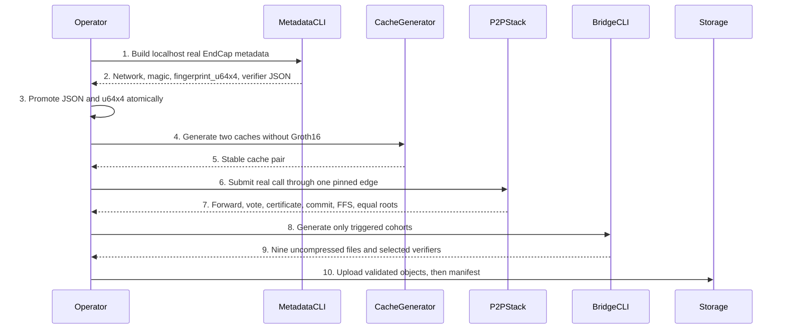
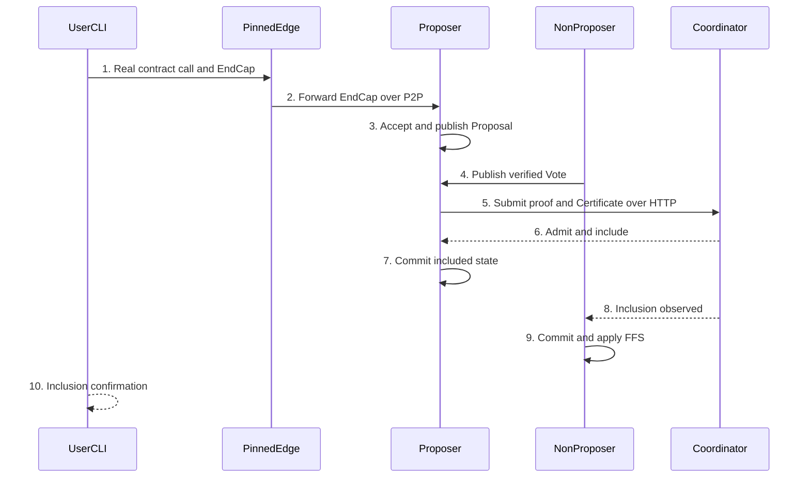

# Circuit and Verifier Operations

> Internal developer documentation — repository-only. Not part of the published mdBook (SUMMARY.md).

> Updated: 2026-10-28. Status: Review.

## Overview

This runbook covers EndCap verifier metadata, Plonky2 caches, real peer-to-peer transaction acceptance, cross-repository delivery, and the four independent Bridge Groth16 cohorts. `config_gen_v2` selects localhost or testnet from the compiled network while retaining the shared `PsyNetworkLocalDevnetConstants` circuit shape. The verifier selector accepts `LocalDevnet` and, only in a matching `testnet` build, `PsyPublicTestnet`; all other selectors fail closed. The shared metadata must match a real construction with the selected network's magic, not merely a localhost measurement. Section 4.4 describes the bounded testnet adoption checks; it does not replace proof or deployment acceptance. Bridge publication is a separate, explicitly authorized operation: package offline, hash the twelve uncompressed files and four full compressed objects in a sixteen-entry version-1 manifest, upload the two single objects and required parts first, read them back and validate them, then upload the manifest last.

A local restart is not part of that release flow. [Section 16](#16-pre-restart-gate) is mandatory before `make restart` or `make run-all`. Changing a fingerprint pin is not permission to restart or to treat the constant as a measurement. Regenerate trusted setup only when section 3 selects that cohort.

## Background

Circuit metadata forms a dependency cascade, but not every circuit-related change triggers every generator. EndCap verifier JSON and its four-limb fingerprint must come from one real circuit construction. Cache generation must not enter the Groth16 path. Genesis data and the embedded wallet circuit bundle have narrower independent triggers. Bridge aggregation, deposit append, withdrawal claim, and reward claim each own a separate trusted-setup cohort. Finally, compilation success or HTTP admission alone does not prove the real peer-to-peer path: acceptance requires one real `psy_user_cli call`, a forwarded EndCap through one pinned edge, proposal voting and certification, Coordinator admission, proposer commit, non-proposer fast-forward synchronization, and equal roots.

## Table of Contents

- [Terminology](#terminology)
- [1. Authority and Operational Boundary](#1-authority-and-operational-boundary)
- [2. Dependency Model](#2-dependency-model)
- [3. Trigger Matrices](#3-trigger-matrices)
- [3.2 Independent Bridge matrix](#32-independent-bridge-matrix)
- [3.3 Token privacy circuit fingerprints](#33-token-privacy-circuit-fingerprints)
- [4. Localhost EndCap Metadata](#4-localhost-endcap-metadata)
- [5. Cache Generation](#5-cache-generation)
- [6. Genesis and Embedded Circuit Boundaries](#6-genesis-and-embedded-circuit-boundaries)
- [7. Real Peer-to-Peer End-to-End Acceptance](#7-real-peer-to-peer-end-to-end-acceptance)
- [8. Cross-Repository Release Applicability and DAG](#8-cross-repository-release-applicability-and-dag)
- [9. Bridge Cohort Generation](#9-bridge-cohort-generation)
- [10. Offline Packaging and Manifest](#10-offline-packaging-and-manifest)
- [11. Publication Boundary](#11-publication-boundary)
- [12. Verification and Failure Handling](#12-verification-and-failure-handling)
- [13. File Impact](#13-file-impact)
- [14. Rationale](#14-rationale)
- [15. Security Considerations](#15-security-considerations)
- [16. Pre-Restart Gate](#16-pre-restart-gate)

## Terminology

| Term | Definition |
|---|---|
| ABI | Application Binary Interface. |
| CLI | Command-line interface. |
| DAG | Directed acyclic graph. |
| DTO | Data transfer object. |
| EndCap | Final proof of one User Proving Session, produced by `UPSStandardEndCapCircuit`. |
| FFS | Fast-forward synchronization applied by a non-proposer after Coordinator inclusion. |
| Groth16 | Proving system used by the Bridge wrappers for layer-one verification. |
| GUTA | Global User Tree Aggregator. |
| JSON | JavaScript Object Notation. |
| P2P | Peer-to-peer. |
| PI | Public input. |
| RPC | Remote procedure call. |
| SDK | Software development kit. |
| UPS | User Proving Session. |
| WASM | WebAssembly. |

## 1. Authority and Operational Boundary

1. Run node commands from `<repo-root>`, sibling commands from `<workspace>/<repo>`, local keystore commands against `<home>/.psy/keystore`, and disposable operations under `<tmp>`. Repository documentation must not contain workstation paths.
2. Current Audit source is the governing reference. Relevant release policy and repository topology are at `AGENTS.md:75-93,95-137`.
3. The metadata CLI prints the compiled `CURRENT_NETWORK`, `PSY_NETWORK_MAGIC`, display fingerprint, exact `[u64; 4]`, verifier JSON, and the separate zk, secp, eth-personal, and multisig display/limb lines (`client_prover/psy_cli/psy_user_cli/src/subcommand/get_user_endcap_common_data.rs`). Section 4's generation procedure is localhost-specific; section 4.4 separately checks adoption of the unchanged metadata in a testnet build.
4. Replacing `END_CAP_ALT_VERIFIER_DATA_SERIALIZED` affects both supported selectors. `config_gen_v2` selects `LocalDevnet` or `PsyPublicTestnet` from compiled `CURRENT_NETWORK` and instantiates the shared `PsyNetworkLocalDevnetConstants` (`psy_plonky2_circuits/examples/config_gen_v2.rs`). The testnet verifier selector also requires compiled `CURRENT_NETWORK == "testnet"` and the selected network magic to equal compiled `PSY_NETWORK_MAGIC` (`psy_plonky2_circuits/src/circuit_library/end_cap_verifier_data.rs`). Distinct per-network verifier blobs remain unimplemented; a different magic or circuit requires its own measurement and release review.
5. Generation, repository delivery, artifact upload, package publication, contract deployment, and Git push are separate actions. Authorization for one does not authorize another (`AGENTS.md:59-70`).

## 2. Dependency Model

### 2.1 Operator flow



### 2.2 EndCap cascade

```text
UPS / EndCap circuit source or circuit-defining constant
                         |
                         v
              UPSStandardEndCapCircuit
                         |
              +----------+----------+
              |                     |
              v                     v
         verifier JSON      fingerprint_u64x4
              +----------+----------+
                         |
                         v
                   GUTA inputs
                         |
                         v
        coordinator circuit library and caches
                         |
                         v
 bridge_agg only if its consumed circuit shape/data changed
```

`UPSStandardEndCapCircuit` constrains the UPS whitelist, proof-tree whitelist, roots, state transition, GUTA statistics, and final public-input hash (`client_prover/psy_circuit/psy_network_circuit/src/ups/circuits/end_cap.rs:55-70,105-160`). `PsyUPSStepCircuitManager` constructs the real EndCap from the real UPS circuit set (`client_prover/psy_circuit/psy_ups_circuit/src/circuit_manager/core.rs:61-76,96-140`).

### 2.3 Bridge cohorts

```text
<home>/.psy/keystore/
├── circuit_groth16.bin, pk_groth16.bin, vk_groth16.bin
├── deposit_append/
│   └── circuit_groth16.bin, pk_groth16.bin, vk_groth16.bin
├── withdrawal_claim/
│   └── circuit_groth16.bin, pk_groth16.bin, vk_groth16.bin
└── reward_claim/
    └── circuit_groth16.bin, pk_groth16.bin, vk_groth16.bin

psy-contracts/src/
├── GnarkGroth16Verifier.sol
├── DepositBatchVerifier.sol
├── WithdrawalClaimVerifier.sol
└── RewardClaimVerifier.sol
```

With no cohort flags, `regenerate-groth16-keystore` regenerates `bridge_agg`, `deposit_append`, `withdrawal_claim`, and `reward_claim`. `--skip-bridge-agg`, `--skip-deposit-append`, `--skip-withdrawal-claim`, and `--skip-reward-claim` omit one cohort each (`psy_cli/psy_relayer_cli/src/bridge/regen_groth16_keystore.rs:105-139`). Each selected directory owns exactly `circuit_groth16.bin`, `pk_groth16.bin`, and `vk_groth16.bin` (`psy_cli/psy_relayer_cli/src/bridge/regen_groth16_keystore.rs:95,777-783`). All four verifier exports write the `psy-contracts` checkout used by the launcher — the sibling repository next to `psy-node` (Make `CONTRACTS_DIR` resolves the sibling first and falls back to the legacy nested `./psy-contracts`).

The reward cohort changes when `RewardClaimWrapCircuit` changes its public commitment. The wrapper exports 256 bits of the full token-domain message's Keccak commitment, and the generic gnark path keccak-hashes those bits and binds the result as two 128-bit halves. `PsyToken.claimReward` computes the identical double hash (`psy_plonky2_circuits/src/bridge/circuits/reward_claim_wrap.rs:207-221`; `psy-contracts/src/PsyToken.sol:106-123`). That double hash matches the deposit cohort, whose EVM public-inputs hash is `keccak256(abi.encodePacked(keccak256(buf)))` (`<workspace>/psy-contracts/src/Bridge.sol:1159-1171`), but not the withdrawal cohort: its EVM public-inputs binding is a single Keccak of the 72-byte packed 18-word buffer (`<workspace>/psy-contracts/src/Bridge.sol:1068-1085`), with the wrapper registering the words as 32-bit limbs for that single hash (`psy_plonky2_circuits/src/bridge/circuits/bridge_wrap.rs:381-404`). The checkpoint aggregate remains 147 fields at capacity 64. This invalidates only the reward setup and `RewardClaimVerifier.sol`, not the other three cohorts.

### 2.4 Crate entry-point map

| Crate entry | Verified dependent consumers | Trigger / generation step |
|---|---|---|
| COMMON `psy_plonky2_common_circuits`: generic gadgets plus the inner deposit/withdrawal batch circuits (`src/bridge/deposit_batch_append_circuit.rs:243`, `withdrawal_batch_claim_circuit.rs:67`); no dependency on any other circuit-family crate (local deps `psy_plonky2_common_circuits/Cargo.toml:38-43`) | `psy_plonky2_circuits` (`psy_plonky2_circuits/Cargo.toml:45`), `psy_common_circuit` (`client_prover/psy_circuit/psy_common_circuit/Cargo.toml:27`), `psy_dpn_circuit` (`psy_dpn_circuit/Cargo.toml:31`), `psy_prover` (`client_prover/psy_prover/Cargo.toml:36`), `psy_relayer_cli` (`psy_cli/psy_relayer_cli/Cargo.toml:47`), `guardian_common` (`psy_cli/guardian_common/Cargo.toml:22`), `psy_plonky2_proof` (`psy_plonky2_proof/Cargo.toml:41`; not a root workspace member); `psy_ups_circuit`/`psy_network_circuit` consume it transitively through `psy_common_circuit` | Per-consumer impact only: GUTA/coordinator shape → §3.1; inner batch circuit → §3.2 and the §9.2 cohort commands |
| NETWORK `psy_network_circuit`: owns `UPSStandardEndCapCircuit` (`src/ups/circuits/end_cap.rs:28`) and other network circuits | `psy_ups_circuit` (`psy_ups_circuit/Cargo.toml:28`; constructor call `circuit_manager/core.rs:130`), `psy_dpn_circuit` (`:27`), `psy_plonky2_circuits` (`psy_plonky2_circuits/Cargo.toml:54`), `psy_prover` (`:26`), `psy_provider` (`psy_provider/Cargo.toml:27`) | EndCap constraints → §3.1 row 1 (EndCap metadata §4, caches §5); other network circuits → §3.1 by actual constructed-circuit change. Coordinator/GUTA circuits are not here; they live in `psy_plonky2_circuits` |
| UPS `psy_ups_circuit`: `PsyUPSStepCircuitManager::new_with_config` builds the real EndCap from the real UPS set (`circuit_manager/core.rs:97,130`) | `psy_plonky2_circuits` (`Cargo.toml:56,71`), `psy_prover` (`:32`), `psy_user_cli` (`psy_cli/psy_user_cli/Cargo.toml:17`), `psy_cli_common` (`psy_cli/psy_cli_common/Cargo.toml:15`), `psy_dev_cli` (`psy_cli/psy_dev_cli/Cargo.toml:86`), `psy_relayer_cli` (`:61`) | §3.1 EndCap metadata plus cache pair; Genesis only when a §6.1 input changed |
| Bridge `psy_plonky2_circuits/src/bridge`: wrappers `DepositBatchWrapCircuit`/`WithdrawalClaimWrapCircuit` (`bridge/circuits/bridge_wrap.rs:262,361`) and `RewardClaimWrapCircuit` (`reward_claim_wrap.rs:68`) wrap the COMMON inner circuits | Setup owner `psy_relayer_cli` (`Cargo.toml:46`, `gnark-wrap`); deployment consumers per §8.1 | Four independent cohorts, reward independent: §3.2 selects, §9.2 commands, §9.1 reward cut-over |
| DPN `psy_dpn_circuit`: function-VM circuits and privacy circuits `PrivateNoteInclusionCircuit` (`src/circuits/privacy/private_note_inclusion.rs:237`), `DepositInclusionCircuit` (`deposit_inclusion.rs:212`) | `psy_ups_circuit` (`Cargo.toml:29`), `psy_prover` (`:27`), `psy_user_cli` (`:16`), `psy-mcp-server` (`client_prover/psy_mcp_server/Cargo.toml:23`) | The two burned privacy fingerprints: §3.3 plus [token-privacy-circuit-fingerprints.md](token-privacy-circuit-fingerprints.md); wallet bundle §6.2; function-VM changes per §3.1 actual impact |

Any row whose constructed circuit changed recompiles node/compiler/SDK/services from one source revision as one cohort (§8.2). The token-precompile constants update only when a burned constant changes (§3.3). Genesis runs only when a §6.1 input changed; no row in this table alone forces Genesis or trusted setup.

## 3. Trigger Matrices

### 3.1 EndCap, cache, Genesis, and embedded wallet bundle

| Changed input | EndCap metadata | Cache pair | Genesis outputs | `local_circuits.json` |
|---|---:|---:|---:|---:|
| UPS or EndCap constraints, gates, ordered PI, whitelist inputs, minifier, verifier shape, or `PSY_NETWORK_MAGIC` supplied to the EndCap constructor | Yes | Yes | No | No unless an embedded bundle circuit also changed |
| EndCap verifier JSON or fingerprint correction | Re-derive and promote as one set | Yes | No | No |
| Runtime Realm validator membership selected by `PSY_CONFIG_PATH` | No unless an EndCap input changed | Yes; validator count is a cache input | No | No |
| GUTA or coordinator constraints, verifier shape, ordered PI, registered circuit triplet, common data, or library composition | No unless EndCap changed | Yes | No | No |
| P2P/storage `chain_id` migration that changes RealmFinalizeGUTA `H(chain_id)` while the EndCap constructor magic stays unchanged | No | Yes; also regenerate `bridge_agg` under §3.2 | No | No |
| `checkpoints_per_epoch` or RealmFinalizeGUTA rotation constants change, including the active validator count used by the rotation schedule | No | Yes; regenerate and stabilize per §5.1/§5.3. Measure the constructed circuit 63; do not echo a fingerprint constant. Cascade: circuit 63 → GUTA whitelist → circuit 40 → circuit 32 → `bridge_agg`; common-data bytes may stay identical, so compare rather than assume. Also regenerate the `bridge_agg` cohort per §9.2 | No | No |
| Cache encoding or serialization with identical reconstructed circuits | No | Yes | No | No |
| Ordinary EndCap, GUTA, cache, verifier, transport, witness, logging, retry, or storage change | No extra action | As rows above | No | No |
| Realm or Coordinator block-scheduling cadence constants only (4.5 s / 8.5 s processing windows) | No | No | No | No |
| `psy-genesis/genesis_contracts.json` content changes | Apply separate Genesis trigger | Only if circuit inputs changed | Yes | Yes only if embedded bundle circuit sources/version/heights changed |
| Genesis setup constants used by `local_devnet.rs` change | No unless EndCap input changed | Only if network circuits changed | Yes | Yes only if embedded bundle circuit sources/version/heights changed |
| Serialized `genesis.json` format or serializer changes | No | No unless network circuits changed | Yes | No |
| Adopted `psy-genesis` gitlink changes to Genesis inputs | No unless EndCap input changed | Only if network circuits changed | Yes | Yes only if embedded bundle circuit sources/version/heights changed |
| Embedded zk-sign, private-note-inclusion, or shield-deposit-claim circuit source, serialization version, or circuit-defining height changes | No unless EndCap input changed | Only if network library changed | No | Yes |

Epoch/rotation impact is a circuit-63 change, not a withdrawal change. The epoch and validator list enter `RealmFinalizeGUTACircuit` through `psy_plonky2_circuits/src/guta/guta_helper.rs:232-291` and `psy_plonky2_circuits/src/guta_v2/circuits/realm_finalize_guta.rs:309-352,379-395,743-754`; the changed fingerprint is a leaf of the GUTA whitelist. The root is embedded by circuit 40 (`psy_plonky2_circuits/src/coordinator/gadgets/verify_agg_user_registration_deploy_guta.rs:226-227`), and circuit 32 embeds circuit 40's fingerprint (`psy_plonky2_circuits/src/coordinator/coordinator_helper.rs:200-226`). `bridge_agg` embeds the checkpoint fingerprint (`psy_plonky2_circuits/src/bridge/circuits/bridge_agg_final.rs:181,217-218`). Regenerate the cache pair with §5.1 and require §5.3; the writer replaces only `psy_plonky2_circuits/src/generated/cached_circuit_library.rs` and `psy_plonky2_circuits/src/generated/cached_common_data.rs` (`psy_plonky2_circuits/examples/config_gen_v2.rs:448-474`). Common-data bytes may be identical; compare actual output instead of assuming a change. For `bridge_agg`, regenerate only that Groth16 cohort with §9.2 and require its three files `circuit_groth16.bin`, `pk_groth16.bin`, and `vk_groth16.bin` under `<home>/.psy/keystore` plus `<workspace>/psy-contracts/src/GnarkGroth16Verifier.sol`; cohort selection is at `psy_cli/psy_relayer_cli/src/bridge/regen_groth16_keystore.rs:123-139`. Epoch alone does not trigger EndCap metadata (§4), the wallet bundle (§6.2), root `genesis.json` (§6.1), or `withdrawal_claim`. The separate 35-word withdrawal cutover owns its own `withdrawal_claim/` cohort and `<workspace>/psy-contracts/src/WithdrawalClaimVerifier.sol` (paragraph above); do not mix it with this row.

A transport-only or DTO-only field is a non-trigger only while constraints, ordered PI count and meaning, verifier data, fingerprints, common data, cap heights, and tree heights remain identical. A runtime scheduling-only change is a non-trigger for EndCap metadata, caches, trusted setup, and Genesis: the 4.5 s realm and 8.5 s coordinator processing cadences are wall-clock loops (`current_slot % 45 == 0` at `psy_node_common/src/realm/processor/core/runner.rs:99`; `current_slot % 85 == 0` at `psy_node_common/src/coordinator/processor/core/runner.rs:62`) that feed no circuit input, unless another §3.1 or §3.2 input also changed.

The PSY chain-identity migration replaces former `u32` chain IDs with the per-network `u64` magic from `psy-genesis/config.json` (`PSY_CONFIG_PATH` selects the same build-time override as client_prover). `PsyChainNetworkType` remains a selector: LocalDevnet maps to localhost, PsyPublicTestnet to testnet, and PsyMainnet to mainnet; other selectors fail closed. Read the selected magic from the pinned configuration rather than inferring it from an L1 network name.

This is a breaking source cutover: Proposal is 214 bytes, Certificate 204 bytes, EndCapForwardHeader 60 bytes, stored ValidatorLeafPreimage 108 bytes, and the QBlob tree-node batch header 84 bytes. Existing validator preimages, blob headers, persisted processor state, proposals, certificates, and forwarded EndCaps are not a compatible storage/wire cohort. Do not mix old and rebuilt nodes or resume old state with rebuilt binaries; the owner must authorize a purge/reinitialization under the lifecycle guide before adopting this source.

The finalizer's `H(chain_id)` circuit constant changes, cascading through the GUTA whitelist and coordinator to `bridge_agg`; proposal and EndCap IDs also change. The finalizer derives that domain from `network.get_chain_id()` (`psy_plonky2_circuits/src/circuit_library/core.rs:63`; `psy_data/src/guta/realm_finalize.rs:78-85`). This is distinct from the EndCap constructor's `psy_config::PSY_NETWORK_MAGIC` input (`client_prover/psy_cli/psy_user_cli/src/subcommand/get_user_endcap_common_data.rs:13-14`), which this migration leaves unchanged. On an owner-authorized rebuild, regenerate the cache pair with `config_gen_v2`, then the matching `bridge_agg` Groth16 cohort and Solidity verifier. This migration alone does **not** authorize root `genesis.json` regeneration, token privacy fingerprint changes, EndCap metadata promotion, or deposit/withdrawal cohort regeneration: user sighashes and EndCap ZK signatures already use `PSY_NETWORK_MAGIC`, and the validator Merkle leaf hash still excludes chain identity. Source-only edits leave the running stack untouched; no rebuild, purge, restart, or artifact regeneration is implicit.

### 3.2 Independent Bridge matrix

| Changed input | `bridge_agg` | `deposit_append` | `withdrawal_claim` |
|---|---:|---:|---:|
| Bridge aggregation final, chain, wrapper constraints, ordered PI, verifier data, checkpoint common data, checkpoint fingerprint, cached rollup step-commit fingerprint, cap height, or passed tree height | Yes | No | No |
| Deposit leaf, frontier, batch, tree, minifier, commitment, wrapper constraints, ordered PI, or verifier data | No | Yes | No |
| Withdrawal slot, Merkle, padding, batch, tree, commitment, wrapper constraints, ordered PI, or verifier data | No | No | Yes |
| `validator_tree_root` added only to a DTO, transport, log, or storage record | No | No | No |
| `validator_tree_root` added to a canonical checkpoint hash or circuit gadget | Yes | No | No |
| Witness values, roots, amounts, addresses, nonces, checkpoint numbers, transport, logging, timeout, retry, or Solidity caller logic with unchanged verifier key and ABI | No | No | No |

Deposit append exposes its batch commitment as PI and owns its own frontier, leaf, batch, and tree targets (`psy_plonky2_common_circuits/src/bridge/deposit_batch_append_circuit.rs:242-259,267-374`). Withdrawal claim independently owns root, count, fixed slots, Merkle checks, padding, and batch commitment PI (`psy_plonky2_common_circuits/src/bridge/withdrawal_batch_claim_circuit.rs:59-69,78-175`).

The withdrawal identity cutover in the current audit worktree is Bridge V6: `VERSION = 6` and 35 slot words at `<workspace>/psy-contracts/src/Bridge.sol:55,63`, with `token_contract_id` in word 34 and `uint256[1120]` for a 32-slot batch. The batch commitment includes that word. Registered public inputs stay 18 words (`withdrawal_root` u32×8, `real_count`, `bridge_user_id`, `batch_commit` u32×8). The per-withdrawal L1 key is a separate keccak256 of that slot's 35 big-endian u32 words (140 bytes), not a hash of the Poseidon leaf and not the raw nonce. The working V6 source requires a fresh L1 chain, a fresh L2 chain, and a new genesis; clearing the services database does not upgrade a committed-V5 raw-nonce claim, same-root replay, or pending orphan, and there is no in-place upgrade or pending compatibility path. This note does not record that purge or restart as executed. This changes only the `withdrawal_claim` verifier. Regenerate that cohort and its Solidity verifier; do not regenerate EndCap metadata, the Plonky2 cache pair, or the `bridge_agg`, `deposit_append`, or `reward_claim` cohorts for this change. The required fresh genesis is the chain cutover, not an EndCap or cache trigger. That `withdrawal_claim` regeneration has not been run. An existing keystore, and the 2026-10-28 bridge PASS, are not this cohort.

### 3.3 Token privacy circuit fingerprints

`private_note_inclusion_fingerprint` and `shield_claim_fingerprint` are four-limb constants in the PSY and USDT token precompiles. They bind `private_claim` / `claim_deposit` to the minifier fingerprints of `PrivateNoteInclusionCircuit` and `DepositInclusionCircuit` (protocol alias `ShieldDepositClaimCircuit`). They are not EndCap metadata, coordinator-library fingerprints, or Groth16 keys. A change that updates the last row of §3.1 for those two embedded circuits also requires the token-precompile procedure in [token-privacy-circuit-fingerprints.md](token-privacy-circuit-fingerprints.md). Cache generation does not copy those limbs.

## 4. Localhost EndCap Metadata

### 4.1 Preconditions

1. Use the exact source revision intended for the release.
2. Require `<repo-root>/psy-genesis/config.json` to contain the intended localhost configuration. The current localhost magic and realm-0 edge list are at `psy-genesis/config.json:3-19`.
3. Preserve the previous verifier JSON, applicable fingerprint constants, and both caches as one rollback unit. Inventory every localhost and testnet deployment built from that shared JSON.
4. Do not run this section for a non-local target and do not treat localhost validation as evidence for another network.

### 4.2 Generate

Run exactly from `<repo-root>`:

```bash
PSY_CONFIG_PATH=<repo-root>/psy-genesis/config.json \
PSY_NETWORK=localhost \
cargo run --release -p psy_user_cli --no-default-features -- \
  get-user-end-cap-common-data
```

Require these records from the same successful invocation. The EndCap promotion set is network, magic, `endcap_fingerprint_u64x4`, and `alt_verify_data`. It also prints `endcap_fingerprint` plus the zk, secp, eth-personal, and multisig display and limb lines; none of those are EndCap verifier metadata:

```text
psy_network: localhost
psy_network_magic: 0x...
endcap_fingerprint: <display fingerprint>
endcap_fingerprint_u64x4: [limb0, limb1, limb2, limb3]
alt_verify_data: {complete JSON object}
zk_fingerprint: <display fingerprint>
secp_fingerprint: <display fingerprint>
eth_personal_fingerprint: <display fingerprint>
multisig_fingerprint: <display fingerprint>
zk_fingerprint_u64x4: [limb0, limb1, limb2, limb3]
secp_fingerprint_u64x4: [limb0, limb1, limb2, limb3]
eth_personal_fingerprint_u64x4: [limb0, limb1, limb2, limb3]
multisig_fingerprint_u64x4: [limb0, limb1, limb2, limb3]
```

The command constructs `PsyUPSStepCircuitManager` with the compiled network magic and converts its real verifier-only data (`client_prover/psy_cli/psy_user_cli/src/subcommand/get_user_endcap_common_data.rs:16-47`). Copy only `alt_verify_data` and `endcap_fingerprint_u64x4` into the EndCap artifacts. Do not promote zk, secp, eth-personal, or multisig display/limb lines as EndCap metadata.

### 4.3 Promote atomically

1. Require `psy_network: localhost`. Parse the printed magic and `networks.localhost.magic` in `<repo-root>/psy-genesis/config.json` as hexadecimal integers and require equality (`psy-genesis/config.json:3-5`). The CLI prints lowercase hex while the configuration may use uppercase; case-sensitive string comparison is invalid. A numeric mismatch is a hard failure.
2. Copy the complete value after `alt_verify_data:` verbatim into `END_CAP_ALT_VERIFIER_DATA_SERIALIZED` at `psy_plonky2_circuits/src/circuit_library/end_cap_verifier_data.rs`. The blob is shared by localhost and the guarded testnet selector; changing it requires checking both consumers, not just localhost.
3. Copy the printed `endcap_fingerprint_u64x4` limbs verbatim, in printed order, into the localhost `END_CAP_CIRCUIT_FINGERPRINT_HASH_U64_X4`. Do not convert from the display fingerprint and do not reorder, reinterpret, or recalculate limbs. The CLI obtains the four canonical limbs directly from the fingerprint elements (`client_prover/psy_cli/psy_user_cli/src/subcommand/get_user_endcap_common_data.rs:19-29`).
4. Do not copy the dummy verifier constant at `psy_plonky2_circuits/src/circuit_library/end_cap_verifier_data.rs:5-25`.
5. Do not update a non-local network fingerprint constant from localhost output. Testnet adoption requires its own section 4.4 measurement; every other non-local selector remains unsupported.
6. Treat the localhost verifier JSON, localhost `[u64; 4]`, and both generated caches as one atomic rollback unit. A partial update is invalid.

### 4.4 Testnet adoption of unchanged metadata

Run `get-user-end-cap-common-data` from the exact release source, using the
selected public configuration and `PSY_NETWORK=testnet`. This constructs the
actual circuit; printing a checked-in constant is not a measurement:

```bash
PSY_CONFIG_PATH=<repo-root>/psy-genesis/config.json \
PSY_NETWORK=testnet \
cargo run --locked --release -p psy_user_cli -- \
  get-user-end-cap-common-data
```

Require a successful exit, `psy_network: testnet`, and numeric equality between
the printed magic and `networks.testnet.magic`. Compare the complete
`alt_verify_data` object and all four `endcap_fingerprint_u64x4` limbs against
the adopted metadata and the constants actually used by the Plonky2 startup
path. Public testnet currently uses `PsyNetworkLocalDevnetConstants` in
`psy_cli/psy_node_cli/src/node/startup_edge_plonky2_scylla.rs` and
`psy_core/src/network_config/circuit_config_gen.rs`; the historical
`PsyNetworkPsyPublicTestnetConstants` fingerprint must agree too.

The selector tests in `end_cap_verifier_data.rs` check the supported-network
boundary and recompute the fingerprint from the complete adopted verifier.
They do not substitute for real circuit construction, a signed EndCap proof,
or P2P inclusion. Mainnet and other unvalidated selectors remain rejected.
Changing the shared magic or any circuit input invalidates this adoption
evidence. Do not relabel an npm package's compile-time network or rebuild it
silently: verify its actual WASM constants and embedded circuit artifacts.

## 5. Cache Generation

### 5.1 Cache-only command

Cache loading calls `load_realm_rotation_config(network)` for the selected localhost or testnet network, requiring nonempty `realm_configs[].validators`. The localhost prerequisite below uses the existing `init-realm-p2p-keys` command; it reads `PSY_CONFIG_PATH=psy-genesis/config.json` and writes `local_checkpoints/realm_p2p/config.json` plus real identity keys. It does not read or require `genesis.json`/`private_keys.json`. Genesis `validators` injection is a separate later step, not a cache prerequisite. Testnet must use its selected configuration and preserved identities, not generate replacement live keys from this localhost example. Run the localhost procedure from `<repo-root>`:

```bash
PSY_CONFIG_PATH=psy-genesis/config.json \
PSY_NETWORK=localhost \
PSY_REALM_P2P_PUBLIC_HOST=127.0.0.1 \
./target/release/psy_node_cli init-realm-p2p-keys \
  --out-dir local_checkpoints/realm_p2p \
  --realm-ids 0,1 \
  --validators-per-realm 2 \
  --validator-user-ids 0,262144,1048576,1572864 \
  --edges-per-validator 1
```

This writes runtime membership and identity keys only. Then run the cache-only command with the runtime config selected:

```bash
PSY_CONFIG_PATH=<repo-root>/local_checkpoints/realm_p2p/config.json \
PSY_NETWORK=localhost \
RUST_MIN_STACK=134217728 \
cargo run --release -p psy_plonky2_circuits \
  --example config_gen_v2 \
  --no-default-features \
  --features std,serialize_rkyv,serialize_speedy,serialize_postcard
```

This command writes only:

```text
psy_plonky2_circuits/src/generated/cached_circuit_library.rs
psy_plonky2_circuits/src/generated/cached_common_data.rs
```

Generate the pair only with the membership created above (two validators per Realm 0 and 1, four reserved ids); a different validator count changes the generated pair even though the second-run stability loop still passes.

The writer compares and replaces only those paths (`psy_plonky2_circuits/examples/config_gen_v2.rs:448-474`).

### 5.2 Forbidden cache command

Do not run either of these for cache-only work:

```bash
make config_gen_v2
cargo run --release --package psy_plonky2_circuits --example config_gen_v2
```

The crate default features include `gnark-wrap`, while the required command explicitly disables defaults. The generator conditionally enters Groth16 setup under that feature (`psy_plonky2_circuits/Cargo.toml:7-13`; `psy_plonky2_circuits/examples/config_gen_v2.rs:256-259,353-445`). Cache generation must not delete, generate, or export Bridge setup material.

### 5.3 Stability loop

```text
entry: a cache trigger from Section 3.1
1. Complete localhost metadata promotion first when EndCap changed.
2. Run the cache-only command once.
3. Run the identical cache-only command again.
4. Require both “cached_circuit_library.rs is up to date.” and
   “cached_common_data.rs is up to date.” on the second run.
5. If either file changes on the second run, restore the previous pair and stop.
exit: both generated files are stable as one pair
```

## 6. Genesis and Embedded Circuit Boundaries

### 6.1 Genesis trigger

Run Genesis generation only when at least one of these inputs changed:

1. `psy-genesis/genesis_contracts.json` content;
2. a Genesis setup constant or construction input in `psy_plonky2_circuits/src/node/config/networks/local_devnet.rs`;
3. the serialized `genesis.json` format or serializer changes;
4. an intentionally adopted `psy-genesis` gitlink revision whose changed content affects Genesis construction.

EndCap metadata, GUTA, cache, verifier JSON, network fingerprint, ordinary circuit witness, Bridge cohort, transport, DTO, logging, or retry changes do not trigger Genesis generation.

That non-trigger does not cover an identity pin. `STAGE_CF69_MULTISIG_FINGERPRINT_U64` and the default faucet SD-key pin change the registration-2 account and the faucet-operator identities. Those pin edits still do not trigger EndCap promotion, cache generation, `local_circuits.json`, or any Groth16 cohort. Regenerate Genesis through [section 16](#16-pre-restart-gate) on the authorized fresh path. Do not load the new pins with `make restart`.

When triggered, the current target is:

```bash
make generate-genesis-data
```

The selected `psy-genesis/config.json` network must already carry the three public `guardian_initial_member_hashes`, then run the command with no account environment variable and no account flag. The target runs `psy_dev_cli generate-genesis-data --repo-root` (`Makefile:141-142`). There is no `guardian_authorization` or policy JSON input, no `PSY_RELAYER_MULTISIG_ACCOUNT` variable, no `PSY_MULTISIG_POLICY_ARTIFACT` variable, and no `--multisig-policy-artifact` flag. Registration 2 is derived from those three member hashes and the actual multisig circuit fingerprint, with the fixed contract-1 policy fields initialized in Genesis; it is not derived from an L1 keystore or password. See [genesis-generation.md](genesis-generation.md) section 1.2.1 for the exact input contract. The generator writes root `genesis.json`, root `private_keys.json`, and, unless disabled, `psy-dapp/apps/bridge/src/config/faucetOperators.json` (`psy_cli/psy_dev_cli/src/subcommand/generate_genesis.rs`). Entry 2 of the dense private-key export is `null`; other validator/faucet entries retain their existing keys and positions. The generator does not write `faucet_operators.json` beside Genesis. See [devnet lifecycle, environment variable reference](devnet_lifecycle.md#12-environment-variable-reference) for the launcher's public input and child-environment behavior.

### 6.2 Embedded wallet circuit trigger

Run the following only when an embedded bundle circuit source, bundle serialization version, or circuit-defining height changes:

```bash
make generate-local-circuits
```

The target regenerates `client_prover/psy_prover/src/wallet/local_circuits.json` (`Makefile:120-121`). Runtime loads that embedded bundle, containing zk-sign plus the private-note-inclusion and shield-deposit-claim base circuits (`client_prover/psy_prover/src/wallet/memory_wallet.rs:336-339,426-451`). Ordinary EndCap, GUTA, cache, or verifier changes do not trigger it. The same privacy-circuit change also invalidates the token-precompile fingerprint constants; follow [token-privacy-circuit-fingerprints.md](token-privacy-circuit-fingerprints.md) and do not treat this wallet bundle as a substitute for those contract limbs.

## 7. Real Peer-to-Peer End-to-End Acceptance

### 7.1 Acceptance flow



### 7.2 Single pinned edge configuration

Create `<tmp>/p2p-e2e.json` by copying `<repo-root>/psy-genesis/config.json`, then change only `networks.localhost.realm_configs` entry `id: 0` so `rpc_url` contains exactly one edge URL. Determine the scheduled proposer from the `realm P2P scheduled proposer` log. If sub-1 is the non-proposer, retain only `http://127.0.0.1:13380`; if sub-2 is the non-proposer, retain only `http://127.0.0.1:13381`. Leave every other value unchanged. The source configuration defines these two realm-0 edges (`psy-genesis/config.json:12-19`).

The resulting fragment must be exactly one of:

```json
{"id": 0, "rpc_url": ["http://127.0.0.1:13380"]}
```

```json
{"id": 0, "rpc_url": ["http://127.0.0.1:13381"]}
```

### 7.3 Real transaction command

Preconditions, in order, before this acceptance call:

1. Genesis user 0 has called contract 5 `faucet(1, 1)`. The faucet defers contract 0 `transfer` as method id `2789897329` with inputs `[1, 1]` (`../psy-compiler/psy-precompiles/faucet/src/main.psy:45-46`).
2. User 1 has included contract 0 `claim` with input `[0]`, so the deferred amount `1` is on user 1's spendable balance (`../psy-compiler/psy-precompiles/token/src/main.psy:461`).
3. User 1 still holds at least amount `1` after fees. Do not invent a larger balance.

Then run one serial acceptance transaction through the pinned config. The method is the current contract-0 `transfer(recipient, amount)` (`../psy-compiler/psy-precompiles/token/src/main.psy:430`). Recipient `0` and amount `1` are the funded sample. Do not pass a private key on argv. Export `PRIVATE_KEY` in the operator environment; `WalletSessionArgs.private_key` reads that variable (`client_prover/psy_core/psy_common/src/args.rs:95-96`):

```bash
<repo-root>/target/release/psy_user_cli call \
  --rpc-config <tmp>/p2p-e2e.json \
  --contract-id 0 \
  --method-name transfer \
  --inputs '[0,1]' \
  --wait-until-confirmation
```

`WalletSessionArgs` defines repeated contract, method, and JSON input arguments plus `--wait-until-confirmation` (`client_prover/psy_core/psy_common/src/args.rs:114-171`). The command waits for EndCap inclusion and logs `endcap submitted` followed by `endcap included` (`client_prover/psy_cli/psy_user_cli/src/subcommand/submit_end_cap_proof.rs:150-181`).

Do not use `mint` as the canonical acceptance transaction: bridge operations state that mint is not a funding path. Plain `psy_user_cli deposit` is also excluded: it calls the layer-one Router and is not an L2 EndCap producer (`client_prover/psy_cli/psy_user_cli/src/subcommand/deposit.rs:1-15,183-184`). Real EndCap-producing paths include `call`, `withdraw`, and `claim-deposit`; `withdraw` builds an L2 contract call and waits for EndCap inclusion (`client_prover/psy_cli/psy_user_cli/src/subcommand/withdraw.rs:115-161`), while `claim-deposit` builds the L2 `claim_deposit` call (`client_prover/psy_cli/psy_user_cli/src/subcommand/claim_deposit.rs:493-556`).

### 7.4 Required log and RPC assertions

Capture one coherent transaction chain. Require:

| Stage | Owning log | Exact log substring |
|---|---|---|
| Forward from pinned non-proposer edge | Non-proposer edge | `realm P2P EndCap forwarded end_cap_id=` |
| Accept at scheduled proposer edge | Proposer edge | `realm P2P EndCap accepted end_cap_id=` |
| Proposal | Proposer processor | `realm P2P proposal published proposal=` |
| Non-proposer vote | Non-proposer processor | `realm P2P vote published proposal=` |
| Certificate | Proposer processor | `realm P2P certificate formed` |
| HTTP submit | Proposer processor | `Submitting GUTA proof to Coordinator proposal=` |
| Coordinator admission | Coordinator edge | `realm P2P certificate admitted realm=0` |
| Proposer commit | Proposer processor | `Committed new realm block with checkpoint_id` |
| Non-proposer FFS | Non-proposer processor | `Applied proposal FFS checkpoint_id=` |

Require the same 64-hex `end_cap_id` in forward and accept. Require the same 64-hex `proposal` identifier in proposal, vote, certificate, submit, and admission. Then correlate proposer commit and non-proposer FFS by the admitted inclusion checkpoint and resulting realm root; those two logs do not contain the proposal identifier. Do not accept `Applied Realm gatherer FastForward`: that string is the gatherer path, not proposal FFS. Require the certificate to show both validator signers or equivalent evidence with at least two verified votes. Source ownership for these needles includes `psy_node_common/src/realm/network/drive.rs` (`realm P2P vote published proposal=`), `psy_node_common/src/realm/edge/handler.rs` (EndCap forward/accept), `psy_node_common/src/realm/processor/core/process_block.rs:397-401,673-675` (FFS and commit), `psy_cli/psy_node_cli/src/node/realm_p2p.rs`, and `psy_node_common/src/coordinator/edge/handler.rs` (certificate admission).

After inclusion, query `psy_get_checkpoint_global_state_roots` for the included checkpoint from Coordinator RPC and both realm-0 edge RPC endpoints. Require identical complete results across all three endpoints. Also require equal latest checkpoint identifiers on both realm edges. The RPC surfaces are defined in `psy_api_core/src/coordinator/standard_edge_rpc.rs:46-50,78-79` and `psy_api_core/src/realm/standard_edge_rpc.rs:78-82,128-133`.

A dummy prover, lookalike circuit, direct fabricated submission, HTTP admission without commit, transaction without confirmation, missing vote, missing certificate, missing non-proposer FFS, or unequal roots fails acceptance.

## 8. Cross-Repository Release Applicability and DAG

### 8.1 Applicability gate

| Change | Required delivery | Excluded unless another row applies |
|---|---|---|
| Documentation only | `psy-node` only | Genesis, SDK, WASM, packages, DApp, Wallet, Bridge publication |
| Circuit or prover source consumed by SDK | Freeze `psy-node`; pin SDK to that revision; rebuild SDK Rust, prover WASM, compiler WASM when compiler input changed, and TypeScript outputs | Package publication without changed packed bytes and authorization |
| Node crate consumed by compiler or services | Freeze `psy-node`; update only affected consumer pins | Genesis unless its trigger in Section 6 applies |
| Genesis input from Section 6.1 | Generate and publish Genesis; update only applicable Genesis gitlinks | Unchanged Genesis gitlinks |
| SDK Rust, public TypeScript, generated types, prover WASM, or compiler WASM bytes change | Build and pack SDK; compare outputs | Package publication without authorization |
| Bridge circuit/verifier/deployment input | `psy-contracts`, affected DApp, applicable gitlinks, and authorized artifact storage | SDK and Genesis unless their own inputs changed |
| DTO-only or transport-only change with unchanged circuit and public contract | Changed source repository and affected runtime consumers only | Circuit generation, Bridge cohorts, Genesis, SDK packages |

The repository ownership and consumer table is at `AGENTS.md:75-93`; the applicability rules are at `AGENTS.md:95-111`.

### 8.2 Release DAG

```text
publish consumed psy-node source revision R_node before any consumer pin
  ├── affected psy-compiler Cargo pins use pushed R_node
  ├── affected psy-services Cargo pins use pushed R_node
  ├── psy-sdk Cargo pins use the same pushed R_node before WASM generation
  └── psy-contracts changes only for L1/verifier/deployment/config inputs

pushed R_node + clean affected compiler revision
  ├── generate SDK prover WASM for web and nodejs and compiler WASM
  ├── keep generated bigint bindings; do not copy or cast them back to number
  ├── rebuild TypeScript packages and compare packed output
  └── generate Genesis only when Section 6.1 triggers

published child revisions / authorized package versions
  ├── publish each changed child and prove its SHA is on its remote destination
  ├── update every affected gitlink, including nested SDK/DApp/Wallet links
  ├── update DApp only after required package registry confirmation
  └── update Wallet only after required package registry confirmation

commit parent psy-node generated outputs and child gitlinks last
```

`R_node` is one consumed source revision. The user publishes that reviewed producer commit by SSH to the named destination; this procedure never pushes. If reachability is already proven, continue. Otherwise prove it before any consumer pin:

```bash
destination_ref=${MATCHING_BRANCH:-mainnet-beta}
git -C <workspace>/psy-node fetch origin "$destination_ref"
git -C <workspace>/psy-node merge-base --is-ancestor "$R_NODE" "origin/$destination_ref"
```

The later parent integration commit may add generated outputs and gitlinks, but consumers stay on `R_node` unless that later commit changes a consumed crate. Apply the same user-only SSH publication and reachability proof to every changed child before its gitlink moves. Parent gitlinks are last.

`psy-node` now records only `psy-genesis` as a submodule; `psy-contracts` and `psy-dapp` are sibling repositories checked out next to `psy-node`. SDK and Wallet each have their own `psy-genesis` gitlink, and DApp separately links both `psy-genesis` and `psy-contracts`. On a clean checkout, first clone or verify the sibling `psy-contracts` and `psy-dapp` checkouts and run `git submodule update --init --checkout -- psy-genesis`, then check out the already-pushed child SHA inside each affected repository and stage that repository's gitlink. Do not use `--remote` or move a tracking branch. Do not assume the node parent, DApp, SDK, or Wallet links move together.

Keep the existing `[patch."https://github.com/PsyProtocol/plonky2-hwa"]` sections in node, compiler, SDK, and services. They replace the proving backend across the dependency graph; do not add a second patch or a `[replace]` override for the pinned `psy-node` revision, and do not expect a root patch to be inherited by a git-pinned consumer.

SDK WASM bindings are generated, not copied. From `../psy-sdk/psy-ts-sdk/packages/psy-sdk`, `pnpm build` runs `prepare:wasm`: `build:wasm` generates both `web` and `nodejs` prover bindings, and `build:wasm-compiler` writes `.compiler-artifact.json`. Commit the generated `bigint` exports. Do not replace them with `number` casts or copy an older `.d.ts` over the generated files. The package scripts default `PSY_NETWORK` to `testnet`; export `PSY_NETWORK=localhost` for a localhost cohort. Do not add a manual `wasm-pack` invocation to this procedure. SDK `make build` repeats wasm-pack, `build:wasm`, and `pnpm build`, so use the package command once.

npm publication is separate from source publication and from consumer lockfile updates. A new package needs an unused version and its own authorization. DApp or Wallet may move to an existing compatible registry version without that new publication. `publish:psy-sdk`, `publish:utils`, `publish:contract-sdk`, and `publish:all` bump before publishing, so do not use them after `version:patch:*`.

R2 publication has two paths. A prefix whose sixteen-entry manifest, four compressed assemblies and twelve uncompressed files already passed validation is reused; do not upload it again. A separately authorized new cohort needs a fresh `localhost-<digest>` prefix. After Sections 10.2-10.4, before its first upload, require HTTP 404 for every actual data object key plus the manifest. The current cohort has fourteen data objects: two single objects and twelve parts (`.part-00` through `.part-02` for each of four large objects). Do not probe the nonexistent whole large-object keys instead of their parts:

```bash
set -euo pipefail
export PSY_KEYSTORE_R2_PREFIX='localhost-<digest>'
export ARTIFACT_URL="https://pub-23b7764b3820454094ce80557ab38d0b.r2.dev/$PSY_KEYSTORE_R2_PREFIX"
for file in "$PACKAGE_DIR/circuit_groth16.bin.zst" "$PACKAGE_DIR/vk_groth16.bin.zst" \
  "$PACKAGE_DIR/"*.part-* "$PACKAGE_DIR/sha256sums.json"; do
  object=${file##*/}
  code=$(curl -sS -o /dev/null -w '%{http_code}' -I "$ARTIFACT_URL/$object")
  test "$code" = 404
done
```

An unexpected object, partial upload, or hash mismatch blocks further writes to that prefix. Select another fresh prefix for the new cohort; do not overwrite the partial prefix and do not discard a fully verified cohort.

The producer-before-consumer order and immutable node pin are defined at `AGENTS.md:113-137,167-182`. SDK pins must use the frozen node revision before WASM generation (`AGENTS.md:210-233`). Package publication is permitted only when packed bytes or a public contract changed and the exact package and version are authorized; registry confirmation precedes DApp or Wallet updates (`AGENTS.md:265-303`). Do not bump or publish unchanged packages. Do not advance a Genesis gitlink when Genesis did not change.

## 9. Bridge Cohort Generation

### 9.1 Preconditions

1. Apply Section 3.2 and select only triggered cohorts.
2. Build the release relayer executable:

```bash
cargo build --release -p psy_relayer_cli
```

3. Set the local root:

```bash
export KEYSTORE_DIR=<home>/.psy/keystore
```

4. Stop local consumers of selected cohorts and preserve the previous complete selected cohort plus matching Solidity verifier.
5. Never recursively delete the keystore root. The CLI removes only the three named files in a selected directory (`psy_cli/psy_relayer_cli/src/bridge/regen_groth16_keystore.rs:763-775`).
6. For a reward commitment cutover, generate in an isolated keystore root while an existing end-to-end run continues. Never overwrite its active `reward_claim` directory. Freeze the reward wrapper/common/verifier identity, pinned Gnark revision, all three setup binaries and exported `RewardClaimVerifier.sol` as one artifact set, recording immutable source revisions and exact file hashes/sizes. The old terminal wrap/Groth16 proofs cannot be reused with the new verifier; unchanged inner aggregate proofs and job caches do not acquire new semantics.
7. Cut over only after independent review, real Groth16 verification and a real token claim with exact mint/replay checks pass. Stop affected consumers before installing the matching code, complete reward setup and deployed verifier together. Preserve the previous complete set for rollback. The wrapper exports 256 Boolean bits of `C = keccak256(M)`; the unchanged generic Gnark path binds the two 128-bit halves of `keccak256(C)`, matching PsyToken's double hash.

### 9.2 Exact commands

| Triggered cohorts | Regeneration | Verifier export |
|---|---|---|
| All four (`bridge_agg`, `deposit_append`, `withdrawal_claim`, `reward_claim`) | `make regen-groth16-keystore` | `make export-all-solidity-verifier` |
| `bridge_agg` only | `make regen-bridge-agg-keystore` | `make export-solidity-verifier` |
| `deposit_append` only | `<repo-root>/target/release/psy_relayer_cli regenerate-groth16-keystore --keystore-dir <home>/.psy/keystore --skip-bridge-agg --skip-withdrawal-claim --skip-reward-claim` | `make export-solidity-verifier-deposit` |
| `withdrawal_claim` only | `<repo-root>/target/release/psy_relayer_cli regenerate-groth16-keystore --keystore-dir <home>/.psy/keystore --skip-bridge-agg --skip-deposit-append --skip-reward-claim` | `make export-solidity-verifier-withdrawal` |
| `reward_claim` only | `<repo-root>/target/release/psy_relayer_cli regenerate-groth16-keystore --keystore-dir <home>/.psy/keystore --skip-bridge-agg --skip-deposit-append --skip-withdrawal-claim` | `make export-solidity-verifier-reward` |
| Deposit and withdrawal | `<repo-root>/target/release/psy_relayer_cli regenerate-groth16-keystore --keystore-dir <home>/.psy/keystore --skip-bridge-agg --skip-reward-claim` | `make export-solidity-verifier-deposit && make export-solidity-verifier-withdrawal` |
| Bridge aggregation and deposit | `<repo-root>/target/release/psy_relayer_cli regenerate-groth16-keystore --keystore-dir <home>/.psy/keystore --skip-withdrawal-claim --skip-reward-claim` | `make export-solidity-verifier && make export-solidity-verifier-deposit` |
| Bridge aggregation and withdrawal | `<repo-root>/target/release/psy_relayer_cli regenerate-groth16-keystore --keystore-dir <home>/.psy/keystore --skip-deposit-append --skip-reward-claim` | `make export-solidity-verifier && make export-solidity-verifier-withdrawal` |

`make regen-groth16-keystore` passes no cohort flags, so the CLI regenerates all four cohorts. `make regen-bridge-agg-keystore` remains bridge-only by passing `--skip-deposit-append --skip-withdrawal-claim --skip-reward-claim`. `make export-all-solidity-verifier` exports all four verifiers into the `psy-contracts` checkout (`CONTRACTS_DIR`, resolved sibling-first: `../psy-contracts` when present, else the legacy nested `./psy-contracts`). The Make targets and exact verifier destinations are at `Makefile:162-181`. After generation, require every selected file to exist and be nonempty. The generator itself requires existence (`psy_cli/psy_relayer_cli/src/bridge/regen_groth16_keystore.rs:777-783`).

For isolated reward generation, use the reward-only command above with `--keystore-dir <isolated-keystore-root>`, then run `<repo-root>/target/release/psy_relayer_cli export-solidity-verifier <isolated-keystore-root>/reward_claim <isolated-contracts-checkout>/src/RewardClaimVerifier.sol`. Do not use a Make target pointing at the active keystore during that run. Before freezing, record measured circuit/proving-key/verifying-key sizes, portable wrapper and Groth16 proving time/peak memory, and cold preload time/peak memory. A smaller public commitment is not evidence of a particular setup size or completed verification.

The ignored Rust test `two_and_three_real_roots_aggregate_canonical_ids_and_wrap_public_bits` in `psy_plonky2_circuits/src/bridge/circuits/user_reward_checkpoint_aggregate.rs` produces real recursive proofs and checks the compact digest against independently encoded message bytes. Run it with `cargo test --release -p psy_plonky2_circuits two_and_three_real_roots_aggregate_canonical_ids_and_wrap_public_bits -- --ignored --nocapture` only after review. It does not export a Groth16 fixture or execute Groth16 verification or a token claim; both remain required before freeze.

## 10. Offline Packaging and Manifest

### 10.1 Package layout

`scripts/trust-setup.py` is the official packager, validator and publisher. Run from the repository root with Python 3.9+ and installed `zstd` and `tar`; publication additionally needs `curl` and the official installed `wrangler`. No dependencies are installed.

The source has three files (`circuit_groth16.bin`, `pk_groth16.bin`, `vk_groth16.bin`) in each of four cohorts: the keystore root, `deposit_append/`, `withdrawal_claim/`, and `reward_claim/`. Other keystore files, wallet JSON and credentials are not packaged.

The local package retains six full compressed objects: the three root files with `.zst` appended and `deposit_append.tar.zst`, `withdrawal_claim.tar.zst`, `reward_claim.tar.zst`. Each archive contains exactly its three regular files under the cohort directory, without a separate directory entry. The package also contains `sha256sums.json` and publication parts. Only root circuit/vk objects are published whole. Root pk and all three archives are split into 268435456-byte parts, named `<object>.part-NN` from `00`; the last part contains the remainder. Counts are computed from compressed sizes, never hard-coded. The current published cohort has fourteen data objects (two singles and twelve parts), plus the manifest.

### 10.2 Offline packaging command

Set `KEYSTORE_DIR` to the existing source keystore and `PACKAGE_DIR` to a new, disjoint output directory whose parent exists:

```bash
scripts/trust-setup.py pack --source "$KEYSTORE_DIR" --package "$PACKAGE_DIR"
```

This compresses, splits, writes the manifest and performs full offline verification. Existing output directories (even empty ones), symlink output paths, and output paths overlapping the source are rejected. Source and existing output are never deleted. A failed pack can leave its newly created incomplete package for inspection; use a different fresh directory on retry. Allow temporary disk space for a compressed assembly and decompressed archive in addition to the retained package. Do not mutate the source during packing.

### 10.3 Version-1 manifest

The exact schema is `{ "version": 1, "files": { "<fixed path>": { "sha256": "<64 lowercase hex characters>", "size": <positive safe integer> } } }`. Extra keys and duplicate JSON keys are rejected. `files` contains exactly sixteen entries:

- The twelve uncompressed paths defined in Section 10.1.
- Full compressed entries for `pk_groth16.bin.zst`, `deposit_append.tar.zst`, `withdrawal_claim.tar.zst`, and `reward_claim.tar.zst`.

Sizes are bytes in `1..2^53-1`. Compressed hashes cover the complete ordered concatenation, not individual parts. The two single compressed objects have no compressed manifest entries; their decompressed files are verified. This matches the consumer's `trustSetupGroups` and `downloadTrustSetupObject` in `dev/locSetupV4.ts`.

### 10.4 Offline validation

```bash
scripts/trust-setup.py verify --package "$PACKAGE_DIR"
```

Verification checks exact manifest keys and fixed paths, package filenames, regular non-symlink files, computed part names and sizes, ordered compressed size/SHA-256, optional retained full compressed objects, and all twelve decompressed size/SHA-256 values. It accepts either a local package or a public readback package containing only publication objects and manifest; it never modifies that package. All archive member names, types and sizes must match the expected three files before any member is opened. Links, extra members, traversal paths and sparse files are rejected. Archive paths are never extracted into the filesystem. Private temporary verification files are automatically removed.

## 11. Publication Boundary

### 11.1 Authorization and storage class

Artifact upload requires separate exact authorization naming storage location and prefix. Generation, packaging, source push, or deployment does not authorize upload. The fixed destination is Cloudflare R2 bucket `psy-proving-keystores`, publicly readable at `https://pub-23b7764b3820454094ce80557ab38d0b.r2.dev`. The publisher invokes installed official `wrangler r2 object put ... --remote` with inherited trusted CLI authentication. There are no credential arguments; raw Wrangler output is suppressed. Never inspect credential files or include credentials, profile names or wallet JSON in publication evidence.

### 11.2 Objects first, manifest last

Reserve exclusive writer ownership of a fresh authorized `localhost-<digest>` prefix. The prefix must match `[A-Za-z0-9._-]{1,128}` and must not contain `..`. Reuse an already verified published cohort without uploading again; the vacancy gate rejects any occupied publication key, including the manifest. Set `PSY_KEYSTORE_R2_PREFIX` to the authorized segment:

```bash
scripts/trust-setup.py publish --package "$PACKAGE_DIR" --prefix "$PSY_KEYSTORE_R2_PREFIX"
```

The publisher takes a private snapshot and fully verifies it before any upload. It requires HTTP 404 for **every** actual data object and the manifest before the first write; any other status or transport failure aborts. Each key is checked again immediately before upload. Only the two singles and computed parts are uploaded, then the manifest last. No custom bucket or public base URL is accepted.

Wrangler object-put does not provide atomic conditional creation: vacancy checks cannot prevent an independent concurrent writer racing the upload. Exclusive prefix ownership is mandatory. A partial upload, occupied key or readback mismatch blocks further writes; abandon that prefix and use a separately authorized fresh prefix, never overwrite or resume a partial prefix.

Safe, network-read-only publication behavior smoke:

```bash
scripts/trust-setup.py publish --package "$PACKAGE_DIR" --prefix "$PSY_KEYSTORE_R2_PREFIX" --check-only
```

`--check-only` performs snapshot verification and the complete HTTP vacancy gate, then prints planned data/readback ordering and the final manifest step. It performs **no uploads** and is **not upload or readback proof**. Use a fresh prefix, not the already published prefix.

### 11.3 Read back and validate every object

After each data upload, the publisher anonymously reads the public object through HTTPS and verifies size and SHA-256 against the immutable, fully verified snapshot before proceeding. Equality to those bytes preserves the verified four compressed assemblies and twelve uncompressed files. Any failed or differing readback prevents manifest publication. Redirects are not followed; only HTTP 200 is accepted. Curl configuration loading is disabled with `-q`.

### 11.4 Publish manifest last and confirm

Only after every data object passes public readback does the script upload `sha256sums.json`, then require HTTP 200 and exact byte equality to the snapshot manifest. The manifest is the publication commit point. No success is reported before its readback passes. Failures do not roll back remote objects or authorize replacement.

### 11.5 Clean consumer download proof

Consumer verification is separate from publisher verification. Use an empty disposable `<home>/.psy/keystore`, exact `PSY_SKIP_KEYSTORE=0`, and the published `PSY_KEYSTORE_R2_PREFIX`, then launch the normal consumer startup path. Require a successful version-1 manifest fetch and `verified OK` for every group. The downloader derives part counts from the four compressed entries, verifies ordered assemblies, and validates all twelve uncompressed files. Manifest errors are fatal; there is no existence-only fallback. Consumers need curl, not Wrangler or credentials. Retained files or local skip mode are not clean-download proof. Run Section 10.4 against a separate public readback package for the exact sixteen-entry publication contract.

## 12. Verification and Failure Handling

### 12.1 Release checks

Section 12 does not clear a restart. [Section 16](#16-pre-restart-gate) must already have passed, including its evidence split. Do not mark a row below as passed because a pin constant was edited.

1. Rerun Section 4.2 with identical environment. Require identical network, magic, display fingerprint, `endcap_fingerprint_u64x4`, and verifier JSON. The zk, secp, eth-personal, and multisig display/limb lines are printed but are not part of the EndCap promotion set.
2. Rerun Section 5.1. Require both cache files to report up to date.
3. Complete Section 7 through dual-sub root equality.
4. For each triggered Bridge cohort, require three nonempty files, export the matching Solidity verifier, generate a proof through the matching wrapper, and verify it with that newly exported verifier before deployment. The system prove provider constructs separate withdrawal, deposit, Bridge aggregation, and reward-claim wrappers (`client_prover/psy_prover/src/local/native/prove_proxy/system.rs:119-222`).
5. Complete Section 10.4 before upload and Sections 11.3-11.5 after authorized upload.
6. Require the final change scope to contain only triggered metadata, both caches, selected Solidity verifiers, applicable downstream pins or generated outputs, and the source changes that caused them. Genesis, embedded wallet circuits, unrelated Bridge cohorts, gitlinks, and packages remain unchanged unless their matrix row triggers.

### 12.2 Failure table

| Failure | Required response |
|---|---|
| Metadata prints a network other than `localhost` or a numerically different magic | Stop; do not promote any output |
| Non-local generation, promotion, runtime use, or validation claim requested | Testnet adoption requires section 4.4 plus its separate release acceptance; stop for every other non-local selector. Distinct per-network verifier blobs remain unimplemented |
| Fingerprint constant differs | Rerun metadata generation; copy printed `[u64; 4]` verbatim; never weaken the check |
| One cache changes on the second run | Restore the previous pair; identify unstable input; restart Section 5 |
| Cache command enters Groth16 setup | Stop; restore affected cohort from its complete preserved copy; rerun the exact cache-only command |
| Genesis or embedded bundle generator was run without its trigger | Discard those unrelated outputs; retain the previously verified artifacts |
| Real call confirms but any P2P stage is missing | Fail acceptance; confirmation alone does not prove the required path |
| Forward and accept EndCap identifiers differ | Fail acceptance |
| Proposal identifiers differ across stages | Fail acceptance |
| Coordinator, proposer, and non-proposer roots differ | Fail acceptance |
| Selected cohort generation leaves a missing or empty file | Keep consumers stopped; restore or regenerate the entire selected cohort |
| New proof fails against new verifier | Roll back the entire cohort and matching Solidity verifier |
| Offline package validation fails | Do not upload |
| Any object readback differs or fails uncompressed manifest validation | Stop publication; abandon the partial prefix and use a separately authorized fresh prefix, never replace its objects |
| Manifest fetch falls back to existence checks | Fail publication verification |
| Upload lacks exact authorization | Do not upload |
| Restart from a checkout other than the recorded cohort, or from a revision other than the recorded revision | Stop. Do not build, generate, or start |
| `PSY_NETWORK`, `PSY_CONFIG_PATH`, `VITE_NETWORK`, or `networks.localhost.magic` disagree, or the network was taken from Make `?=`, `.env`, or `defaultNetwork` alone | Stop. Do not build or start |
| The six release bins were not all rebuilt from the recorded revision and the section 16.2 environment, or only `psy_dev_cli`, `buildProject`, or `ensureAllBinariesBuilt` ran | Rebuild once with the section 16.3 locked command. Do not start |
| A pin was printed from its constant, or a measurement was skipped because the constant "looks current" | Measure the constructed circuit. Do not start |
| A pin-only edit is followed by cache generation, `regen-groth16-keystore`, or trusted-setup publication | Stop. Restore any cohort that command touched. The pin assignment itself is not that trigger; section 3 still selects its own generators |
| New multisig or faucet identity is applied with `make restart`, retained journals, or an uncleared registration-2 leaf | Stop. Use the authorized fresh path; retained identities are not migrated by the pin edit |
| `make run-all` starts before the pre-launch rows pass | Stop the start. Pre-launch rows are worktree and dirty scope, network and config, both constructed-circuit measurements, the EndCap and wallet fingerprint compare, the one six-bin build, the selected trusted-setup row, and fresh authorization. Genesis generation, operator reload, verifier wiring, and E2E are produced inside that start; their absence is not a reason to withhold it. Do not repair a withheld start with another restart |

Rollback units are: the localhost verifier JSON plus localhost fingerprint plus both caches, with every localhost deployment built from that JSON accounted for; or one complete Groth16 cohort plus its matching Solidity verifier. Partial rollback is forbidden.

## 13. File Impact

| Action | Path | Trigger |
|---|---|---|
| Manual replace | `psy_plonky2_circuits/src/circuit_library/end_cap_verifier_data.rs` | Localhost EndCap verifier changes |
| Manual replace | `psy_core/src/network_config/local_devnet.rs` | Same metadata run changes printed `[u64; 4]` |
| Generated replace | `psy_plonky2_circuits/src/generated/cached_circuit_library.rs` | Cache output differs |
| Generated replace | `psy_plonky2_circuits/src/generated/cached_common_data.rs` | Cache output differs |
| Conditional generated local artifact | `genesis.json` | Section 6.1 trigger only |
| Secret local artifact; never package | `private_keys.json` | Section 6.1 trigger only |
| Conditional generated DApp config | `psy-dapp/apps/bridge/src/config/faucetOperators.json` | Section 6.1 trigger only |
| Conditional generated bundle | `client_prover/psy_prover/src/wallet/local_circuits.json` | Section 6.2 trigger only |
| Manual replace (separate procedure) | `../psy-compiler/psy-precompiles/token/src/main.psy` and `usdt_token/src/main.psy` | Token privacy circuit fingerprints; see [token-privacy-circuit-fingerprints.md](token-privacy-circuit-fingerprints.md) |
| Selected verifier replace | `psy-contracts/src/GnarkGroth16Verifier.sol` | `bridge_agg` trigger |
| Selected verifier replace | `psy-contracts/src/DepositBatchVerifier.sol` | `deposit_append` trigger |
| Selected verifier replace | `psy-contracts/src/WithdrawalClaimVerifier.sol` | `withdrawal_claim` trigger |
| Selected verifier replace | `psy-contracts/src/RewardClaimVerifier.sol` | `reward_claim` trigger |

```diff
--- a/psy_plonky2_circuits/src/circuit_library/end_cap_verifier_data.rs
+++ b/psy_plonky2_circuits/src/circuit_library/end_cap_verifier_data.rs
@@ localhost real EndCap verifier metadata @@
-previous complete verifier JSON
+complete alt_verify_data JSON from one localhost metadata invocation

--- a/psy_core/src/network_config/local_devnet.rs
+++ b/psy_core/src/network_config/local_devnet.rs
@@ line 17: localhost EndCap fingerprint @@
-previous four limbs
+endcap_fingerprint_u64x4 copied verbatim from the same invocation

--- a/psy_plonky2_circuits/src/generated/cached_circuit_library.rs
+++ b/psy_plonky2_circuits/src/generated/cached_circuit_library.rs
@@ generated library @@
-previous generated bytes
+cache-only generator output

--- a/psy_plonky2_circuits/src/generated/cached_common_data.rs
+++ b/psy_plonky2_circuits/src/generated/cached_common_data.rs
@@ generated common data @@
-previous generated bytes
+cache-only generator output

--- a/psy-contracts/src/GnarkGroth16Verifier.sol
+++ b/psy-contracts/src/GnarkGroth16Verifier.sol
@@ bridge_agg verification key when selected @@
-previous bridge_agg verifier
+export from matching newly generated bridge_agg cohort

--- a/psy-contracts/src/DepositBatchVerifier.sol
+++ b/psy-contracts/src/DepositBatchVerifier.sol
@@ deposit_append verification key when selected @@
-previous deposit_append verifier
+export from matching newly generated deposit_append cohort

--- a/psy-contracts/src/WithdrawalClaimVerifier.sol
+++ b/psy-contracts/src/WithdrawalClaimVerifier.sol
@@ withdrawal_claim verification key when selected @@
-previous withdrawal_claim verifier
+export from matching newly generated withdrawal_claim cohort

--- a/psy-contracts/src/RewardClaimVerifier.sol
+++ b/psy-contracts/src/RewardClaimVerifier.sol
@@ reward_claim verification key when selected @@
-previous reward_claim verifier
+export from matching newly generated reward_claim cohort
```

## 14. Rationale

1. **Network-scoped metadata:** the cache generator selects localhost or testnet but retains the shared local-devnet circuit shape. The verifier selector supports localhost and a compile-time guarded testnet adoption of the same blob; all other networks fail closed. Distinct per-network blobs remain unimplemented. Testnet circuit-identity checks are not proof, P2P, or deployment acceptance.
2. **Verbatim limbs:** the CLI already prints canonical fingerprint limbs. Copying those limbs removes error-prone display-hash conversion.
3. **Atomic metadata and caches:** verifier JSON, fingerprint, and generated libraries jointly define compatibility. A mixed generation can reject real proofs.
4. **Narrow Genesis and bundle triggers:** these generators write unrelated, large, or secret-bearing artifacts. Circuit metadata regeneration does not authorize their churn.
5. **Real P2P acceptance:** the required chain proves forwarding, consensus, Coordinator admission, local commit, non-proposer FFS, and state convergence rather than only client or HTTP success.
6. **Independent Bridge cohorts:** each cohort has distinct constraints, key files, and Solidity verifier. Regenerating an unaffected cohort increases custody and deployment risk without improving correctness.
7. **Manifest-last publication:** consumers never observe a manifest that advertises objects which have not passed storage readback and uncompressed hash validation.
8. **Applicability-gated DAG:** immutable producer revisions and conditional downstream delivery prevent needless package, WASM, Genesis, DApp, Wallet, and gitlink changes.
9. **Restart gate:** identity pins, release binaries, and retained chain state are different cohorts. Measuring a constructed circuit, rebuilding every release bin from that same source, and an explicit fresh authorization are not implied by a constant edit.

## 15. Security Considerations

1. **Fail-closed network boundary:** never use localhost validation as evidence for another network. Testnet requires its own real construction, matching compiled network and magic, and the complete unchanged verifier; every other non-local selector is rejected. A different network or circuit requires separately validated metadata.
2. **Private-key exclusion:** root `private_keys.json` and faucet operator private keys are secrets. Never package, upload, commit, paste, or publish them.
3. **Public proving artifacts:** the authorized R2 bucket `psy-proving-keystores` serves this localhost proving-artifact release publicly. Publish only the two single compressed objects, the required parts of the four large compressed objects, and the sixteen-entry manifest defined in Section 10: fourteen data object keys plus the manifest for the current cohort, representing twelve uncompressed circuit/proving/verifying files. Exclude signing keys, passwords, validator secrets, and setup randomness. Public availability does not authorize use on an unvalidated network.
4. **Separate authorization:** source delivery, package publication, artifact upload, and deployment each require their own authorization. Upload commands must not embed credentials or profile names.
5. **Atomic verifier deployment:** deploy a Solidity verifier only with its matching complete cohort and runtime configuration.
6. **No dummy substitution:** dummy EndCap provers, dummy verifier JSON, lookalike circuits, and fabricated submissions are never release evidence.
7. **No verification bypass:** fingerprint mismatch, missing manifest, existence-only fallback, missing vote, missing certificate, proof rejection, or root mismatch is a release failure.
8. **Least deletion:** remove only selected cohort files and disposable verification directories. Never recursively delete the active keystore root.
9. **Objects before manifest:** upload, read back, decompress, and validate every data object before publishing the version-1 manifest.
10. **Immutable provenance:** record exact source revisions, selected network and magic, commands, manifest, object URI, and package versions without recording secrets or relying on branch names.
11. **Retained identity and secrets:** a new multisig or faucet fingerprint does not migrate registration 2, faucet users, or guardian/relayer journals. Do not bypass those checks, delete a keystore to force a match, or print `private_keys.json`, faucet `privateKey` fields, `.env`, keystore files, or passwords. L1 keystores are not the L2 identity and stay in place.

## 16. Pre-Restart Gate

Run the pre-launch rows before every local `make restart` and before every `make run-all`. Those rows are sections 16.1 through 16.4, the selected trusted-setup check, and the fresh authorization in section 16.7: worktree and dirty scope, network and config, both constructed-circuit measurements, the EndCap and wallet fingerprint compare, the one six-bin build, and that authorization record. Genesis generation, faucet-operator reload, startup logs, verifier wiring, and E2E cannot exist before the first start; they are post-launch acceptance in section 16.8 and do not decide whether that start may begin. Record the selected cohort worktree and its revision. Repository text does not record an absolute path and does not freeze one commit: a later legitimate commit is valid once the record names it. This section does not change the launcher and does not add a second runbook.

Passing sections 4 through 12 is not this gate. A previous six-bin build, a later `psy_dev_cli`-only build, root `make build`, `buildProject`, or `ensureAllBinariesBuilt` is not this gate. `PSY_SKIP_BUILD` defaults to `1` (`Makefile:18`), so `make run-all` will keep whatever binaries are already on disk.

Record each check outside this runbook. The record names the command, revision, input scope, and result. This section gives the criteria only. It does not store a campaign's pass, fail, or pending state, because that state expires on the next commit.

### 16.1 Worktree and revision

From the directory that will own the build:

```bash
pwd -P
git rev-parse --show-toplevel
git rev-parse --git-common-dir
git rev-parse HEAD
git status --porcelain
git hash-object <each-dirty-path>
```

Require all of the following:

1. Record `pwd -P`, the toplevel, and `HEAD`. The toplevel is the selected cohort worktree for this campaign. A linked worktree's `--git-common-dir` is not that worktree's own `.git`. Another checkout with the same repository name does not pass by having the same pins. Do not hard-code one historical commit into this runbook. A later commit is the target revision once the record names it.
2. Record every `git status --porcelain` line, its reviewed diff, and the blob hash of each dirty path. Dirty files and dirty gitlinks do not fail the gate. The record must state that the dirty diff was reviewed and is part of the cohort. Do not drop, stash, or format it. Do not infer the revision from a binary built elsewhere.

### 16.2 Explicit network and config

Set `PSY_NETWORK` and `PSY_CONFIG_PATH` on the one Cargo release command in section 16.3. Make command-line assignments are how a later Make target can override `.env`; they do not make `make build` that release command. Do not accept the Make default, and do not read or print `.env`: `Makefile:5-9` applies `PSY_NETWORK ?= localhost` and then includes `.env`, which can override that default and can contain secrets. An environment prefix before `make` does not win over `.env`. A recorded `psy_node_cli` wall time of 174.53s, on a run that recompiled, and a later 0.88s wall (Cargo 0.81s) is a measurement baseline only. It is not evidence of a build-input change in this tree, and it is not a build-time improvement.

```text
PSY_NETWORK=localhost
PSY_CONFIG_PATH=<repo-root>/psy-genesis/config.json
VITE_NETWORK=localhost
VITE_FORK=false
```

`<repo-root>` is the toplevel from section 16.1. Require all of the following before Cargo runs:

1. `PSY_CONFIG_PATH` is that worktree's `psy-genesis/config.json`, not another checkout's copy and not `local_checkpoints/realm_p2p/config.json`.
2. `VITE_NETWORK` is `localhost` and `VITE_FORK` is `false`. Full fresh startup rejects any other stage, L1 network, fork, daemon mode, or non-canonical Genesis path (`dev/locSetupV4.ts:6411-6415`).
3. The build script reads `PSY_NETWORK` and that same config. It rejects a missing key and a magic that is not the stage magic, then compiles `CURRENT_NETWORK` from that key (`client_prover/psy_core/psy_config/build.rs:43-90,186-206`). There is no implicit localhost default at that step.
4. Launcher child processes for the node network `local-devnet` set `PSY_NETWORK` to `localhost` (`dev/locSetupV4.ts:1439-1440,6235-6236`). Realm-config generation sets `defaultNetwork` to that key, and both the resume and fresh branches put the same key into child `PSY_NETWORK` (`dev/locSetupV4.ts:1653,6462,6467`). A binary whose compiled magic differs from the loaded network fails `verify_chain_identity` (`client_prover/psy_core/psy_config/src/lib.rs:686-695`).
5. Localhost and testnet share `0x1337CF514544CF69`. Mainnet is `0x1337CF514544C069` and is a different multisig circuit. This gate does not measure or start mainnet. Building with `PSY_NETWORK=testnet` is not a localhost cohort.

### 16.3 One release build

After sections 16.1 and 16.2, and after the measurements in section 16.4, rebuild the six node bins once from the recorded target revision. The only passing input is the section 16.2 environment on the locked Cargo command below. Do not run a second release build. Later Cargo use is allowed; what fails is starting from a partial or older bin cohort.

```bash
PSY_NETWORK=localhost PSY_CONFIG_PATH=<repo-root>/psy-genesis/config.json \
cargo build --release --locked \
  --bin psy_worker_cli --bin psy_node_cli --bin psy_dev_cli \
  --bin psy_relayer_cli --bin psy_user_cli --bin psy-mcp-server
```

The six bins are `psy_worker_cli`, `psy_node_cli`, `psy_dev_cli`, `psy_relayer_cli`, `psy_user_cli`, and `psy-mcp-server` (`Makefile:26-27`). The Make recipe also builds `realm_repl` and `coordinator_repl`. Those examples are not substitutes for a missing bin. A build of `psy_dev_cli` alone, or `buildProject`, or `ensureAllBinariesBuilt`, does not pass. `make build` omits `--locked` and can rewrite `Cargo.lock`. It is not equivalent, it does not pass this gate, and it must not be run in addition to the locked command.

`buildProject` builds exactly three bins — `psy_node_cli`, `psy_worker_cli`, and `psy_relayer_cli` — with `--locked` (`dev/locSetupV4.ts:3369-3395`). It sets `PSY_CONFIG_PATH` to `<cwd>/psy-genesis/config.json` without `realpath`, and `PSY_NETWORK` from `resolveStage()` (`VITE_PSY_STAGE`, default `localhost`; `dev/locSetupV4.ts:418-421,3371-3376`). `ensureAllBinariesBuilt` builds five node bins — those three plus `psy_user_cli` and `psy_dev_cli` — and, when `PSY_SKIP_BUILD` is exact `0`, also builds sibling `psy-services` and `psy-indexer` (`dev/locSetupV4.ts:2329-2377`). Its Cargo invocation does not set that config or network. It still omits `psy-mcp-server`. Neither path passes this gate. Do not call `buildProject` the five-bin path, and do not call `ensureAllBinariesBuilt` the six-bin path.

`make run-all` with the default `PSY_SKIP_BUILD=1` does not repair a partial node cohort (`dev/locSetupV4.ts:2343-2346`). Exact `0` is not this command: it runs `ensureAllBinariesBuilt` and rebuilds the sibling from the manifest currently checked in. Sibling presence is a launcher existence check, not evidence that these six bins are current, and not permission to overwrite the tested services binaries. The restored-pin exception is in [devnet lifecycle §2](devnet_lifecycle.md#2-artifact-gate). This is the only six-bin command. Lifecycle cites this section and does not copy it.

### 16.4 Measure the circuit; do not echo the pin

Classify the diff with section 3 first. Then measure every affected fingerprint by constructing the circuit under the section 16.2 environment. Printing `STAGE_CF69_MULTISIG_FINGERPRINT_U64`, `get_multisig_fingerprint()`, `DEFAULT_SD_KEY_FINGERPRINT`, or `client_prover/Makefile`'s `SD_KEY_FINGERPRINT` is an echo, not a measurement. Those constants are the values under test.

The filter must be the full Rust test name. A short function name with `--exact` matches nothing, because the test name includes the module path. The executable itself is the package test binary. Require exactly `1 passed` and `0 failed`.

Multisig, from `<repo-root>`:

```bash
PSY_NETWORK=localhost PSY_CONFIG_PATH=<repo-root>/psy-genesis/config.json \
cargo test --release --locked -p psy_prover --lib \
  wallet::memory_wallet::tests::multisig_fingerprint_matches_signature_circuit_or_rejects_unmeasured_magic \
  -- --exact --nocapture
```

The test constructs `MultisigSignatureCircuit::new()` and requires `get_multisig_fingerprint()` to equal that fingerprint (`client_prover/psy_prover/src/wallet/memory_wallet.rs:1361-1367`). A stale pin fails. The getter itself only copies the constant (`memory_wallet.rs:97-108`).

Then run section 4.2 with `--locked` added. The command already constructs the multisig circuit at `client_prover/psy_cli/psy_user_cli/src/subcommand/get_user_endcap_common_data.rs:35` and prints `multisig_fingerprint` and `multisig_fingerprint_u64x4`. It must not be replaced with a printf of the constant. From the same invocation, require `psy_network: localhost` and numeric magic equality with `networks.localhost.magic`. Compare the printed `endcap_fingerprint_u64x4`, `alt_verify_data`, `zk_fingerprint_u64x4`, `secp_fingerprint_u64x4`, `eth_personal_fingerprint_u64x4`, and `multisig_fingerprint_u64x4` with the constants compiled into that same source. Equality authorizes no EndCap promotion. An EndCap inequality is a section 3.1 EndCap and cache trigger and returns to sections 4 and 5. It is still not, by itself, a Groth16 trigger. Do not paste verifier JSON or a current fingerprint value into this runbook.

Default faucet SD-key policy, same environment:

```bash
PSY_NETWORK=localhost PSY_CONFIG_PATH=<repo-root>/psy-genesis/config.json \
cargo test --release --locked -p psy_dev_cli --lib \
  subcommand::generate_genesis::tests::default_faucet_policy_circuit_matches_genesis_and_exported_identity \
  -- --exact --nocapture
```

This builds `get_allow_method_sd_key_fingerprint` for transaction count `3`, contract IDs `[5, 0, 0]`, and method IDs `[3375543263, 2789897329, 3998182541]` (`generate_genesis.rs:819-842`; `memory_wallet.rs:232-237`). It uses in-memory fixture keys only. Require the printed fingerprint to equal both `DEFAULT_SD_KEY_FINGERPRINT` (`generate_genesis.rs:42`) and `SD_KEY_FINGERPRINT` (`client_prover/Makefile:99`). Do not copy the expected hex into this runbook: the constructed value and the two constants are the comparison. Do not pass `--sd-key-fingerprint` into this measurement. A custom policy is a different circuit and needs its own constructed fingerprint. The test passing does not prove process startup or a faucet claim.

### 16.5 What a pin-only change does not regenerate

Apply section 3 to the recorded diff. A pin-only correction is the narrow case where the constructed circuit now matches its checked-in constant and no circuit constraint, ordered public input, or verifier input changed:

| Input actually changed | EndCap JSON and caches | Genesis identities | Groth16 / trusted setup | `make restart` |
|---|---|---|---|---|
| Multisig pin corrected to the constructed `MultisigSignatureCircuit` fingerprint | No, while section 16.4's EndCap compare matches | Registration 2 changes only on an authorized fresh Genesis. Member hashes can stay unchanged | No | No. Journals and the occupied slot stay on the old account |
| Default faucet SD-key pin corrected to the constructed allow-method circuit | No, while that same EndCap compare matches | Yes, but only with a fresh Genesis and all 10 faucet operators together | No | No. Replacing only an exported fingerprint leaves users and operators split |


For that pin-only case, do not run cache generation, `make generate-local-circuits`, `regen-groth16-keystore`, `generate-groth16`, or trusted-setup pack/publish merely because the constant changed. This is not a permanent ban. A real section 3.1 or section 3.2 trigger still runs its own generator, including trusted setup when that matrix row says yes. After a local Groth16 regeneration, keep `PSY_SKIP_KEYSTORE=1` so startup uses that local cohort. Exact `0` downloads the published prefix and is valid only after section 11 publication, not as a way to load unpublished local keys.

`make restart` keeps the database and the three Anvil processes and does not generate Genesis (`devnet_lifecycle.md` startup and restart rules). It cannot load a new registration-2 or faucet identity. Use the authorized fresh path in section 16.7 for that change.


### 16.6 Artifact, identity, and config order

Measurement does not write `genesis.json`, `private_keys.json`, or `faucetOperators.json`. After the pre-launch rows pass, the only start path is the fresh command in [devnet lifecycle](devnet_lifecycle.md#startup-sequence). Its load order is fixed. Skipping or reordering it fails post-launch acceptance; it does not add a second command, and it is not a condition that must already be true before the first start.

1. Canonical input stays `psy-genesis/config.json`, selected by the explicit `PSY_NETWORK=localhost` from section 16.2. The file is read-only for generation and for the fresh helper. Guardian member hashes must already be present. No account file, keystore password, or policy artifact selects registration 2.
2. Preflight calls `ensureGenesisFiles(..., preflight=true)`. Before the preflight return it checks that `psy-genesis/genesis_contracts.json` is usable and, when the sibling stamp exists, that the stamp matches the compiler identity and those contract bytes. The preflight return itself then checks that `target/release/psy_dev_cli` is executable and that `planGenesisGeneration` can see `networks.localhost.guardian_initial_member_hashes` (`dev/locSetupV4.ts:3272-3275,3177-3203`). It must not write Genesis. The later "genesis artifacts already exist" return is not this preflight.
3. The fresh helper runs `psy_dev_cli fresh-devnet-state` with secret-bearing enrollment variables removed. The launcher calls its reset after preparation (`dev/locSetupV4.ts:6429`). Reset clears the databases and then deletes `genesis.json` through the helper target list (`fresh_devnet_state.rs:37-41,91`). This is destructive. Every campaign must first record its own target-specific fresh authorization; this runbook grants none.
4. `ensureGenesisFiles` then runs `target/release/psy_dev_cli generate-genesis-data --repo-root <repo-root>` because `genesis.json` is gone (`Makefile:150-151`). Require the log `[AutoSetup] Generating genesis.json`. The log `[AutoSetup] genesis artifacts already exist` means the new binary did not generate identities; stop. Registration 2 is derived from `multisig_fingerprint()` and the public member hashes. All 10 faucet users and operators are derived from the constructed SD-key pin (`faucet-operator-count` default 10, registrations `5..14`). Do not pass `--skip-faucet-operators` or a hand-copied fingerprint.
5. The generator serializes every body before opening an output (`generate_genesis.rs:530-538`). `genesis.json` uses `write_exclusive`: create-only, `O_NOFOLLOW|O_EXCL`, one owner link, mode `0600` (`generate_genesis.rs:566-582`). Fresh reset has already removed it, so this create is the supported path. `private_keys.json` and `faucetOperators.json` use `write_owned_regular`: metadata preflight, then a same-directory temporary and `renameat` (`generate_genesis.rs:592-695`). Preflight does not read file bytes. A missing file is first generation. An existing destination that is one regular owner link in mode `0600` is atomically replaced. A symlink, extra link, wrong owner, or other mode is refused and the old bytes stay. A failed temporary write deletes only the temporary. Do not archive, remove, pre-create, or print either file to force success. Keep the stack stopped and let the operator resolve ownership, mode, or path. Do not delete L1 keystores, including the bridge-relayer keystore, and do not try guardian keystore passwords as this L2 identity. Public checks are exit status 0 and a `genesis.json` user array that parses. Do not dump secret files to confirm them.

6. The launcher reloads operators from the fresh `psy-dapp/apps/bridge/src/config/faucetOperators.json` and must log `Loaded faucet operators from freshly generated artifact`. A pre-generation copy is stale.
7. Infrastructure starts only after that reload (`start_db.sh --fresh`).
8. Realm configuration is generated from `PSY_CONFIG_PATH=psy-genesis/config.json` and `PSY_NETWORK=localhost`, written under `local_checkpoints/realm_p2p/`, then injected into `genesis.json`'s `validators`. Child `PSY_CONFIG_PATH` switches to `local_checkpoints/realm_p2p/config.json` only after that injection (`dev/locSetupV4.ts:6464-6467`). Prove-proxy is the exception: its `--rpc-config` remains `psy-genesis/config.json` (`dev/locSetupV4.ts:6481-6486`).
9. Guardians start after fresh reset and Genesis preparation, not after every UI (`dev/locSetupV4.ts:7133`, UI from `7174`). They enroll with `multisig_fingerprint()` from this same binary. Old journals remain bound to the previous registration-2 identity. The fresh reset must already have cleared them. Do not reuse a journal, occupied slot, or faucet user from the previous pin, and do not weaken the identity check.

Standalone `make generate-genesis-data` before `make run-all` is optional inspection, not a substitute for steps 3-6. It follows the same split: create-only `genesis.json`, and metadata-checked atomic replacement of the two secret outputs. `make run-all` deletes `genesis.json` on the fresh path and generates again. If inspection generation is used, it must be the section 16.3 binary, it must include all 10 operators, and it must not be followed by `make restart`.

### 16.7 Authorization, then the lifecycle fresh command

The pre-launch rows must succeed before the first start: sections 16.1-16.4, the selected trusted-setup check, and a separately recorded fresh authorization for the target campaign. That is worktree and dirty scope, network and config, both constructed-circuit measurements, the EndCap and wallet fingerprint compare, the one six-bin build, and the authorization record. A new registration-2 or faucet identity is incompatible with retained journals and faucet users. `make restart` cannot change that. `make run-all` always starts a fresh chain and destroys retained local chain state. This runbook grants no reset authorization. A green fingerprint result does not replace the authorization record: the record still names the worktree, target revision, reviewed dirty diff, and identities being discarded. Start only through the fresh sequence in [devnet lifecycle](devnet_lifecycle.md#startup-sequence). Do not keep a second startup command here. Generator exit, the fresh-generation log, and the operator reload log are evidence that this start produced, not evidence required before it is allowed.

`PSY_SKIP_BUILD=1` is valid only because section 16.3 just built this node cohort. That command does not build sibling services; do not follow it with `make build` or exact `PSY_SKIP_BUILD=0`. The restored services pin is the [devnet lifecycle §2](devnet_lifecycle.md#2-artifact-gate) exception. `PSY_SKIP_KEYSTORE=1` keeps the local proving-keystore cohort, including keys regenerated by a selected section 3.2 row. Exact `PSY_SKIP_KEYSTORE=0` downloads the published prefix and requires section 11 publication first. Keep the supervisor in the foreground. A failed gate is not fixed by restarting the same supervisor.

### 16.8 Check record

Copy this template into the campaign record. Leave a cell blank until that command has been run against the recorded revision. Do not paste an older campaign's result into this file, and do not treat a blank cell as a pass. The first nine rows are the pre-launch rows. They are the only rows that can release the first `make run-all`. The last two rows are post-launch acceptance: they are filled from evidence that start produces, and they decide whether this campaign is complete. A blank post-launch row does not withhold the first start.

| Check | Record |
|---|---|
| Worktree toplevel and target revision | Path and the selected `HEAD`; no historical SHA is frozen here |
| Dirty scope | Every porcelain path, its blob hash, and confirmation that its diff was reviewed; dirty is not a failure |
| Network and config | Explicit `PSY_NETWORK`, `PSY_CONFIG_PATH`, `VITE_NETWORK`, `VITE_FORK`, and numeric magic |
| Multisig constructed-circuit test | Full filter and `1 passed; 0 failed` |
| EndCap and wallet fingerprint compare | Same-invocation network, magic, EndCap limbs, verifier JSON compare, and zk/secp/eth/multisig limbs; no pasted secret or verifier body |
| SD-key constructed-circuit test | Full filter, printed fingerprint equal to both pins, and `1 passed; 0 failed` |
| Six-bin release build | The one locked Cargo command from section 16.3, canonical `PSY_NETWORK` and `PSY_CONFIG_PATH`, target revision, and all six bins rebuilt. `make build` is not a substitute |
| Trusted setup | The section 3 row that selected it, or `not selected` for a pin-only change |
| Fresh authorization | Blank until this campaign records the worktree, target revision, reviewed dirty diff, and discarded identities. Authorization applies only to that named campaign |
| Genesis and faucet operators | Post-launch acceptance, not a pre-launch row. Generator exit, fresh-generation log, and operator reload log decide campaign completion after startup; they cannot exist before the first start. No secret dump |
| Startup and E2E | Post-launch acceptance, not a pre-launch row. Lifecycle command result, verifier wiring, and end-to-end evidence decide campaign completion. Blank means not run; it does not withhold the first start |

The first start is allowed only when every pre-launch row has a current pass: worktree and dirty scope, network and config, both constructed-circuit measurements, the EndCap and wallet fingerprint compare, the one six-bin build, the selected trusted-setup row, and fresh authorization. Genesis generation, operator reload, startup, verifier wiring, and E2E do not belong to that decision. The campaign is complete only when those post-launch rows also have a current pass. A historical pass does not carry forward to another revision or dirty scope.


## Related Documents

- [Devnet lifecycle](devnet_lifecycle.md)
- [Fn circuit fingerprint playbook](fn-circuit-fingerprint-playbook.md)
- [Genesis generation](genesis-generation.md)
- [Realm p2p validators](realm-p2p-validators.md)
- [Reward tree circuit layouts](reward-tree-circuits.md)
- [Token privacy circuit fingerprints](token-privacy-circuit-fingerprints.md)
