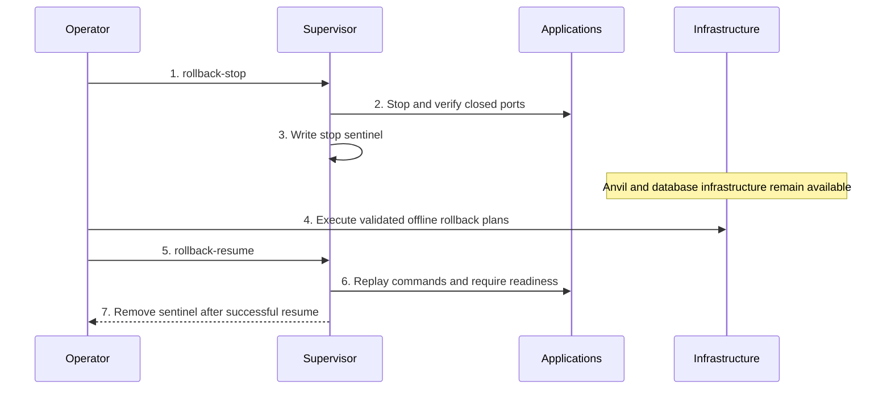

# Devnet Startup, Shutdown, Restart, and Rollback Lifecycle

> Internal developer documentation — repository-only. Not part of the published mdBook (SUMMARY.md).

> Updated: 2026-10-28. Status: Review; the historical fresh-chain bridge end-to-end run passed independent Main/GLM review. Its evidence limits, and the separate limited Groth16 smoke, are recorded in section 4.

## Overview

`devnet_lifecycle.md` is the required operating procedure for local Psy devnet work and the single owner of the launcher internals documented in sections 10-24. `make run-all` always starts a fresh chain. `make restart` and `make rollback-resume` keep the database and the three running Anvil processes and restart applications only. `make shutdown` is teardown; `PURGE=1` is its default. Supported entry points are `make run-all`, `make restart`, `make rollback-stop`, `make rollback-resume`, and `make shutdown`.

This document owns `dev/locSetupV4.ts` internals: parser behavior, startup selection, environment flow, process construction, readiness, supervision, control commands, ports, persistent Anvil recovery, daemonized behavior, and current-source limitations (`dev/locSetupV4.ts:342-344,3541-3557,4013-4104,7230-7725`). Use the Make targets for the repository-supported operating lifecycle, and use direct launcher commands only when selecting a documented component set or diagnosing launcher behavior. When a section describes a direct launcher command, it describes source behavior, not a replacement lifecycle procedure.

Persistent infrastructure means **Anvil, Scylla, Redis/Valkey, NATS, Nostr, and Envio backing services**. Applications means **processors, edges, workers, proxy, faucet, services, indexers, relayer, and UIs**. The control classifier keeps tracked processes named `db` and `l1_anvil`; the `db` process supervises Scylla, Redis/Valkey, NATS, and Nostr, while Envio Postgres and Hasura are Docker backing services outside the tracked process list (`dev/locSetupV4.ts:5202-5205`; `dev/start_db.sh:83-227`; `dev/locSetupV4.ts:4462-4477`). The tracked Envio indexer is an application even though its Docker backing services are persistent infrastructure. Outside frozen mode its command is `pnpm start`; frozen mode uses `frozenEnvioStartCommand` (`dev/locSetupV4.ts:4289-4303,4488-4489,5202-5205`).

## Background

Use only this lifecycle for local devnet operations; it supersedes ad-hoc per-service startup and manual state repair. The supervisor distinguishes persistent infrastructure from application processes. `make restart` and `make rollback-resume` leave the running database and the three Anvil processes in place. A purge removes the paired L1/L2 state. These are distinct operations, not interchangeable restart shortcuts (`dev/locSetupV4.ts:5221-5225,5740-5746,7715-7724`).

The launcher combines repository setup, resource allocation, persistent infrastructure, application startup, readiness gates, process supervision, local Layer 1 persistence, and destructive cleanup in one entry point (`dev/locSetupV4.ts:3541-3557,4013-4104,5202-5205`). Operators therefore need one source-grounded map that distinguishes supported Make commands from direct launcher mechanics, especially because a bare launcher invocation and `make run-all` select different counts, and because the embedded help contains current-source defects that must not be copied into commands (`Makefile:96-99`; `dev/locSetupV4.ts:7245-7247,7471-7472,7699-7725`).

## Table of Contents

- [1. Environment](#1-environment)
- [2. Artifact Gate](#2-artifact-gate)
  - [Public-only generate-genesis-data inputs](#public-only-generate-genesis-data-inputs)
- [3. Fresh Start](#3-fresh-start)
  - [Startup sequence](#startup-sequence)
  - [Generated-secret outputs and failure cleanup](#generated-secret-outputs-and-failure-cleanup)
  - [Retained state is not part of a test run](#retained-state-is-not-part-of-a-test-run)
  - [Process DAG](#process-dag)
- [4. Readiness](#4-readiness)
  - [Staged transaction acceptance](#staged-transaction-acceptance)
  - [Observed versus unverified](#observed-versus-unverified-2026-10-28)
  - [Foreground process inventory](#foreground-process-inventory)
- [5. Application Restart](#5-application-restart)
- [6. Offline Rollback Stop and Resume](#6-offline-rollback-stop-and-resume)
- [7. Post-Restart and Post-Rollback Verification](#7-post-restart-and-post-rollback-verification)
- [8. Failure Rules](#8-failure-rules)
- [9. Forbidden Operations](#9-forbidden-operations)
- [Terminology and Abbreviations](#terminology-and-abbreviations)
- [10. Startup Mode Selection](#10-startup-mode-selection)
  - [10.1 Bare launcher defaults](#101-bare-launcher-defaults)
  - [10.2 make run-all](#102-make-run-all)
  - [10.3 Component selection](#103-component-selection)
- [11. CLI Option Reference](#11-cli-option-reference)
- [12. Environment Variable Reference](#12-environment-variable-reference)
  - [12.1 Network and Anvil](#121-network-and-anvil)
  - [12.2 Repository setup and build](#122-repository-setup-and-build)
  - [12.3 Keystore and credentials](#123-keystore-and-credentials)
  - [12.4 Resources, logging, and supervision](#124-resources-logging-and-supervision)
  - [12.5 Faucet and service forwarding](#125-faucet-and-service-forwarding)
- [13. Ports and P2P Formulas](#13-ports-and-p2p-formulas)
- [14. CPU Partition and Rayon Derivation](#14-cpu-partition-and-rayon-derivation)
- [15. Anvil State Flags and Fresh Persistence](#15-anvil-state-flags-and-fresh-persistence)
- [16. Control Socket and Application Lifecycle](#16-control-socket-and-application-lifecycle)
- [17. Auto-Restart](#17-auto-restart)
- [18. Shutdown, Teardown, and Purge](#18-shutdown-teardown-and-purge)
- [19. Daemonized Path Differences](#19-daemonized-path-differences)
- [20. Direct Launcher Command Recipes](#20-direct-launcher-command-recipes)
- [21. Current-Source Limitations](#21-current-source-limitations)
- [22. Launcher Data Structures, Functions, and Loops](#22-launcher-data-structures-functions-and-loops)
- [23. Rationale](#23-rationale)
- [24. Security Considerations](#24-security-considerations)
- [Related Documents](#related-documents)



```text
artifact gate -> infrastructure -> validator injection -> processors/edges -> workers
  -> proxy -> L1 deployment/reuse -> services/indexers -> faucet/relayer -> interfaces -> supervisor
```

## Terminology and Abbreviations

| Term  | Meaning in this document                                                                                      | Evidence                                                     |
| ----- | ------------------------------------------------------------------------------------------------------------- | ------------------------------------------------------------ |
| CLI   | Command-line interface parsed by `runMain()`.                                                                 | `dev/locSetupV4.ts:7359-7440`                                |
| CPU   | Central processing unit; the launcher partitions complete physical-core sibling groups on Linux.              | `dev/locSetupV4.ts:161-195`; `dev/locSetupPolicy.ts:82-180`  |
| DAG   | Directed acyclic graph; the ordered startup dependencies in section 3.                                        | `dev/locSetupV4.ts:4069-4104,5859-6336`                      |
| HTTP  | Hypertext Transfer Protocol, used for coordinator, Realm, Layer 1, Envio, and service readiness.              | `dev/locSetupV4.ts:4404-4452`; `dev/locSetupV4.ts:4456-4575` |
| JSON  | JavaScript Object Notation, used by genesis, deployment summaries, control replies, and faucet configuration. | `dev/locSetupV4.ts:1149-1199`; `dev/locSetupV4.ts:5348-5358` |
| L1    | Layer 1: local Anvil, a forked Anvil, Sepolia, or Ethereum.                                                   | `dev/locSetupV4.ts:342-344`; `dev/locSetupV4.ts:6292-6332`   |
| L2    | Layer 2: Coordinator and Realm processors, edges, workers, checkpoints, services, and indexers.               | `dev/locSetupV4.ts:4060-4630`                                |
| LWT   | Lightweight transaction; the launcher configures Scylla contention and write timeouts.                        | `dev/locSetupV4.ts:4889-4905`; `dev/start_db.sh:123-171`     |
| NATS  | The NATS JetStream messaging service in persistent infrastructure.                                            | `dev/start_db.sh:109-120`                                    |
| Nostr | The local Nostr relay in persistent infrastructure.                                                           | `dev/start_db.sh:184-227`                                    |
| P2P   | Peer-to-peer Realm transport started by default for every Realm validator.                                    | `dev/locSetupV4.ts`                                          |
| RPC   | Remote procedure call endpoint exposed by Layer 1, Coordinator edges, and Realm edges.                        | `dev/locSetupV4.ts:3541-3557`; `dev/locSetupV4.ts:6292-6326` |
| SMP   | Symmetric multiprocessing shard count supplied to Scylla.                                                     | `dev/locSetupV4.ts:203-221`; `dev/start_db.sh:132-171`       |
| TCP   | Transmission Control Protocol, used by launcher port readiness gates.                                         | `dev/locSetupV4.ts:4030-4045`; `dev/locSetupV4.ts:4384-4396` |
| UI    | User interface: Privacy Bridge, IDE, Explorer, or Mode A Web Wallet Bridge.                                   | `dev/locSetupV4.ts:4706-4839`                                |

## 1. Environment

Use release binaries. These environment variables are valid for fresh startup:

Operate from the explicitly selected `psy-node` checkout, not another checkout with the same repository name. Record `pwd -P`, `git rev-parse HEAD`, and the names/status of local changes before building; a revision alone does not identify an uncommitted launcher fix. Keep that workspace, source/config inputs, and release output directory fixed through acceptance. Do not print `.env`, daemon credentials, faucet JSON, private-key files, or process environments. For this local campaign, use `PSY_NETWORK=localhost`, `VITE_NETWORK=localhost`, `VITE_FORK=false`, and this checkout's `psy-genesis/config.json`; a runtime environment variable cannot change constants already compiled into a binary (`Makefile:3-9,26-27,105-108`; `dev/locSetupV4.ts:6235-6236,6411-6414`). Inspect only the selected public configuration fields, and stop on a source/build/runtime network disagreement.

```bash
PSY_SKIP_BRANCH_CHECK=1
PSY_SKIP_KEYSTORE=1
```

Do not set `PSY_NO_AUTO_RESTART=1` when `make restart`, `make rollback-stop`, or `make rollback-resume` will be used. Those targets require the foreground supervisor to remain active. `PSY_SKIP_BUILD=1` is valid only after the release binaries and compiler-generated artifacts have been verified against the current source. Sibling `psy-services` and `psy-indexer` in this campaign are verified by binary hash and temporary-path source under section 2, not by rebuilding the restored manifest. `Makefile:16-19` defines the skip and purge defaults; `dev/locSetupV4.ts` rejects stale Psy SDK compiler artifacts.

Before startup, from a clean `<workspace>` (the parent directory that holds the `psy-node` checkout): `psy-genesis` is the only remaining `psy-node` submodule, while `psy-contracts` and `psy-dapp` are sibling repositories cloned next to `psy-node`. Initialize the submodule at its recorded SHA, verify both siblings, then initialize every nested DApp link at its recorded SHA:

```bash
git submodule update --init --checkout -- psy-genesis
git -C ../psy-dapp submodule update --init -- psy-genesis psy-contracts
git -C ../psy-sdk submodule update --init -- psy-genesis
```

Run `git -C ../psy-wallet submodule update --init -- psy-genesis` only when the wallet surface is exercised. Root `git submodule update --init --recursive` does not reach the DApp's nested gitlinks. Do not use `--remote` or move a tracking branch. Install frozen dependencies in the sibling `psy-dapp` checkout and its `mode-a-web-wallet-bridge` directory. Install `../psy-wallet` dependencies only when the wallet surface is exercised. The node release build must cover all six bins: `psy_node_cli`, `psy_worker_cli`, `psy_dev_cli`, `psy_relayer_cli`, `psy_user_cli`, and `psy-mcp-server` (`Makefile:26-27`). Sibling `psy-services` and `psy-indexer` are not produced by that node build; section 2 forbids rebuilding them from the restored services manifest. Follow the canonical [one release build](circuit-and-verifier-operations.md#163-one-release-build) once, with that section's environment, before setting `PSY_SKIP_BUILD=1`; file existence or a newer timestamp is not proof of source, config, or circuit identity. The launcher skips its node build when the checked binaries exist (`dev/locSetupV4.ts:6391-6409`), and Make defaults skip-build to 1. Exact `PSY_SKIP_BUILD=0` is not a second node build and is not a services refresh: `ensureAllBinariesBuilt` then compiles five node bins and the sibling pair from the sibling manifest (`dev/locSetupV4.ts:2329-2377`).

Never run a formatter. Root `rustfmt.toml` and `client_prover/rustfmt.toml` set `disable_all_formatting = true`.

## 2. Artifact Gate

This section's compiler provenance checks are necessary but not sufficient. **Before any fresh launch**, complete the canonical [pre-restart gate](circuit-and-verifier-operations.md#16-pre-restart-gate): build the selected release binaries, construct the real circuits with their exact runtime parameters, and compare derived identities with their pins and consumers. Validate a Groth16 cohort only when that gate's trigger matrix selects it. A pin-only correction does not select trusted setup. That document owns the commands and fingerprint comparisons; do not maintain a second fingerprint-value table here. Any changed source, circuit-defining config, generator output, or binary invalidates the affected gate results. A genesis file, port probe, copied hash, or old generation-time manifest does not substitute for real construction and comparison.

Before startup, compare both stamps with the selected clean sibling compiler. The source hash is the committed-tree fingerprint from `readCompilerProvenance`: eligible blobs at `HEAD`, sorted by UTF-8 path, each hashed as `path || NUL || blob || NUL`. Both `compilerRevision` fields and both `compilerSourcesHash` fields must equal that result. Genesis must also record the current SHA-256 and size of its three payloads:

```bash
set -euo pipefail
compiler_changes=$(git -C ../psy-compiler status --porcelain --untracked-files=all)
test -z "$compiler_changes"
python3 - <<'PY'
import hashlib, json, pathlib, subprocess, sys
compiler = pathlib.Path("../psy-compiler")
def git(*args, input=None):
    result = subprocess.run(["git", *args], cwd=compiler, input=input, stdout=subprocess.PIPE)
    if result.returncode != 0:
        sys.exit(result.returncode)
    return result.stdout
def source(path):
    path = path.replace("\\", "/")
    lower = path.lower()
    if path == ".compiler-artifact.json":
        return False
    if path in {"Cargo.toml", "Cargo.lock", "rust-toolchain.toml", "Makefile"}:
        return True
    if pathlib.PurePosixPath(path).name in {"build.rs", "precompiles.json", "package.json"}:
        return True
    return any(lower.endswith(ext) for ext in (".rs", ".psy", ".toml", ".lock"))
revision = git("rev-parse", "HEAD").decode().strip()
entries = []
for row in git("ls-tree", "-r", "--full-tree", revision).decode().splitlines():
    meta, path = row.split("\t", 1)
    mode, kind, oid = meta.split()
    if kind == "blob" and source(path):
        entries.append((path, oid))
entries.sort(key=lambda item: item[0].encode())
payload = "".join(oid + "\n" for _, oid in entries).encode()
blobs = {}
if payload:
    raw = git("cat-file", "--batch", input=payload)
    offset = 0
    for path, oid in entries:
        end = raw.index(b"\n", offset)
        parsed = raw[offset:end].decode().split()
        if parsed != [oid, "blob", parsed[2]]:
            sys.exit(1)
        start = end + 1
        blobs[path] = raw[start:start + int(parsed[2])]
        offset = start + int(parsed[2]) + 1
digest = hashlib.sha256()
for path, _ in entries:
    digest.update(path.encode())
    digest.update(b"\0")
    digest.update(blobs[path])
    digest.update(b"\0")
expected = {"compilerRevision": revision, "compilerSourcesHash": digest.hexdigest()}
sdk = json.loads(pathlib.Path("../psy-sdk/psy-ts-sdk/packages/psy-sdk/.compiler-artifact.json").read_text())
genesis = json.loads(pathlib.Path("psy-genesis/.genesis_contracts.compiler-artifact.json").read_text())
failed = False
for stamp in (sdk, genesis):
    for field in ("compilerRevision", "compilerSourcesHash"):
        if stamp.get(field) != expected[field]:
            failed = True
root = pathlib.Path("psy-genesis")
for name, digest_key, size_key in (
    ("genesis_contracts.json", "artifactSha256", "artifactByteSize"),
    ("token.json", "tokenArtifactSha256", "tokenArtifactByteSize"),
    ("token.update.json", "tokenUpdateArtifactSha256", "tokenUpdateArtifactByteSize"),
):
    data = (root / name).read_bytes()
    if hashlib.sha256(data).hexdigest() != genesis.get(digest_key) or len(data) != genesis.get(size_key):
        failed = True
sys.exit(1 if failed else 0)
PY
```

Repair only the stale output:

- Compiler-produced Genesis content or its stamp is stale: rerun `make -C ../psy-compiler gen-deploy-json` from the final clean pin and lockfile.
- SDK compiler identity or generated WASM is stale: `CARGO_NET_GIT_FETCH_WITH_CLI=true PSY_NETWORK=localhost pnpm --dir ../psy-sdk/psy-ts-sdk/packages/psy-sdk build`. This generates both prover targets and the compiler stamp. Keep generated `bigint` exports; do not copy another package's bindings or cast them to `number`.
- A required node binary is missing or older than the recorded cohort: run the canonical [one release build](circuit-and-verifier-operations.md#163-one-release-build) once, with that section's environment. Root `make build` does not pass it: `Makefile:26-27` omits `--locked` and also builds examples `realm_repl` and `coordinator_repl`.
- Sibling `psy-services` or `psy-indexer` is missing, or its on-disk hash does not match the tested temporary-path build: do not run `make build` in `../psy-services`, and do not set `PSY_SKIP_BUILD=0`. The restored manifest pins every psy-node git dependency at `7d6815d22728debbc71f6a928f85aa4b209ebf4f` (`../psy-services/Cargo.toml:12-25,127`; the same rev is in `Cargo.lock`). `../psy-services/Makefile:231-233` is unlocked `cargo build --release`. `ensureAllBinariesBuilt` with exact `PSY_SKIP_BUILD=0` runs `cargo build --release --locked --bin psy-services --bin psy-indexer` in that sibling (`dev/locSetupV4.ts:2366-2375`). Either command compiles the restored pin and overwrites `target/release/psy-services` and `target/release/psy-indexer`. Those outputs are not this campaign's tested cohort (node `d56084a2` plus reviewed runtime changes). Before reuse, hash both files and match them to the run evidence, and record that their source is the temporary-path build rather than the restored pin. A newer timestamp or a clean manifest is not that proof. This exception is this campaign only. Do not copy `7d6815d22728debbc71f6a928f85aa4b209ebf4f`, or the tested binary hash, into this runbook as the long-term default pin. An intentional pin change is a new cohort: update the manifest first, rebuild once from that new source, re-check hash and source, and repeat the pre-restart gate. Do not get there by rebuilding the restored pin.

Repair only stale compiler outputs and rebuild affected node binaries with that one release build; do not weaken provenance checks, add Cargo patch overrides, or rebuild `../psy-services` from the restored pin. `make run-all` is destructive and must have explicit operator authorization for a new local chain before invocation; successful preflight is not authorization. Standalone generation reads the three public `guardian_initial_member_hashes` commitments from the selected network in `psy-genesis/config.json`; it takes no account-file path. Pre-generating root `genesis.json` is not a fresh-start workaround: the supported fresh helper removes it, and the launcher generates it again using the current release binary.

### Public-only `generate-genesis-data` inputs

`make generate-genesis-data` passes only `--repo-root` to the release CLI (`Makefile:150-151`). It removes legacy secret-bearing enrollment variables from that child. It does not accept `PSY_RELAYER_MULTISIG_ACCOUNT`, `--relayer-multisig-account`, `--guardians-root`, or `--max-fee`. The public two-of-three policy is the three existing `guardian_initial_member_hashes` commitments on the selected network in `psy-genesis/config.json`. An operator provisions those public commitments once for this workspace's guardian keys ([genesis-generation.md §1.2.2](genesis-generation.md#122-first-workspace-guardian-provisioning)); they are not a secret, not a separate file, and not a universal development default. A missing or invalid value fails before destruction. There is no operator fee ceiling to configure. Protocol fees remain computed and verified, with no operator limit. The generator resolves the `multisig_policy` compiler artifact from `PSY_PROJECTS_DIR/psy-compiler`, or the sibling `psy-compiler` checkout when unset.

Use that current release `psy_dev_cli`. A stale binary still checks contract ID 6 (`public multisig account must name contract 6`; `Genesis contract 6 must be multisig_policy`) and fails a contract-1 account.

The Make target does not redirect writes. Isolated output flags are `--genesis-out`, `--private-keys-out`, and `--faucet-operators-out`; `--skip-faucet-operators` omits the faucet file. Defaults are `<repo-root>/genesis.json`, `<repo-root>/private_keys.json`, and `<repo-root>/psy-dapp/apps/bridge/src/config/faucetOperators.json` (`psy_cli/psy_dev_cli/src/subcommand/generate_genesis.rs:122-132,668-671`).

## 3. Fresh Start

`make run-all` passes `--all` and always starts a fresh local chain, independently of `PURGE`. Explicit worker and proxy counts still apply, including `--prove-proxy 0`. Partial component commands never perform the full reset; `--db` refuses existing containers or volumes rather than adopting them. Full startup validates daemon and public configuration, generation inputs, resource settings, namespace ownership, and complete Docker listings before stopping anything. An unbound checkout cannot adopt matching resources, including legacy names. The existing owner-only guardian `db/` directory is a provisioning prerequisite. The foreground `fresh-devnet-state` helper validates protected fixed paths and acquires all four real redb exclusive guards before printing `{"phase":"prepared"}`. Any live database owner blocks startup. The launcher then writes `reset\n`; the helper retains those guards across the reset, fresh Genesis generation, and the three local deployments. After deployment the launcher writes `finish\n`, waits for `{"phase":"finished"}`, and requires exit 0. Finish rechecks the held database bindings and the guardian-root identity; it writes nothing and does not pin `psy-genesis/config.json`. The launcher does not snapshot or byte-compare that file. Database tables are cleared in place and the files are never unlinked. The helper exits before guardian services start. Fresh preflight requires the selected network's three `guardian_initial_member_hashes`. It does not configure or read an operator fee ceiling, and it does not require or create an authorization object. Protocol fees stay computed and verified. `guardian-service` startup and application restart consume the same read-only canonical fields plus the selected deployment documents. Namespace binding, guardian keys, and the rest of the public network configuration are not reset (`dev/locSetupV4.ts:358-375,3129-3189,4170-4249,6056-6060,6491-6494`; `psy_cli/psy_dev_cli/src/subcommand/fresh_devnet_state.rs:1-12,57-113`; `psy_cli/psy_dev_cli/src/subcommand/generate_genesis/guardians_root.rs:84-104`).
Before the helper preflight, the launcher monotonically normalizes the managed state trees `db`, `local_checkpoints`, `logs`, and `psy-contracts/deployments` (and again over `db/` alone before L1 startup): it strips only forbidden bits — group/other write from directories, plus execute from files — grants no missing bit, and returns before `chmod` on every symlink. A directory symlink is therefore neither widened nor entered, so an owner-only `0700` guardian `db/` keeps its exact mode and the helper's fail-closed validation still rejects the symlink (`dev/locSetupV4.ts:3511-3522,4323,6823`).

Before that preflight, the selected network of `psy-genesis/config.json` must already carry the public guardian endpoints. `guardian_configs` is exactly three entries, ids `1`, `2`, and `3`, each with `listen_address` and an optional `rpc_url`. The reusable localhost listeners are `127.0.0.1:15441`, `127.0.0.1:15442`, and `127.0.0.1:15443`. `guardian_history` has `listen_address` `127.0.0.1:15450` and an optional `rpc_url`. No listener uses port `0` or a wildcard host, and the three advertised guardian origins stay unique. These entries contain no keystore path and no guardian root. Chain id and bridge are not written into this file and there is no `l1_endpoints` list. After the selected chains deploy, the launcher passes each existing `psy-contracts/deployments/<network>/deployed-contracts.json` as a repeatable `--l1-config` path. Those documents stay where deployment wrote them: nothing is copied and no config is written. A missing document fails startup (`dev/locSetupV4.ts:358-375,6450-6452`; `psy_cli/guardian_common/src/runtime.rs:188-229`). Reusing these endpoint defaults does not make another operator's member commitments portable.

`PSY_GUARDIAN_ROOT` must already name an existing non-symlink directory whose `db/` child is an existing owner-only directory: current-uid owned, not group- or world-accessible (`dev/locSetupV4.ts:4070-4071`). The helper does not create `db/`; that directory must already exist (`psy_cli/psy_dev_cli/src/subcommand/fresh_devnet_state.rs:57-61`). It does not create the four redb files until stdin `reset`. A populated database must already be the exact current table set (`guardian_schema` `u32` 3 for the guardians, or `journal_schema` `u64` 4 for the relayer). A partial set, a wrong marker, or an older table set fails closed before reset and is not wiped or migrated; explicit operator-controlled migration is deferred, not automatic. An existing empty `guardian-*.redb` later fails `guardian-service` with `DatabaseUnavailable` rather than being reinitialized. The three `$HOME/.psy/keystore/guardian-<id>.keystore.json` keystore files and their `GUARDIAN_<id>_KEYSTORE_PASSWORD` password environment variables (section 12.3) are the separate operator key prerequisite in [genesis-generation.md §1.2.2](genesis-generation.md#122-first-workspace-guardian-provisioning). There is no password file. A new chain initializes registration 2 from the member commitments already in the canonical config and embedded in Genesis. An existing chain replaces that policy only through the current two-of-three quorum; startup does not submit a pristine-account bootstrap.

The new Anvil writes `--state` to the now-absent snapshot path and does not load it, and local contracts deploy with `--reset` (section 15). After the four in-place database clears, in order `guardian-1.redb`, `guardian-2.redb`, `guardian-3.redb`, then `relayer.redb`, the helper removes fixed paths in this order: `db/anvil`; contents of `local_checkpoints` except the retained `devnet-namespace` file; `genesis.json`; then `psy-contracts/deployments/localhost`, `localhostBsc`, and `localhostBase`. Each database commit is separate. A failure stops immediately: earlier commits and removals remain, later cleanup does not start, and nothing is rolled back (`psy_cli/psy_dev_cli/src/subcommand/fresh_devnet_state.rs:5-12,57-103`). TypeScript does not recursively remove these paths or inspect redb contents. Ancestor symlink checks alone are not a race-safety guarantee. The launcher does not request Anvil historical-state preservation. `make restart` only restarts applications: it does not run the helper, recreate databases, generate Genesis, deploy contracts, or write configuration.

The protected helper requires trusted root/current-user-owned ancestry without group/world write access, and current-user-owned cleanup descendants; symlinks and hardlinked files are rejected. Opening and closing real redb databases can update engine housekeeping headers even when preflight rejects another input. The no-side-effects guarantee for failed preflight is therefore no business-table reset and no cleanup deletion, not byte-for-byte equality of redb files.

The launcher does not generate bridge identity or a `[relayer_wallet]` section; L1 sender signing resolves per
`[finalize]`/`[[chains]]` entry as the config `keystore_path`, then the `KEYSTORE_PATH` environment value, then
failure with no signing credential. The launcher exports `KEYSTORE_PATH` for the daemon child with the
setup-selected bridge-relayer keystore path, so the forwarded template holds no absolute path; an explicit
`private_key` or `keystore_path` in the config is never replaced by that environment value. `password_env` remains
inside the forwarded daemon file (section 12.5).

### Startup sequence

```mermaid
sequenceDiagram
    participant Operator
    participant Launcher
    participant Infra as Persistent infrastructure
    participant Core as Processors and edges
    participant Apps as Applications
    participant Control as Control socket

    Operator->>Launcher: 1. Make target or direct CLI
    Launcher->>Launcher: 2. Parse flags, environment, and acquire lock
    Launcher->>Launcher: 3. Auto-setup repositories, artifacts, and tools
    Launcher->>Infra: 4. Start DB group and wait for TCP readiness
    Launcher->>Core: 5. Start processors, edges, and workers in dependency order
    Launcher->>Infra: 6. Start or connect to L1; deploy or reuse contracts
    Launcher->>Apps: 7. Start Envio, services, indexers, relayer, faucet, and UIs
    Launcher->>Control: 8. Open repository-keyed Unix socket
    Control-->>Operator: 9. Supervisor ready
```

Steps 1-3 are implemented by CLI parsing, lock acquisition, and `ensureDevEnvironment()`; steps 4-7 are the foreground `setupProcesses()` phases. The control socket opens only after `setupProcesses()` resolves, so startup-time failures cannot be repaired through `make restart` (`dev/locSetupV4.ts`, `runMain`, `setupProcesses`). Fresh database startup uses `start_db.sh --fresh`, which refuses existing resources. The helper retains exclusive redb guards across reset and deployments; end of input aborts its protocol. Namespace binding and operator keys survive supported fresh cleanup.

For this fresh-chain campaign, use only `make shutdown` and `make run-all` as lifecycle entry points. Do not use direct launcher flags, manual service startup, `make restart`, or retained-state resume as substitutes. Other lifecycle modes below describe separate maintenance operations.

1. Obtain explicit authorization to discard the current local chain and its journals; preserve operator keystores and public policy commitments. Stop the old stack with `make shutdown` (`PURGE=1` is the default). Require exit 0 and confirm the old supervisor, tracked children, listeners, and redb owners are gone. An occupied port is a blocker, not permission to kill an unrelated service or launch a second supervisor.
2. Complete sections 1-2, including the canonical build/fingerprint gate, before launching anything. Do not regenerate trusted setup or replace policy commitments merely to make a comparison pass.
3. Check generated-secret output metadata against the rules below, with the stack stopped. Require the existing guardian root and owner-only `db/` prerequisite; never delete guardian keystores or redb files. Let `fresh-devnet-state` perform supported in-place journal reset and paired chain cleanup.
4. In the one designated foreground terminal, set `umask 077` and invoke the fresh target with explicit local selection:

   ```bash
   umask 077
   make run-all PSY_NETWORK=localhost VITE_NETWORK=localhost VITE_FORK=false PSY_SKIP_BUILD=1 PSY_SKIP_KEYSTORE=1 PSY_SKIP_BRANCH_CHECK=1
   ```

5. Require generation → faucet configuration reload → child spawn, then the staged acceptance below. Keep the launcher in that terminal; do not start another launcher while a slow proof service is warming up.

### Generated-secret outputs and failure cleanup

`private_keys.json` and `psy-dapp/apps/bridge/src/config/faucetOperators.json` are generated secret-bearing outputs, not guardian keystores. The incident checklist described a create-new collision and manual archival workaround; that description is not the current generator contract. In this checkout, `preflight_owned_regular_destination` accepts a missing destination or a current-user-owned, single-link regular file with mode `0600`, and `write_owned_regular` publishes a replacement through an exclusive temporary and atomic rename. It rejects symlinks, hardlinks, wrong ownership/mode, and unusable parent paths without reading existing secret bytes (`psy_cli/psy_dev_cli/src/subcommand/generate_genesis.rs:592-694`). The unflagged generator writes both default secret outputs; `--skip-faucet-operators` suppresses the faucet output only for standalone use, and the fresh launcher does not pass it (`dev/locSetupV4.ts:3202`). Root `genesis.json` remains create-only and is removed by the supported fresh helper before generation.

**Do not manually archive, remove, pre-create, or print these outputs to unblock this run.** Compatible existing `0600` outputs are replaced by the supported generator. An incompatible destination fails preflight: keep the stack stopped and resolve its ownership, mode, or path issue with the operator rather than bypassing the check or moving unknown secret material. Build the current generator before launch; do not use manual archival to compensate for a stale executable. Guardian keystores and public policy commitments remain untouched; journal reset belongs exclusively to the supported fresh helper.

`umask 077` prevents new group/world-writable state, including Anvil snapshots; it does not repair existing ancestry. Keep the guardian `db/` owner-only (`0700`) and cleanup ancestry non-group/world-writable. The launcher's monotonic normalization described above is not a general recursive permission repair: do not use `chmod -R`, follow links, or widen permissions to bypass preflight. A failed generation can leave earlier outputs published; the multi-file write/reset is not one transaction. A failed temporary write is cleaned by the writer, but a pre-existing `.tmp` collision is not deleted for you. Preserve failure evidence, run supported `make shutdown` for partial startup, resolve the exact blocker, and repeat the full applicable gate before an explicitly authorized new run. Never manually clear individual journal rows, unlink redb files, or replay stale proof files.

The fresh foreground path performs `freshState.reset()`, `ensureGenesisFiles()`, then `loadFreshGenesisFaucetOperators()` **before** starting infrastructure and proof/faucet children (`dev/locSetupV4.ts:6423-6443`). The reload replaces only the auto-loaded environment slot; an explicit operator faucet configuration takes precedence and must independently match the new genesis. An unreadable generated artifact aborts setup. Do not pre-create a faucet file to satisfy the old startup snapshot behavior, and do not inject an old explicit environment value as a fallback (`dev/locSetupV4.ts:3205-3212,8198-8203`).

`make shutdown` remains the explicit teardown; `PURGE=1` is its default and the supported complete teardown (section 18). Although the launcher also performs its own fresh reset, this campaign requires the preceding supported teardown and gate above.

`make run-all` stays in the foreground. Run it in a dedicated terminal or tmux pane. Do not background it with `&`.

A second `make run-all` is another fresh chain, not a resume. Run it only after the first supervisor has exited, its control socket is gone, configured local ports are free, and no process still holds the four redb files. It repeats the same clear-then-cleanup order, then generates a new Genesis and deployments. `make restart` cannot replace that second fresh start: restart requires the original supervisor and its recorded `db`, `l1_anvil`, `l1_anvil_bsc`, and `l1_anvil_base` processes to still be running. If any of those processes is absent, restart fails and starts nothing.

### Retained state is not part of a test run

An explicitly authorized new bridge/end-to-end campaign uses `make shutdown` followed by the gated fresh sequence above. Do not mix old deposits, withdrawal nonces, finalized cursors, proofs, or guardian journals into its assertions. Keep a failing retained chain only for diagnosis; a new chain is a separately authorized operation, not an automatic retry.

- `make restart` is maintenance under an unchanged chain, not a way to start this campaign. A stopped retained stack is not resumed by `make run-all`; that target always creates a new chain.
- A retained account identity, circuit fingerprint, journal schema, or canonical policy mismatch fails closed. Stop and resolve compatibility through its documented migration/recovery procedure or an explicitly approved new campaign. Never silently relabel the mismatch as fresh, alter an account identity, or delete journals to bypass it.
- Gatherer backups before the checkpoint-seed circuit change use `CGB1` and are rejected by the current `CGB2` loader. Do not resume across that boundary or reuse those proofs; any discard/new-chain decision requires the same authorization and gate (`psy_node_common/src/coordinator/processor/gatherers/coordinator_guta_update_gatherer.rs`).

### Process DAG

The following ASCII graph is definitive for the foreground path; conditional nodes run only when selected by the mode logic in section 10 (`dev/locSetupV4.ts:3950-3969`).

```text
resource derivation + logs + release-binary gate
  |
  v
DB group: Redis/Valkey + NATS + Scylla + Nostr
  |  readiness: group marker, then TCP 6379, 4222, 9042
  v
core-selected Realm P2P key generation + genesis validator injection
  |
  v
Prove proxy processes; TCP 9999+index readiness (600 x 1s) completes before core
  |
  v
Coordinator processor
  |
  v
Coordinator edges (parallel)
  |
  v
Realm processors in batches of at most four
  |  processors sequential inside a batch
  v
Realm edges for that batch (parallel), then two-second spacing
  |
  v
Coordinator workers (after the complete Realm processor/edge phase)
  |
  v
Realm workers (parallel) -> dummy provers (parallel)
  |
  v
Anvil or external L1 -> contract deploy/reuse
  |
  v
Envio Postgres + Hasura -> Envio indexer API
  |
  v
psy-services -> Coordinator indexer -> Realm indexers
  |
  +--------------------+
  |                    |
  v                    v
faucet              relayer
  |                    |
  +----------+---------+
             |
             v
Nostr readiness -> Privacy Bridge -> IDE -> Explorer -> Mode A UI
             |
             v
control socket + steady-state supervisor
```

The DB phase starts `dev/start_db.sh --fresh` and then probes ports 6379, 4222, and 9042 (`dev/locSetupV4.ts:4030-4045`). Coordinator startup precedes Realm batching (`dev/locSetupV4.ts:4060-4248`). Coordinator workers explicitly await the full Realm phase, not only the Coordinator phase (`dev/locSetupV4.ts`). Workers and dummy provers follow the core phase. Prove proxy is spawned after genesis preparation and its TCP listen gate completes before the Coordinator processor. Layer 1, bridge services, faucet, relayer, and UIs then follow in source order (`dev/locSetupV4.ts`).

## 4. Readiness

The following are infrastructure/startup probes only. An open port, health response, `DevNet started`, or processor marker does **not** establish a successful transaction or end-to-end run:

```bash
nc -z 127.0.0.1 9042
nc -z 127.0.0.1 1337
nc -z 127.0.0.1 13380
nc -z 127.0.0.1 13381
nc -z 127.0.0.1 13390
nc -z 127.0.0.1 13391
curl -fsS http://127.0.0.1:3000/health
curl -fsS http://127.0.0.1:9999/health
```

Required processor markers:

```text
[COORD_CREATE] processor new done
[REALM_CREATE] processor new done
```

The markers are defined in `dev/locSetupPolicy.ts`. A launcher timeout is not proof of startup failure while `make run-all` remains active. Check ports and markers, then read `logs/coordinator_processor_errs.txt` and `logs/realm_*_processor_errs.txt`.

Read checkpoint heads with the `psy_` RPC prefix:

```bash
curl -s -X POST http://127.0.0.1:1337 \
  -H 'content-type: application/json' \
  --data '{"jsonrpc":"2.0","id":1,"method":"psy_get_latest_checkpoint_id","params":[]}'
```

With the default `make run-all` topology (`--realms-count 2`, `--realm-edge-nodes 1`, two validators per Realm), Realm edge HTTP ports are `13380`/`13381` for Realm 0 subs `1`/`2` and `13390`/`13391` for Realm 1. Each Realm starts processors for both sub-IDs. `start-realm-processor` does not take a sub-id flag; the process derives sub-id from its Ed25519 identity match in `PSY_CONFIG_PATH`. Rollback plans still require explicit `--realm-id` / `--realm-sub-id` and must match that derived identity.

### Staged transaction acceptance

Use [Bridge Common Operations](bridge-common-operations.md#12-observable-state-matrix) for executable transaction/readback commands and its [round-trip invariants](bridge-common-operations.md#round-trip-invariants); use [real peer-to-peer acceptance](circuit-and-verifier-operations.md#7-real-peer-to-peer-end-to-end-acceptance) for the Realm transaction path. Keep one runner responsible for transactions. Record public transaction hashes, chain/deposit indexes, checkpoint IDs, receipt status, balance deltas, and nonce transitions, never secret/proof payloads.

| Stage | Required evidence before proceeding |
|---|---|
| RPC and identity | Successful JSON-RPC results, not merely HTTP 200: `eth_chainId` and `eth_blockNumber` on each selected Anvil must match this run's deployment documents; `psy_get_latest_checkpoint_id` on Coordinator and every Realm edge must return a usable result and show progress. Registration 2's leaf must match the live multisig policy identity. Faucet identity must match this run's generated policy; relayer account resolution must succeed, not loop on `no user_id found`. |
| Verifier wiring | Read back this run's deployed verifier addresses and deployed code as specified by the canonical verifier gate, including Bridge deposit/withdrawal verifiers and the reward verifier provider entry. A local Solidity export alone does not establish live wiring. |
| Faucet / real L2 call | Require the submitted EndCap's confirmed outcome, expected account/token state and nonce transition, and checkpoint inclusion. For the peer-to-peer path require forward, vote/certificate, Coordinator inclusion, proposer commit and non-proposer synchronization with matching roots. Faucet TCP 9998 and proxy health are only prerequisites. |
| Deposit | Require the current-chain L1 receipt with success status and the intended deposit event/index, then the relayer's appended L2 deposit state. Generate the inclusion proof from this run's deposit; never reuse a previous chain's `deposit-proof.json`. |
| Deposit claim | Require confirmed L2 claim, exact recipient balance increase and the claimed deposit nullifier at the Realm tip. Count that deposit once; a duplicate must not credit again. A service claim count or matching amount/address is not deposit identity evidence. |
| Withdrawal | Require confirmed L2 burn/withdrawal, exact L2 balance decrease, the raw withdrawal nonce and destination as preimage fields, successful append/finalization, and advancement of the L1 finalized checkpoint. The L1 key is the keccak identity in the next row, not this nonce. |
| L1 registration and payout | The L1 slot is 35 big-endian u32 words: `sender_user_id`, `recipient[8]`, `token[8]`, `amount[8]`, `nonce[8]`, `destination_chain_index`, `token_contract_id` (word 34). A batch is `batchClaimWithdrawal(uint256[8],uint256[18],uint256[1120])`. The L1 key is keccak256 of one slot's 140-byte preimage. It keys `claimedNullifiers`, `pendingWithdrawals`, settlement, and the indexed id on pending, claimed, and per-item receipt events. The raw nonce is only a preimage field. Services and the withdrawal-proof API match Poseidon of the same 35 felts, not this keccak and not the nonce. Registration evidence is `claimedNullifiers(L1 key)` plus a matching pending or direct-payout event for that same key, not payment by itself. After `claimableAt`, require the successful settlement receipt, the exact recipient token balance increase, and the cleared pending entry when one was created. Read `token_contract_id` from `Router.l1ToL2Token`; stop if that value is missing or wider than one u32. Native PSY contract id 0 is a real token id, not a missing value. The USDT script rejects 0 because that run is USDT-only. The 2026-10-28 PASS used the previous raw-nonce key and is not this evidence. |
| Campaign complete | All stages above pass for the same run, with one claim per deposit and one L1 payout per withdrawal. Reconcile initial/final L1 and L2 token balances against the canonical round-trip formula, account/withdrawal nonce transitions, and checkpoint progress; record zero `InvalidProof` in the run's relevant proof/transaction logs. Pending receipts, timeouts, missing observations, and skipped stages remain incomplete, never passed. |

The current audit worktree source is Bridge V6: `VERSION = 6` and 35 slot words at `<workspace>/psy-contracts/src/Bridge.sol:55,63`, a `uint256[1120]` batch argument, and keccak256 of each slot's 140-byte preimage as the L1 key. Public inputs stay 18 words. Node and services lookup stays the Poseidon hash of those 35 felts. Committed `psy-contracts` HEAD `63b56a58` is still `VERSION = 5` with 34 slot words; that is the previous commit, not the current source. The node gitlink still records contracts `e54d1a22`. Adopting the working V6 source requires a fresh L1 chain, a fresh L2 chain, and a new genesis. Clearing the services database is not enough. Committed V5 state, including a raw-nonce claim, a same-root replay, or a pending orphan, is incompatible. There is no in-place upgrade and no pending-entry compatibility path. This document does not claim that purge or restart has been executed. The identity also requires a new `withdrawal_claim` cohort; that regeneration has not been run, and no fresh-chain run has accepted it. The 2026-10-28 PASS below, and the isolated leaf-hash-nullifier deployment, accepted the previous layout: 34 L1 slot words, 1088 batch words, and the raw nonce as the L1 key, with a 35-felt Poseidon leaf used only for Merkle inclusion and services lookup. Those results are historical and are not this layout. Follow the [Bridge cutover boundary and deployed-getter check](bridge-common-operations.md#2-start-and-prove-readiness) before transactions. The historical isolated cohort is node `a4a5bb42`, contracts `52a3369`, dapp `1cc0137`, services `2185cfee`, and sdk `1a2c7e1c`. Its real isolated Groth16 smoke passed only with the checkpoint root forced through `forceSetState` and with token fixture code and state; a new full fresh-chain Groth16 end-to-end run has not been run and is not a PASS. Historical-state migration is outside this procedure.

### Observed versus unverified (2026-10-28)

The PASS in this section exercised the previous L1 layout: 34 slot words, `batchClaimWithdrawal` batch data `uint256[1088]`, and the raw withdrawal nonce as the `claimedNullifiers`, `pendingWithdrawals`, and event key. It is historical evidence of that layout only. It is not acceptance of the current 35-word keccak identity, and it did not regenerate the `withdrawal_claim` cohort.


This round's fresh-chain bridge end-to-end run is **PASS**, independently confirmed by Main and GLM; the completion marker is `E2E_OK` in `tmp/e2e-stages47.log:6853-6856`. The tested cohort is node `d56084a2` plus reviewed runtime changes, compiler `a99ef4c3`, and the services temporary-path build whose binary hash is recorded in the run evidence—not a clean-HEAD-only cohort. The sibling manifest is again pin `7d6815d22728debbc71f6a928f85aa4b209ebf4f`, which is not that temporary-path source; rebuilding from it would replace the tested binaries and does not reproduce this PASS. Confirm `../psy-services/target/release/psy-services` and `psy-indexer` by hash against the run evidence and by that source. Neither the restored pin nor that hash is the long-term default. The L1 deposit receipt had status `1`, block `1931`, amount `2000`, and `provedCount=1`; the L2 claim confirmed at checkpoint `254`, and withdrawal of `1000` confirmed at checkpoint `258`. L1 batch transaction prefix `80ac1faa` reported `succ=1`, `failed=0`; payout transaction prefix `bf0c5f7e` had status `1` and `WithdrawalClaimed` amount `1000`. Recipient token balance rose from `999998000` to `999999000`, pending withdrawal became `0`, and claimed state was `true`.

The main script was interrupted, then the supported transaction resume path completed the same run without another deposit; this was not a launcher restart or a new chain. The interruption cause is unproven and must not be attributed to an external kill. The duplicate deposit-claim trace rejected the already-used claim. **No duplicate L1 withdrawal-claim transaction was actually submitted:** its protection was checked only through state/source evidence, not a passed live negative test. This run's success does not replace the canonical pre-restart gate for another cohort or imply that untriggered cache/trusted-setup regeneration was performed. The historical checklist's create-new/manual-archive/pre-create-file workaround remains superseded by the current supported atomic secret-output replacement above.

Separately, one live localhost Guardian refusal probe passed: a synthetic schema-3 `Bootstrap` request parsed successfully, encoded to 1050 bytes, and was sent once to port `15441`, `/v1/sign-session`; the response was HTTP `401`, `UnauthorizedCaller`, `retry_after_ms=0`, with the matching request ID and no signature. This rejection occurs before the service lock (`psy_cli/psy_relayer_cli/src/guardian/service.rs:581-594`); the probe read no live keys or journals and performed no signing or transaction. This establishes only that specific caller-policy refusal path, not all policy paths.

The corrected stage-6 wall time for that PASS is 487.548s. The driver script's own counter recorded 485s for the same interval; use the wall time, not the script counter, when comparing runs. Separately, the deposit and withdrawal request-envelope-to-completion intervals were 369.653s and 323.084s respectively; their internal phase breakdown remains unknown. The measured 0 is the L1 withdrawal-flow claimable timelock: this run selected the zero tier of the three claim delays, so `claimableAt` did not add a wait. It is not a retry delay. The relayer still polls at `poll_interval_secs`, default 30s (`psy_cli/psy_relayer_cli/src/bridge/daemon.rs:998,1332`), and a missing guardian quorum still retries after 1s (`daemon.rs:3924-3926`). None of those spans is a guardian-verification time: each mixes proof generation, guardian signatures, inclusion, and checkpoint polling. Do not infer a verification cost from the silent gap. Splitting that gap into proof, signing, submission, and inclusion wait is a troubleshooting recommendation only. The current daemon does not emit per-phase elapsed logs. `verify_guardian_session` still runs twice: first with an empty reservation, then again with the saved dynamic reservation (`daemon.rs:3895-3896,3906-3908`). That second check stays. These baselines are not a speedup result. This note does not change the pre-restart gate.

### Foreground process inventory

| Process                | Command/log identity                                                                  | Readiness and prerequisite                                                                  | Evidence                                                       |
| ---------------------- | ------------------------------------------------------------------------------------- | ------------------------------------------------------------------------------------------- | -------------------------------------------------------------- |
| DB group | `dev/start_db.sh --fresh`, `logs/db_*` | `All services are running.`, then TCP 6379/4222/9042. | `setupProcesses`, `dev/start_db.sh` |
| Redis/Valkey           | Docker `valkey-server`                                                                | Group marker plus TCP 6379.                                                                 | `dev/start_db.sh:83-107`; `dev/locSetupV4.ts:4041-4045`        |
| NATS                   | Docker NATS JetStream                                                                 | Group marker plus TCP 4222.                                                                 | `dev/start_db.sh:109-121`; `dev/locSetupV4.ts:4041-4045`       |
| Scylla                 | Docker Scylla                                                                         | `nodetool status` contains `UN`, then TCP 9042.                                             | `dev/start_db.sh:232-255`; `dev/locSetupV4.ts:4041-4045`       |
| Nostr                  | Docker Nostr relay                                                                    | Must remain alive for DB group; direct TCP 8081 gate precedes Privacy Bridge.               | `dev/start_db.sh:184-245`; `dev/locSetupV4.ts:4706-4714`       |
| Coordinator processor  | `psy_node_cli start-coordinator-processor`                                            | Exact marker `[COORD_CREATE] processor new done`; 120-second attempt, narrow Scylla retry.  | `dev/locSetupV4.ts:4060-4090`; `dev/locSetupPolicy.ts:319-333` |
| Coordinator edges      | `start-coordinator-edge`                                                              | Edge RPC marker; all edges start in parallel after processor.                               | `dev/locSetupV4.ts:4095-4118`                                  |
| Realm processors       | `start-realm-processor`                                                               | Exact marker `[REALM_CREATE] processor new done`; 180-second attempt, narrow Scylla retry.  | `dev/locSetupV4.ts:4163-4208`; `dev/locSetupPolicy.ts:319-333` |
| Realm edges            | `start-realm-edge`                                                                    | Edge RPC marker; parallel after every processor in the batch.                               | `dev/locSetupV4.ts:4208-4244`                                  |
| Coordinator workers    | `psy_worker_cli worker`                                                               | Worker-start marker; start sequentially after complete Realm readiness.                     | `dev/locSetupV4.ts:4120-4162`; `dev/locSetupV4.ts:4248`        |
| Realm workers          | `psy_worker_cli worker`                                                               | Worker-start marker; all selected worker promises are awaited.                              | `dev/locSetupV4.ts:4250-4342`                                  |
| Dummy provers          | `dev/dummy_prover.sh`                                                                 | Dummy-prover marker; start in parallel after Realm workers.                                 | `dev/locSetupV4.ts:4343-4360`                                  |
| Prove proxy            | `psy_user_cli prove-proxy --role all`                                                 | Spawned after genesis prep; TCP `9999 + index` (600 x 1s, 1500ms connect) completes before Coordinator processor. Faucet and relayer still await the same gate. | `dev/locSetupV4.ts` (`waitForProveProxy`) |
| Anvil                  | `anvil ... --state db/anvil/state.json --state-interval <ANVIL_STATE_INTERVAL\|\|900>` | `Listening on`, then HTTP Layer 1 probe, preserved genesis check, then `anvil_setIntervalMining([1])` on each launcher-managed chain. | `dev/locSetupV4.ts` (`l1StartedDetector`, `assertPreservedAnvilGenesis`, `setLocalAnvilIntervalMining`) |
| Envio backing services | Generated Docker Compose                                                              | Postgres TCP 5433, SQL `select 1`, Hasura `/healthz`.                                       | `dev/locSetupV4.ts:3338-3364`                                  |
| Envio indexer          | `pnpm start`, or the frozen generated command                             | Outer setup requires TCP 9898. Frozen mode does not run `pnpm start`.                          | `dev/locSetupV4.ts:4289-4303,4488-4501`                    |
| psy-services           | `psy-services --disable-auth`                                                         | Start marker, then `http://127.0.0.1:3000/health`.                                          | `dev/locSetupV4.ts:4545-4575`                                  |
| psy-indexers           | `psy-indexer` Coordinator then Realm                                                  | `Starting PSY Indexer`; sequential ordering.                                                | `dev/locSetupV4.ts:4576-4630`                                  |
| Faucet                 | `psy_user_cli faucet-server`                                                          | Waits for same-launch proxies; its TCP 9998 probe is nonblocking after spawn.               | `dev/locSetupV4.ts:4633-4662`                                  |
| Relayer                | `psy_relayer_cli --config <PSY_BRIDGE_DAEMON_CONFIG>`                              | `multichain bridge relayer started` or `bridge relayer started`, after same-launch proxy readiness and the bridge stack. | `dev/locSetupV4.ts` |
| UIs                    | Vite/Bun development servers                                                          | `ready in`; ports 5177, 5176, 5178, 5179.                                                   | `dev/locSetupV4.ts:4706-4839`                                  |

General initialization-hint startup retries after two seconds, with `maxRetries=3` meaning at most four attempts; without an explicit initialization timeout, a live child that never prints its marker has no helper-level deadline (`dev/locSetupV4.ts:764-904`). Processor startup is narrower: only recognized transient Scylla schema failures and a follow-on timeout after such a failure are retried (`dev/locSetupV4.ts:47-96`).

## 5. Application Restart

Keep the terminal running `make run-all` alive. Restart only its supervised application children:

```bash
make restart
```

`make restart` sends `restart` to the existing supervisor. It requires the recorded `db`, `l1_anvil`, `l1_anvil_bsc`, and `l1_anvil_base` processes to still be running. A healthy primary Anvil is not sufficient. If any required process is absent, the command fails and starts nothing. On success it stops and recreates processors, edges, workers, proof services, APIs, indexers, relayer, and UIs from their recorded commands. Restart consumes the selected network's existing `guardian_initial_member_hashes`, guardian endpoints, and the already selected deployment documents; it does not create them and it does not write `l1_endpoints`. It does not delete files, remove volumes, deploy contracts, write configuration, or start a replacement database or Anvil (`dev/locSetupV4.ts:358-375,5743-5746`).

Anvil continues writing its current chain to `db/anvil/state.json` (and the localhostBsc and localhostBase paths). Those files are outputs of the running process. The next `make run-all` removes them before starting a new chain.

## 6. Offline Rollback Stop and Resume

Rollback generation and execution require processors, services, indexers, relayer, and UIs to stop while Anvil, its `db/anvil/state.json` snapshot, Scylla, Redis, NATS, Nostr, Envio infrastructure, checkpoint files, and logs remain available.

1. Record the L1 block number, deployed contract addresses, L1 finalized checkpoint, and every L2 checkpoint head.
2. Pause applications through the existing supervisor:

```bash
make rollback-stop
```

This command writes `local_checkpoints/rollback-stop.sentinel` with exactly:

```text
rollback offline: all processors and relayer stopped; Scylla Redis NATS and checkpoints retained
```

Pass that path to rollback generation and execution with `--stop-sentinel local_checkpoints/rollback-stop.sentinel`.

3. Confirm processor endpoints are down and retained infrastructure is up:

```bash
for p in 1337 13380 13381 13390 13391 3000 9999; do ! nc -z 127.0.0.1 "$p"; done
for p in 8545 9545 10545 9042 6379 4222 8081 5433 8080; do nc -z 127.0.0.1 "$p"; done
```

4. Generate and execute one rollback plan for the Coordinator and one for every Realm processor identity `(realm_id, realm_sub_id)` (default `make run-all`: four Realm plans for realms `0`/`1` × subs `1`/`2`). Realm plans require `--realm-id` and `--realm-sub-id` matching the processor derived from its identity key. Rollback validation uses only `plonky2-poseidon-goldilocks`; JTMB is test-only. `--target-contract-state <json>` is optional: generation retains it only when `last_finalized_checkpoint_id` exactly equals the rollback target, and absence or mismatch never blocks local rollback. Generate every RP before executing any RP, then require every phase in every RP to be `completed` before resume. Any L1 force-state action is a separate operator task.
5. Before resuming a bridge-enabled stack, run `psy_dev_cli restore-bridge-state` once for the common target. Supply one `--processor-config`, explicit `--processor-role`, and completed `--rp-path` per configured processor in matching order, plus `--target`, `--rpc-config local_checkpoints/realm_p2p/config.json` (the launcher's `PSY_CONFIG_PATH`, not `psy-genesis/config.json`: that source file's realm `validators` arrays are empty and restore rejects them), local `--chain-document` deployment metadata, `--guardians-root`, `--proof-dir`, the retained `--stop-sentinel`, and all `--coordinator-endpoint` / `--realm-endpoint` probes. The inventory must cover the configured Coordinator and every Realm validator. Keep the same configuration and plans on retry.

   The restore reconstructs checkpoint-authenticated account/contract state from retained Scylla stores, deposit frontiers from finalized canonical L1 events, and withdrawal preimages from existing Realm end-cap archives. Missing archive coverage or any state/root mismatch is an error, not permission to write empty journals. All four existing journals are exclusively locked and replaced transactionally per database; signer rows remain unchanged. Immutable `.pre-restore-<operation>` backups and a synced `bridge-restore.intent.json` precede journal mutation. Do not start any application while that intent is incomplete. Retry the identical invocation to finish a partial restore; never overwrite or delete its original backups. Completion is operation-specific (`bridge-restore.<operation>.done.json`), not an old generic done flag.

   Restore completion means journal recovery only. L1 state and claims are unchanged even when L1 is above the target. Previously appended, unclaimed withdrawals are not automatically re-queued. Erasing local rows does not revoke external signature copies. Nonces at or below the restored nonce remain consumed; erased history is no longer locally fetchable. A guardian missing that history needs offline recovery. The command refuses before replacing journals when any original account is inactive, any imported cursor is above the authenticated bridge nonce, an equal cursor has a different ending leaf, or any retained signed, session, or relayer request row decodes above that nonce. A cursor already above the nonce refuses even when the next row was pruned. A target with no imported nonce is unsupported. The same check is repeated against the original `.pre-restore-<operation>` backups, including when retrying an incomplete intent and when a matching completion marker already exists. Each backup is copied to a private file before it is opened, so the immutable backup itself is not rewritten. The four files cannot prove they are the uninterrupted journals of these signing keys: a journal recreated, restored from an older copy, or used beside another signer can hide an external signature, and this command has no separate acknowledgement for that case. Absence of rows is not proof that no external signature exists. Keep the documented offline assumption, or do not restore. The sentinel is operator-controlled, not a universal process-start interlock.

6. After matching journal-restore completion and any separately required external recovery, resume the saved application commands without deploying L1 or resetting Envio:

```bash
make rollback-resume
```

The supervisor removes the stop sentinel only after every saved application process reaches its startup condition. `make rollback-resume` starts those saved templates against the infrastructure left running by `make rollback-stop`. It is not `make run-all`: it does not deploy L1, reset Envio, or create a fresh chain. Do not run `make shutdown`, including `PURGE=0 make shutdown`, between rollback plan generation, execution, recovery, and resume.

`make rollback-resume` can take several minutes because release Plonky2 workers and the prove proxy rebuild circuit state. A long-running command is not stuck while new `CONTROLLED START` markers appear and readiness ports progressively open. The current supervisor starts templates serially; the prove proxy warm-up is usually the critical path.

## 7. Post-Restart and Post-Rollback Verification

1. Require the Anvil block number to be no lower than before the operation, `db/anvil/state.json` to parse as complete JSON, and StateManager, Bridge, and Router addresses to remain byte-identical. If `target_contract_state` was omitted or ignored because its checkpoint differed, record that no matching target contract snapshot was attached to the local RP; verify any separate L1 recovery independently.
2. Require Coordinator and every Realm processor readiness marker.
3. Require every processor checkpoint head to advance above the rollback target, allow short Realm lag, then require all heads to converge.
4. Verify the target checkpoint remains queryable and target application state was restored.
5. Submit a real state-changing transaction that covers the rolled-back state. Repeating the exact pre-rollback spend is stronger than registering a new user because it proves the consumed balance/state can be used again.
6. Require the transaction to confirm and checkpoint heads to continue advancing.
7. Require checkpoint ring buffers to be contiguous through the current head and new gatherer backups to begin above the retained monotonic pending high-water.
8. If an end cap anchors to a historical checkpoint after rollback, bound the checkpoint-tree proof query by the current logical head; an unbounded per-node max query can mix physical post-rollback residual versions.

## 8. Failure Rules

Lifecycle failure rules:

All fresh retry instructions in this table require explicit authorization, the sections 1-3 build/fingerprint gate, and supported teardown first. A retained identity/policy/schema mismatch is not a retryable startup fault; keep it failed closed. Never resolve it by substituting a fresh chain without approval.

| Failure | Action |
|---|---|
| `compiler revision changed` | Regenerate compiler and Genesis contract artifacts, regenerate root `genesis.json`, rebuild affected node binaries with the one release build, then run the artifact checks. Do not rebuild `../psy-services` from the restored pin (section 2). |
| Root `genesis.json` contract circuit differs from canonical compiler output | Run `make generate-genesis-data` with the matching sibling compiler artifact and the selected network's `guardian_initial_member_hashes` already present; stale embedded definitions can fail prove-proxy circuit construction. |
| Cargo cannot authenticate to `git@github.com` | Set `CARGO_NET_GIT_FETCH_WITH_CLI=true`; repair empty cached submodules without deleting the whole Cargo git cache. |
| Submodule fetch reports `early EOF` | Retry the same authenticated command. |
| Scylla `raft operation add_entry timed out` during fresh schema creation | Stop the partial stack with `PURGE=1 make shutdown`, then run `make run-all`. Do not reuse the partial Scylla volume. |
| Anvil state or a localhost deployment is missing or inconsistent | Run `PURGE=1 make shutdown`, then `make run-all`. `make run-all` creates a fresh chain; it does not reuse one side of a partial pair. |
| `db/anvil/state.json` is truncated or invalid JSON | The L1 snapshot is unusable. Do not repair it manually or claim L1 continuity. Use `PURGE=1 make shutdown`, then `make run-all`. |
| Database proof differs from checkpoint ring buffer proof | Keep the stack stopped and identify whether the DB history or ring buffer is stale; do not delete only one side. |
| `rollback-stop` reports an application port still open | Keep the supervisor in `stopping`, terminate the tracked application process group, and retry `make rollback-stop`. Do not write the sentinel manually. |
| `make restart` cannot reach the control socket | The foreground supervisor/socket is absent; daemon mode and completed teardown have no control server. `make run-all` creates a fresh chain; it does not preserve the previous chain. |
| Processor exits before the exact readiness marker | Read that processor's error log; do not treat an open RPC port as processor readiness. |
| Realm resume has no positive pending/proc mapping below the retained counter | Resolve the committed pair from the latest checkpoint mapping at or before the marker; the `(0,0)` sentinel is valid for an unchanged Realm. Never lower or reuse the counter. |
| Rollback CLI says an endpoint is reachable | Run `make rollback-stop`; do not bypass the offline guard. |
| Rollback plan phase fails | Keep applications stopped and rerun the same RP. The phase model is idempotent. |
| `make rollback-resume` fails | Keep the sentinel and the infrastructure that is still running; fix the failing application, then rerun `make rollback-resume`. Do not replace it with `make run-all`. |

Launcher diagnosis (source-grounded checks for the same operations):

| Symptom                                            | Diagnosis and action                                                                                                     | Evidence                                                     |
| -------------------------------------------------- | ------------------------------------------------------------------------------------------------------------------------ | ------------------------------------------------------------ |
| Another devnet is running                          | A repository-keyed kernel `flock` is held; use supported teardown or control rather than starting a second foreground launcher.          | `dev/locSetupV4.ts:5260-5309`                                |
| Help or teardown fails before its branch           | Network resolution and `--env` parsing occur before help/teardown; correct invalid network, missing external RPC, or invalid assignment. | `dev/locSetupV4.ts:5511-5539`; `dev/locSetupV4.ts:5722-5725` |
| Processor exits before ready                       | Read its error log; only recognized transient Scylla schema failures receive processor retry.                                            | `dev/locSetupV4.ts:47-96`; `dev/locSetupV4.ts:4060-4090`     |
| Leftover local Anvil snapshot or deployment       | `make run-all` removes this checkout's scoped state first. A file that remains, or an occupied local port, fails the start.              | `dev/locSetupV4.ts` (`resetScopedDevnetState`, `resolveLocalAnvilStatePlan`) |
| Rollback stop reports open ports                   | The manager remains in `stopping`; identify the retained application listener and retry the supported stop after resolving it.           | `dev/locSetupV4.ts:3560-3587`; `dev/locSetupV4.ts:3877-3879` |
| Controlled resume fails                            | Newly started applications are stopped and lifecycle returns to `stopped`; fix the failing application and rerun resume.                 | `dev/locSetupV4.ts:3905-3913`                                |
| Prove proxy appears slow                           | Log readiness can precede TCP readiness; the TCP gate permits up to 600 one-second attempts.                                             | `dev/locSetupV4.ts:4362-4402`                                |
| Faucet port is not open when setup continues       | Its post-spawn TCP wait is detached and warning-only.                                                                                    | `dev/locSetupV4.ts:4649-4662`                                |
| DB group restarts repeatedly                       | One Redis/Valkey, NATS, Scylla, or Nostr pipeline exited; the DB script stops the group and exits nonzero for supervisor restart.        | `dev/start_db.sh:232-294`                                    |
| `PSY_SKIP_BUILD=1` reports missing/stale artifacts | Rebuild node bins once with the canonical one release build, or regenerate the named compiler artifact. Do not repair a services hash mismatch by rebuilding the restored pin (section 2). Skip-build intentionally fails instead of repairing them. | `dev/locSetupV4.ts:1933-1968`; `dev/locSetupV4.ts:2247-2252` |

## 9. Forbidden Operations

- Do not follow `make shutdown` with `make run-all` in order to reuse Anvil state or deployments. `PURGE=0` does not turn `make run-all` into a state-preserving restart. `make run-all` always starts a fresh chain.
- Do not run `docker compose` or manually restart one devnet service.
- Do not run individual process binaries to substitute for the supervisor control targets.
- Do not use `PSY_NO_AUTO_RESTART=1` when process-only restart or rollback stop/resume is required.
- Do not use `make restart` after the supervisor has exited, or after deleting Scylla, Redis, NATS, Anvil state, deployments, or checkpoint files. `make restart` requires the recorded database and all three Anvil processes to still be running.
- Do not use `PSY_SKIP_BUILD=1` after node source, compiler, Genesis, or SDK artifact changes without the section 2 rebuild. Do not set `PSY_SKIP_BUILD=0` to rebuild `../psy-services` while its manifest is still the restored pin in section 2.
- Do not regenerate a rollback plan after destructive phases have started; resume the frozen RP.
- Do not restart processors until all Coordinator and Realm rollback plans and external recovery have completed.
- Do not run formatters.

## 10. Startup Mode Selection

### 10.1 Bare launcher defaults

```bash
bun run dev/locSetupV4.ts
```

A bare invocation has no component selector, so `startAll` is true. Its defaults are one Realm beginning at Realm 0,
one Coordinator edge, one Realm edge, one Coordinator worker, two Realm workers, one implicit prove proxy, and the
full foreground infrastructure/application set (`dev/locSetupV4.ts:5443-5449,5477-5486,3950-3969,4362-4369`).

### 10.2 make run-all

```bash
make run-all
```

`make run-all` does **not** rely on bare defaults. It expands an explicit component list with two Realms, two
Coordinator workers, one Realm worker, one prove proxy, the database group, Coordinator/Realm nodes, faucet, Layer 1,
relayer stack, and all four UI flags (`Makefile:93`). Make defaults `PSY_SKIP_BRANCH_CHECK`,
`PSY_SKIP_KEYSTORE`, and `PSY_SKIP_BUILD` to `1`. A direct launcher also skips branch sync, remote keystore
refresh, and build unless that value is exact `0` (`Makefile:16-18`; `dev/locSetupPolicy.ts:505-507`).

| Setting             | Bare launcher                                      | `make run-all`                         | Evidence                                        |
| ------------------- | -------------------------------------------------: | -------------------------------------: | ----------------------------------------------- |
| Realm count         | 1                                                  | 2                                      | `Makefile:93`    |
| Coordinator workers | 1                                                  | 2                                      | `Makefile:93`    |
| Realm workers       | 2                                                  | 1                                      | `Makefile:93`    |
| Prove proxy         | Implicit 1                                         | Explicit 1                             | `Makefile:93`    |
| Build policy        | Existing artifacts unless exact `0`. Exact `0` runs five-bin `ensureAllBinariesBuilt`, including the sibling rebuild (section 2). Three-bin `buildProject` runs only if `psy_node_cli`, `psy_worker_cli`, and `psy_relayer_cli` are still missing | Existing artifacts required by default | `Makefile:18,108`; `dev/locSetupV4.ts:2329-2377,3369-3395,6405-6409` |

### 10.3 Component selection

The component selectors are `--db`, `--coordinator`, `--prove-proxy`, `--faucet-server`, `--dummy-provers`, `--l1`,
`--relayer`, `--bridge-proposer-daemon`, `--psy-privacy-bridge`, `--ide`, `--explorer`, and
`--mode-a-web-wallet-bridge`. Without `--all`, selectors choose component mode and disable full-mode worker defaults. `make run-all` explicitly supplies `--all`, preserving its component/count overrides while requiring the protected fresh-local-start sequence. Explicit worker and proxy counts control startup, including a zero proxy count. Realm P2P is not a selector or modifier: every Realm launch uses it.
Component selectors do not automatically select runtime dependencies: for example, `--coordinator` does not select `--db`, `--relayer` does not select Layer 1 or the
core, and `--psy-privacy-bridge` does not select Nostr (`dev/locSetupV4.ts:3950-3969,4454-4704,4706-4718`).

## 11. CLI Option Reference

Numeric strings are parsed with `parseInt(..., 10)`, so malformed suffixes can still be accepted. Core startup additionally validates the parsed Realm start identifier, Realm count, edge count, and every requested Realm port before setup (`dev/locSetupV4.ts:1107-1121,5482-5487`). Worker and Coordinator counts do not receive that Realm-topology validation.

| Option                           | Type and effective default             | Source-accurate effect                                                                                                                                                                                                                                                                                                                                                                                                             | Evidence                                                                                      |
| -------------------------------- | -------------------------------------- | ---------------------------------------------------------------------------------------------------------------------------------------------------------------------------------------------------------------------------------------------------------------------------------------------------------------------------------------------------------------------------------------------------------------------------------- | --------------------------------------------------------------------------------------------- |
| `--all` | Boolean, false | Explicit full fresh foreground localhost startup, even with component selectors; no fork or alternate Genesis path. Counts still apply. | `setupProcesses`, `Makefile` |
| `--jtmb`                         | Boolean, false                         | Chooses `jtmb-poseidon-goldilocks` only when `--proving-backend` is absent.                                                                                                                                                                                                                                                                                                                                                        | `dev/locSetupV4.ts:5440-5441,4004`                                       |
| `--proving-backend VALUE`        | String, Plonky2 fallback               | Supplies processor, worker, dummy-prover, and daemonized backend arguments.                                                                                                                                                                                                                                                                                                                                                        | `dev/locSetupV4.ts:3627-3641,4004-4354`                                  |
| `--disable-worker-edge-logs`     | Boolean, false                         | Omits launcher log files for workers and edges in foreground mode.                                                                                                                                                                                                                                                                                                                                                                 | `dev/locSetupV4.ts:3993-4001`                                                                 |
| `--realm-workers COUNT`          | 2 full / 0 component                   | Starts shared Realm workers; a positive value also counts toward Rayon sizing.                                                                                                                                                                                                                                                                                                                                                     | `dev/locSetupPolicy.ts:303-315`; `dev/locSetupV4.ts:3966-3975,4250-4341` |
| `--realm-edge-nodes COUNT`       | String, `1`                            | Sets the number of distinct standard-P2P edge identities per Realm validator. Each edge receives its own secret key, public address, P2P listen port, and HTTP port.                                                                                                                                                                                                                                                               | `dev/locSetupV4.ts:5444,5482,4207-4237`                                                       |
| `--coordinator-edge-nodes COUNT` | String, `1`                            | Starts Coordinator edges on `1337 + index`.                                                                                                                                                                                                                                                                                                                                                                                        | `dev/locSetupV4.ts:5445,5483,4094-4118`                                                       |
| `--coordinator-workers COUNT`    | 1 full / 0 component                   | Starts Coordinator workers after Realm readiness.                                                                                                                                                                                                                                                                                                                                                                                  | `dev/locSetupV4.ts:5446,5484,4120-4128,4248`                                                  |
| `--start-realm-id ID`            | String, `0`                            | Sets the inclusive first Realm ID.                                                                                                                                                                                                                                                                                                                                                                                                 | `dev/locSetupV4.ts:5447,5485`                                                                 |
| `--realms-count COUNT`           | String, `1`                            | Sets the number of consecutive Realm IDs.                                                                                                                                                                                                                                                                                                                                                                                          | `dev/locSetupV4.ts:5448,5486`                                                                 |
| `--host HOST`                    | String, `127.0.0.1`                    | Builds foreground DB, NATS, Redis, Coordinator, worker, and routable Realm P2P public addresses; it is not the Anvil host setting.                                                                                                                                                                                                                                                                                                 | `dev/locSetupV4.ts:5449,5488,4054,4126`                                                       |
| Realm P2P                        | Core-only runtime setup                | Coordinator/Realm core startup uses the standard Realm P2P protocol, generates or reuses two ordered validators per Realm, injects public validator identities into Genesis, and exports a public-only runtime config. DB-, worker-, service-, and UI-only selections do not create secrets/config or rewrite Genesis. Daemon core mode writes a separate config using Compose DNS public addresses and wildcard listen addresses. | `dev/locSetupV4.ts:4048-4056,4870-4875`                                                       |
| `--genesis-data-path PATH`       | String, `genesis.json`                 | Supplies processor Genesis and receives public validator identities only when Coordinator/Realm core is selected.                                                                                                                                                                                                                                                                                                                  | `dev/locSetupV4.ts:5451,5489,4056`                                                            |
| `--coordinator`                  | Boolean selector                       | Starts Coordinator processor/edges and Realm processors/edges; it does not select DB.                                                                                                                                                                                                                                                                                                                                              | `dev/locSetupV4.ts:3950-3965,4060-4248`                                  |
| `--db` | Boolean selector | Starts fresh Redis/Valkey, NATS, Scylla and Nostr; refuses existing containers or volumes without stopping or deleting them. | `dev/start_db.sh --fresh` |
| `--dummy-provers COUNT`          | String, `0`                            | Starts dummy prover scripts for the selected Realm range; daemon mode emits none.                                                                                                                                                                                                                                                                                                                                                  | `dev/locSetupV4.ts:4343-4360,4843-5215`                                  |
| `--prove-proxy COUNT`            | String, `0`; full foreground implies 1 | Starts proxy listeners on `9999 + index`.                                                                                                                                                                                                                                                                                                                                                                                          | `dev/locSetupV4.ts:4362-4396`                                                                 |
| `--faucet-server`                | Boolean selector                       | Starts faucet on 9998 after same-launch proxy readiness, when proxies exist.                                                                                                                                                                                                                                                                                                                                                       | `dev/locSetupV4.ts:6537-6539`                                                                 |
| `--l1`                           | Boolean selector                       | Starts local/forked Anvil or probes external Layer 1, then deploys/reuses contracts.                                                                                                                                                                                                                                                                                                                                               | `dev/locSetupV4.ts:4404-4452`                                                                 |
| `--relayer` | Boolean selector | Starts Envio backing services/indexer, psy-services, indexers, and bridge relayer using the unchanged operator configuration. External core and Layer 1 dependencies must exist. Core-only and relayer-only selection skip SDK sidecar preparation and UI dependency setup unless a UI is also selected. | `dev/locSetupV4.ts` |
| `--relayer-config PATH`          | String, local TOML path                | Supplies the existing Envio/dependency configuration. It is not the bridge daemon config and is not rewritten into one. | `dev/locSetupV4.ts` |
| `--bridge-proposer-daemon`       | Boolean selector                       | Same component selection, bridge dependency guard, and forwarded daemon config as `--relayer`. | `dev/locSetupV4.ts` |
| `--psy-privacy-bridge`           | Boolean selector                       | Starts bridge dependencies (Envio, psy-services, and indexers) without selecting the relayer, then waits for Nostr and starts the bridge UI on 5177. Acceptance omits `--relayer` because the driver owns the relayer. | `dev/locSetupV4.ts:4926,5176-5211,5704-5705` |
| `--ide`                          | Boolean selector                       | Starts the IDE on 5176.                                                                                                                                                                                                                                                                                                                                                                                                            | `dev/locSetupV4.ts:4742-4761`                                                                 |
| `--explorer`                     | Boolean selector                       | Starts Explorer on 5178.                                                                                                                                                                                                                                                                                                                                                                                                           | `dev/locSetupV4.ts:4764-4788`                                                                 |
| `--mode-a-web-wallet-bridge`     | Boolean selector                       | Starts the Mode A UI on 5179 only when every `link:` package resolves.                                                                                                                                                                                                                                                                                                                                                             | `dev/locSetupV4.ts:4790-4839`                                                                 |
| `--daemonlize`                   | Boolean modifier                       | Generates root `docker-compose.yml`, starts its limited service set, releases the lock, and exits.                                                                                                                                                                                                                                                                                                                                 | `dev/locSetupV4.ts:5755-5758`                                                                 |
| `--teardown`                     | Boolean                                | Skips auto-setup and startup lock, stops known processes/containers/ports, and exits.                                                                                                                                                                                                                                                                                                                                              | `dev/locSetupV4.ts:5722-5725`                                                                 |
| `--purge`                        | Boolean                                | The purge switch of the explicit teardown path, not the only data-destroying operation. With `--teardown`, purges and exits; at startup, runs the same paired purge (checkpoints, `db/anvil/state.json`, logs, localhost deployments, devnet Docker volumes) before any process starts, then deploys contracts fresh. Full startup with `--all` is a separate fresh reset that destroys prior state without this flag.                                                                                                                                                                   | `dev/locSetupV4.ts:5693-5698,3450-3468`                                  |
| `--control COMMAND`              | String                                 | Sends exactly `restart`, `rollback-stop`, `rollback-resume`, `shutdown`, or `shutdown-purge` to a live foreground supervisor. Only `shutdown-purge` deletes state among the control commands; a full `--all` startup is the separate fresh reset.                                                                                                                                                                                                                                                                | `dev/locSetupV4.ts:7230,7245-7247,7472,7699-7725`                                             |
| `--env ASSIGNMENTS`              | String                                 | Parses nonempty shell-style `KEY=VALUE` assignments; CLI values override inherited values for foreground children.                                                                                                                                                                                                                                                                                                                 | `dev/locSetupPolicy.ts:42-56`; `dev/locSetupV4.ts:3921-3931`                                  |
| `--help`, `-h`                   | Boolean                                | Prints embedded help after network and environment resolution, then exits.                                                                                                                                                                                                                                                                                                                                                         | `dev/locSetupV4.ts:5516-5539,5539-5636`                                  |

## 12. Environment Variable Reference

Foreground managed children receive inherited launcher environment, then `--env` overrides, then normalized resource
values, then service-specific overrides (`dev/locSetupV4.ts:3921-3931,3970-3975,4550-4566`). Daemonized containers receive only the filtered set described in section 19
(`dev/locSetupV4.ts:4910-4921`).

### 12.1 Network and Anvil

| Variable                   | Default and validation                                  | Effect                                                                                                  | Evidence                                                                                |
| -------------------------- | ------------------------------------------------------- | ------------------------------------------------------------------------------------------------------- | --------------------------------------------------------------------------------------- |
| `VITE_NETWORK`             | `localhost`; accepts `localhost`, `sepolia`, `ethereum` | Selects network metadata, deployment namespace, external RPC, and UI network.                           | `dev/locSetupV4.ts:482-487,3943-3948`                              |
| `VITE_FORK`                | False; truthy: `1`, `true`, `yes`, `on`                 | Requires non-local network and starts local Anvil from the selected external RPC.                       | `dev/locSetupV4.ts:118-121,246-257,4417-4425` |
| `VITE_FORK_BLOCK_NUMBER`   | Unset                                                   | Adds Anvil `--fork-block-number`; launcher only trims, not numerically validates, it.                   | `dev/locSetupV4.ts:4423-4424`                                                           |
| `SEPOLIA_RPC_URL`          | Required by configured Sepolia entry                    | Supplies direct Sepolia RPC or fork source.                                                             | `psy-genesis/config.json:135-138`; `dev/locSetupV4.ts:495-505`                          |
| `ETH_RPC_URL`              | Required by configured Ethereum entry                   | Supplies direct Ethereum RPC or fork source.                                                            | `psy-genesis/config.json:208-211`; `dev/locSetupV4.ts:495-505`                          |
| `L1_RPC_HOST`              | `127.0.0.1`                                             | Changes the URL used to reach local Anvil; Anvil still binds `0.0.0.0`.                                 | `dev/locSetupV4.ts:490-493,4413-4415`                              |
| `REDEPLOY_L1` | Redeploy unless `0`, `false`, `no`, or `off` | Controls external deployment reuse only; full local startup always deploys fresh. | `deployPsyContracts` |
| `DEV_PSY_SOURCE_ADDRESS`   | Deployment constructor source, then deployer            | Selects the impersonated PSY funding source for local/fork accounts.                                    | `dev/locSetupV4.ts:443-447`                                                             |
| `DEV_FUND_EXTRA_ADDRESSES` | Empty comma-separated list                              | Adds addresses to local/fork development funding.                                                       | `dev/locSetupV4.ts:451-477`                                                             |

### 12.2 Repository setup and build

| Variable                | Default                                                                     | Effect                                                                                                     | Evidence                                                                      |
| ----------------------- | --------------------------------------------------------------------------- | ---------------------------------------------------------------------------------------------------------- | ----------------------------------------------------------------------------- |
| `PSY_PROJECTS_DIR`      | Parent of repository root                                                   | Locates sibling `psy-services`, `psy-wallet`, `psy-sdk`, and `psy-compiler` repositories.                  | `dev/locSetupV4.ts:1662-1686`                                                 |
| `PSY_SKIP_BRANCH_CHECK` | Direct source treats every value except exact `0` as skip; Make default `1` | Exact `0` fetches expected branches, stashes dirty/untracked changes, and checks out remote refs detached. | `dev/locSetupPolicy.ts:505-507`; `dev/locSetupV4.ts:1727-1752`; `Makefile:16` |
| `PSY_SKIP_BUILD`        | Direct source treats every value except exact `0` as skip; Make default `1` | Exact `0` runs `ensureAllBinariesBuilt` (five node bins plus the sibling services rebuild in section 2), not the six-bin release command. Every other value requires existing release binaries and current generated artifacts. | `dev/locSetupPolicy.ts:505-507`; `dev/locSetupV4.ts:2310-2311,2343-2375`; `Makefile:18` |
| `PSY_CONFIG_PATH`       | Repository Genesis config                                                   | Make assigns `$(CURDIR)/psy-genesis/config.json` and passes it to Cargo without `realpath` (`Makefile:3,26-27`). `buildProject` joins `<cwd>/psy-genesis/config.json` and sets `PSY_NETWORK` from `resolveStage()` (`dev/locSetupV4.ts:3369-3376`). `ensureAllBinariesBuilt` sets neither. Runtime generated config is unchanged. | `Makefile:3,26-27`; `dev/locSetupV4.ts:2329-2360,3369-3376` |

Core setup replaces child `PSY_CONFIG_PATH` with the generated public runtime configuration. Reuse requires its source-configuration SHA-256 stamp, epoch metadata, topology, and all requested key files to match (`dev/locSetupV4.ts:1149-1199,1237-1287,4053-4056`). Runtime rotation reads compiled `psy_config::CHECKPOINTS_PER_EPOCH`; a runtime JSON edit is not an epoch-length override (`psy_data/src/config/network_config.rs:61-81`). Sibling discovery is not gitlink checkout: `PSY_PROJECTS_DIR` locates `psy-services`, `psy-wallet`, `psy-sdk`, and `psy-compiler`, node `psy-genesis` is the only remaining submodule, and `psy-contracts` plus `psy-dapp` are sibling repositories of `psy-node`; section 1 defines the required checkout order (`dev/locSetupV4.ts:1942-1972,1998-2034`). Do not use `--remote`.

### 12.3 Keystore and credentials

| Variable                   | Default                                                                   | Effect                                                                                                 | Evidence                                                                                    |
| -------------------------- | ------------------------------------------------------------------------- | ------------------------------------------------------------------------------------------------------ | ------------------------------------------------------------------------------------------- |
| `HOME`                     | Required                                                                  | Locates trust setup and default relayer keystore.                                                      | `dev/locSetupV4.ts:2476-2481,2968-2973`                                |
| `KEYSTORE_PATH` | `${HOME}/.psy/keystore/bridge-relayer` | Encrypted UTC JSON for L1 `[finalize]` / `[[chains]]` transaction signing only; not the L2 multisig identity. The daemon fills an unset config `keystore_path` from this variable after the launcher resolves `PSY_BRIDGE_RELAYER_KEYSTORE_PATH` / `BRIDGE_RELAYER_KEYSTORE_PATH`; with neither config nor environment value, signing fails closed. A config `private_key` is never replaced. | `dev/locSetupV4.ts` (`resolveBridgeRelayerKeystorePath`); `psy_cli/psy_relayer_cli/src/bridge/daemon.rs` (`load_config`) |
| `PSY_BRIDGE_RELAYER_KEYSTORE_PATH` | unset | First-choice L1 relayer keystore path; not a Genesis enrollment input. | `dev/locSetupV4.ts` (`resolveBridgeRelayerKeystorePath`) |
| `BRIDGE_RELAYER_KEYSTORE_PATH` | unset | L1 keystore alias when `PSY_BRIDGE_RELAYER_KEYSTORE_PATH` is unset. | same |
| `WALLET_PASSWORD` | Existing prompt/development policy | Decrypts L1 deployment and relayer keystores; not consumed for public Genesis enrollment. | `dev/locSetupV4.ts` (`resolveWalletPassword`, `planGenesisGeneration`) |
| `GUARDIAN_<id>_KEYSTORE_PASSWORD` | Localhost test value `devnet` | Names `GUARDIAN_1_KEYSTORE_PASSWORD`, `GUARDIAN_2_KEYSTORE_PASSWORD`, or `GUARDIAN_3_KEYSTORE_PASSWORD` by guardian id. All three carry `devnet` for `$HOME/.psy/keystore/guardian-<id>.keystore.json`. No password file is read, including `guardian-<id>.password`. | `psy_cli/guardian_common/src/runtime.rs:102-108,250-254`; [genesis-generation.md §1.2.2](genesis-generation.md#122-first-workspace-guardian-provisioning) |
| Canonical guardian policy | Required before generation | Three distinct nonzero public `guardian_initial_member_hashes` commitments on the selected network in `psy-genesis/config.json`. No operator fee ceiling, account path, environment variable, or file flag. Protocol fees stay computed and verified. | `dev/locSetupV4.ts:3129-3189`; `client_prover/psy_core/psy_config/src/lib.rs:79-83` |
| `PSY_SKIP_KEYSTORE`        | Direct source treats every value except exact `0` as skip; Make default `1` | Exact `0` refreshes remote trust setup; every other value skips refresh but still requires mandatory local files. | `dev/locSetupPolicy.ts:316-318`; `dev/locSetupV4.ts:2670-2706`; `Makefile:17`                                                |
| `PSY_KEYSTORE_R2_PREFIX` | Required only for exact `PSY_SKIP_KEYSTORE=0`; no default | Public `psy-proving-keystores` R2 prefix, e.g. `localhost-<digest>`: one `[A-Za-z0-9._-]{1,128}` segment, without `..`, slash or whitespace. Anonymous HTTPS curl; no legacy alias. | `dev/locSetupPolicy.ts` (`r2CurlArgs`); `dev/locSetupV4.ts` (`downloadKeystoreObject`) |
| `PSY_FROZEN_DEPS` | Off; exact `1` enables | Require preinstalled contracts/UI dependencies and current selected-UI SDK artifacts. Always run real Envio codegen through the guarded offline/frozen-lock adapter; do not rewrite the indexer manifest or run ordinary installs/approve-builds. | `dev/frozenDeps.ts`; `runFrozenEnvioCodegen` |
| `PSY_FROZEN_DEPS_PNPM` | Required in frozen mode | Absolute reviewed cached pnpm 10.33.0 `bin/pnpm.cjs`; no package-manager download. | `dev/frozenDeps.ts` |
| `PSY_FROZEN_DEPS_STORE` | Required in frozen mode | Absolute existing offline pnpm store, checked by the adapter. | `dev/frozenDeps.ts` |

Frozen Envio codegen validates the approved lock/manifests and rejects project configuration files before
dispatching guarded package-manager children. It never skips codegen based on a config hash. Generated
ReScript compilation runs inside the guarded codegen path; startup invokes the real Envio executable
directly instead of `pnpm start`. Missing prerequisites fail rather than triggering an unguarded install.

Remote trust-setup mode fails closed on manifest fetch, parse, version or missing/invalid entries for any of the twelve uncompressed files (`dev/locSetupV4.ts:2780-2799`). The publication manifest has sixteen entries: those twelve plus full compressed size/SHA-256 entries for `pk_groth16.bin.zst`, `deposit_append.tar.zst`, `withdrawal_claim.tar.zst` and `reward_claim.tar.zst`. Each chunked download requires its compressed entry, derives the part count from its size, downloads zero-based `.part-NN` keys in 268435456-byte parts (last part the remainder), and verifies the ordered concatenation before decompression (`dev/locSetupV4.ts:2557-2646`). The current cohort has three parts per large object; circuit and verifying-key compressed root files remain single objects, for fourteen data object keys plus the manifest. Local files are checked against manifest size and SHA-256 before reuse, and extracted files must verify after download. Every value except exact `PSY_SKIP_KEYSTORE=0` selects local nonempty-file checks; remote failures never do. Consumers download from the fixed public base `https://pub-23b7764b3820454094ce80557ab38d0b.r2.dev` without login, credentials or Wrangler. Curl ignores its configuration file, rejects HTTP errors and non-HTTPS redirects; the launcher suppresses raw subprocess output/spawn errors and reports object URL/exit diagnostics. Uploads still require authenticated Wrangler. Never publish wallet/UTC JSON or credentials.

Official producer commands are `scripts/trust-setup.py pack`, `verify`, and `publish`; see [offline packaging and manifest](circuit-and-verifier-operations.md#10-offline-packaging-and-manifest) and [publication boundary](circuit-and-verifier-operations.md#11-publication-boundary). Publication validates the complete package, requires all public keys absent, verifies uploaded bytes through public readback, and publishes the manifest last. `publish --check-only` validates and preflights without writes; it is not publication proof. Reserve exclusive ownership of a fresh prefix because Wrangler cannot atomically enforce conditional creation.

#### Wallet provisioning

- `wallet create --output <wallet-path>` without `--password` reads the password from the controlling terminal (`/dev/tty`), not standard input: piping a password does not answer the prompt. The source also accepts an explicit `--password` value (`client_prover/psy_cli/psy_user_cli/src/subcommand/args.rs:19-20`), but that form places the secret in argv, where it leaks into shell history and process listings; this document does not execute that form, and no lifecycle step requires it. The CLI chooses the explicit password or `rpassword::read_password()` at `client_prover/psy_cli/psy_user_cli/src/subcommand/wallet.rs:17-29`; flag: `client_prover/psy_cli/psy_user_cli/src/subcommand/args.rs:15-22`. The locked dependency is `rpassword` 7.4.0 (`Cargo.lock:9601-9604`); its Unix terminal path is `rpassword-7.4.0/src/lib.rs:115-121` (dependency source).
- Guardian L2 custody is not this L1 wallet flow. The three localhost guardian keystores are `$HOME/.psy/keystore/guardian-<id>.keystore.json`, each created with `--password devnet`. Place only the printed public hash in the selected network, by [genesis-generation.md §1.2.2](genesis-generation.md#122-first-workspace-guardian-provisioning). Guardian signing reads `devnet` from `GUARDIAN_<id>_KEYSTORE_PASSWORD` and accepts no other name (`psy_cli/guardian_common/src/runtime.rs:102-108,250-254`). There is no `guardian-<id>.password` file, and a file of that name is not read. `wallet create --output` writes a keystore at the exact path given (`client_prover/psy_provider/src/wallet/secp_wallet.rs:209-225`; `eth-keystore-0.5.0/src/lib.rs:223-255`). Do not use `wallet info` or `wallet random` for guardian provisioning: both print secret-bearing output. Automatic setup generates only the L1 bridge-relayer keystore and proving trust setup; it does not create guardian keys or a universal development policy.
- To derive an existing key's ZK identity without creating a keystore, export `PRIVATE_KEY` and run `./target/release/psy_user_cli wallet info --sign-type zk`, as in [Common Operations §2](common-operations.md#2-wallet-lifecycle). Do not pass `-p` or `--private-key`: either form places the key in argv. The command prints `fingerprint`, `public_key_param`, and `public_key` **and the private key**. Run it only in a private terminal, not captured or shared logs (`client_prover/psy_cli/psy_user_cli/src/subcommand/wallet.rs:84-94`; `client_prover/psy_core/psy_common/src/args.rs:95`; `client_prover/psy_provider/src/wallet/secp_wallet.rs:228-230`).
- An existing keystore needs the password used to create **that file**, not another wallet's password or a newly selected launcher password. Encryption/decryption use the supplied password (`client_prover/psy_provider/src/wallet/secp_wallet.rs:209-220,233-244`). `Mac Mismatch` means keystore authentication failed: first correct the file/password pairing; it is **not evidence by itself of corruption**, and it is not a reason to overwrite the file. The worker wraps the underlying error at `psy_worker_core/src/config/worker_cli_config.rs:47-49`; the literal is defined by the locked `eth-keystore` 0.5.0 dependency (`Cargo.lock:3044-3047`; `eth-keystore-0.5.0/src/error.rs:6-9`, dependency source), not by that wrapper.

#### Separate L1 transaction signing and L2 multisig identity

`KEYSTORE_PATH` and its higher-priority aliases configure the encrypted L1 transaction-signing keystore only. The proving trust setup stays under `~/.psy/keystore` regardless of that variable. L2 registration 2 (`user_id` 524288) is derived from the public `MultisigAccount` and actual multisig circuit fingerprint, not from a keystore secret. Genesis seeds the initial policy at contract 1 and exports `null` at registration index 2 in `private_keys.json`; other indexed validator/faucet secrets remain secret. See [public Genesis inputs](genesis-generation.md#121-public-bridge-multisig-account).

Generation reads `networks[PSY_NETWORK].guardian_initial_member_hashes` from `psy-genesis/config.json` and the `multisig_policy` compiler artifact in the existing sibling checkout (`PSY_PROJECTS_DIR` may select the projects parent). There is no `PSY_RELAYER_MULTISIG_ACCOUNT`, `--relayer-multisig-account`, `--guardians-root`, `--max-fee`, or separate policy-artifact flag, and no operator fee ceiling to configure. The generation child excludes legacy secret-bearing enrollment variables without changing the parent's L1 signing environment. Full startup preflights the three commitments before any reset and always produces a fresh Genesis; the canonical config is read-only throughout, so nothing is published after deploy. Application restart never regenerates Genesis (`dev/locSetupV4.ts:3129-3197,4170-4249`).

L1 password behavior is unchanged: an existing keystore requires its correct password, non-interactive startup without the required password fails, and an existing keystore is not silently re-encrypted. A missing development L1 keystore can be generated from the named local-devnet fixture; that fixture is not an L2 enrollment key and is not a guardian signing key. Do not copy development secrets into deployment documentation. Launcher startup does not register a guardian daemon. Guardian key provisioning and its three public member commitments are [genesis-generation.md §1.2.2](genesis-generation.md#122-first-workspace-guardian-provisioning).

### 12.4 Resources, logging, and supervision

| Variable                           | Default                               | Effect                                                                                | Evidence                                                       |
| ---------------------------------- | ------------------------------------- | ------------------------------------------------------------------------------------- | -------------------------------------------------------------- |
| `PSY_WORKER_BATCH_SIZE`            | Positive integer `2`                  | Supplies worker `--batch-size` and is normalized into child environment.              | `dev/locSetupPolicy.ts:1`; `dev/locSetupV4.ts:136-140,208-221` |
| `RAYON_NUM_THREADS`                | Derived, maximum `4`                  | Sets Rayon threads per proving process.                                               | `dev/locSetupPolicy.ts:2,218-220`; `dev/locSetupV4.ts:198-221` |
| `PSY_RUNTIME_CPUSET`               | Automatic or unset                    | Linux-only complete-core runtime partition; wraps foreground children with `taskset`. | `dev/locSetupV4.ts:146-195,656-660`       |
| `SCYLLA_CPUSET`                    | Automatic or unset                    | Linux-only complete-core Scylla partition.                                            | `dev/locSetupPolicy.ts:128-180`; `dev/start_db.sh:165-171`     |
| `SCYLLA_SMP`                       | Reserved logical-core count, else 1-2 | Sets Scylla shard count.                                                              | `dev/locSetupV4.ts:203-221`; `dev/start_db.sh:132-171`         |
| `SCYLLA_MEMORY`                    | `8G`                                  | Sets Scylla memory budget.                                                            | `dev/locSetupPolicy.ts:3,14-16`; `dev/start_db.sh:134,171`     |
| `SCYLLA_CAS_CONTENTION_TIMEOUT_MS` | Positive integer `10000`              | Sets Scylla LWT contention timeout.                                                   | `dev/start_db.sh:135-160`; `dev/locSetupV4.ts:4889-4905`       |
| `SCYLLA_WRITE_REQUEST_TIMEOUT_MS`  | Positive integer `10000`              | Sets Scylla write timeout.                                                           | `dev/start_db.sh:136-160`; `dev/locSetupV4.ts:4894-4905`       |
| `SCYLLA_COMMITLOG_SYNC`            | `batch` in foreground DB script       | Sets foreground Scylla commitlog mode; daemon generation has no equivalent input.     | `dev/start_db.sh:125-163`; `dev/locSetupV4.ts:4899-4908`       |
| `SCYLLA_COMMITLOG_BATCH_WINDOW`    | `2` milliseconds                      | Sets foreground batch sync window.                                                    | `dev/start_db.sh:129-163`                                      |
| `SCYLLA_COMMITLOG_PERIOD`          | `10` milliseconds                     | Sets foreground periodic sync interval.                                               | `dev/start_db.sh:129-163`                                      |
| `SCYLLA_IO_PROPERTIES`             | Unset                                 | Optional existing regular file. `resolveScyllaIoProperties` rejects a missing path, directory, or symlink at the supplied path before `path.resolve` and `realpath`, then rejects `:` in the canonical path. Foreground startup calls it before the full reset and before `dev/start_db.sh`; daemon generation uses the same helper before writing compose. `start_db.sh` repeats the same order before `stop_owned_containers`. The canonical path is mounted read-only at `/etc/scylla.d/io_properties.yaml` with `--io-properties-file` for the container path. Unset leaves the launch unchanged. Contents are not parsed. | `dev/locSetupV4.ts` (`resolveScyllaIoProperties`); `dev/start_db.sh` |
| `RUST_LOG`                         | No direct global default              | Controls Rust tracing; Make maps `LOG_LEVEL` to `--env RUST_LOG=...`.                 | `Makefile:9,61`; `dev/locSetupV4.ts:3923-3930` |
| `PSY_NO_AUTO_RESTART`              | Restart enabled                       | Exact `1` disables foreground child auto-restart.                                     | `dev/locSetupV4.ts:3643-3645,5775-5780`   |
| `TMPDIR`                           | `/tmp`                                | Bases the repository-keyed lock and control socket paths.                             | `dev/locSetupV4.ts:5238-5241,5328-5330`   |

Both the foreground `dev/start_db.sh` launcher and daemon compose generation pin Scylla to `scylladb/scylla@sha256:43a600f5291e55f1239dd94680c95d2b8a8be11bc0d73ced062031c978c155ca`. The pin is the image identity only. It does not change durability, timeouts, consistency, or shard settings.

One authorized external maintenance handoff launched the calibrated Scylla through `make rollback-db` (`dev/start_db.sh --persist`) on the same retained volumes and the pinned image. The old supervisor's database-restart limit cannot reload that external process, so `make restart` is unavailable until a normal startup. Use `make rollback-stop` and `make rollback-resume` for application pause and resume. Final `PURGE=0 make shutdown` stops the externally started database containers. The calibration itself had high variance and is not a machine-independent result; it is not a claim that startup is fixed.

### 12.5 Faucet and service forwarding

The supported faucet keys are `PSY_FAUCET_OPERATORS_JSON`, `PSY_FAUCET_OPERATORS_JSON_B64`,
`PSY_FAUCET_TURNSTILE_SECRET`, `PSY_FAUCET_REQUIRE_TURNSTILE`, `PSY_FAUCET_TURNSTILE_ACTION`,
`PSY_FAUCET_TURNSTILE_ALLOWED_HOSTNAMES`, and `PSY_FAUCET_WINDOW_CHECKPOINTS`
(`dev/locSetupPolicy.ts`). If neither operator representation exists, the launcher best-effort loads the bridge
faucet-operator JSON file before and after auto-setup. Foreground children inherit these values broadly.

`PSY_BRIDGE_DAEMON_CONFIG` is required before startup whenever full mode, `--relayer`, or `--bridge-proposer-daemon`
is selected. It names an existing public daemon TOML. The launcher validates metadata and forwards that file unchanged as
`psy_relayer_cli --config <path>` with no subcommand. Required fields are `rpc_config`, `services_url`, and
`withdraw_method_id`. `[[chains]].family` is optional and defaults to `evm` in the daemon. The daemon TOML has no
`guardian_config`. `PSY_GUARDIAN_ROOT` names the guardians-root runtime directory; the launcher preflights its
owner-only `db` directory against the selected canonical network's public guardian endpoints and launches each guardian as
`psy_relayer_cli guardian-service --rpc-config <rpc_config> --guardian-root <root> --guardian-id <id>`. Database files are
derived as `<root>/db/guardian-<id>.redb` and `<root>/db/relayer.redb`. They hold mutable runtime rows only. The launcher requires the owner-only `db` directory and, for guardian-service startup, the selected network's three `guardian_initial_member_hashes` and guardian endpoints, plus one repeatable `--l1-config` path per selected deployment document. Those paths replace `l1_config_url`; the selected network has no `l1_endpoints` list. It configures no operator fee ceiling and writes no password file. A selected network carrying `guardian_authorization` or `guardian_root` is rejected. Fresh preflight requires the same member commitments (section 3). Guardian listeners use nonzero ports. Their advertised origins are unique after URL normalization, and wildcard advertisements are rejected. The launcher never creates or opens the database files, and it never creates the guardian keystores (`dev/locSetupV4.ts:358-375,5861-5878,6450-6678`; `psy_cli/guardian_common/src/runtime.rs:126-229`).
The launcher does not generate bridge identity or a `[relayer_wallet]` section. L1 sender signing resolves per
`[finalize]`/`[[chains]]` entry as the config `keystore_path`, then the `KEYSTORE_PATH` environment value, then
failure with no signing credential; the launcher exports `KEYSTORE_PATH` for the daemon child with the
setup-selected bridge-relayer keystore path, so the forwarded template holds no absolute path. An explicit
`private_key` or `keystore_path` in the config is never replaced by that environment value. `password_env` remains inside the
forwarded file and defaults to `WALLET_PASSWORD`. Core-only and relayer-only selections skip the DApp dependency setup: `selectedUiDependencies`
is false unless full mode or a UI option (`--psy-privacy-bridge`, `--ide`, `--explorer`,
`--mode-a-web-wallet-bridge`) is selected, so nested psy-dapp gitlink init (legacy nested checkout only), SDK artifacts, and UI dependency
installs do not run (`dev/locSetupV4.ts:3266-3268,7731`). Selections that do run the setup force a UI
dependency refresh when the SDK artifacts are rebuilt (`dev/locSetupV4.ts:3315-3318`).

## 13. Ports and P2P Formulas

For Realm ID `R`, one-based validator position `S`, zero-based edge index `E`, configured Realm edge count `C`,
P2P Realm stride `P = max(20, 2C)`, and HTTP Realm stride `H = max(10, 2C)`:

```text
Coordinator edge HTTP/RPC = 1337 + edgeIndex
Realm edge HTTP/RPC       = 13380 + RH + (S - 1)C + E
Realm processor P2P TCP   = 41000 + 20R + S
Realm edge P2P TCP        = 41100 + RP + (S - 1)C + E + 1
Coordinator P2P bootnode  = N/A
Prove proxy               = 9999 + proxyIndex
```

Local-devnet `validator_user_id` values are **not** `R * 2^20 + S`. The launcher binds each `(realm_id, sub_id)` to
dedicated Strategy5 registrations (`0`, `1`, `3`, `4` for realms `0..1`), keeping registration `2` as the bridge
relayer (`user_id` `524288`). See [realm-p2p-validators.md](realm-p2p-validators.md) and `dev/locSetupV4.ts`
(`reservedValidatorRegistrationId` / `reservedValidatorUserId`).

Every requested processor P2P, edge P2P, and Realm HTTP port is enumerated before startup. A topology is rejected
before secret/config/Genesis mutation or process startup if any port exceeds 65535 or if any two requested endpoints,
including endpoints from different port families, resolve to the same number. Multiple edges for one validator use
their edge index and therefore receive unique P2P and HTTP ports.

| Surface           | Port                          | Evidence                                                |
| ----------------- | ----------------------------: | ------------------------------------------------------- |
| Redis/Valkey      | 6379                          | `dev/start_db.sh:91-105`                                |
| NATS              | 4222                          | `dev/start_db.sh:109-120`                               |
| Scylla            | 9042                          | `dev/start_db.sh:173-181`                               |
| Nostr             | 8081                          | `dev/start_db.sh:184-225`                               |
| Anvil             | 8545 in valid current CLI use | `dev/locSetupV4.ts:5516,4408-4416` |
| Envio Postgres    | 5433                          | `dev/locSetupV4.ts:3338-3347`                           |
| Hasura            | 8080                          | `dev/locSetupV4.ts:3349-3356`                           |
| Envio indexer API | 9898                          | `dev/locSetupV4.ts:4478-4492`                           |
| psy-services      | 3000                          | `dev/locSetupV4.ts:4550-4575`                           |
| Faucet            | 9998                          | `dev/locSetupV4.ts:6537-6539,7467`                  |
| Privacy Bridge    | 5177                          | `dev/locSetupV4.ts:4717-4739`                           |
| IDE               | 5176                          | `dev/locSetupV4.ts:4742-4761`                           |
| Explorer          | 5178                          | `dev/locSetupV4.ts:4764-4788`                           |
| Mode A UI         | 5179                          | `dev/locSetupV4.ts:4790-4839`                           |

## 14. CPU Partition and Rayon Derivation

The proving-process count is Coordinator workers plus Realm workers plus dummy provers plus prove proxies; a full
foreground launch counts one proxy when no explicit proxy count is positive (`dev/locSetupV4.ts:3966-3975`). The
launcher then performs this deterministic derivation (`dev/locSetupV4.ts:131-221`):

```text
1. Validate PSY_WORKER_BATCH_SIZE; use 2 when absent.
2. Determine available physical cores.
3. On macOS, prefer sysctl hw.physicalcpu.
4. On Linux, parse lscpu topology and intersect launcher affinity.
5. When managing Scylla, partition complete sibling groups between Scylla and runtime.
6. Derive Rayon = max(1, min(4, floor(runtime physical cores / max(1, proving processes)))).
7. Derive Scylla SMP from reserved logical cores, else clamp availableParallelism to 1..2.
8. Export normalized resource values to managed children.
```

The exact Rayon formula is `resolveRayonThreadCount()` (`dev/locSetupPolicy.ts:218-220`). With no overrides, Scylla
receives four physical cores when at least sixteen are available, two when eight to fifteen are available, and one when two to seven are available; runtime receives the complement
(`dev/locSetupPolicy.ts:128-180`). Overrides must select available complete sibling groups, be disjoint, cover all
available CPUs, and leave both partitions nonempty (`dev/locSetupPolicy.ts:139-180`). Every foreground child is
wrapped with `taskset --cpu-list` when a runtime set exists; the DB script separately applies the runtime set to
Redis/Valkey, NATS, and Nostr and the Scylla set to Scylla (`dev/locSetupV4.ts:656-660`;
`dev/start_db.sh:77-80,154-180,219-223`).

## 15. Anvil State Flags and Fresh Persistence

Fresh start, application restart, and the supported stop/resume order are sections 3, 5, and 6; this section keeps only launcher flags and resource behavior.

`make run-all` points Anvil `--state` at the absent output path and passes `--state-interval` from `ANVIL_STATE_INTERVAL`. Unset or empty selects 900 seconds; any supplied value must be a positive integer. The fresh launch does not pass `--timestamp` and does not read an old snapshot. `localAnvilLaunchArgs` appends `--timestamp` only when a caller supplies a preserved genesis. A file still present at the state path fails startup. An occupied configured port also fails startup; the launcher does not kill a listener it did not prove to be this checkout's Anvil (`dev/locSetupV4.ts:3541-3557,6307`).

Local deployment summaries are deleted with the snapshots, so localhost, localhostBsc, and localhostBase deploy with `--reset`. `REDEPLOY_L1=false` still governs non-local networks only. Envio storage for the bound namespace is reset with the new chain.

The launcher's `--resume` path is the only startup that reuses the existing localhost chain. Invoke it directly (`bun run dev/locSetupV4.ts --all --resume --skip-bridge ...` with explicit zero coordinator-worker, realm-worker, and prove-proxy counts); the Makefile exposes only the fresh start (`run-all`), the live recycle (`restart`), and the stop (`shutdown`). It requires loopback, no fork, the canonical `genesis.json`, and no daemon, purge, teardown, or control selector. Before the first spawn it requires the existing genesis, three Anvil snapshots, three localhost deployment documents, Realm P2P config and secret files, and the bound Docker volumes. It starts the database with `start_db.sh --persist`, loads each Anvil snapshot, and checks the saved genesis, chain id, and Bridge and StateManager code. It does not reset volumes, generate genesis, deploy contracts, or run `envio compose down -v`. The services database must already exist. The privacy UI still starts, but the relayer, guardians, and bridge proposer do not, and no guardian or relayer key is loaded. A stopped database group is a prerequisite; this path does not stop one.

Do not pass `--steps-tracing`. It records full execution traces into the state dump until the periodic write starves the RPC loop.

## 16. Control Socket and Application Lifecycle

The foreground launcher derives a repository-keyed Unix socket beside its lock under `TMPDIR` or `/tmp`; the server
sets permissions to `0600` (`dev/locSetupV4.ts:5238-5241,5328-5330,5416-5424`). Clients send one newline-terminated command and receive one JSON response; the client
timeout is 900,000 milliseconds (`dev/locSetupV4.ts:5337-5369`). Server commands are serialized through one promise
queue, so lifecycle mutations do not overlap (`dev/locSetupV4.ts:5395-5413`).

| Command           | Supported Make target  | Effect                                                               | Evidence                                                                       |
| ----------------- | ---------------------- | -------------------------------------------------------------------- | ------------------------------------------------------------------------------ |
| `restart`         | `make restart`         | Stop then start applications; keep DB and all three Anvils alive. | `Makefile:101-102`; `dev/locSetupV4.ts:5740-5746,7715-7717` |
| `rollback-stop`   | `make rollback-stop`   | Stop applications, verify ports closed, write rollback sentinel.     | `Makefile:104-105`; `dev/locSetupV4.ts:7719-7721`              |
| `rollback-resume` | `make rollback-resume` | Start saved application templates against the infrastructure still running. It is not a fresh `make run-all`. | `Makefile:107-108`; `dev/locSetupV4.ts:7723-7724`              |

Application stop sends process groups `SIGTERM`, waits for exit without SIGKILL escalation, and verifies derived
application ports are closed. Resume order is Coordinator processor, Coordinator edges, Realm processors, Realm
edges, workers/dummy provers, proxies, tracked Envio indexer, psy-services, psy-indexers, faucet, relayer, then UIs and
other applications (`dev/locSetupV4.ts:3514-3534`). Controlled resume adds explicit post-start gates for proxy TCP,
Envio 9898, and psy-services health (`dev/locSetupV4.ts:3835-3847`). A failed resume stops the newly started subset and
returns lifecycle state to `stopped` (`dev/locSetupV4.ts:3905-3913`).

## 17. Auto-Restart

All tracked foreground children are wired for restart unless `PSY_NO_AUTO_RESTART=1`; intentional application stop
and full teardown suppress restart (`dev/locSetupV4.ts:3643-3645,3693-3714,3737-3766`). The delay sequence is 1, 2, 4, 8, 16, then 30 seconds for subsequent exits
(`dev/locSetupV4.ts:3751-3755`). Restarts reuse the saved command, working directory, environment, logs, readiness
detector, and retry settings, and append restart banners rather than truncating logs
(`dev/locSetupV4.ts:3768-3793,3814-3833`). Failed reconstruction retries after twice the prior
delay, capped at 60 seconds (`dev/locSetupV4.ts:3797-3810`).

Recognized fatal processor output terminates the processor for supervised recreation
(`dev/locSetupV4.ts:3717-3734`). When the DB group recovers, running Coordinator and Realm processors are terminated
for supervised restart so they rebuild infrastructure connections (`dev/locSetupV4.ts:3647-3669,3794-3796`).

## 18. Shutdown, Teardown, and Purge

`make shutdown` invokes `--teardown --purge` by default. `PURGE=0 make shutdown` is the non-purge path and
does not enter broad process or port killing. That path discovers zero to three repo Anvil processes, requires
the listener owner to match, sends SIGTERM to that exact process, and stops the resolved database namespace
without escalating to SIGKILL. Its database stop is `docker stop -t -1` (`dev/locSetupV4.ts` `stopNamedDocker`),
which waits indefinitely for the containers' own graceful exit and never escalates. That supervisor-side
Docker stop subprocess has no deadline; the control client normally times out at 900 seconds
(`dev/locSetupV4.ts:7355-7362`).
It does not change mining, watch native state files, call `anvil_dumpState`, or
promote a staged snapshot. Anvil's own `--state` exit dump is the only retained L1 evidence. Purge remains the
destructive path (`Makefile`; `dev/locSetupV4.ts` `gracefulDevnetStop` and `teardownDevnet`).

```text
1. Purge only: kill known command patterns, excluding Anvil argv.
2. Purge only: stop Anvil processes whose identity matches this checkout, then remove the resolved namespace's containers and volumes. That removal is `docker stop -t 10` on the exact owned names (11s caller deadline, plus at most 1s to reap the client), then `docker rm -f` of those same names. It is not a wildcard kill. A stop timeout is not a failure only when that stop client was reaped and the force-remove succeeded. An unreaped stop client fails purge and blocks fresh startup.
3. Non-purge: exact SIGTERM only, no SIGKILL, no fuser, and no global port kill. Failure leaves Anvil and database state in place.
4. Purge commands and discovery listings are bounded. Non-purge Docker stop is `docker stop -t -1` and waits indefinitely; it never escalates.
5. Path deletion requires successful Anvil, Docker, and known-application gates.
```

`PSY_DEVNET_NAMESPACE` is bound to `local_checkpoints/devnet-namespace` only after initial resource absence
checks succeed. Later launches inherit the binding when the environment is unset; explicit conflicts fail.
An unbound checkout with no namespace retains legacy identities. An explicit unbound namespace cannot be
used for shutdown. Foreground and daemon startup share admission and a host-resource lock because ports
are fixed. Failed admission never authorizes resource cleanup. Setup failures stop tracked applications
only and retain infrastructure for explicit recovery; they do not discover and stop unrelated resources.
Non-purge shutdown includes both Envio Postgres and GraphQL. Orphan producers are a hard failure before
Anvil is signaled, including sibling services attributable through checkout paths or the local services listener.
The waiting shutdown CLI is excluded only when its runtime executable and user match the supervisor,
its cwd is the checkout root, and its complete command is `bun [run] dev/locSetupV4.ts --teardown`
(the equivalent absolute script path is accepted). Extra selectors, purge flags, and other Bun scripts
remain producer candidates; this exception does not disable the orphan-producer guard.

Control commands, including `shutdown` and `shutdown-purge`, use the generic 900-second client timeout.

The application gate checks known command patterns plus loopback TCP ports 1337-1346, 3000, 5433, 8080, 8081, 9898, 9998, and 5174-5179. It is not an exhaustive socket census: Realm ports 13380-14679, proxy ports 9999-10008, guardian ports 15441-15443, and history port 15450 are not individually probed by purge. Their normal launcher processes are covered only where they match the known command patterns. Custom listeners or renamed writers are outside this postcondition; success does not certify that every application port is closed.

Non-purge teardown still keeps `local_checkpoints`, Anvil `--state` files, deployment summaries, logs, Envio volumes, and named infrastructure volumes. It does not fall through into purge after a stop failure. Purge deletes `local_checkpoints`, the complete `db/anvil` directory, logs, localhost, localhostBsc, localhostBase, Sepolia, and Ethereum deployment directories, generated Envio volumes, and named Redis/Scylla/NATS volumes.

## 19. Daemonized Path Differences

The flag spelling is exactly `--daemonlize`. It generates root `docker-compose.yml`, runs
`docker compose up -d --remove-orphans`, releases the launcher lock, and exits without a control socket
(`dev/locSetupV4.ts:5465,5203-5215,5755-5758`).

The daemonized service map contains Redis/Valkey, NATS, Scylla, Coordinator/Realm processors and edges, workers,
explicit prove proxies, and faucet (`dev/locSetupV4.ts:4923-5160`). It omits Nostr, Anvil/deployment, Envio,
psy-services, psy-indexers, relayer, dummy provers, and UIs (`dev/locSetupV4.ts:4843-5215`). It creates no
`RunningProcess` objects, per-process launcher readiness detectors, launcher log supervision, control socket, or
launcher auto-restart; generated services also have no Compose `restart` field
(`dev/locSetupV4.ts:4987-5000,5162-5215`).

Daemonized containers receive only `RUST_LOG`, forced `RUST_BACKTRACE=1`, `RAYON_NUM_THREADS`,
`PSY_WORKER_BATCH_SIZE`, and nonempty faucet keys; arbitrary `--env` entries are not generally forwarded
(`dev/locSetupV4.ts:4910-4921`). CPU sets become Compose `cpuset` fields, and every daemonized Realm worker connects to
every generated Realm edge instead of using the foreground count-sensitive distribution
(`dev/locSetupV4.ts:4923-4959,5108-5133`).

## 20. Direct Launcher Command Recipes

Operating procedures for fresh start, application restart, rollback stop, rollback resume, and shutdown are sections 3 and 5-9 (`Makefile:93,96-108,131-132`). Do not substitute these recipes for them. The remaining recipes in this section are direct launcher invocations, not the supported lifecycle.

### Bare foreground full mode

```bash
bun run dev/locSetupV4.ts
```

This uses the bare defaults in section 10.1 and differs from `make run-all` (`dev/locSetupV4.ts:5443-5486`;
`Makefile:93,96-99`).

### Self-contained two-Realm core without Layer 1, bridge, or UIs

```bash
bun run dev/locSetupV4.ts \
  --db \
  --coordinator \
  --realms-count 2 \
  --coordinator-workers 2 \
  --realm-workers 1
```

`--db` and `--coordinator` make this component mode, so worker counts are explicit
(`dev/locSetupV4.ts:5477-5484,4030-4342`).

### Realm P2P core

```bash
bun run dev/locSetupV4.ts \
  --db \
  --coordinator \
  --start-realm-id 0 \
  --realms-count 2 \
  --realm-edge-nodes 2 \
  --coordinator-workers 1 \
  --realm-workers 2
```

This selects validator positions 1 and 2, creates four Realm processors and eight distinct Realm edges, and injects
their public standard-P2P identities and routable addresses into the selected genesis/runtime configuration. Every
edge has a unique secret filename, P2P listen port, and HTTP port; the launcher rejects any requested cross-family or
same-family port collision before mutation or startup.

### Proxy-only component

```bash
bun run dev/locSetupV4.ts --prove-proxy 2
```

This starts proxy listeners 9999 and 10000 without selecting DB, core, Layer 1, or services
(`dev/locSetupV4.ts:5477,4362-4396`).

### Dummy provers against an existing core

```bash
bun run dev/locSetupV4.ts \
  --dummy-provers 4 \
  --start-realm-id 1 \
  --realms-count 2
```

This starts four dummy-prover processes targeting Realms 1 and 2 and does not select their dependencies
(`dev/locSetupV4.ts:4343-4360,5477`).

### Direct non-purge and purge teardown

```bash
bun run dev/locSetupV4.ts --teardown
bun run dev/locSetupV4.ts --teardown --purge
```

Only the second command deletes persisted state in this teardown pair; a full `--all` startup is the separate fresh reset that also destroys prior state (`dev/locSetupV4.ts:5722-5725,3450-3468`).

## 21. Current-Source Limitations

These are limitations of the current source, not supported command examples.

1. `--l1-port` is read and documented but not declared in `parseArgs`; strict parsing therefore makes the intended
   custom port unreachable through a valid current command (`dev/locSetupV4.ts:5439-5471,5516,5565-5566`).
2. Embedded help advertises `--workers` and examples use `--realm`, but neither option is declared; do not use those
   examples (`dev/locSetupV4.ts:5439-5471,5561,5602-5603`).
3. Help says bare startup uses Realms 0-127, while the parser default is one Realm; section 10.1 is definitive
   (`dev/locSetupV4.ts:5448,5486,5581-5582`).
4. Core-only and relayer-only selection skip both SDK sidecar preparation and UI dependency setup. Full-system startup or an explicitly selected privacy bridge, IDE, explorer, or Mode A wallet UI retains those prerequisites (`selectedUiDependencies`).
5. Numeric CLI strings use `parseInt`, which accepts malformed suffixes. Core mode rejects invalid parsed Realm topology, including nonpositive Realm/edge counts and port collisions; other counts still lack equivalent range validation and can suppress loops (`dev/locSetupV4.ts:1107-1121,5482-5495`).
6. `--host` is not a complete topology relocation: Layer 1 uses `L1_RPC_HOST`, while bridge services contain literal
   loopback endpoints (`dev/locSetupV4.ts:490-493,4482,4550-4566`).
7. Daemonized selectors for Layer 1, relayer, dummy provers, and UIs can suppress daemon full mode without generating
   the requested service because those implementations are absent (`dev/locSetupV4.ts:4852-4860,4923-5160`).
8. Daemonized Realm P2P uses a separate public-only runtime config: processor and edge public multiaddresses name the
   corresponding Compose DNS services, while each container listens on `/ip4/0.0.0.0/tcp/...`.
9. Non-purge teardown uses fixed process patterns and port ranges rather than the actual launch plan. Anvil ports are not in `killKnownPorts`; purge matches only this checkout's Anvil processes. Mode A port 5179 is included in `killKnownPorts` and matched by `psy-dapp/mode-a-web-wallet-bridge` plus `vite.js --host 0.0.0.0 --port 5179`.
10. Startup purge with `--purge` performs the full paired teardown (processes, containers, checkpoints, Anvil state,
    deployments, volumes) before auto-setup; it is equivalent to `PURGE=1 make shutdown` followed by `make run-all`
    (`dev/locSetupV4.ts:5693-5698,3472-3492`).

## 22. Launcher Data Structures, Functions, and Loops

### `ProcessOptions`

```ts
interface ProcessOptions {
    cwd?: string;
    jtmb?: boolean;
    l1Port?: number;
    workerRealmCount: number;
    realmEdgeCount: number;
    coordinatorEdgeCount: number;
    coordinatorWorkersCount: number;
    disableWorkerEdgeLogs?: boolean;
    startRealmId?: number;
    realmsCount?: number;
    coordinator?: boolean;
    db?: boolean;
    dummyProvers?: number;
    genesisDataPath?: string;
    proveProxyCount?: number;
    faucetServer?: boolean;
    l1?: boolean;
    relayer?: boolean;
    relayerConfig?: string;
    bridgeProposerDaemon?: boolean;
    bridgeUi?: boolean;
    privacyUi?: boolean;
    psyPrivacyBridge?: boolean;
    ide?: boolean;
    explorer?: boolean;
    modeAWebWalletBridge?: boolean;
    daemonlize?: boolean;
}
```

`runMain()` creates this object after CLI/network/environment processing, and `DevNetProcessManager` reads it to
construct either foreground processes or Compose services (`dev/locSetupV4.ts:3470-3498,5727-5760`). Required count fields always receive parsed/default values; optional booleans are false
when omitted (`dev/locSetupV4.ts:5477-5506`). Example: `make run-all` materializes counts `workerRealmCount=1`,
`realmEdgeCount=1`, `coordinatorEdgeCount=1`, `coordinatorWorkersCount=2`, `realmsCount=2`, plus its explicit component
booleans (`Makefile:60`; `dev/locSetupV4.ts:5727-5753`).

### `RuntimeResourceSettings`

```ts
type RuntimeResourceSettings = {
    workerBatchSize: string;
    runtimeCpuSet?: string;
    scyllaCpuSet?: string;
    scyllaSmp: string;
    env: { [key: string]: string };
};
```

`resolveRuntimeResourceSettings()` owns creation; foreground and daemonized setup read it, while callers do not mutate
it (`dev/locSetupV4.ts:123-135,216-221,3970-3975,4882-4921`). Worker batch size, Rayon override, and Scylla shard count are validated as positive integers before construction, and CPU sets are
present only when partitioning succeeds (`dev/locSetupV4.ts:136-214`). A four-core runtime with two proving processes
and no override yields `RAYON_NUM_THREADS=2` by the documented formula (`dev/locSetupPolicy.ts:218-220`).

### `LocalAnvilStatePlan`

```ts
export interface LocalAnvilStatePlan {
    statePath: string;
    hasState: boolean;
    shouldResetEnvio: boolean;
}
```

`resolveLocalAnvilStatePlan()` creates this immutable decision record for a fresh local chain;
foreground Layer 1 and Envio startup consume it (`dev/locSetupV4.ts:3667-3689,4404-4475`). Local startup never loads a snapshot: an existing state file fails the start, and the returned value is always
`{ statePath: "db/anvil/state.json", hasState: false, shouldResetEnvio: true }` relative to the repository
(`dev/locSetupV4.ts:3667-3689`).

### `DevnetControlResponse`

```ts
interface DevnetControlResponse {
    ok: boolean;
    message: string;
}
```

The control server serializes one instance as one JSON line; the client accepts `message` only when `ok` is true
(`dev/locSetupV4.ts:5319-5322,5348-5358,5404-5413`). Example success messages are returned by the command handler after restart, stop, or
resume (`dev/locSetupV4.ts:5761-5772`).

### `runMain()`

**Signature:** `async function runMain()` (inferred return type `Promise<void>`) (`dev/locSetupV4.ts:5435`).

**Internal flow:**

```text
parseArgs(Bun.argv)
  -> derive selector mode, counts, flags, network, RPC, and child environment
  -> control client OR help OR startup/teardown
  -> acquireDevnetLock()
  -> ensureDevEnvironment()
  -> teardownDevnet() OR construct ProcessOptions
  -> setupDaemonized() OR setupProcesses()
  -> startDevnetControlServer()
  -> steady-state interval
```

The exact dispatch and cleanup are at `dev/locSetupV4.ts:5437-5794`. CLI/network/environment/lock errors before the
main `try` do not enter the `Setup failed` cleanup branch, while errors inside auto-setup, teardown, manager setup, or
control-server creation invoke non-purge manager teardown and exit 1 (`dev/locSetupV4.ts:5511-5690,5783-5792`).

### `DevNetProcessManager.setupProcesses()`

**Signature:** `async setupProcesses(options: ProcessOptions): Promise<void>`
(`dev/locSetupV4.ts:3933`).

**Preconditions:** required tools/artifacts have passed auto-setup, selected external RPC values exist, and the caller
holds the repository startup lock (`dev/locSetupV4.ts:5639-5706`).

**Postcondition:** every selected foreground phase has reached its source-defined readiness point; tracked children
are supervisor-wired (`dev/locSetupV4.ts:3693-3734,3950-4839`).

**Internal flow:** derive selection/resources, prepare logs/binaries, start DB, inject P2P validators, await prove-proxy
TCP readiness, start core, workers, Layer 1/deployment, bridge stack, faucet/relayer, then UIs
(`dev/locSetupV4.ts`).

### `resolveRuntimeResourceSettings()`

**Signature:**

```ts
async function resolveRuntimeResourceSettings(
    env: { [key: string]: string },
    provingProcessCount: number,
    shouldPartitionCpus: boolean,
): Promise<RuntimeResourceSettings>
```

The function validates worker size, inspects platform topology, resolves optional CPU partitioning, derives Rayon and
Scylla concurrency, and returns normalized child environment (`dev/locSetupV4.ts:131-221`). It calls
`parseLscpuTopology()`, `resolveCpuPartitionForAffinity()`, `resolveRayonThreadCount()`, and
`resolvePositiveIntegerSetting()` (`dev/locSetupV4.ts:161-206`).

### `resolveLocalAnvilStatePlan()`

**Signature:** `export async function resolveLocalAnvilStatePlan(repoCwd: string, network: L1DeploymentNetwork = "localhost"): Promise<LocalAnvilStatePlan>`
(`dev/locSetupV4.ts:3668`). It requires the configured local Anvil port to be free and the state path to be absent, throwing on either violation; it never reuses state and always resets
Envio storage (`dev/locSetupV4.ts:3667-3689`).

### `stopApplications()`, `startApplications()`, and `restartApplications()`

**Signatures:**

```ts
async stopApplications(cwd: string = ".", writeRollbackSentinel: boolean = false): Promise<void>
async startApplications(cwd: string = "."): Promise<void>
async restartApplications(cwd: string = "."): Promise<void>
```

Stop separates persistent processes, terminates applications, waits for exits/closed ports, and optionally writes the
sentinel (`dev/locSetupV4.ts:3851-3886`). Start replays sorted templates, applies selected readiness gates, removes the
sentinel only after success, and rolls back a partial start on failure (`dev/locSetupV4.ts:3888-3913`). Restart is
exactly stop without sentinel followed by start (`dev/locSetupV4.ts:3916-3919`).

### Foreground Realm startup loop

**Entry:** after DB and Coordinator readiness (`dev/locSetupV4.ts:4030-4150`).

```text
for each Realm batch of at most four:
  1. Build the batch's Realm IDs.
  2. For each active sub-ID, start processors sequentially by Realm ID.
  3. Require every processor's exact readiness marker.
  4. Start all batch Realm edges in parallel.
  5. Require every edge initialization detector.
  6. Sleep two seconds.
repeat until every Realm is ready.
```

This loop terminates on completion or the first unhandled process-start failure
(`dev/locSetupV4.ts:4150-4248`). Coordinator workers wait on the entire loop's promise
(`dev/locSetupV4.ts:4150-4162,4248`).

### Supervisor restart loop

**Trigger:** unexpected tracked-child exit (`dev/locSetupV4.ts:3704-3714`).

```text
1. Stop if manager teardown or intentional stop is active.
2. Stop if PSY_NO_AUTO_RESTART=1.
3. Increment restart count and derive capped exponential delay.
4. Wait; recheck stop state.
5. Recreate the child from its saved template and readiness detector.
6. Replace the old tracked entry and append log banners.
7. If DB recovered, request processor reconnection restarts.
8. On reconstruction failure, wait up to 60 seconds and retry.
```

The implementation is `dev/locSetupV4.ts:3737-3811`. State retained between iterations includes command, spawn
options, readiness detector, retry policy, name, and restart count (`dev/locSetupV4.ts:3768-3793,3814-3833`).

### Control command queue

**Entry:** one newline-terminated socket command (`dev/locSetupV4.ts:5396-5404`).

```text
1. Append handler work to commandQueue.
2. Parse one of restart, rollback-stop, rollback-resume.
3. Await the complete lifecycle mutation.
4. Return one JSON line with ok=true and message.
5. Convert handler failure to ok=false without stopping the supervisor.
```

Commands execute serially and the loop remains available until the server is closed during shutdown
(`dev/locSetupV4.ts:5395-5430,5667-5688`).

## 23. Rationale

- **Make for lifecycle, direct CLI for mechanics:** Make fixes the repository-supported full-stack counts and control
  entry points, while direct CLI exposes lower-level component selection (`Makefile:60-79`; section 10).
- **Paired Anvil state and deployment:** restoring chain storage without matching addresses, or addresses without the
  chain, would describe different Layer 1 histories; the launcher therefore fails closed on mismatch
  (`dev/locSetupV4.ts:2999-3007`).
- **Persistent/application split:** restart and offline rollback need application processes to stop without recreating
  Anvil or the DB group (`dev/locSetupV4.ts:3505-3512,3851-3919`).
- **Exact readiness before dependents:** processors require exact completion markers, bridge services require network
  health, and proof consumers wait for proxy TCP to avoid treating process creation as service readiness
  (`dev/locSetupPolicy.ts:319-333`; `dev/locSetupV4.ts:4362-4402,4456-4575`).
- **Complete-core CPU partitioning:** assigning sibling threads from one physical core to competing Scylla/runtime
  partitions would violate the partition model, so overrides require complete sibling groups
  (`dev/locSetupPolicy.ts:143-180`).

## 24. Security Considerations

1. Never put `WALLET_PASSWORD`, `GUARDIAN_<id>_KEYSTORE_PASSWORD`, or another secret in `--env`; CLI arguments are visible in shell history and process
   inspection, while the launcher already supports parent-environment transport
   (`dev/locSetupV4.ts:5468-5470,5521,3921-3924`).
2. Treat external RPC URLs as credential-bearing. `make run-all` expands them into a recipe command, and fork mode
   passes the selected URL to Anvil as `--fork-url` (`Makefile:63-66`; `dev/locSetupV4.ts:4417-4424`).
3. Treat `PSY_FAUCET_TURNSTILE_SECRET` and operator configuration as sensitive. Daemon mode writes nonempty faucet
   values into generated Compose environment data (`dev/locSetupPolicy.ts:4-12`;
   `dev/locSetupV4.ts:4910-4921,5203-5207`).
4. Foreground environment inheritance is broad: after resolution, `WALLET_PASSWORD` and other parent values are
   available to managed children, not only the process that semantically consumes them
   (`dev/locSetupV4.ts:275-315,3921-3924`).
5. `PSY_SKIP_KEYSTORE=1` replaces remote manifest/hash refresh with local existence checks, and `PSY_SKIP_BUILD=1`
   trusts current artifacts instead of rebuilding them; use both only under the artifact gate in section 2.
   Exact `PSY_SKIP_BUILD=0` rebuilds the sibling from its manifest and is not a hash or source check
   (`dev/locSetupV4.ts:2487-2521,1933-1968,2366-2375`).
6. The control socket is local and permissioned `0600`, but any process running as the same account can attempt its
   three lifecycle commands (`dev/locSetupV4.ts:5317-5335,5416-5424`).
7. Purge is intentionally destructive across both Layer 1 and Layer 2 state, and it is the `make shutdown` default.
   Review the deletion set before running either command. Use `PURGE=0 make shutdown` to preserve state;
   `make run-all` is itself the fresh-chain sequence and does not depend on that purge (`Makefile`).
8. With Coordinator/Realm core selected, `--genesis-data-path` is input and output: startup rewrites validators. Use a
   disposable copy when preserving an existing validator list matters. Component-only modes without core processors do
   not rewrite it (`dev/locSetupV4.ts:1225-1234,4072-4079`).

## Related Documents

- [Circuit and verifier operations](circuit-and-verifier-operations.md)
- [Common account and contract operations](common-operations.md)
- [Bridge common operations](bridge-common-operations.md)
- [Fn circuit fingerprint playbook](fn-circuit-fingerprint-playbook.md)
- [Genesis generation](genesis-generation.md)
- [Realm p2p validators](realm-p2p-validators.md)
- [Token privacy circuit fingerprints](token-privacy-circuit-fingerprints.md)

## Changelog

- 2026-10-30: withdrawal L1 identity is 35 big-endian u32 words, word 34 `token_contract_id`, batch argument `uint256[1120]`. Pending, claimed, and receipt-event keys are keccak256 of that 140-byte preimage. The raw nonce is only a field. Node and services queries stay the Poseidon hash of the same 35 felts. Public inputs stay 18 words. Current audit worktree source is Bridge `VERSION` 6 at `<workspace>/psy-contracts/src/Bridge.sol:55`; committed contracts HEAD `63b56a58` remains `VERSION` 5. Adopting the working V6 source requires a fresh L1 chain, a fresh L2 chain, and a new genesis. A services-database clear is not that cutover, and committed V5 raw-nonce state has no in-place upgrade or pending compatibility. This note does not record a purge or restart as executed. Only the `withdrawal_claim` cohort must be regenerated; that regeneration has not been run, and this change does not authorize EndCap metadata or Plonky2 cache regeneration. The acceptance table below is historical: its withdrawal row recorded the previous raw-nonce event and `uint256[1088]` calldata, and is not acceptance of this key.
- 2026-10-30: corrected Realm cycle ownership: sealing A commits its end root R1 and publishes the next gathering baseline before B starts. The source preserves B intake/aggregation on R1 during A proving, P2P consensus, and Coordinator inclusion; authenticated own-producer inclusion does not reapply tree FFS. At B's seal, a real checkpoint must authenticate its start root. An existing identity checkpoint-upgrade node preserves the older intake graph's witnesses and transition before finalization; neither the root guard nor proof values are relaxed. Sources: `psy_node_common/src/realm/processor/gatherers/realm_end_cap_gatherer.rs::finalize_with_tree`, `psy_node_common/src/realm/processor/core/process_block.rs::{get_results_from_gatherers,apply_proposal_ffs,process_block}`, and `psy_node_common/src/guta_planner/realm_guta_planner.rs::append_realm_finalize_guta`. The fresh-stack real CLI campaign below passed; its serial operations did **not** measure simultaneous A/B runtime overlap.

  | Observed acceptance check | Result (token amounts in raw units) |
  | --- | --- |
  | Faucet claims | Sender and receiver claims both confirmed inclusion. |
  | Two L1 deposits and claims | Each deposit and claim credited 2000 USDT; deposit identities were distinct across source-chain/index, note, and nullifier. Before claim 2, claim 1 was marked claimed and deposit 2 remained unclaimed. |
  | Deposit-claim replay | Replaying claim 1 was rejected with `shield claim already used`; the then-current USDT balance remained 2000. |
  | Withdrawal | L2 decreased by 1000 and L1 increased by 1000; exactly one `WithdrawalClaimed` event carried the raw nonce. Calldata length was 35652 bytes: `4 + 8*32 + 18*32 + 1088*32`. |
  | Private transfer and claim | Sender decreased by 500 and receiver increased by 500. Replaying the private claim was rejected with `nullifier already claimed`, with no additional credit. |
  | Measured PSY fees | First deposit claim, withdrawal, and private claim each cost 1000004000; private transfer cost 1000024000. |

  The production release build and five targeted regressions passed. Each regression was run with `cargo test --release -p psy_node_common <filter>`: `finalizer_upgrades_checkpoint_without_replacing_intake_graph`, `successful_seal_publishes_next_cycle_baseline_before_inclusion`, `seal_rejects_status_that_does_not_authenticate_owned_start`, `sync_to_coordinator_fetches_checkpoint_one_metadata`, and `apply_proposal_ffs_keeps_synchronized_checkpoint_when_coordinator_advances`.
