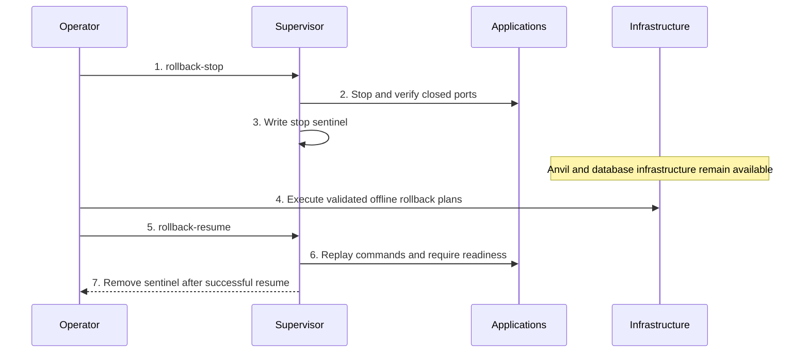

# Devnet Startup, Shutdown, Restart, and Rollback Lifecycle

> Internal developer documentation — repository-only. Not part of the published mdBook (SUMMARY.md).

> Updated: 2026-10-21. Status: Review.

## Overview

`devnet_lifecycle.md` is the required operating procedure for local Psy devnet work. `make run-all` always starts a fresh chain. `make restart` and `make rollback-resume` keep the database and the three running Anvil processes and restart applications only. `make shutdown` is teardown; `PURGE=1` is its default. Supported entry points are `make run-all`, `make restart`, `make rollback-stop`, `make rollback-resume`, and `make shutdown`.

## Background

Use only this lifecycle for local devnet operations; it supersedes ad-hoc per-service startup and manual state repair. The supervisor distinguishes persistent infrastructure from application processes. `make restart` and `make rollback-resume` leave the running database and the three Anvil processes in place. A purge removes the paired L1/L2 state. These are distinct operations, not interchangeable restart shortcuts (`dev/locSetupV4.ts:5221-5225,5740-5746,7715-7724`).

## Table of Contents

- [1. Environment](#1-environment)
- [2. Artifact Gate](#2-artifact-gate)
- [Public-only generate-genesis-data inputs](#public-only-generate-genesis-data-inputs)
- [3. Fresh Start](#3-fresh-start)
- [4. Readiness](#4-readiness)
- [5. Application Restart](#5-application-restart)
- [6. Offline Rollback Stop and Resume](#6-offline-rollback-stop-and-resume)
- [7. Post-Restart and Post-Rollback Verification](#7-post-restart-and-post-rollback-verification)
- [8. Failure Rules](#8-failure-rules)
- [9. Forbidden Operations](#9-forbidden-operations)
- [Related Documents](#related-documents)



```text
artifact gate -> infrastructure -> validator injection -> processors/edges -> workers
  -> proxy -> L1 deployment/reuse -> services/indexers -> faucet/relayer -> interfaces -> supervisor
```

## 1. Environment

Use release binaries. These environment variables are valid for fresh startup:

```bash
PSY_SKIP_BRANCH_CHECK=1
PSY_SKIP_KEYSTORE=1
```

Do not set `PSY_NO_AUTO_RESTART=1` when `make restart`, `make rollback-stop`, or `make rollback-resume` will be used. Those targets require the foreground supervisor to remain active. `PSY_SKIP_BUILD=1` is valid only after the release binaries and compiler-generated artifacts have been verified against the current source. `Makefile:16-18` defines the skip and purge defaults; `dev/locSetupV4.ts` rejects stale Psy SDK compiler artifacts.

Before startup, from a clean `<repo-root>`, check out the recorded DApp pin despite `update = none`, then initialize every nested link at its recorded SHA:

```bash
git submodule update --init --checkout -- psy-genesis psy-contracts psy-dapp
git -C psy-dapp submodule update --init -- psy-genesis psy-contracts
git -C ../psy-sdk submodule update --init -- psy-genesis
```

Run `git -C ../psy-wallet submodule update --init -- psy-genesis` only when the wallet surface is exercised. Root `git submodule update --init --recursive` does not populate `psy-dapp`. Do not use `--remote` or move a tracking branch. Install frozen dependencies in `./psy-dapp` and `./psy-dapp/mode-a-web-wallet-bridge`. Install `../psy-wallet` dependencies only when the wallet surface is exercised. Build release `psy_node_cli`, `psy_worker_cli`, `psy_dev_cli`, `psy_relayer_cli`, `psy_user_cli`, `psy-services`, and `psy-indexer`. Use `PSY_SKIP_BUILD=1` only after those binaries are newer than their changed sources.

Never run a formatter. Root `rustfmt.toml` and `client_prover/rustfmt.toml` set `disable_all_formatting = true`.

## 2. Artifact Gate

Before startup, compare both stamps with the selected clean sibling compiler. The source hash is the committed-tree fingerprint from `readCompilerProvenance`: eligible blobs at `HEAD`, sorted by UTF-8 path, each hashed as `path || NUL || blob || NUL`. Both `compilerRevision` fields and both `compilerSourcesHash` fields must equal that result. Genesis must also record the current SHA-256 and size of its three payloads:

```bash
set -euo pipefail
compiler_changes=$(git -C ../psy-compiler status --porcelain --untracked-files=all)
test -z "$compiler_changes"
python3 - <<'PY'
import hashlib, json, pathlib, subprocess, sys
compiler = pathlib.Path("../psy-compiler")
def git(*args, input=None):
    result = subprocess.run(["git", *args], cwd=compiler, input=input, stdout=subprocess.PIPE)
    if result.returncode != 0:
        sys.exit(result.returncode)
    return result.stdout
def source(path):
    path = path.replace("\\", "/")
    lower = path.lower()
    if path == ".compiler-artifact.json":
        return False
    if path in {"Cargo.toml", "Cargo.lock", "rust-toolchain.toml", "Makefile"}:
        return True
    if pathlib.PurePosixPath(path).name in {"build.rs", "precompiles.json", "package.json"}:
        return True
    return any(lower.endswith(ext) for ext in (".rs", ".psy", ".toml", ".lock"))
revision = git("rev-parse", "HEAD").decode().strip()
entries = []
for row in git("ls-tree", "-r", "--full-tree", revision).decode().splitlines():
    meta, path = row.split("\t", 1)
    mode, kind, oid = meta.split()
    if kind == "blob" and source(path):
        entries.append((path, oid))
entries.sort(key=lambda item: item[0].encode())
payload = "".join(oid + "\n" for _, oid in entries).encode()
blobs = {}
if payload:
    raw = git("cat-file", "--batch", input=payload)
    offset = 0
    for path, oid in entries:
        end = raw.index(b"\n", offset)
        parsed = raw[offset:end].decode().split()
        if parsed != [oid, "blob", parsed[2]]:
            sys.exit(1)
        start = end + 1
        blobs[path] = raw[start:start + int(parsed[2])]
        offset = start + int(parsed[2]) + 1
digest = hashlib.sha256()
for path, _ in entries:
    digest.update(path.encode())
    digest.update(b"\0")
    digest.update(blobs[path])
    digest.update(b"\0")
expected = {"compilerRevision": revision, "compilerSourcesHash": digest.hexdigest()}
sdk = json.loads(pathlib.Path("../psy-sdk/psy-ts-sdk/packages/psy-sdk/.compiler-artifact.json").read_text())
genesis = json.loads(pathlib.Path("psy-genesis/.genesis_contracts.compiler-artifact.json").read_text())
failed = False
for stamp in (sdk, genesis):
    for field in ("compilerRevision", "compilerSourcesHash"):
        if stamp.get(field) != expected[field]:
            failed = True
root = pathlib.Path("psy-genesis")
for name, digest_key, size_key in (
    ("genesis_contracts.json", "artifactSha256", "artifactByteSize"),
    ("token.json", "tokenArtifactSha256", "tokenArtifactByteSize"),
    ("token.update.json", "tokenUpdateArtifactSha256", "tokenUpdateArtifactByteSize"),
):
    data = (root / name).read_bytes()
    if hashlib.sha256(data).hexdigest() != genesis.get(digest_key) or len(data) != genesis.get(size_key):
        failed = True
sys.exit(1 if failed else 0)
PY
```

Repair only the stale output:

- Compiler-produced Genesis content or its stamp is stale: rerun `make -C ../psy-compiler gen-deploy-json` from the final clean pin and lockfile.
- SDK compiler identity or generated WASM is stale: `CARGO_NET_GIT_FETCH_WITH_CLI=true PSY_NETWORK=localhost pnpm --dir ../psy-sdk/psy-ts-sdk/packages/psy-sdk build`. This generates both prover targets and the compiler stamp. Keep generated `bigint` exports; do not copy another package's bindings or cast them to `number`.
- A required node, services, or indexer binary is missing or older than its sources: `make build` in the owning repository.

Repair only stale compiler outputs and rebuild affected binaries; do not weaken provenance checks or add Cargo patch overrides. `make run-all` explicitly authorizes a fresh local Genesis after complete startup preflight. Standalone generation reads the public signing policy from the selected network in `psy-genesis/config.json`; it takes no account-file path.

### Public-only `generate-genesis-data` inputs

`make generate-genesis-data` passes only `--repo-root` to the release CLI (`Makefile:141-142`). It removes legacy secret-bearing enrollment variables from that child. It does not accept `PSY_RELAYER_MULTISIG_ACCOUNT` or `--relayer-multisig-account`. The public two-of-three policy is the existing JSON string at `networks[CURRENT_NETWORK].guardian_authorization.bridge_relayer_signing_policy`. An operator configures that public member policy once in the canonical JSON; it is not a secret and is not a separate file. A missing checked-in policy fails before destruction. The generator resolves compiler artifacts from `PSY_PROJECTS_DIR/psy-compiler`, or the sibling `psy-compiler` checkout when unset.

Use that current release `psy_dev_cli`. A stale binary still checks contract ID 6 (`public multisig account must name contract 6`; `Genesis contract 6 must be multisig_policy`) and fails a contract-1 account.

The Make target does not redirect writes. Isolated output flags are `--genesis-out`, `--private-keys-out`, and `--faucet-operators-out`; `--skip-faucet-operators` omits the faucet file. Defaults are `<repo-root>/genesis.json`, `<repo-root>/private_keys.json`, and `<repo-root>/psy-dapp/apps/bridge/src/config/faucetOperators.json` (`psy_cli/psy_dev_cli/src/subcommand/generate_genesis.rs:122-132,668-671`).

## 3. Fresh Start

`make run-all` passes `--all` and always starts a fresh local chain, independently of `PURGE`. Explicit worker and proxy counts still apply, including `--prove-proxy 0`. Partial component commands never perform the full reset; `--db` refuses existing containers or volumes rather than adopting them. Full startup validates daemon and public configuration, generation inputs, resource settings, namespace ownership, and complete Docker listings before stopping anything. An unbound checkout cannot adopt matching resources, including legacy names. The existing owner-only guardian `db/` directory is a provisioning prerequisite. The foreground `fresh-devnet-state` helper validates protected fixed paths and acquires all four real redb exclusive guards before acknowledging `prepared`. Any live database owner blocks startup. It retains those guards across stdin `reset`, fresh Genesis generation, and the three local deployments. After deployment the launcher sends stdin `authorize` and waits for `authorized`. That phase writes `guardian_authorization` onto the selected `CURRENT_NETWORK` object in `psy-genesis/config.json` and writes no separate authorization file. Database tables are cleared in place and the files are never unlinked. The helper exits before guardian services start. The first fresh preflight does not require `guardian_authorization`; guardian-service startup and application restart do. Namespace binding, guardian keys, and the rest of the public network configuration are not reset (`dev/locSetupV4.ts:3163-3223,4013-4017,4069-4104,5904-5913,6334-6336`; `psy_cli/psy_dev_cli/src/subcommand/fresh_devnet_state.rs:57-95`; `psy_cli/psy_dev_cli/src/subcommand/generate_genesis/guardians_root.rs:229-236`).

The new Anvil writes `--state` to the now-absent snapshot path and does not load it. Local contracts deploy with `--reset`. If a configured local port already has a listener, startup fails and does not kill that process.

After the four in-place database clears, in order `guardian-1.redb`, `guardian-2.redb`, `guardian-3.redb`, then `relayer.redb`, the helper removes fixed paths in this order: `db/anvil`; contents of `local_checkpoints` except the retained `devnet-namespace` file; `genesis.json`; then `psy-contracts/deployments/localhost`, `localhostBsc`, and `localhostBase`. Each database commit is separate. A failure stops immediately: earlier commits and removals remain, later cleanup does not start, and nothing is rolled back (`psy_cli/psy_dev_cli/src/subcommand/fresh_devnet_state.rs:5-6,23-31,81-85`). TypeScript does not recursively remove these paths or inspect redb contents. Ancestor symlink checks alone are not a race-safety guarantee. The launcher does not request Anvil historical-state preservation. `make restart` only restarts applications: it does not run the helper, recreate databases, generate Genesis, deploy contracts, or rewrite `guardian_authorization`.

The protected helper requires trusted root/current-user-owned ancestry without group/world write access, and current-user-owned cleanup descendants; symlinks and hardlinked files are rejected. Opening and closing real redb databases can update engine housekeeping headers even when preflight rejects another input. The no-side-effects guarantee for failed preflight is therefore no business-table reset and no cleanup deletion, not byte-for-byte equality of redb files.

```bash
make build
export PSY_SKIP_KEYSTORE=1
export PSY_SKIP_BRANCH_CHECK=1
export PSY_SKIP_BUILD=1
make run-all
```

`make shutdown` remains the explicit teardown. `PURGE=1` is still its default and performs the broader purge documented in the launcher reference; it is the supported complete teardown. `PURGE=0` stops without purging, but its database stop is `docker stop -t -1`, which waits indefinitely; that supervisor-side Docker stop subprocess has no deadline, while the control client normally times out at 900 seconds (`dev/locSetupV4.ts:7355-7362`). In the recorded observation the invoker was cut off at 180 seconds while the supervisor kept waiting, and the supported purge teardown then completed in 11.44 seconds. It is not required before `make run-all`.

`make run-all` stays in the foreground. Run it in a dedicated terminal or tmux pane. Do not background it with `&`.

A second `make run-all` is another fresh chain, not a resume. Run it only after the first supervisor has exited, its control socket is gone, configured local ports are free, and no process still holds the four redb files. It repeats the same clear-then-cleanup order, then generates a new Genesis and deployments. `make restart` cannot replace that second fresh start: restart requires the original supervisor and its recorded `db`, `l1_anvil`, `l1_anvil_bsc`, and `l1_anvil_base` processes to still be running. If any of those processes is absent, restart fails and starts nothing.


## 4. Readiness

Startup is ready only after all of these checks pass:

```bash
nc -z 127.0.0.1 9042
nc -z 127.0.0.1 1337
nc -z 127.0.0.1 13380
nc -z 127.0.0.1 13381
nc -z 127.0.0.1 13390
nc -z 127.0.0.1 13391
curl -fsS http://127.0.0.1:3000/health
curl -fsS http://127.0.0.1:9999/health
```

Required processor markers:

```text
[COORD_CREATE] processor new done
[REALM_CREATE] processor new done
```

The markers are defined in `dev/locSetupPolicy.ts`. A launcher timeout is not proof of startup failure while `make run-all` remains active. Check ports and markers, then read `logs/coordinator_processor_errs.txt` and `logs/realm_*_processor_errs.txt`.

Read checkpoint heads with the `psy_` RPC prefix:

```bash
curl -s -X POST http://127.0.0.1:1337 \
  -H 'content-type: application/json' \
  --data '{"jsonrpc":"2.0","id":1,"method":"psy_get_latest_checkpoint_id","params":[]}'
```

With the default `make run-all` topology (`--realms-count 2`, `--realm-edge-nodes 1`, two validators per Realm), Realm edge HTTP ports are `13380`/`13381` for Realm 0 subs `1`/`2` and `13390`/`13391` for Realm 1. Each Realm starts processors for both sub-IDs. `start-realm-processor` does not take a sub-id flag; the process derives sub-id from its Ed25519 identity match in `PSY_CONFIG_PATH`. Rollback plans still require explicit `--realm-id` / `--realm-sub-id` and must match that derived identity.

## 5. Application Restart

Keep the terminal running `make run-all` alive. Restart only its supervised application children:

```bash
make restart
```

`make restart` sends `restart` to the existing supervisor. It requires the recorded `db`, `l1_anvil`, `l1_anvil_bsc`, and `l1_anvil_base` processes to still be running. A healthy primary Anvil is not sufficient. If any required process is absent, the command fails and starts nothing. On success it stops and recreates processors, edges, workers, proof services, APIs, indexers, relayer, and UIs from their recorded commands. Restart also requires the selected network's `guardian_authorization` object to already exist. It does not delete files, remove volumes, deploy contracts, publish authorization, or start a replacement database or Anvil (`dev/locSetupV4.ts:4013-4017,4240-4248,5743-5746`).

Anvil continues writing its current chain to `db/anvil/state.json` (and the localhostBsc and localhostBase paths). Those files are outputs of the running process. The next `make run-all` removes them before starting a new chain.


## 6. Offline Rollback Stop and Resume

Rollback generation and execution require processors, services, indexers, relayer, and UIs to stop while Anvil, its `db/anvil/state.json` snapshot, Scylla, Redis, NATS, Nostr, Envio infrastructure, checkpoint files, and logs remain available.

1. Record the L1 block number, deployed contract addresses, L1 finalized checkpoint, and every L2 checkpoint head.
2. Pause applications through the existing supervisor:

```bash
make rollback-stop
```

This command writes `local_checkpoints/rollback-stop.sentinel` with exactly:

```text
rollback offline: all processors and relayer stopped; Scylla Redis NATS and checkpoints retained
```

Pass that path to rollback generation and execution with `--stop-sentinel local_checkpoints/rollback-stop.sentinel`.

3. Confirm processor endpoints are down and retained infrastructure is up:

```bash
for p in 1337 13380 13381 13390 13391 3000 9999; do ! nc -z 127.0.0.1 "$p"; done
for p in 8545 9545 10545 9042 6379 4222 8081 5433 8080; do nc -z 127.0.0.1 "$p"; done
```

4. Generate and execute one rollback plan for the Coordinator and one for every Realm processor identity `(realm_id, realm_sub_id)` (default `make run-all`: four Realm plans for realms `0`/`1` × subs `1`/`2`). Realm plans require `--realm-id` and `--realm-sub-id` matching the processor derived from its identity key. Rollback validation uses only `plonky2-poseidon-goldilocks`; JTMB is test-only. `--target-contract-state <json>` is optional: generation retains it only when `last_finalized_checkpoint_id` exactly equals the rollback target, and absence or mismatch never blocks local rollback. Generate every RP before executing any RP, then require every phase in every RP to be `completed` before resume. Any L1 force-state action is a separate operator task.
5. Resume the saved application commands without deploying L1 or resetting Envio:

```bash
make rollback-resume
```

The supervisor removes the stop sentinel only after every saved application process reaches its startup condition. `make rollback-resume` starts those saved templates against the infrastructure left running by `make rollback-stop`. It is not `make run-all`: it does not deploy L1, reset Envio, or create a fresh chain. Do not run `make shutdown`, including `PURGE=0 make shutdown`, between rollback plan generation, execution, recovery, and resume.

`make rollback-resume` can take several minutes because release Plonky2 workers and the prove proxy rebuild circuit state. A long-running command is not stuck while new `CONTROLLED START` markers appear and readiness ports progressively open. The current supervisor starts templates serially; the prove proxy warm-up is usually the critical path.

## 7. Post-Restart and Post-Rollback Verification

1. Require the Anvil block number to be no lower than before the operation, `db/anvil/state.json` to parse as complete JSON, and StateManager, Bridge, and Router addresses to remain byte-identical. If `target_contract_state` was omitted or ignored because its checkpoint differed, record that no matching target contract snapshot was attached to the local RP; verify any separate L1 recovery independently.
2. Require Coordinator and every Realm processor readiness marker.
3. Require every processor checkpoint head to advance above the rollback target, allow short Realm lag, then require all heads to converge.
4. Verify the target checkpoint remains queryable and target application state was restored.
5. Submit a real state-changing transaction that covers the rolled-back state. Repeating the exact pre-rollback spend is stronger than registering a new user because it proves the consumed balance/state can be used again.
6. Require the transaction to confirm and checkpoint heads to continue advancing.
7. Require checkpoint ring buffers to be contiguous through the current head and new gatherer backups to begin above the retained monotonic pending high-water.
8. If an end cap anchors to a historical checkpoint after rollback, bound the checkpoint-tree proof query by the current logical head; an unbounded per-node max query can mix physical post-rollback residual versions.

The earlier checkpoint-289-to-0 run is historical L2 evidence from the old restart path: it showed L2 rollback, convergence, and transaction acceptance, and it did not prove localhost L1 continuity because that path recreated Anvil. It is not verification of the current three-Anvil restart.

## 8. Failure Rules

| Failure | Action |
|---|---|
| `compiler revision changed` | Regenerate compiler and Genesis contract artifacts, regenerate root `genesis.json`, rebuild affected release binaries, then run the artifact checks. |
| Root `genesis.json` contract circuit differs from canonical compiler output | Run `make generate-genesis-data` with the matching sibling compiler artifacts and the canonical signing policy already present; stale embedded definitions can fail prove-proxy circuit construction. |
| Cargo cannot authenticate to `git@github.com` | Set `CARGO_NET_GIT_FETCH_WITH_CLI=true`; repair empty cached submodules without deleting the whole Cargo git cache. |
| Submodule fetch reports `early EOF` | Retry the same authenticated command. |
| Scylla `raft operation add_entry timed out` during fresh schema creation | Stop the partial stack with `PURGE=1 make shutdown`, then run `make run-all`. Do not reuse the partial Scylla volume. |
| Anvil state or a localhost deployment is missing or inconsistent | Run `PURGE=1 make shutdown`, then `make run-all`. `make run-all` creates a fresh chain; it does not reuse one side of a partial pair. |
| `db/anvil/state.json` is truncated or invalid JSON | The L1 snapshot is unusable. Do not repair it manually or claim L1 continuity. Use `PURGE=1 make shutdown`, then `make run-all`. |
| Database proof differs from checkpoint ring buffer proof | Keep the stack stopped and identify whether the DB history or ring buffer is stale; do not delete only one side. |
| `rollback-stop` reports an application port still open | Keep the supervisor in `stopping`, terminate the tracked application process group, and retry `make rollback-stop`. Do not write the sentinel manually. |
| `make restart` cannot reach the control socket | The foreground supervisor is absent. `make run-all` creates a fresh chain; it does not preserve the previous chain. |
| Processor exits before the exact readiness marker | Read that processor's error log; do not treat an open RPC port as processor readiness. |
| Realm resume has no positive pending/proc mapping below the retained counter | Resolve the committed pair from the latest checkpoint mapping at or before the marker; the `(0,0)` sentinel is valid for an unchanged Realm. Never lower or reuse the counter. |
| Rollback CLI says an endpoint is reachable | Run `make rollback-stop`; do not bypass the offline guard. |
| Rollback plan phase fails | Keep applications stopped and rerun the same RP. The phase model is idempotent. |
| `make rollback-resume` fails | Keep the sentinel and the infrastructure that is still running; fix the failing application, then rerun `make rollback-resume`. Do not replace it with `make run-all`. |

## 9. Forbidden Operations

- Do not follow `make shutdown` with `make run-all` in order to reuse Anvil state or deployments. `PURGE=0` does not turn `make run-all` into a state-preserving restart. `make run-all` always starts a fresh chain.
- Do not run `docker compose` or manually restart one devnet service.
- Do not run individual process binaries to substitute for the supervisor control targets.
- Do not use `PSY_NO_AUTO_RESTART=1` when process-only restart or rollback stop/resume is required.
- Do not use `make restart` after the supervisor has exited, or after deleting Scylla, Redis, NATS, Anvil state, deployments, or checkpoint files. `make restart` requires the recorded database and all three Anvil processes to still be running.
- Do not use `PSY_SKIP_BUILD=1` after source, compiler, Genesis, or SDK artifact changes without rebuilding.
- Do not regenerate a rollback plan after destructive phases have started; resume the frozen RP.
- Do not restart processors until all Coordinator and Realm rollback plans and external recovery have completed.
- Do not run formatters.

## Related Documents

- [Circuit and verifier operations](circuit-and-verifier-operations.md)
- [Devnet launcher reference](devnet-launcher-reference.md)
- [Common account and contract operations](common-operations.md)
- [Bridge common operations](bridge-common-operations.md)
- [Fn circuit fingerprint playbook](fn-circuit-fingerprint-playbook.md)
- [Genesis generation](genesis-generation.md)
- [Realm p2p validators](realm-p2p-validators.md)
- [Token privacy circuit fingerprints](token-privacy-circuit-fingerprints.md)
