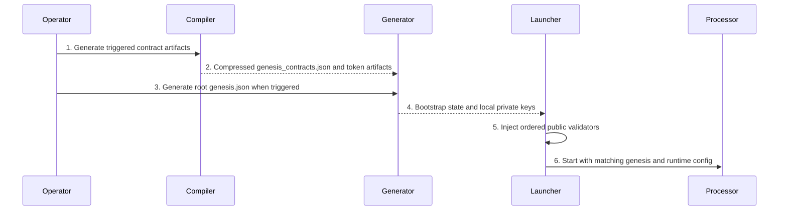

# Genesis Generation

> Internal developer documentation — repository-only. Not part of the published mdBook (SUMMARY.md).

> Updated: 2026-10-22. Status: Review.

## Overview

"Genesis" names three distinct generated artifacts. They have different producers, different triggers, and different consumers; never substitute one procedure for another. The trigger rules live in `AGENTS.md` (`Genesis Regeneration Boundary`) and [circuit-and-verifier-operations.md](circuit-and-verifier-operations.md) §6.1. This page is the operational how-to; those sections own when generation is authorized.

| Artifact | Producer | Consumer |
|---|---|---|
| Root `genesis.json` (network bootstrap state) | `make generate-genesis-data` in `psy-node` | Coordinator/Realm processors via `--genesis-data-path` |
| `psy-genesis/` contract artifacts (`genesis_contracts.json`, `genesis_abi/`, token artifacts) | `make gen-deploy-json` in `<workspace>/psy-compiler` | Node builds, SDK, services, contracts, DApp gitlinks |
| `validators` list inside root `genesis.json` | Devnet launcher P2P injection | Coordinator/Realm P2P validator registry |

## Background

The compiler produces contract definitions, while the node generator embeds those definitions into a network bootstrap snapshot. The launcher then adds public validator membership. `psy-genesis/config.json` is the one public configuration, including the read-only guardian member commitments; `make gen-deploy-json` does not generate it (`<workspace>/psy-compiler/Makefile:270-309`). Keep these ownership boundaries explicit when debugging stale artifacts.



```text
compiler contract artifacts -> node bootstrap snapshot -> launcher validator injection -> processors
network config -------------> build-time constants and runtime membership validation
```

## Table of Contents

- [1. Root `genesis.json`](#1-root-genesisjson)
  - [1.1 Trigger](#11-trigger)
  - [1.2 Command](#12-command)
  - [1.2.1 Public bridge multisig account](#121-public-bridge-multisig-account)
  - [1.2.2 First-workspace guardian provisioning](#122-first-workspace-guardian-provisioning)
  - [1.3 Outputs](#13-outputs)
  - [1.4 Verification](#14-verification)
- [2. `psy-genesis/` Repository Artifacts](#2-psy-genesis-repository-artifacts)
- [3. P2P Validator Injection into `genesis.json`](#3-p2p-validator-injection-into-genesisjson)
- [4. Guardians root](#4-guardians-root)
  - [4.1 Guardians-root inputs and identity](#41-guardians-root-inputs-and-identity)
  - [4.2 Outputs](#42-outputs)
  - [4.3 Trusted proxy config, anchors, and availability](#43-trusted-proxy-config-anchors-and-availability)
  - [4.4 Validation status](#44-validation-status)
- [5. Excluded Generation Tasks](#5-excluded-generation-tasks)
- [6. Failure Handling](#6-failure-handling)

## 1. Root `genesis.json`

Fresh Genesis contracts carry a mandatory canonical layout manifest alongside
the deployment fields. The generator binds each of the six deployments to its
complete compiler artifact and derives the manifest from that artifact's ABI.
The runtime builder recomputes layout commitments before initializing contract
leaves. Missing metadata is rejected; literal-zero fallback is not supported.
The compiler bundle alone is not the complete generation input.

Faucet operator accounts use a caller-aware SDKey policy. The generator defaults
to `--sd-key-min-tx-count 1 --sd-key-max-tx-count 64`: this counts the calls in
one UPS, including nested calls and fee burn, rather than lifetime faucet claims.
Top-level calls may invoke the faucet method and fee burn; token Transfer is
authorized only when its caller is the faucet contract. The generator derives
the account fingerprint from this policy and writes `sdKeyMinTxCount`,
`sdKeyMaxTxCount`, and `sdKeyAllowedCallerContractIds` into the operator config.
An explicit `--sd-key-fingerprint` must match the derived fingerprint. Changing
these policy inputs changes faucet account identities; editing an existing
operator config alone cannot change an account already registered on-chain.

### 1.1 Trigger

Run generation only when at least one of these changed ([circuit-and-verifier-operations.md](circuit-and-verifier-operations.md) §6.1):

1. `psy-genesis/genesis_contracts.json` content;
2. a Genesis construction input or default in `psy_cli/psy_dev_cli/src/subcommand/generate_genesis.rs` or its `generate_genesis/guardians_root.rs` branch;
3. the serialized `genesis.json` format or serializer;
4. an intentionally adopted `psy-genesis` gitlink whose changed content affects Genesis construction.

EndCap metadata, GUTA, cache, verifier JSON, fingerprint, and ordinary witness changes do not trigger it.

### 1.2 Command

To reuse existing validator and Faucet identities, select the import mode instead
of `--random-private-keys`. Import requires both the hash-pinned private-key array
and the prior public Genesis. Before writing outputs, generation checks every
account fingerprint/public-key parameter and each Validator's Realm/user mapping.
The selected network still comes from the canonical config; imported keys do not
permit deterministic keys on a public network. Input errors never generate replacements.

```bash
PSY_NETWORK=testnet PSY_CONFIG_PATH=<canonical-config> \
./target/release/psy_dev_cli generate-genesis-data \
  --repo-root <repo-root> \
  --private-keys-in <protected-private-key-array> \
  --private-keys-sha256 <private-key-array-sha256> \
  --accounts-genesis-in <prior-public-genesis> \
  --accounts-genesis-sha256 <prior-public-genesis-sha256> \
  --genesis-out <new-genesis-path> \
  --private-keys-out <new-protected-private-key-array> \
  --faucet-operators-out <new-protected-faucet-operators>
```

Pass the deployment's actual Validator slots and Faucet count as well; the
example deliberately does not change the generator's global account defaults.
All import-mode outputs are create-only, including the copied private-key array.
Reuse Guardian and P2P custody separately and inject the approved public
membership before final Genesis hashing. Generation does not start or reset a chain.

When generation is authorized, the selected network of `psy-genesis/config.json` must already carry `guardian_initial_member_hashes`: exactly three public member commitments. The generator reads that field and nothing else from the network. The policy compiler artifact is read from the sibling checkout, not from a flag:

```bash
make generate-genesis-data
```

The equivalent command from the repository root is:

```bash
./target/release/psy_dev_cli generate-genesis-data \
  --repo-root .
```
There is no `--relayer-multisig-account` flag and no `PSY_RELAYER_MULTISIG_ACCOUNT` variable (`Makefile:150-151`). The compiler artifact is `<projects>/psy-compiler/psy-precompiles/multisig_policy/target/multisig_policy.json`, where `<projects>` is `$PSY_PROJECTS_DIR` or the parent of `--repo-root`. There is no `--multisig-policy-artifact`, `--guardians-root`, or `--max-fee` flag, and no `PSY_MULTISIG_POLICY_ARTIFACT` variable. The Make target strips secret-bearing legacy enrollment variables from the generator child environment; it does not change L1 custody in the parent process. Full startup always generates a fresh Genesis after its preflight. Missing or invalid member commitments fail before any destruction. Application restart does not generate Genesis. Sources: `psy_cli/psy_dev_cli/src/subcommand/generate_genesis.rs:71-151,479-486`; `Makefile:150-151`; `dev/locSetupV4.ts:3129-3195`. The first-workspace procedure that produces the three commitments is [§1.2.2](#122-first-workspace-guardian-provisioning).

### 1.2.1 Public bridge multisig account

Registration 2 (`user_id` 524288) is a public-only two-of-three multisig account. Its only generation input is `networks[CURRENT_NETWORK].guardian_initial_member_hashes` in `psy-genesis/config.json`. `initial_account` derives one `MultisigAccount` from those three commitments: `contract_id` 1 and `initial_policy` version 1, threshold 2, member count 3, with the three commitments in `member_hashes` slots 0 through 2 and zeros in slots 3 through 7. Account construction rejects a zero or duplicate active member, so generation does not accept one. This document does not invent member values. The commitments identify the approved public signers; they are not addresses or private keys. Nothing is published after deploy: the canonical config stays read-only. Source: `psy_cli/guardian_common/src/protocol.rs:412-420`; `client_prover/psy_vm/src/ups/multisig.rs:31-49`; `psy_cli/psy_dev_cli/src/subcommand/generate_genesis.rs:167-192,479-493`.

The sibling compiler artifact contains the approved policy contract's ABI 2.0.0 and exactly `get_policy` and `set_policy` circuit definitions, with declared state-tree height 4. The generator checks the ABI schema, method identifiers, input and output felt counts, view or external mutability, and the visible `header` and three-`members` offsets, then derives the deployment and requires its code root and function roots to equal Genesis contract 1. The compiler JSON stays in the compiler's `target` directory; these commands never copy or regenerate it. Source: `psy_cli/psy_dev_cli/src/subcommand/generate_genesis.rs:194-292`.

The generator derives the account identity from `multisig_fingerprint()` and the derived initial policy. It initializes contract 1 with header `[1, 2, 3, 0]` in slot 0 and the three member commitments in slots 1 through 3. Contract 0 slot 0 holds the configured nonzero canonical initial fee balance. The user nonce is zero, but the policy is already initialized: the first signed session uses the current initial policy, not pristine-account bootstrap. No relayer master secret is generated, decrypted, or exported. Source: `psy_cli/psy_dev_cli/src/subcommand/generate_genesis.rs:167-192`.

The stage-magic multisig pin (`0x1337CF514544CF69`, localhost/testnet) is measured from `MultisigSignatureCircuit::new().get_fingerprint()`. After the shared circuit security fixes its value is `4554ad0ac443b495aa1fa68443fd54ed83a59e7a9f7cbd5900bea05a1340e050`; the sole runtime constant is `STAGE_CF69_MULTISIG_FINGERPRINT_U64` in `client_prover/psy_prover/src/wallet/memory_wallet.rs`. The existing `get-user-end-cap-common-data` command constructs the multisig circuit and exports its actual fingerprint and limbs rather than echoing this pin. Validate the pin against the constructed circuit with `PSY_NETWORK=localhost cargo test --release --locked -p psy_prover --lib multisig_fingerprint_matches_signature_circuit_or_rejects_unmeasured_magic`. Mainnet remains unmeasured and the getter rejects it.

A fingerprint change changes the account public key even when all member commitments stay identical. Updating the compiled pin does not migrate an existing registration-2 leaf or guardian/relayer journals: they remain bound to the previous identity, and occupied-slot and journal identity checks must not be bypassed. Existing chains require a separately authorized state lifecycle or a verified identity migration; do not register a replacement account, clear journals, or regenerate live Genesis as part of updating this pin.

L1 transaction keystores and passwords remain separate operator custody inputs; they do not select this L2 identity. Do not regenerate an existing chain to rotate members. Use a current-quorum-authorized policy replacement instead. Current quality assurance for public Genesis construction, initialized-state proofs, and startup is pending; the input contract does not establish that generated artifacts are ready for use.

#### 1.2.2 First-workspace guardian provisioning

A clean checkout has no portable guardian development keys and no checked-in `guardian_initial_member_hashes`. Copying another workspace's commitments does not provision this workspace: guardian `id` authenticates `member_hashes[id - 1]`, and a mismatch returns `PolicyMismatch` (`psy_cli/psy_relayer_cli/src/guardian/service.rs:307-309`). There is no environment-policy alias, authorization sidecar, or universal development policy. The only supported input is the operator-provisioned canonical field on the selected network of the existing `psy-genesis/config.json`.

The three keystore paths come from `guardian_keystore_path` (`psy_cli/guardian_common/src/runtime.rs:110-115`):

```text
$HOME/.psy/keystore/guardian-1.keystore.json
$HOME/.psy/keystore/guardian-2.keystore.json
$HOME/.psy/keystore/guardian-3.keystore.json
```

There is no `guardian-<id>.password` file, and no tool reads one. A file of that name beside the keystore is not a password source. Localhost keystores use one fixed test password for all three ids: `devnet`. It is a local-devnet test value, not an operator secret and not a credential for any shared network. Export it as `GUARDIAN_1_KEYSTORE_PASSWORD`, `GUARDIAN_2_KEYSTORE_PASSWORD`, and `GUARDIAN_3_KEYSTORE_PASSWORD`. Do not write it to a file. If a guardian's keystore already exists as this user's regular file and opens with `devnet`, reuse it and do not create it again. If the name exists as a symlink or a dangling symlink, stop: do not overwrite, truncate, or recreate it. `$HOME/.psy/keystore` must already exist as this user's mode-`0700` directory, with no symlink component from `/` through `.psy`. Inspect it before creation:

```bash
namei -l "$HOME/.psy/keystore"
```

Stop if any component is `l`, or if the listing continues past that component into the symlink target. The final line must be this user's `drwx------` directory. Do not run `mkdir` or `chmod` here: both follow a directory symlink.

`wallet create --output <path>` writes that exact file. `Wallet::save` passes the `--output` file name to `PrivateKeySigner::encrypt_keystore`, which forwards it to `eth-keystore` 0.5.0 `encrypt_key`; with a name, that function writes `directory/name` (`client_prover/psy_provider/src/wallet/secp_wallet.rs:209-225`; `eth-keystore-0.5.0/src/lib.rs:223-255`). `wallet info` and `wallet random` print secret-bearing output and are not part of this procedure (`client_prover/psy_cli/psy_user_cli/src/subcommand/wallet.rs:65-90`).

Run the binary from `<repo-root>` as the keystore owner, only after the `namei` check above passes, and only for a guardian whose final keystore name is absent. Pass `--password devnet` for this localhost test key. Repeat for guardians 2 and 3 with the same password. The three `Public Key:` lines are the only values copied forward. `umask 077` makes the new keystore mode `0600`. If the destination exists, stop; do not delete it and do not retry creation over it.

```bash
set -euo pipefail
umask 077
./target/release/psy_user_cli wallet create \
  --output "$HOME/.psy/keystore/guardian-1.keystore.json" \
  --password devnet
```

When the keystore already exists, skip creation and load that exact file with `--wallet-password devnet`. The command prints `ETH Address:` and `Public Key:` only (`wallet.rs:42-50`; `secp_wallet.rs:228-244`). The printed public key is `hash_no_pad_compressed_public_key` of the compressed secp256k1 key (`secp_wallet.rs:79-85,396-397`). Copy the `Public Key:` hex into the matching position: guardian 1 is index 0, guardian 2 is index 1, and guardian 3 is index 2. Do not sort the three hashes. `Mac Mismatch` means this file was not created with `devnet`; stop and report that, do not read a password file and do not overwrite the keystore.

```bash
./target/release/psy_user_cli wallet load \
  --keystore-path "$HOME/.psy/keystore/guardian-1.keystore.json" \
  --wallet-password devnet
```

Write those three printed values, in that order, as the JSON array `networks.<selected>.guardian_initial_member_hashes` in `psy-genesis/config.json`. Each value is a `QHashOut` hex string of at most 64 digits; the three must be nonzero and pairwise distinct. Do not write a `guardian_authorization` object, a `guardian_root` key, an `l1_endpoints` list, a policy string, a digest, a fee ceiling, or a password. Chain id and bridge stay in the deployment documents passed later as repeatable `--l1-config` paths; this step does not write those documents or any frontend deployment config. The selected network must not carry `guardian_authorization` or `guardian_root`: launcher admission rejects them. Protocol fees are still computed and verified, with no operator limit. Do not commit the keystores or another operator's commitments as a development default. Editing the commitments of an already deployed chain is not provisioning: replace the live policy only through the current two-of-three quorum. Source: `client_prover/psy_core/psy_config/src/lib.rs:74-84`; `dev/locSetupV4.ts:358-375`.

Guardian signing never reads a password file. Export the same `devnet` value through the names from `guardian_password_env`: `GUARDIAN_1_KEYSTORE_PASSWORD`, `GUARDIAN_2_KEYSTORE_PASSWORD`, and `GUARDIAN_3_KEYSTORE_PASSWORD` (`psy_cli/guardian_common/src/runtime.rs:101-108,248-259`). Do not pass those names as command arguments. The launcher inherits these three variables and never writes them (`dev/locSetupV4.ts:4073-4089`).

```bash
export GUARDIAN_1_KEYSTORE_PASSWORD=devnet
export GUARDIAN_2_KEYSTORE_PASSWORD=devnet
export GUARDIAN_3_KEYSTORE_PASSWORD=devnet
```

### 1.3 Outputs

| Output | Handling |
|---|---|
| Root `genesis.json` | Network bootstrap state containing contract registrations, worker whitelist, validator list, and checkpoint stats. |
| Root `private_keys.json` | Dense registration-indexed array: entry 2 is JSON `null`; other validator/faucet entries retain their existing keys and positions. The file remains **secret**. Never package, upload, commit, paste, or publish it ([circuit-and-verifier-operations.md](circuit-and-verifier-operations.md) §13 and Security Considerations). |
| `psy-dapp/apps/bridge/src/config/faucetOperators.json` | Faucet operator config (`psy_cli/psy_dev_cli/src/subcommand/generate_genesis.rs`). Skip with `--skip-faucet-operators`. |

### 1.4 Verification

The following are required QA outcomes, not recorded passes for the current cutover. Generation and runtime execution remain subject to the pipeline gates.

1. The CLI exits 0; the three output files exist and are nonempty.
2. `genesis.json` is valid JSON and its `validators` list matches the intended set (see §3).
3. Node startup accepts it via `--genesis-data-path`.

The default faucet SD-key pin in `generate_genesis.rs` and the matching
`client_prover/Makefile` pin must be measured from the current policy circuit:
transaction count `3`, ordered contract IDs `[5, 0, 0]`, and ordered method IDs
`[3375543263, 2789897329, 3998182541]`. After an SD-key constraint change, verify
the intended worktree and source revision before building; a different checkout
can reproduce the old pin correctly without containing the constraint repair.
Run the behavioral regression from that node repository root before restarting:

```bash
PSY_NETWORK=localhost cargo test --release -p psy_dev_cli --lib \
  subcommand::generate_genesis::tests::default_faucet_policy_circuit_matches_genesis_and_exported_identity \
  -- --exact --nocapture
```

This constructs the same policy circuit as faucet runtime from the exported
policy fields and compares its fingerprint and derived addresses against every
generated Genesis faucet user and exported operator. A stale pin must fail;
updating both pins to the measured fingerprint must pass. This test uses only
in-memory fixture keys, not existing secret output files. Custom policies need
their own measured `--sd-key-fingerprint`; the default pin is not universal.

A changed default pin changes Genesis faucet identities: regenerate Genesis
and the complete faucet operator export together on the authorized fresh-reset
path. Replacing only exported fingerprints leaves addresses and Genesis users
inconsistent. Rebuild the release generator before fresh startup; the runtime
fingerprint guard must remain enabled. The in-memory regression does not prove
startup or claim execution: those still require the stopped stack's authorized
fresh E2E run.

## 2. `psy-genesis/` Repository Artifacts

`psy-genesis/genesis_contracts.json`, `genesis_abi/`, and the token artifacts are generated from a clean `psy-compiler` HEAD, not edited by hand:

```bash
cd <workspace>/psy-compiler
make gen-deploy-json
```

The compiler tree must be clean and exactly at the selected `R_compiler`. The user publishes that commit by SSH; if its reachability is already proven, do not publish it again. Finalize the node pin and `Cargo.lock`, then generate. `make gen-deploy-json` compiles the six genesis contracts, writes `genesis_contracts.json`, refreshes `genesis_abi/`, and copies `token.json` and `token.update.json` into the default `PSY_GENESIS` directory `../psy-node/psy-genesis`. Its final recipe also writes `.genesis_contracts.compiler-artifact.json`. That sidecar records `compilerRevision`, `compilerSourcesHash`, and SHA-256 plus byte size for `genesis_contracts.json`, `token.json`, and `token.update.json` (`<workspace>/psy-compiler/Makefile:270-309`).

The node generator consumes the existing flat array of named deployments from `genesis_contracts.json`, not a nested layout wrapper. Names must be nonempty and unique; entry 1 must be `multisig_policy`. Its sibling `.genesis_contracts.compiler-artifact.json` is mandatory: the generator accepts the existing eight-field stamp, checks fixed-width lowercase identity strings, and verifies the raw bundle byte size and SHA-256 before decoding. The stamp must be a regular file of at most 65,536 bytes. This does not introduce a private-storage ABI export or a new bundle schema.

That command writes the node checkout only. It does not update sibling `../psy-genesis`, `../psy-sdk/psy-genesis`, `../psy-dapp/psy-genesis`, or `../psy-wallet/psy-genesis`. After review, the user publishes those bytes as `R_genesis`. Then check out that already-pushed SHA in every affected gitlink.

If `genesis_contracts.json` content changed, regenerate root `genesis.json` (§1) and check the `TOKEN_CONTRACT_STATE_TREE_HEIGHT` consequence per [token-privacy-circuit-fingerprints.md](token-privacy-circuit-fingerprints.md). A stamp or compiler-revision refresh alone does not authorize that regeneration.

## 3. P2P Validator Injection into `genesis.json`
Devnet core startup rewrites the `validators` list of the file passed as `--genesis-data-path` from the selected public-only runtime network config. Each Realm's ordered validator array is flattened into Genesis with `realm_id`, `validator_user_id`, `node_id`, and `bls_public_key`; sub-id is derived later as the one-based array position. The launcher pins `PSY_NETWORK` to the same config key selected by the node (`localhost` for `local-devnet`) and exports the generated config as `PSY_CONFIG_PATH`.

Local-devnet Genesis pre-places dedicated ZK validator accounts at registrations `0`, `1`, `3`, `4` for realms `0..1` (Strategy5 GROUP=1), and the initialized public multisig account at registration `2` with fixed Strategy5 `user_id` `524288`. Faucet sd-key operators occupy registrations `5..14`. The launcher binds each `(realm_id, sub_id)` to the reserved validator registrations and does not scan ordinary faucet or relayer users. Dense local-devnet Genesis currently covers validator realms `0..1` only.

`[finalize]` and `[[chains]]` retain their separate encrypted L1 keystore configuration. That keystore does not determine registration 2. See the public inputs in [§1.2.1](#121-public-bridge-multisig-account). This lane does not register a guardian daemon in the launcher.

The key generator writes P2P identity/BLS secrets and creates one distinct edge identity and public address for every requested edge index. Foreground public addresses use the requested host. Daemon startup writes a separate runtime config whose public addresses use Compose DNS service names; container listeners remain wildcard addresses. All of these addresses use the standard Realm P2P transport.

Genesis construction fails closed when a Realm exceeds the P2P validator cap (`MAX_VALIDATORS_PER_REALM = 64` in `psy_data/src/p2p/limits.rs`), a NodeId, BLS key, or validator user ID is duplicated, a public identity is invalid, or `validator_user_id` is outside the owning Realm's half-open user range. Processor startup also requires its local Ed25519 NodeId and BLS secret to match the configured public values exactly.

## 4. Guardians root
`PSY_GUARDIAN_ROOT` is the operator runtime directory. `fresh-devnet-state --repo-root <repo-root> --guardians-root <root>` is its only command, and it is a reset helper, not a generator. `generate-genesis-data` has no `--guardians-root` and no `--max-fee` flag. It reads the selected network and writes Genesis; the helper never writes `genesis.json`, `private_keys.json`, `faucetOperators.json`, or any configuration. There is no `--chains`, `--approved-contracts`, `--multisig-policy-artifact`, or `--relayer-multisig-account` flag.

Shared guardian code lives in the `psy_cli/guardian_common` crate (`lib.rs` declares `db`, `protocol`, `runtime`). The generator and `psy_relayer_cli` both consume it; it depends on neither binary.

### 4.1 Guardians-root inputs and identity

No input contains a signing secret. The helper and the generator read `psy-genesis/config.json` no-follow and duplicate-free, and neither writes it. Keystore contents are never opened here; only file metadata is.

| Input | Required | Exact rule |
|---|---|---|
| `guardian_initial_member_hashes` | yes | Three `QHashOut` commitments at `networks[CURRENT_NETWORK].guardian_initial_member_hashes`. Generation and fresh preflight both derive the account through `initial_account`; fresh preflight also requires the three to be pairwise distinct. A missing or invalid value fails before generation or destruction. |
| sibling `multisig_policy` artifact | derived | `<projects>/psy-compiler/psy-precompiles/multisig_policy/target/multisig_policy.json`, where `<projects>` is `$PSY_PROJECTS_DIR` or the parent of `--repo-root`. Read once; the raw bytes stay in that directory. |
| guardian keystores | fresh preflight, metadata only | The three `guardian_keystore_path` files. Each must already be an effective-uid regular file in mode `0600`, with no symlink and no extra hard link. Passwords are environment-only and are not inspected (`guardians_root.rs:107-139`). |

`ChainEndpoint` is `{ chain_index, chain_id, bridge, deployment_block, rpc_url }`, parsed at runtime from the selected deployment documents. It is not a generation or fresh-preflight input and not an `l1_endpoints` field of `psy-genesis/config.json`. Repeatable `--l1-config` paths replace the selected network's `l1_config_url`. A local summary has no `l1_chains` key. Its sibling `Bridge_Proxy.json` must be present: `address` must match the summary `bridge`, and `deployment_block` is `receipt.blockNumber`. A remote `l1_config_url` document supplies no proxy receipt. Each `l1_chains` entry must already carry `deployment_block`. A missing or unparsable value fails startup. There is no block-zero fallback and no automatic remote migration. `parse_chain_documents` requires unique `chain_index` and unique chain id and rejects a missing or conflicting value. Nothing in generation or the fresh helper writes those documents or the canonical config (`psy_cli/guardian_common/src/runtime.rs:188-315`; `dev/locSetupV4.ts:358-375`).

Canonical decoding rejects duplicate keys through `parse_duplicate_free_json` (`guardians_root.rs:51-82`). Error text names `networks.<selected>.guardian_initial_member_hashes`.

Identity is the derived account, not a stored authorization object. Generation places that account at registration 2 as [§1.2.1](#121-public-bridge-multisig-account) describes. At guardian startup, `enroll_guardian_account` passes the same derived account and `multisig_fingerprint()` to `register_recorded_multisig_user`, then requires the returned fingerprint and account key to match (`psy_cli/psy_relayer_cli/src/guardian/service.rs:328-339`).

### 4.2 Outputs

There is no authorization output. The helper does not create an authorization database, object, digest, or file. `psy-genesis/config.json` is read-only for the whole helper: the helper never writes it, and finish does not pin its device, inode, or bytes. The launcher does not snapshot or byte-compare the file (`psy_cli/psy_dev_cli/src/subcommand/fresh_devnet_state.rs:1-12,103-110`; `dev/locSetupV4.ts:358-375`).

The committed stdin handshake is `prepared`, then `reset`, then `finish`. The helper prints one JSON line per phase, `{"phase":"<name>"}`. It prints `prepared` after preflight and after holding all four redb exclusive guards. The launcher writes `reset\n`, and the helper creates any missing database, clears the four databases in place, removes the fixed cleanup paths, and prints `reset`. After the three local deployments, the launcher writes `finish\n` and closes stdin. Finish rechecks only the held database bindings and the guardian-root identity, prints `finished`, and exits 0. It does not pin config. Nothing is published. End of input before a command aborts the protocol (`fresh_devnet_state.rs:103-119`; `dev/locSetupV4.ts:6056-6060,6491-6494`).

```text
<guardian_root>/db/guardian-1.redb
<guardian_root>/db/guardian-2.redb
<guardian_root>/db/guardian-3.redb
<guardian_root>/db/relayer.redb
```

Those four files are runtime databases. The existing owner-only `db/` directory is a prerequisite; the helper does not create it. Missing database files are created only after `reset`, and no database file is ever unlinked. Guardian files hold `deposit_tree_states`, `guardian_account`, `guardian_schema`, `guardian_session`, `guardian_signed`, `guardian_signer`, `guardian_withdrawal_nonce`, and `included_withdrawal_burns`. The relayer file holds `chain_claims`, `deposit_tree_states`, `finalization_batch`, `guardian_account`, `guardian_withdrawal_nonce`, `included_withdrawal_burns`, `journal_schema`, `relayer_request`, and `withdrawal_quarantine`. `guardian_schema` stores one `u32` marker and `journal_schema` stores one `u64` marker; the guardian marker must be version 3 and the relayer marker version 4. They store mutable nonce, signed-request, included-session, per-chain deposit-tree state, included withdrawal burns, per-chain claim, quarantine-marker, and shared finalization-batch state. A populated file must match that table set and marker exactly. A partial set, a wrong marker, or the previous relayer 8-table journal fails closed before reset and is not wiped or migrated; explicit operator-controlled migration is deferred, not automatic. Reset commits each database separately, and a failure leaves earlier commits in place (`fresh_devnet_state.rs:27-40,57-113`).

`GuardianConfig` is an in-memory value, not a serialized file. `GuardianConfig::load(rpc_config, guardian_root, local_documents)` decodes the daemon `--rpc-config` and keeps the selected network. Nonempty repeatable `--l1-config` paths replace `l1_config_url`; otherwise the runtime fetches that URL and requires `l1_chains[].deployment_block` on every entry. `from_network` then requires the three member commitments, three guardian endpoints, history, and the parsed chain documents, including `deployment_block`. Protocol fees are computed and verified there; no operator fee ceiling is configured or read. `build_runtime_config(guardian_id)` derives `<guardian_root>/db/guardian-{id}.redb` and the password variable name and copies those `ChainEndpoint` values into `GuardianRuntimeConfig.l1_rpc_urls`. The relayer reads `<guardian_root>/db/relayer.redb` (`psy_cli/guardian_common/src/runtime.rs:125-315`).

The one secret path per guardian is `$HOME/.psy/keystore/guardian-<id>.keystore.json`, from `guardian_keystore_path`. Its password is the environment variable from `guardian_password_env`, never a file and never serialized. The fresh preflight walks keystore metadata without following symlinks and never opens the files. `guardian-service` alone reads keystore contents, through `load_signing_key` (`runtime.rs:101-115,248-263`).

#### 4.2.1 Offline compressed journal migration

The compressed-journal release requires marker **3**, superseding the marker-2 requirement above. The eight table names and their key types do not change. Business requests remain `PSYGS002`: this is not a business-schema upgrade. Only `guardian_signed`, `guardian_session`, and `relayer_request` values gain the `PSYGR001` Zstandard envelope. Full request code, trace, signature, and proof bytes are preserved; compression does not omit code. The envelope has no fixed decoded or compressed cap; the declared uncompressed length must be exact and each record is one zstd frame, and request work is bounded by the request deadline and concurrency limits, not a memory ceiling. Runtime open and the fresh reset helper reject marker 2; neither silently migrates it (`psy_cli/psy_dev_cli/src/subcommand/fresh_devnet_state.rs:28-40`).

Stop **all three guardians and the relayer**, disable their automatic restarts, and retain an offline backup before invoking the operator-controlled command from the node checkout:

```bash
./target/release/psy_relayer_cli migrate-guardian-journals \
  --rpc-config psy-genesis/config.json \
  --guardian-root "$PSY_GUARDIAN_ROOT" \
  --l1-config l1-deployments/chain-0.json \
  --l1-config l1-deployments/chain-1.json \
  --l1-config l1-deployments/chain-2.json
```

Use the existing deployment-document paths for this workspace; repeat `--l1-config` once per document. Omitting them retains the runtime's configured `l1_config_url` loading behavior. The command does not rewrite either source. Migration needs no private key or password and never opens signing-key files. After acquiring all four exclusive database handles, it reads each existing `guardian_signer` singleton, validates its compressed SEC1 public point, and passes that exact retained identity to the migration API. This checks retained identity consistency, not key possession or independent signer membership in the configured policy. Account/network checks against configuration and full record validation remain mandatory. Normal guardian startup still checks the actual encrypted keystore identity. Preserve the keystores: do not regenerate, replace, delete, or pass keys/passwords in migration arguments (`psy_cli/psy_relayer_cli/src/main.rs`, `migration_signer`, `migrate_guardian_journals`).

The command requires the existing protected `db/guardian-1.redb`, `db/guardian-2.redb`, `db/guardian-3.redb`, and `db/relayer.redb` files. It does not create a missing file, initialize an empty file, reset the chain, delete rows, prune history, or write configuration. It obtains and retains all four exclusive redb handles before invoking either migration API; a live database owner prevents migration. Opening can still perform normal redb recovery/header housekeeping (`psy_cli/psy_relayer_cli/src/main.rs`, `open_migration_database`, `migrate_guardian_journals`).

Each database migration validates its identities and records, preserves table keys and exact decoded record bytes, and commits the compressed values together with its marker in **one transaction**. The four databases are **not one atomic transaction**: the order is guardians 1, 2, 3, then relayer. A failure stops immediately; earlier successful commits remain. Keep services stopped, correct the reported prerequisite, and rerun the same command. Marker-3 files are validated without conversion, so a partially completed run can resume. Output reports database names and row counts, never requests, signatures, proofs, keys, or passwords. All rows survive migration; normal subsequent guardian runtime retention remains one latest included session plus pending work, while the relayer retains full compressed history. Restart the compatible services only after all four databases complete migration.

### 4.3 Trusted proxy config, anchors, and availability

Provenance: user rulings `trusted_guardian_proxy`, `trusted_guardian_proxy_config`, `trusted_guardian_proxy_anchors`, and `trusted_guardian_proxy_availability` (2026-10-13). Implemented. The earlier design-only and no-separate-pinning statements are withdrawn.

`prove_proxy_url` remains `Vec<String>` on `NetworkConfigGoldilocks` (`client_prover/psy_core/psy_config/src/lib.rs`). `load_network` accepts 1 to 8 URLs and rejects an empty, blank, or invalid URL (`psy_cli/guardian_common/src/runtime.rs:200-220`). Guardian startup calls `WalletSession::new_with_provider` with no recorded fingerprint. Only a `Some` fingerprint applies the same 1-to-8 bound, builds one `ProveProxyRpcProvider` per URL, and refuses the local `PsyUPSStepCircuitManager` fallback (`client_prover/psy_prover/src/session/session.rs:2527-2566`). A construction error fails that startup closed.

There is no `GuardianAuthorization` and no stored fingerprint field. The account and its approval use `MULTISIG_POLICY_CONTRACT_ID` (1), the same identity Genesis writes; the former literal 6 is not accepted. `multisig_fingerprint()` is computed when needed. A member-commitment change is a canonical-config change followed by Genesis regeneration on a new chain, not an authorization rewrite.

Enrollment uses the computed fingerprint. `enroll_guardian_account` calls `register_recorded_multisig_user` and requires the returned fingerprint and account key to match (`psy_cli/psy_relayer_cli/src/guardian/service.rs:263-267,337-339`). It does not construct `MultisigSignatureCircuit`.

The proxy supplies method definitions, fingerprints, and verifier metadata only. It returns neither a guardian signature nor a proof verdict. `verify_cached_endcap_proof` calls `ups_end_cap_circuit_verifier_config` on every configured manager, fingerprints the returned `VerifierOnly` data with `get_circuit_fingerprint_generic`, and requires `canonical_endcap_fingerprint()`. That expected value comes from `PsyNetworkLocalDevnetConstants`; a different `PSY_NETWORK_MAGIC` fails closed (`psy_cli/psy_relayer_cli/src/guardian/verify.rs:440-468`). EndCap proof verification and checkpoint, state, policy, nonce, trace, signing, and journal checks stay local.

Negative checks: there is no pin file, proxy-signature approval, or guardian local-proving fallback. Fresh preflight does not clear `prove_proxy_url`. Guardian enrollment does not construct `MultisigSignatureCircuit`.

Implemented in `psy_cli/guardian_common/src/protocol.rs`, `psy_cli/guardian_common/src/runtime.rs`, `psy_cli/psy_dev_cli/src/subcommand/generate_genesis/guardians_root.rs`, `psy_cli/psy_relayer_cli/src/guardian/service.rs`, `psy_cli/psy_relayer_cli/src/guardian/verify.rs`, and `client_prover/psy_prover/src/session/session.rs`.

### 4.4 Validation status

The counts below are historical results for the old proxy revision and the old authorization object. They are not acceptance of `guardian_initial_member_hashes` and do not verify the current read-only config at runtime:

```text
cargo test -p guardian_common --release --lib
30 passed, 2 ignored
cargo test -p psy_relayer_cli --release --lib guardian::
16 passed, 2 ignored
cd dev && bun test locSetupV4.test.ts
97 passed
```

The recorded release stack enabled the old proxy path. All four HTTP checks returned 200: guardians 1, 2, and 3, then the relayer. Guardians started together at 10:32:23 UTC and were ready before the relayer's first log at 10:35:39 UTC, about 195 seconds. That interval is not a one-minute result, and the contradictory 95 ms bound is rejected. After ready, guardian RSS was 1,428,784 / 1,400,296 / 1,400,032 KiB, with peaks 1,832,112 / 1,855,628 / 1,851,436 KiB and swap 0. The prior local-construction baseline was 15,688,444 / 16,442,988 / 16,084,444 KiB. These measurements belong to that old revision.

For that historical revision, first-signature timing, quorum, and whole-flow E2E are NOT VERIFIED; current fresh-chain readiness and its evidence limits are recorded in [devnet_lifecycle.md](devnet_lifecycle.md) §4. `psy_cli/psy_relayer_cli/tests/guardian_acceptance.rs` remains ignored. Separately, Envio discovery of the existing deposit failed, so the funds flow has not reached guardian signing. Envio schema reset remains unapproved and was not run. Rotation approval remains an unresolved finding, not a guardians-root requirement.

## 5. Excluded Generation Tasks

| Task | Owner |
|---|---|
| Regenerate `cached_circuit_library.rs` / `cached_common_data.rs` | [circuit-and-verifier-operations.md](circuit-and-verifier-operations.md) §5.1 |
| Regenerate EndCap verifier JSON | [circuit-and-verifier-operations.md](circuit-and-verifier-operations.md) §4 |
| Regenerate `local_circuits.json` | `make generate-local-circuits` (`Makefile:157-158`) |
| Regenerate token fingerprints in precompiles | [token-privacy-circuit-fingerprints.md](token-privacy-circuit-fingerprints.md) |
| Regenerate Groth16 keystores | `Makefile:170-174` |

## 6. Failure Handling

| Failure | Response |
|---|---|
| Missing or invalid `guardian_initial_member_hashes`, a missing sibling compiler artifact, or an invalid derived account | Fail closed before destruction. Provision this workspace's three commitments in the selected network of `psy-genesis/config.json` ([§1.2.2](#122-first-workspace-guardian-provisioning)) and supply the compiler checkout; do not fall back to a keystore, a plaintext key, `deterministic_private_key(2)`, or another operator's commitments. There is no `PSY_RELAYER_MULTISIG_ACCOUNT` or `PSY_MULTISIG_POLICY_ARTIFACT`, and no operator fee ceiling to configure. |
| Relayer cannot authorize user `524288` | Registration 2 was not initialized from the selected `guardian_initial_member_hashes` and the sibling compiler artifact. There is no policy-file flag. Regenerate Genesis from those inputs on a new chain; do not paste a plaintext key into daemon config. |
| `validators` entries differ from the selected runtime membership | Core startup injects the selected ordered validators; component-only startup does not rewrite them. Diagnose configuration drift before the next authorized core startup. |
| Provenance mismatch in `psy-genesis` stamp | Rebuild `make gen-deploy-json` from the committed clean compiler revision after its node pin and lockfile are final; never hand-edit provenance JSON |
| `private_keys.json` leaked | Treat as secret compromise; rotate and remove from every distribution channel |
| Fresh helper stops before `finished` | Leave the retained database commits and cleanup removals in place. Nothing is rolled back, and the canonical config was not written. Fix the reported input and rerun only through the supported fresh startup (`fresh_devnet_state.rs:1-12`). |
| `guardian-service` meets an empty database file | `DatabaseUnavailable`. Opening the raw empty file fails closed. The service does not delete or reinitialize it, and this is not a journal error (`psy_cli/guardian_common/src/db.rs:164`; `psy_cli/psy_relayer_cli/src/guardian/service.rs:341-348`). |

## Security Considerations
Preserve matching source revisions, configuration, and generated artifact cohorts. Never publish root `private_keys.json`, validator or faucet secrets, or a guardian keystore password. Generation does not authorize deployment or publication. Treat fingerprint, provenance, and membership mismatches as failures rather than bypassing verification. Neither generation nor the fresh helper writes `psy-genesis/config.json`; guardian keystore contents are read exclusively by `guardian-service` through protected file descriptors, and its password comes only from `GUARDIAN_<id>_KEYSTORE_PASSWORD`.

## Related Documents

- [Circuit and verifier operations](circuit-and-verifier-operations.md)
- [Devnet lifecycle](devnet_lifecycle.md)
- [Fn circuit fingerprint playbook](fn-circuit-fingerprint-playbook.md)
- [Realm p2p validators](realm-p2p-validators.md)
- [Token privacy circuit fingerprints](token-privacy-circuit-fingerprints.md)
