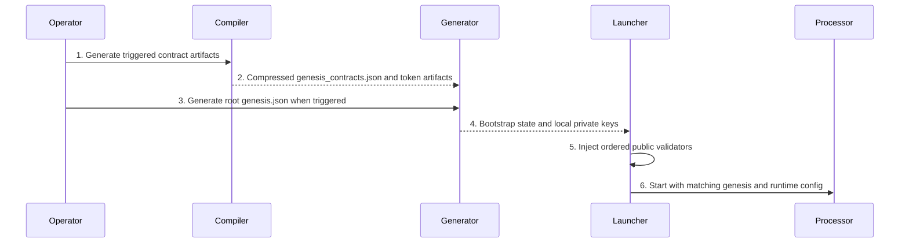

# Genesis Generation

> Internal developer documentation — repository-only. Not part of the published mdBook (SUMMARY.md).

> Updated: 2026-10-21. Status: Review.

## Overview

"Genesis" names three distinct generated artifacts. They have different producers, different triggers, and different consumers; never substitute one procedure for another. The trigger rules live in `AGENTS.md` (`Genesis Regeneration Boundary`) and [circuit-and-verifier-operations.md](circuit-and-verifier-operations.md) §6.1. This page is the operational how-to; those sections own when generation is authorized.

| Artifact | Producer | Consumer |
|---|---|---|
| Root `genesis.json` (network bootstrap state) | `make generate-genesis-data` in `psy-node` | Coordinator/Realm processors via `--genesis-data-path` |
| `psy-genesis/` contract artifacts (`genesis_contracts.json`, `genesis_abi/`, token artifacts) | `make gen-deploy-json` in `<workspace>/psy-compiler` | Node builds, SDK, services, contracts, DApp gitlinks |
| `validators` list inside root `genesis.json` | Devnet launcher P2P injection | Coordinator/Realm P2P validator registry |

## Background

The compiler produces contract definitions, while the node generator embeds those definitions into a network bootstrap snapshot. The launcher then adds public validator membership. `psy-genesis/config.json` is the one public configuration, including authorization; `make gen-deploy-json` does not generate it (`<workspace>/psy-compiler/Makefile:270-309`). Keep these ownership boundaries explicit when debugging stale artifacts.



```text
compiler contract artifacts -> node bootstrap snapshot -> launcher validator injection -> processors
network config -------------> build-time constants and runtime membership validation
```

## Table of Contents

- [1. Root `genesis.json`](#1-root-genesisjson)
  - [1.1 Trigger](#11-trigger)
  - [1.2 Command](#12-command)
  - [1.2.1 Public bridge multisig account](#121-public-bridge-multisig-account)
  - [1.3 Outputs](#13-outputs)
  - [1.4 Verification](#14-verification)
- [2. `psy-genesis/` Repository Artifacts](#2-psy-genesis-repository-artifacts)
- [3. P2P Validator Injection into `genesis.json`](#3-p2p-validator-injection-into-genesisjson)
- [4. Guardians root](#4-guardians-root)
  - [4.1 Guardians-root inputs and identity](#41-guardians-root-inputs-and-identity)
  - [4.2 Outputs](#42-outputs)
  - [4.3 Trusted proxy config, anchors, and availability](#43-trusted-proxy-config-anchors-and-availability)
  - [4.4 Validation status](#44-validation-status)
- [5. Excluded Generation Tasks](#5-excluded-generation-tasks)
- [6. Failure Handling](#6-failure-handling)

## 1. Root `genesis.json`

### 1.1 Trigger

Run generation only when at least one of these changed ([circuit-and-verifier-operations.md](circuit-and-verifier-operations.md) §6.1):

1. `psy-genesis/genesis_contracts.json` content;
2. a Genesis construction input or default in `psy_cli/psy_dev_cli/src/subcommand/generate_genesis.rs` or its `generate_genesis/guardians_root.rs` branch;
3. the serialized `genesis.json` format or serializer;
4. an intentionally adopted `psy-genesis` gitlink whose changed content affects Genesis construction.

EndCap metadata, GUTA, cache, verifier JSON, fingerprint, and ordinary witness changes do not trigger it.

### 1.2 Command

When generation is authorized, the public signing policy must already be the JSON string at `networks[CURRENT_NETWORK].guardian_authorization.bridge_relayer_signing_policy` in `psy-genesis/config.json`. The policy compiler artifact is read from the sibling checkout, not from a flag:

```bash
make generate-genesis-data
```

The equivalent command from the repository root is:

```bash
./target/release/psy_dev_cli generate-genesis-data \
  --repo-root .
```
There is no `--relayer-multisig-account` flag and no `PSY_RELAYER_MULTISIG_ACCOUNT` variable (`Makefile:141-142`). The compiler artifact is `<projects>/psy-compiler/psy-precompiles/multisig_policy/target/multisig_policy.json`, where `<projects>` is `$PSY_PROJECTS_DIR` or the parent of `--repo-root`. There is no `--multisig-policy-artifact` flag and no `PSY_MULTISIG_POLICY_ARTIFACT` variable. The Make target strips secret-bearing legacy enrollment variables from the generator child environment; it does not change L1 custody in the parent process. Full startup always generates a fresh Genesis after its preflight. A missing checked-in policy fails before any destruction. Application restart does not generate Genesis. Sources: `psy_cli/psy_dev_cli/src/subcommand/generate_genesis.rs:72-76`; `Makefile:141-142`; `dev/locSetupV4.ts:3113-3167`. The `--guardians-root` branch of the same command is documented in §4.

### 1.2.1 Public bridge multisig account

Registration 2 (`user_id` 524288) is a public-only two-of-three multisig account. Its only input is the existing JSON string `bridge_relayer_signing_policy` on the selected network. That string decodes as a `MultisigAccount` containing exactly `contract_id` and `initial_policy`; unknown or duplicate fields are rejected. `contract_id` must be 1. `initial_policy` contains exactly `version` 1, `threshold` 2, `member_count` 3, and `member_hashes`, an array of eight commitments. The first three commitments must be nonzero and pairwise unequal; the remaining five must be zero. This document does not invent member values. The commitments identify the approved public signers; they are not addresses or private keys. Before deploy, only this policy field is required. After deploy, the published authorization contains the full seven-field object and preserves this same policy string. Source: `psy_cli/psy_dev_cli/src/subcommand/generate_genesis.rs:185-212`; `psy_cli/psy_dev_cli/src/subcommand/generate_genesis/guardians_root.rs:186-203`; `dev/locSetupV4.ts:3135-3153`.

The sibling compiler artifact contains the approved policy contract's ABI 2.0.0 and exactly `get_policy` and `set_policy` circuit definitions, with declared state-tree height 4. The generator checks the ABI schema, method identifiers, input and output felt counts, view or external mutability, and the visible `header` and three-`members` offsets, then derives the deployment and requires its code root and function roots to equal Genesis contract 1. The same read covers every genesis deployment: a `state_map` must be a Hash-keyed map of capacity 1,048,576 with value size 4 starting on its alignment boundary, and a `withdraw` method's withdrawal map operands must be unique typed literals with exactly one write preceded by at least one read of the same base and capacity. The compiler JSON stays in the compiler's `target` directory; these commands never copy or regenerate it.

The generator derives the account identity from the actual `MultisigSignatureCircuit` fingerprint and the initial public policy. It initializes contract 1 with header `[1, 2, 3, 0]` in slot 0 and the three member commitments in slots 1 through 3. Contract 0 slot 0 holds the configured nonzero canonical initial fee balance. The user nonce is zero, but the policy is already initialized: the first signed session uses the current initial policy, not pristine-account bootstrap. No relayer master secret is generated, decrypted, or exported.

L1 transaction keystores and passwords remain separate operator custody inputs; they do not select this L2 identity. Do not regenerate an existing chain to rotate members. Use a current-quorum-authorized policy replacement instead. Current quality assurance for public Genesis construction, initialized-state proofs, and startup is pending; the input contract does not establish that generated artifacts are ready for use.

### 1.3 Outputs

| Output | Handling |
|---|---|
| Root `genesis.json` | Network bootstrap state containing contract registrations, worker whitelist, validator list, and checkpoint stats. |
| Root `private_keys.json` | Dense registration-indexed array: entry 2 is JSON `null`; other validator/faucet entries retain their existing keys and positions. The file remains **secret**. Never package, upload, commit, paste, or publish it ([circuit-and-verifier-operations.md](circuit-and-verifier-operations.md) §13 and Security Considerations). |
| `psy-dapp/apps/bridge/src/config/faucetOperators.json` | Faucet operator config (`psy_cli/psy_dev_cli/src/subcommand/generate_genesis.rs`). Skip with `--skip-faucet-operators`. |

### 1.4 Verification

The following are required QA outcomes, not recorded passes for the current cutover. Generation and runtime execution remain subject to the pipeline gates.

1. The CLI exits 0; the three output files exist and are nonempty.
2. `genesis.json` is valid JSON and its `validators` list matches the intended set (see §3).
3. Node startup accepts it via `--genesis-data-path`.

## 2. `psy-genesis/` Repository Artifacts

`psy-genesis/genesis_contracts.json`, `genesis_abi/`, and the token artifacts are generated from a clean `psy-compiler` HEAD, not edited by hand:

```bash
cd <workspace>/psy-compiler
make gen-deploy-json
```

The compiler tree must be clean and exactly at the selected `R_compiler`. The user publishes that commit by SSH; if its reachability is already proven, do not publish it again. Finalize the node pin and `Cargo.lock`, then generate. `make gen-deploy-json` compiles the six genesis contracts, writes `genesis_contracts.json`, refreshes `genesis_abi/`, and copies `token.json` and `token.update.json` into the default `PSY_GENESIS` directory `../psy-node/psy-genesis`. Its final recipe also writes `.genesis_contracts.compiler-artifact.json`. That sidecar records `compilerRevision`, `compilerSourcesHash`, and SHA-256 plus byte size for `genesis_contracts.json`, `token.json`, and `token.update.json` (`<workspace>/psy-compiler/Makefile:270-309`).

The node generator consumes the existing flat array of named deployments from `genesis_contracts.json`, not a nested layout wrapper. Names must be nonempty and unique; entry 1 must be `multisig_policy`. Its sibling `.genesis_contracts.compiler-artifact.json` is mandatory: the generator accepts the existing eight-field stamp, checks fixed-width lowercase identity strings, and verifies the raw bundle byte size and SHA-256 before decoding. The stamp must be a regular file of at most 65,536 bytes. This does not introduce a private-storage ABI export or a new bundle schema.

That command writes the node checkout only. It does not update sibling `../psy-genesis`, `../psy-sdk/psy-genesis`, `../psy-dapp/psy-genesis`, or `../psy-wallet/psy-genesis`. After review, the user publishes those bytes as `R_genesis`. Then check out that already-pushed SHA in every affected gitlink.

If `genesis_contracts.json` content changed, regenerate root `genesis.json` (§1) and check the `TOKEN_CONTRACT_STATE_TREE_HEIGHT` consequence per [token-privacy-circuit-fingerprints.md](token-privacy-circuit-fingerprints.md). A stamp or compiler-revision refresh alone does not authorize that regeneration.

## 3. P2P Validator Injection into `genesis.json`
Devnet core startup rewrites the `validators` list of the file passed as `--genesis-data-path` from the selected public-only runtime network config. Each Realm's ordered validator array is flattened into Genesis with `realm_id`, `validator_user_id`, `node_id`, and `bls_public_key`; sub-id is derived later as the one-based array position. The launcher pins `PSY_NETWORK` to the same config key selected by the node (`localhost` for `local-devnet`) and exports the generated config as `PSY_CONFIG_PATH`.

Local-devnet Genesis pre-places dedicated ZK validator accounts at registrations `0`, `1`, `3`, `4` for realms `0..1` (Strategy5 GROUP=1), and the initialized public multisig account at registration `2` with fixed Strategy5 `user_id` `524288`. Faucet sd-key operators occupy registrations `5..14`. The launcher binds each `(realm_id, sub_id)` to the reserved validator registrations and does not scan ordinary faucet or relayer users. Dense local-devnet Genesis currently covers validator realms `0..1` only.

`[finalize]` and `[[chains]]` retain their separate encrypted L1 keystore configuration. That keystore does not determine registration 2. See the public inputs in [§1.2.1](#121-public-bridge-multisig-account). This lane does not register a guardian daemon in the launcher.

The key generator writes P2P identity/BLS secrets and creates one distinct edge identity and public address for every requested edge index. Foreground public addresses use the requested host. Daemon startup writes a separate runtime config whose public addresses use Compose DNS service names; container listeners remain wildcard addresses. All of these addresses use the standard Realm P2P transport.

Genesis construction fails closed when a Realm exceeds the P2P validator cap (`MAX_VALIDATORS_PER_REALM = 64` in `psy_data/src/p2p/limits.rs`), a NodeId, BLS key, or validator user ID is duplicated, a public identity is invalid, or `validator_user_id` is outside the owning Realm's half-open user range. Processor startup also requires its local Ed25519 NodeId and BLS secret to match the configured public values exactly.

## 4. Guardians root
`generate-genesis-data --guardians-root PATH` is the only guardians-root entry. It reads the **existing** `genesis.json` named by `--genesis-out`, or `<repo-root>/genesis.json` when absent, and never regenerates it. Relative paths resolve against `--repo-root`. It never calls `generate_local_devnet_genesis` and never writes `genesis.json`, `private_keys.json`, or `faucetOperators.json`. Without `--guardians-root`, the publish branch is unchanged and `--max-fee` fails closed. There is no `--chains`, `--approved-contracts`, `--multisig-policy-artifact`, or `--relayer-multisig-account` flag.

Shared guardians-root code lives in the `psy_cli/guardian_common` crate (`lib.rs` declares `db`, `endcap`, `protocol`, `runtime`). The generator and `psy_relayer_cli` both consume it; it depends on neither binary.

### 4.1 Guardians-root inputs and identity

File inputs are resolved by the existing `read_public_input(repo_root, path)` convention; absolute paths stay absolute. No input contains a signing secret: the guardians-root branch never reads keystore contents, only their file metadata.

| Input | Required | Exact decoded rule |
|---|---|---|
| `bridge_relayer_signing_policy` | yes | Existing JSON string at `networks[CURRENT_NETWORK].guardian_authorization.bridge_relayer_signing_policy` in `psy-genesis/config.json`. It is the public `MultisigAccount`: `contract_id` 1 and `initial_policy` version 1, threshold 2, member count 3. No path flag and no secret. A missing policy fails before generation or destruction (`guardians_root.rs:186-203`). |
| sibling compiler artifacts | derived | `<projects>/psy-compiler/psy-precompiles/<stem>/target/<stem>.json` for the six genesis stems, where `<projects>` is `$PSY_PROJECTS_DIR` or the parent of `--repo-root`. Read once; the raw bytes stay in that directory. |
| deployment output | derived, with `--guardians-root` | `psy-contracts/deployments/<network>/deployed-contracts.json` plus the Bridge and StateManager proxy receipts, for `localhost`, `localhostBsc`, and `localhostBase` in chain index order. |
| canonical `l1_endpoints` | with `--guardians-root` | The selected compiled network of `<repo-root>/psy-genesis/config.json` supplies the endpoints; nonempty, no duplicate chain index, no port `0`, no wildcard host, credential-free `https` or loopback `http`. `eth_chainId` must equal the deployed `chainId`, and block 0 supplies the L1 genesis hash. No `--l1-endpoints` flag and no fallback (`dev/locSetupV4.ts:3896-3906,3978-3991`). |
| `--max-fee` | optional | `u64` fee cap, default `2000000000` (`generate_genesis.rs`); must be at least the compiled `GUTA_FEE + DA_FEE` floor (`guardians_root.rs`). `guta_fee` and `da_fee` stay on the canonical network and are not copied into authorization. |

Canonical decoding rejects duplicate and unknown keys through the shared `JsonText`/`parse_canonical_json` decoder (`guardians_root.rs`; `guardian_common/src/protocol.rs`).

Identity is checked end to end before any output exists. Construct `MultisigSignatureCircuit`, derive its fingerprint, locate user `524288` through the Strategy5 registration mapping, and require it to sit at registration 2; require the genesis user's fingerprint, public-key parameter, contract-1 header `[1, 2, 3, 0]` and three member slots to match the supplied account (`guardians_root.rs`). Compiled network dimensions must equal the local-devnet builder's (`guardians_root.rs`). Checkpoint 0 is recomputed offline with the node-side `parth_core::pgoldilocks::PoseidonHasher` through `GenesisDatabaseDataBuilder` (`setup_contracts`, `setup_users`, `setup_validators` with `psy_config::PSY_NETWORK_MAGIC`, populated leaf `qfhash`), then converted to the client 32-byte genesis identity (`guardians_root.rs`).

### 4.2 Outputs

The guardians-root branch does not create authorization databases. Public authorization is the `guardian_authorization` object on `networks[CURRENT_NETWORK]` inside `psy-genesis/config.json`. The fresh helper publishes that object after the three local deployments by rewriting the authorization while preserving the pinned `bridge_relayer_signing_policy` string and keeping every other network. The helper command is `fresh-devnet-state --repo-root <repo-root> --guardians-root <root>`; it takes no policy path. Preflight pins the canonical config device and inode and the exact policy bytes, then revalidates both before reset and before publish (`psy_cli/psy_dev_cli/src/subcommand/generate_genesis/guardians_root.rs:205-247`; `psy_cli/psy_dev_cli/src/subcommand/fresh_devnet_state.rs:39-95`; `dev/locSetupV4.ts:4079-4082`).

First fresh startup is policy-only: before the deploy, the checked-in config must contain only the `bridge_relayer_signing_policy` string on the selected network; the remaining six authorization fields may be absent (`guardians_root.rs:186-197`). After the three local deployments, the fresh helper builds the complete seven-field `GuardianAuthorization` from those pinned policy bytes and publishes it once. Runtime is full-authorization: `GuardianDb` opens only against the complete `GuardianAuthorization`, and every sign request binds its `authorization_sha256`, so a partial object or a digest mismatch fails closed (`psy_cli/guardian_common/src/protocol.rs:241-246`; `psy_cli/guardian_common/src/db.rs:111-121`).

```text
<guardian_root>/db/guardian-1.redb
<guardian_root>/db/guardian-2.redb
<guardian_root>/db/guardian-3.redb
<guardian_root>/db/relayer.redb
```

Those four files are runtime databases, not authorization stores. Guardian files hold `deposit_tree_states`, `guardian_account`, `guardian_session`, `guardian_signed`, `guardian_signer`, `guardian_withdrawal_nonce`, and `included_withdrawal_burns`. The relayer file holds `chain_claims`, `deposit_tree_states`, `finalization_batch`, `guardian_account`, `guardian_withdrawal_nonce`, `included_withdrawal_burns`, and `relayer_request`. They store mutable nonce, signed-request, included-session, per-chain deposit-tree state (`count`, `root`, `frontier`, `anchor`; its `event_block` is the log cursor, not a string prefix), included withdrawal burns, per-chain claim, and shared finalization-batch state and no authorization body. `deposit_tree_states` is keyed by `DepositTreeKey` (`network_magic`, `user_id`, `chain_index`). `included_withdrawal_burns` is keyed by `WithdrawalBurnKey` (`network_magic`, `user_id`, sender, token contract, burn nonce); that key is not an identity. `guardian_withdrawal_nonce` stays the second index. `chain_claims` is keyed by `u8` `chain_index` and holds `pending_claim_withdrawals`, `claim_retry`, and `retired_claim_withdrawals`. `finalization_batch` is the singleton key `()` and holds `pending_finalization_range` (`from_checkpoint`, `to_checkpoint`) and `finalized_chains`. The relayer file does not store `producing_session`, `last_finalized_checkpoint`, or `identity_namespace`. The fresh helper accepts an empty file or exactly that runtime table set, clears tables in place, and never unlinks the files. Directories are mode `0700`. A signed request binds the digest of the current `guardian_authorization`; a digest mismatch fails closed, and an old request is not re-signed under a replacement object (`psy_cli/psy_dev_cli/src/subcommand/fresh_devnet_state.rs:24-28,340-355`; `psy_cli/psy_relayer_cli/src/bridge/guardian_client.rs:211-244,435-492`; `psy_cli/guardian_common/src/db.rs:20-27`).

`guardian_authorization` contains only `genesis_hash`, `bridge_relayer_signing_policy`, `multisig_fingerprint`, `endcap_verifier_fingerprint`, `max_fee`, `approved_contracts`, and `chains`. `bridge_relayer_signing_policy` is the guardian two-of-three signing policy for bridge-relayer L2 operations: a `MultisigAccount` with `contract_id` and `initial_policy`. `account_json` and `multisig_account` are not this field and have no serde alias. `ApprovedContract` contains only `contract_id`, `contract_leaf_json`, `methods`, and `withdrawal_layout`. It does not store `artifact_sha256`. Network magic, user id, contract ids, `guta_fee`, `da_fee`, and the account public key are derived from the canonical network and account, not duplicated in authorization. Proof-byte limits stay at `MAX_BODY_BYTES`; the retained EndCap verifier fingerprint is still checked. The compiler JSON stays in the compiler `target` directory and is not loaded by hash at runtime. The approved methods are `set_policy` on contract 1, `set_chain_root` on contract 2, and `append_withdrawal`, `batch_append_withdrawals_2`, `batch_append_withdrawals_5` on contract 3. Contracts 0, 4, and 5 carry an empty method list. The method id and input count come from the compiled definition and must match the ABI.

This field list is the frozen contract, and current source declares exactly this seven-field `GuardianAuthorization` (`psy_cli/guardian_common/src/protocol.rs:195-202`). Runtime acceptance for this cutover is still pending the paused unified test round; source agreement is not a recorded pass.

Chain authorization is derived the same way. The deployment chain index must equal the canonical endpoint's chain index, `eth_chainId` must equal the deployed `chainId`, and the deployment block is the greater `receipt.blockNumber` of the Bridge and StateManager proxies. The record carries no code hash and no implementation address. The L1 genesis hash is block 0 from that endpoint.

`GuardianConfig` is an in-memory value loaded by `GuardianConfig::load(rpc_config, guardian_root)`. It is not a separate serialized file. `build_runtime_config(guardian_id)` derives `<guardian_root>/db/guardian-{id}.redb`; the relayer reads `<guardian_root>/db/relayer.redb` (`psy_cli/guardian_common/src/runtime.rs:160-213`).

The two secret paths per guardian are absolute `<home>/.psy/keystore/guardian-<id>.keystore.json` and `<home>/.psy/keystore/guardian-<id>.password`, returned by the shared `guardian_secret_paths(id)` helper (`guardian_common/src/runtime.rs`) and never serialized. The guardians-root branch walks their metadata without following symlinks and never opens the files: each must already exist as an effective-uid regular file in mode `0600` (`guardians_root.rs`). Guardian-service alone reads their contents.

### 4.3 Trusted proxy config, anchors, and availability

Provenance: user rulings `trusted_guardian_proxy`, `trusted_guardian_proxy_config`, `trusted_guardian_proxy_anchors`, and `trusted_guardian_proxy_availability` (2026-10-13). Implemented. The earlier design-only and no-separate-pinning statements are withdrawn.

`prove_proxy_url` remains `Vec<String>` on `NetworkConfigGoldilocks` (`client_prover/psy_core/psy_config/src/lib.rs`). `load_network_projection` keeps the compiled-stage projection, including that vector (`guardians_root.rs`). `load_network` accepts 1 to 8 URLs and rejects an empty, blank, or invalid URL (`runtime.rs`). With a recorded EndCap fingerprint, `WalletSession::new_with_provider` applies the same bound, builds one `ProveProxyRpcProvider` per URL, and refuses the local `PsyUPSStepCircuitManager` fallback (`session.rs`). A construction error fails that startup closed.

`GuardianAuthorization.endcap_verifier_fingerprint` is a nonzero `Hash4`. `validate` rejects zero and checks the recorded `multisig_fingerprint` against the account. The account and its required approval use `MULTISIG_POLICY_CONTRACT_ID` (1), the same identity Genesis writes; the former literal 6 is not accepted. `build_authorization` writes the retained fingerprints. A fingerprint change replaces the current `guardian_authorization` object; an old signed request is not re-signed under the replacement object.

Enrollment uses the recorded fingerprint. `enroll_guardian_account` calls `register_recorded_multisig_user` and requires the returned fingerprint and account key to match (`service.rs:220-225,272-283`; `memory_wallet.rs:628-640`). It does not construct `MultisigSignatureCircuit`. The unchanged `register_multisig_user` path still builds that circuit (`memory_wallet.rs:612-626`).

The proxy supplies method definitions, fingerprints, and verifier metadata only. It returns neither a guardian signature nor a proof verdict. For every configured manager, startup and `verify_session` call `ups_end_cap_circuit_verifier_config`, fingerprint the returned `VerifierOnly` data with `get_circuit_fingerprint_generic`, and require `endcap_verifier_fingerprint` (`session.rs:2560-2566`; `verify.rs:464-490`). A mismatch fails closed. EndCap proof verification and checkpoint, state, policy, nonce, trace, signing, and journal checks stay local.

Negative checks: there is no pin file, proxy-signature approval, or guardian local-proving fallback. The guardians-root branch does not clear `prove_proxy_url`. Guardian enrollment does not construct `MultisigSignatureCircuit`.

Implemented in `psy_cli/guardian_common/src/protocol.rs`, `psy_cli/guardian_common/src/runtime.rs`, `psy_cli/psy_dev_cli/src/subcommand/generate_genesis/guardians_root.rs`, `psy_cli/psy_relayer_cli/src/guardian/service.rs`, `psy_cli/psy_relayer_cli/src/guardian/verify.rs`, `client_prover/psy_prover/src/session/session.rs`, and `client_prover/psy_prover/src/wallet/memory_wallet.rs`.

### 4.4 Validation status

The counts below are historical results for the old proxy revision and the old authorization shape. They are not acceptance of `bridge_relayer_signing_policy` and do not verify the current authorization contract at runtime:

```text
cargo test -p guardian_common --release --lib
30 passed, 2 ignored
cargo test -p psy_relayer_cli --release --lib guardian::
16 passed, 2 ignored
cd dev && bun test locSetupV4.test.ts
97 passed
```

The recorded release stack enabled the old proxy path. All four HTTP checks returned 200: guardians 1, 2, and 3, then the relayer. Guardians started together at 10:32:23 UTC and were ready before the relayer's first log at 10:35:39 UTC, about 195 seconds. That interval is not a one-minute result, and the contradictory 95 ms bound is rejected. After ready, guardian RSS was 1,428,784 / 1,400,296 / 1,400,032 KiB, with peaks 1,832,112 / 1,855,628 / 1,851,436 KiB and swap 0. The prior local-construction baseline was 15,688,444 / 16,442,988 / 16,084,444 KiB. These measurements belong to that old revision.

First-signature timing, quorum, and whole-flow E2E are NOT VERIFIED. `psy_cli/psy_relayer_cli/tests/guardian_acceptance.rs` remains ignored. Separately, Envio discovery of the existing deposit failed, so the funds flow has not reached guardian signing. Envio schema reset remains unapproved and was not run. Rotation approval remains an unresolved finding, not a guardians-root requirement.

## 5. Excluded Generation Tasks

| Task | Owner |
|---|---|
| Regenerate `cached_circuit_library.rs` / `cached_common_data.rs` | [circuit-and-verifier-operations.md](circuit-and-verifier-operations.md) §5.1 |
| Regenerate EndCap verifier JSON | [circuit-and-verifier-operations.md](circuit-and-verifier-operations.md) §4 |
| Regenerate `local_circuits.json` | `make generate-local-circuits` (`Makefile:120-121`) |
| Regenerate token fingerprints in precompiles | [token-privacy-circuit-fingerprints.md](token-privacy-circuit-fingerprints.md) |
| Regenerate Groth16 keystores | `Makefile:133-137` |

## 6. Failure Handling

| Failure | Response |
|---|---|
| `make generate-genesis-data` fails | Do not ship the partial `genesis.json`; fix the generator input and rerun |
| Missing canonical `bridge_relayer_signing_policy`, a missing sibling compiler artifact, or an invalid public account | Fail closed before destruction. Put the public policy in the selected network of `psy-genesis/config.json` and supply the compiler checkout; do not fall back to a keystore, a plaintext key, or `deterministic_private_key(2)`. There is no `PSY_RELAYER_MULTISIG_ACCOUNT` or `PSY_MULTISIG_POLICY_ARTIFACT`. |
| Relayer cannot authorize user `524288` | Registration 2 was not initialized from the selected `bridge_relayer_signing_policy` and the sibling compiler artifact. There is no policy-file flag. Regenerate Genesis from those inputs on a new chain; do not paste a plaintext key into daemon config. |
| `validators` entries differ from the selected runtime membership | Core startup injects the selected ordered validators; component-only startup does not rewrite them. Diagnose configuration drift before the next authorized core startup. |
| Provenance mismatch in `psy-genesis` stamp | Rebuild `make gen-deploy-json` from the committed clean compiler revision after its node pin and lockfile are final; never hand-edit provenance JSON |
| `private_keys.json` leaked | Treat as secret compromise; rotate and remove from every distribution channel |
| Guardians-root flag without `--guardians-root`, or a missing guardians-root flag with it | Fail closed (`guardians_root.rs:167-188`). Run the flag sets as disjoint branches. |
| Guardians-root output collision or retained partial output | The rerun refuses to overwrite; resolve the retained output manually after review (`guardians_root.rs:725-732`). |
| `guardian-service` meets an empty database file | `DatabaseUnavailable`. Opening the raw empty file fails closed. The service does not delete or reinitialize it, and this is not a journal error (`psy_cli/guardian_common/src/db.rs:164`; `psy_cli/psy_relayer_cli/src/guardian/service.rs:310-315`). |

## Security Considerations

Preserve matching source revisions, configuration, and generated artifact cohorts. Never publish root `private_keys.json` or validator/faucet secrets. Generation does not authorize deployment or publication. Treat fingerprint, provenance, and membership mismatches as failures rather than bypassing verification. The guardians-root branch writes public configuration only; guardian keystore contents are read exclusively by `guardian-service` through protected file descriptors.

## Related Documents

- [Circuit and verifier operations](circuit-and-verifier-operations.md)
- [Devnet launcher reference](devnet-launcher-reference.md)
- [Devnet lifecycle](devnet_lifecycle.md)
- [Fn circuit fingerprint playbook](fn-circuit-fingerprint-playbook.md)
- [Realm p2p validators](realm-p2p-validators.md)
- [Token privacy circuit fingerprints](token-privacy-circuit-fingerprints.md)
