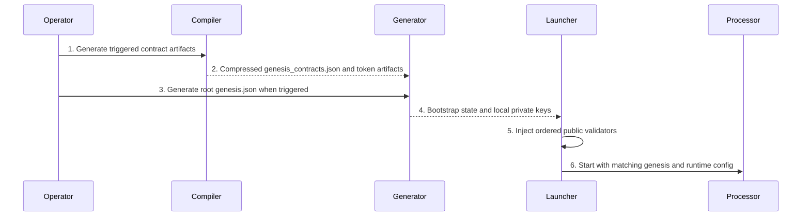

# Genesis Generation

> Internal developer documentation — repository-only. Not part of the published mdBook (SUMMARY.md).

> Updated: 2026-10-13. Status: Review.

## Overview

"Genesis" names three distinct generated artifacts. They have different producers, different triggers, and different consumers; never substitute one procedure for another. The trigger rules live in `AGENTS.md` (`Genesis Regeneration Boundary`) and [circuit-and-verifier-operations.md](circuit-and-verifier-operations.md) §6.1. This page is the operational how-to; those sections own when generation is authorized.

| Artifact | Producer | Consumer |
|---|---|---|
| Root `genesis.json` (network bootstrap state) | `make generate-genesis-data` in `psy-node` | Coordinator/Realm processors via `--genesis-data-path` |
| `psy-genesis/` contract artifacts (`genesis_contracts.json`, `genesis_abi/`, token artifacts) | `make gen-deploy-json` in `<workspace>/psy-compiler` | Node builds, SDK, services, contracts, DApp gitlinks |
| `validators` list inside root `genesis.json` | Devnet launcher P2P injection | Coordinator/Realm P2P validator registry |

## Background

The compiler produces contract definitions, while the node generator embeds those definitions into a network bootstrap snapshot. The launcher then adds public validator membership. `psy-genesis/config.json` is a separate network configuration input; `make gen-deploy-json` does not generate it (`<workspace>/psy-compiler/Makefile:208-255`). Keep these ownership boundaries explicit when debugging stale artifacts.



```text
compiler contract artifacts -> node bootstrap snapshot -> launcher validator injection -> processors
network config -------------> build-time constants and runtime membership validation
```

## Table of Contents

- [1. Root `genesis.json`](#1-root-genesisjson)
  - [1.1 Trigger](#11-trigger)
  - [1.2 Command](#12-command)
  - [1.2.1 Public bridge multisig account](#121-public-bridge-multisig-account)
  - [1.3 Outputs](#13-outputs)
  - [1.4 Verification](#14-verification)
- [2. `psy-genesis/` Repository Artifacts](#2-psy-genesis-repository-artifacts)
- [3. P2P Validator Injection into `genesis.json`](#3-p2p-validator-injection-into-genesisjson)
- [4. Guardians root](#4-guardians-root)
  - [4.1 Guardians-root inputs and identity](#41-guardians-root-inputs-and-identity)
  - [4.2 Outputs](#42-outputs)
  - [4.3 Trusted proxy config, anchors, and availability](#43-trusted-proxy-config-anchors-and-availability)
  - [4.4 Validation status](#44-validation-status)
- [5. Excluded Generation Tasks](#5-excluded-generation-tasks)
- [6. Failure Handling](#6-failure-handling)

## 1. Root `genesis.json`

### 1.1 Trigger

Run generation only when at least one of these changed ([circuit-and-verifier-operations.md](circuit-and-verifier-operations.md) §6.1):

1. `psy-genesis/genesis_contracts.json` content;
2. a Genesis construction input or default in `psy_cli/psy_dev_cli/src/subcommand/generate_genesis.rs` or its `generate_genesis/guardians_root.rs` branch;
3. the serialized `genesis.json` format or serializer;
4. an intentionally adopted `psy-genesis` gitlink whose changed content affects Genesis construction.

EndCap metadata, GUTA, cache, verifier JSON, fingerprint, and ordinary witness changes do not trigger it.

### 1.2 Command

When generation is authorized, supply both required public input files:

```bash
PSY_RELAYER_MULTISIG_ACCOUNT='<public-multisig-account-json>' \
PSY_MULTISIG_POLICY_ARTIFACT='<approved-policy-compiler-artifact-json>' \
make generate-genesis-data
```

The equivalent command from the repository root is:

```bash
./target/release/psy_dev_cli generate-genesis-data \
  --repo-root . \
  --relayer-multisig-account '<public-multisig-account-json>' \
  --multisig-policy-artifact '<approved-policy-compiler-artifact-json>'
```

Both flags are required and have no default. Relative input paths resolve against `--repo-root`. The Make target passes the public paths and strips secret-bearing legacy enrollment variables from the generator child environment; it does not change L1 custody in the parent process. The launcher requires these inputs only when it actually generates Genesis, not when reusing a verified existing snapshot. Sources: `Makefile:139-144`; `dev/locSetupV4.ts` (`planGenesisGeneration`); `psy_cli/psy_dev_cli/src/subcommand/generate_genesis.rs`. The `--guardians-root` branch of the same command is documented in §4.

### 1.2.1 Public bridge multisig account

Registration 2 (`user_id` 524288) is a public-only two-of-three multisig account. The input is a JSON object containing exactly `contract_id` and `initial_policy`; unknown or duplicate fields are rejected. `contract_id` must be 1. `initial_policy` contains exactly `version: 1`, `threshold: 2`, `member_count: 3`, and `member_hashes`, an array of eight strings using the existing `QHashOut` JSON encoding. The first three commitments must be nonzero and strictly increasing by canonical four-limb order; the remaining five must be zero padding. Supply commitments for the approved external signers, not addresses or private keys. Source: `psy_cli/psy_dev_cli/src/subcommand/generate_genesis.rs:198-225`; `client_prover/psy_vm/src/ups/multisig.rs`.

The separate compiler artifact contains the approved policy contract's current ABI 2.0.0 and exactly `get_policy` and `set_policy` circuit definitions, with declared state-tree height 4. The generator checks method identifiers, input/output counts, mutability, and the visible `header`/three-`members` ABI offsets, then derives the complete deployment and requires equality with Genesis contract 1 (`generate_genesis.rs:259-262`). This uses the existing ABI, not a new canonical layout root or nested Genesis metadata schema. The required supplied artifact is not compiled or regenerated by these commands.

The generator derives the account identity from the actual `MultisigSignatureCircuit` fingerprint and the initial public policy. It initializes contract 1 with header `[1, 2, 3, 0]` in slot 0 and the three member commitments in slots 1 through 3. Contract 0 slot 0 holds the configured nonzero canonical initial fee balance. The user nonce is zero, but the policy is already initialized: the first signed session uses the current initial policy, not pristine-account bootstrap. No relayer master secret is generated, decrypted, or exported.

L1 transaction keystores and passwords remain separate operator custody inputs; they do not select this L2 identity. Do not regenerate an existing chain to rotate members. Use a current-quorum-authorized policy replacement instead. Current quality assurance for public Genesis construction, initialized-state proofs, and startup is pending; the input contract does not establish that generated artifacts are ready for use.

### 1.3 Outputs

| Output | Handling |
|---|---|
| Root `genesis.json` | Network bootstrap state containing contract registrations, worker whitelist, validator list, and checkpoint stats. |
| Root `private_keys.json` | Dense registration-indexed array: entry 2 is JSON `null`; other validator/faucet entries retain their existing keys and positions. The file remains **secret**. Never package, upload, commit, paste, or publish it ([circuit-and-verifier-operations.md](circuit-and-verifier-operations.md) §13 and Security Considerations). |
| `psy-dapp/apps/bridge/src/config/faucetOperators.json` | Faucet operator config (`psy_cli/psy_dev_cli/src/subcommand/generate_genesis.rs`). Skip with `--skip-faucet-operators`. |

### 1.4 Verification

The following are required QA outcomes, not recorded passes for the current cutover. Generation and runtime execution remain subject to the pipeline gates.

1. The CLI exits 0; the three output files exist and are nonempty.
2. `genesis.json` is valid JSON and its `validators` list matches the intended set (see §3).
3. Node startup accepts it via `--genesis-data-path`.

## 2. `psy-genesis/` Repository Artifacts

`psy-genesis/genesis_contracts.json`, `genesis_abi/`, and the token artifacts are generated from a clean `psy-compiler` HEAD, not edited by hand:

```bash
cd <workspace>/psy-compiler
make gen-deploy-json
```

The compiler tree must be clean and exactly at the selected `R_compiler`. The user publishes that commit by SSH; if its reachability is already proven, do not publish it again. `make gen-deploy-json` reads `git rev-parse HEAD` and `git ls-tree` at that revision, so a dirty compiler or a later uncommitted lockfile change is not the stamp. Finalize the node pin and `Cargo.lock`, then generate. The target defaults `PSY_GENESIS` to `../psy-node/psy-genesis`, writes `genesis_contracts.json`, refreshes `genesis_abi/`, writes `.genesis_contracts.compiler-artifact.json`, and copies `token.json` and `token.update.json` there. The stamp must contain `compilerRevision`, `compilerSourcesHash`, and SHA-256/size for `genesis_contracts.json`, `token.json`, and `token.update.json`.

The node generator consumes the existing flat array of named deployments from `genesis_contracts.json`, not a nested layout wrapper. Names must be nonempty and unique; entry 1 must be `multisig_policy`. Its sibling `.genesis_contracts.compiler-artifact.json` is mandatory: the generator accepts the existing eight-field stamp, checks fixed-width lowercase identity strings, and verifies the raw bundle byte size and SHA-256 before decoding. The stamp must be a regular file of at most 65,536 bytes. This does not introduce a private-storage ABI export or a new bundle schema.

That command writes the node checkout only. It does not update sibling `../psy-genesis`, `../psy-sdk/psy-genesis`, `../psy-dapp/psy-genesis`, or `../psy-wallet/psy-genesis`. After review, the user publishes those bytes as `R_genesis`. Then check out that already-pushed SHA in every affected gitlink.

If `genesis_contracts.json` content changed, regenerate root `genesis.json` (§1) and check the `TOKEN_CONTRACT_STATE_TREE_HEIGHT` consequence per [token-privacy-circuit-fingerprints.md](token-privacy-circuit-fingerprints.md). A stamp or compiler-revision refresh alone does not authorize that regeneration.

## 3. P2P Validator Injection into `genesis.json`
Devnet core startup rewrites the `validators` list of the file passed as `--genesis-data-path` from the selected public-only runtime network config. Each Realm's ordered validator array is flattened into Genesis with `realm_id`, `validator_user_id`, `node_id`, and `bls_public_key`; sub-id is derived later as the one-based array position. The launcher pins `PSY_NETWORK` to the same config key selected by the node (`localhost` for `local-devnet`) and exports the generated config as `PSY_CONFIG_PATH`.

Local-devnet Genesis pre-places dedicated ZK validator accounts at registrations `0`, `1`, `3`, `4` for realms `0..1` (Strategy5 GROUP=1), and the initialized public multisig account at registration `2` with fixed Strategy5 `user_id` `524288`. Faucet sd-key operators occupy registrations `5..14`. The launcher binds each `(realm_id, sub_id)` to the reserved validator registrations and does not scan ordinary faucet or relayer users. Dense local-devnet Genesis currently covers validator realms `0..1` only.

`[finalize]` and `[[chains]]` retain their separate encrypted L1 keystore configuration. That keystore does not determine registration 2. See the public inputs in [§1.2.1](#121-public-bridge-multisig-account). This lane does not register a guardian daemon in the launcher.

The key generator writes P2P identity/BLS secrets and creates one distinct edge identity and public address for every requested edge index. Foreground public addresses use the requested host. Daemon startup writes a separate runtime config whose public addresses use Compose DNS service names; container listeners remain wildcard addresses. All of these addresses use the standard Realm P2P transport.

Genesis construction fails closed when a Realm exceeds the P2P validator cap (`MAX_VALIDATORS_PER_REALM = 64` in `psy_data/src/p2p/limits.rs`), a NodeId, BLS key, or validator user ID is duplicated, a public identity is invalid, or `validator_user_id` is outside the owning Realm's half-open user range. Processor startup also requires its local Ed25519 NodeId and BLS secret to match the configured public values exactly.

## 4. Guardians root

`generate-genesis-data --guardians-root PATH` is the only guardians-root entry. It verifies the supplied public inputs against the **existing** `genesis.json` named by `--genesis-out`, or `<repo-root>/genesis.json` when absent; relative paths resolve against `--repo-root`. It never calls `generate_local_devnet_genesis` and never writes `genesis.json`, `private_keys.json`, or `faucetOperators.json`. Without `--guardians-root`, the publish branch is unchanged and any guardians-root-only flag fails closed; with `--guardians-root`, the three guardians-root input flags are required (`psy_cli/psy_dev_cli/src/subcommand/generate_genesis.rs:181-187`; `psy_cli/psy_dev_cli/src/subcommand/generate_genesis/guardians_root.rs:69-188`).

Shared guardians-root code lives in the `psy_cli/guardian_common` crate (`lib.rs` declares `db`, `endcap`, `protocol`, `runtime`). The generator and `psy_relayer_cli` both consume it; it depends on neither binary.

### 4.1 Guardians-root inputs and identity

File inputs are resolved by the existing `read_public_input(repo_root, path)` convention; absolute paths stay absolute. No input contains a signing secret: the guardians-root branch never reads keystore contents, only their file metadata.

| Input | Required | Exact decoded rule |
|---|---|---|
| `--relayer-multisig-account` | yes (publish branch too) | Strict public account decoder (`generate_genesis.rs:198-225`): exactly `contract_id` and `initial_policy`; `contract_id` 1; policy `version` 1, `threshold` 2, `member_count` 3, eight `member_hashes` with the nonzero-sorted-first-three/zero-padding rules; unknown or duplicate fields rejected. |
| `--multisig-policy-artifact` | yes (publish branch too) | Existing compiler artifact checked against Genesis contract 1 by `validate_multisig_policy_artifact` (`guardians_root.rs:89-92`). |
| `--chains` | with `--guardians-root` | Canonical JSON array of `ChainAuthorization` (`psy_cli/guardian_common/src/protocol.rs:195-203`): `chain_index`, `chain_id`, `genesis_hash`, Bridge/StateManager proxies with code hashes, `deployment_block`, `token_mappings`. |
| `--l1-endpoints` | with `--guardians-root` | Canonical JSON array of `ChainEndpoint` (`protocol.rs:245`): `chain_index: u8`, `rpc_url: String`; exactly one endpoint per authorized chain index, no duplicates (`guardians_root.rs:357-376`); credential-free `https` or loopback `http` (`guardians_root.rs:497-514`). |
| `--approved-contracts` | with `--guardians-root` | Canonical JSON array of `ApprovedContract` (`protocol.rs:156-161`): `contract_id`, `contract_leaf_json`, `compiler_artifact_json`, `compiler_artifact_sha256`. The two JSON fields are JSON strings, not paths or nested objects. |
| `--max-fee` | optional | `u64` fee cap, default `2000000000` (`generate_genesis.rs:45`); must be at least the compiled `GUTA_FEE + DA_FEE` floor (`guardians_root.rs:349-355`). `guta_fee` and `da_fee` are compiled constants recorded in the authorization, not guardians-root overrides. |

Canonical decoding rejects duplicate and unknown keys through the shared `JsonText`/`parse_canonical_json` decoder (`guardians_root.rs:756-766`; `guardian_common/src/protocol.rs:115-122`).

Identity is checked end to end before any output exists. Construct `MultisigSignatureCircuit`, derive its fingerprint, locate user `524288` through the Strategy5 registration mapping, and require it to sit at registration 2; require the genesis user's fingerprint, public-key parameter, contract-1 header `[1, 2, 3, 0]` and three member slots to match the supplied account (`guardians_root.rs:206-294`). Compiled network dimensions must equal the local-devnet builder's (`guardians_root.rs:297-325`). Checkpoint 0 is recomputed offline with the node-side `parth_core::pgoldilocks::PoseidonHasher` through `GenesisDatabaseDataBuilder` (`setup_contracts`, `setup_users`, `setup_validators` with `psy_config::PSY_NETWORK_MAGIC`, populated leaf `qfhash`), then converted to the client 32-byte genesis identity (`guardians_root.rs:329-347`).

### 4.2 Outputs

The guardians-root branch writes exactly four paths under `--guardians-root` and replaces nothing:

```text
config.json                      public guardian root (schema below)
authorization/versions/1.json    canonical GuardianAuthorization, version 1
authorization/index.json         index { active_version: 1, versions: [{ version: 1, sha256 }] }
archive/relayer-journal/         empty directory reserved for the relayer journal
```

The index hashes the exact written authorization bytes. Files are effective-uid-owned `0600`, directories `0700`, protected ancestors are walked `openat`/`O_NOFOLLOW`, and every file's parent directory is synced. A collision with existing output — including a retained partial output from a failed run — fails closed; a rerun never overwrites it (`guardians_root.rs:569-614,725-746`).

The embedded network is the typed `NetworkConfigGoldilocks` projection of `<repo-root>/psy-genesis/config.json`, loaded at the compiled stage (not the file's default stage), keeping the configured `prove_proxy_url` and re-materializing `system_prove_proxy_url` even when empty (`guardians_root.rs:413-446`). Proxy bounds and fingerprint checks are in [§4.3](#43-trusted-proxy-config-anchors-and-availability).

The serialized schema (`psy_cli/guardian_common/src/protocol.rs:205-226`) is all-required, holds no secret bytes and no database path:

```rust
pub struct GuardianConfig {
    pub network: psy_config::NetworkConfigGoldilocks,
    pub guardians: BTreeMap<u8, GuardianSignerConfig>,
    pub client: GuardianClientConfig,
}
pub struct GuardianSignerConfig {
    pub listen_address: SocketAddr,
    pub signing_key_secret_path: PathBuf,
    pub signing_key_password_secret_path: PathBuf,
}
pub struct GuardianClientConfig {
    pub endpoints: [String; 3],
    pub archive_path: PathBuf,
    pub listen_address: SocketAddr,
    pub l1_endpoints: Vec<ChainEndpoint>,
}
```

`guardians` has exactly JSON keys `"1"`, `"2"`, `"3"`; alternate numeric spellings and duplicates fail (`guardian_common/src/runtime.rs:153-162`). The guardians-root branch fixes guardian listeners `127.0.0.1:15441` through `15443`, matching `client.endpoints` HTTP origins in id order, `client.listen_address` `127.0.0.1:15450`, and `archive_path` `archive/relayer-journal` (`guardians_root.rs:61-65,141-145,448-454`). Guardian endpoint validation requires scheme `http`, a host, no credentials, query, fragment, or path; there is no loopback restriction (`guardians_root.rs:481-495`). The L1 endpoint policy is independent: credential-free `https` or loopback `http` (`guardians_root.rs:497-514`).

The two secret paths per guardian are absolute `<home>/.psy/keystore/guardian-<id>.keystore.json` and `<home>/.psy/keystore/guardian-<id>.password`. The guardians-root branch walks their metadata without following symlinks and never opens the files: each must already exist as an effective-uid regular file in mode `0600` (`guardians_root.rs:472-548`). Guardian-service alone reads their contents.

### 4.3 Trusted proxy config, anchors, and availability

Provenance: user rulings `trusted_guardian_proxy`, `trusted_guardian_proxy_config`, `trusted_guardian_proxy_anchors`, and `trusted_guardian_proxy_availability` (2026-10-13). Implemented. The earlier design-only and no-separate-pinning statements are withdrawn.

`prove_proxy_url` remains `Vec<String>` on `NetworkConfigGoldilocks` (`client_prover/psy_core/psy_config/src/lib.rs:69`). `load_network_projection` keeps the compiled-stage projection, including that vector (`guardians_root.rs:413-426`). `load_network` accepts 1 to 8 URLs and rejects an empty, blank, or invalid URL (`runtime.rs:239-257`). With a recorded EndCap fingerprint, `WalletSession::new_with_provider` applies the same bound, builds one `ProveProxyRpcProvider` per URL, and refuses the local `PsyUPSStepCircuitManager` fallback (`session.rs:2527-2559`). A construction error fails that startup closed.

`GuardianAuthorization.endcap_verifier_fingerprint` is a nonzero `Hash4` (`protocol.rs:184-188`). `validate` rejects zero and checks the recorded `multisig_fingerprint` against the account key (`protocol.rs:434-449`). `build_authorization` writes both (`guardians_root.rs:379-411`). `AuthorizationArchive` and `validate_update` are unchanged: a fingerprint change is a new version, and old versions cannot be replaced (`protocol.rs:472-500`).

Enrollment uses the recorded fingerprint. `enroll_guardian_account` calls `register_recorded_multisig_user` and requires the returned fingerprint and account key to match (`service.rs:220-225,272-283`; `memory_wallet.rs:628-640`). It does not construct `MultisigSignatureCircuit`. The unchanged `register_multisig_user` path still builds that circuit (`memory_wallet.rs:612-626`).

The proxy supplies method definitions, fingerprints, and verifier metadata only. It returns neither a guardian signature nor a proof verdict. For every configured manager, startup and `verify_session` call `ups_end_cap_circuit_verifier_config`, fingerprint the returned `VerifierOnly` data with `get_circuit_fingerprint_generic`, and require `endcap_verifier_fingerprint` (`session.rs:2560-2566`; `verify.rs:464-490`). A mismatch fails closed. EndCap proof verification and checkpoint, state, policy, nonce, trace, signing, and journal checks stay local.

Negative checks: there is no pin file, proxy-signature approval, or guardian local-proving fallback. The guardians-root branch does not clear `prove_proxy_url`. Guardian enrollment does not construct `MultisigSignatureCircuit`. Old authorization versions are not rewritten.

Implemented in `psy_cli/guardian_common/src/protocol.rs`, `psy_cli/guardian_common/src/runtime.rs`, `psy_cli/psy_dev_cli/src/subcommand/generate_genesis/guardians_root.rs`, `psy_cli/psy_relayer_cli/src/guardian/service.rs`, `psy_cli/psy_relayer_cli/src/guardian/verify.rs`, `client_prover/psy_prover/src/session/session.rs`, and `client_prover/psy_prover/src/wallet/memory_wallet.rs`.

### 4.4 Validation status

Release build of `psy_relayer_cli` and `psy_dev_cli` completed. Recorded release results:

```text
cargo test -p guardian_common --release --lib
30 passed, 2 ignored
cargo test -p psy_relayer_cli --release --lib guardian::
16 passed, 2 ignored
cd dev && bun test locSetupV4.test.ts
97 passed
```

The running release stack enabled the new proxy path. All four HTTP checks returned 200: guardians 1, 2, and 3, then the relayer. Guardians started together at 10:32:23 UTC and were ready before the relayer's first log at 10:35:39 UTC, about 195 seconds. That interval is not a one-minute result, and the contradictory 95 ms bound is rejected. After ready, guardian RSS was 1,428,784 / 1,400,296 / 1,400,032 KiB, with peaks 1,832,112 / 1,855,628 / 1,851,436 KiB and swap 0. The prior local-construction baseline was 15,688,444 / 16,442,988 / 16,084,444 KiB.

First-signature timing, quorum, and whole-flow E2E are NOT VERIFIED. `psy_cli/psy_relayer_cli/tests/guardian_acceptance.rs` remains ignored. Separately, Envio discovery of the existing deposit failed, so the funds flow has not reached guardian signing. Envio schema reset remains unapproved and was not run. Rotation approval remains an unresolved finding, not a guardians-root requirement.

## 5. Excluded Generation Tasks

| Task | Owner |
|---|---|
| Regenerate `cached_circuit_library.rs` / `cached_common_data.rs` | [circuit-and-verifier-operations.md](circuit-and-verifier-operations.md) §5.1 |
| Regenerate EndCap verifier JSON | [circuit-and-verifier-operations.md](circuit-and-verifier-operations.md) §4 |
| Regenerate `local_circuits.json` | `make generate-local-circuits` (`Makefile:120-121`) |
| Regenerate token fingerprints in precompiles | [token-privacy-circuit-fingerprints.md](token-privacy-circuit-fingerprints.md) |
| Regenerate Groth16 keystores | `Makefile:133-137` |

## 6. Failure Handling

| Failure | Response |
|---|---|
| `make generate-genesis-data` fails | Do not ship the partial `genesis.json`; fix the generator input and rerun |
| Missing `PSY_RELAYER_MULTISIG_ACCOUNT` or `PSY_MULTISIG_POLICY_ARTIFACT`, or an invalid public account/artifact | Fail closed. Supply both readable public files; do not fall back to a keystore, plaintext key, or `deterministic_private_key(2)`. |
| Relayer cannot authorize user `524288` | Registration 2 was not initialized from the approved public account and policy artifact. Regenerate Genesis from those inputs on a new chain; do not paste a plaintext key into daemon config. |
| `validators` entries differ from the selected runtime membership | Core startup injects the selected ordered validators; component-only startup does not rewrite them. Diagnose configuration drift before the next authorized core startup. |
| Provenance mismatch in `psy-genesis` stamp | Rebuild `make gen-deploy-json` from the committed clean compiler revision after its node pin and lockfile are final; never hand-edit provenance JSON |
| `private_keys.json` leaked | Treat as secret compromise; rotate and remove from every distribution channel |
| Guardians-root flag without `--guardians-root`, or a missing guardians-root flag with it | Fail closed (`guardians_root.rs:167-188`). Run the flag sets as disjoint branches. |
| Guardians-root output collision or retained partial output | The rerun refuses to overwrite; resolve the retained output manually after review (`guardians_root.rs:725-732`). |
| `guardian-service` meets an empty journal file | `JournalUnavailable`; the operator handles the file manually — the service never deletes or reinitializes it (`service.rs:245-261`). |

## Security Considerations

Preserve matching source revisions, configuration, and generated artifact cohorts. Never publish root `private_keys.json` or validator/faucet secrets. Generation does not authorize deployment or publication. Treat fingerprint, provenance, and membership mismatches as failures rather than bypassing verification. The guardians-root branch writes public configuration only; guardian keystore contents are read exclusively by `guardian-service` through protected file descriptors.

## Related Documents

- [Circuit and verifier operations](circuit-and-verifier-operations.md)
- [Devnet launcher reference](devnet-launcher-reference.md)
- [Devnet lifecycle](devnet_lifecycle.md)
- [Fn circuit fingerprint playbook](fn-circuit-fingerprint-playbook.md)
- [Realm p2p validators](realm-p2p-validators.md)
- [Token privacy circuit fingerprints](token-privacy-circuit-fingerprints.md)
