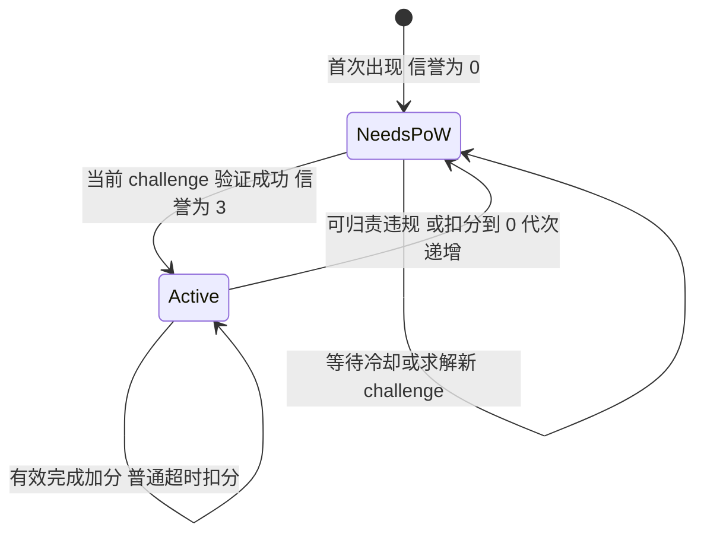

# Worker PoW 接入与信誉恢复设计

状态：设计与分阶段实现，2026 年 10 月 26 日。本文规定完整目标行为；当前实现进度见下节。

Worker 从目标 realm 或 coordinator 的 edge 领取 PoW challenge，完成计算后取得基础信誉和有限的任务领取权限。可归责的违规使信誉归零并撤销当前接入资格；恢复必须完成处罚后签发的新 challenge。有效任务逐步提高信誉和并发额度。

PoW 提高创建身份和恢复身份的成本。ZK 验证继续保证证明正确性，任务租约限制占用时间，并发额度限制单个身份造成的损害。Edge 及其共享状态存储属于可信的调度基础设施；本方案不防御已被攻陷的 edge。

## 实现进度

接手工作请先阅读 [任务交接记录](./WorkerAdmissionPoWHandoff.md)，其中包含工作区状态、已完成范围、历史验证结果和第二阶段实施入口。

[第一阶段模块与使用说明](../../../psy_worker_admission/README.md)已提供固定编码、请求签名、PoW 求解与验证、Redis 原子 challenge 与接入状态、内部处罚与恢复状态机、五个接入 RPC，以及独立客户端验证工具。Realm 与 coordinator 的 edge 均已接入可选模块，默认关闭，只允许 observe 模式。

2026 年 11 月 3 日加入第二阶段的租约状态机库（`lease.rs`）：预约、租约附着、单一验证位置、最终接受与加分、主动超时回收、基础设施失败释放、可归责处罚和 outbox，全部经过同一个 Redis 多记录事务脚本，并有真实 Redis 测试。它尚未接入任何 handler、NATS 或 RPC。

这一阶段使用独立的影子信誉，不替换原有任务领取和提交规则。响应显式返回 `task_enforcement: false`，配置 enforce 会拒绝启动。任务预约、租约、主动超时记账、proof 发布 outbox、worker 自动恢复及正式持久性部署检查仍待后续阶段完成；当前代码不能被当成已启用恶意 worker 防护。

## 现有代码与需要调整的行为

以下是本仓库当前源码的行为，不代表线上部署版本。

| 位置 | 当前行为 | 拟调整 |
| --- | --- | --- |
| [信誉读取](../../../psy_node_core/src/psy_temp_db/v3_implementation/core.rs) | 无记录或记录长度不足时返回初始信誉 5 | 新身份返回未接入；损坏记录报错，禁止领取任务 |
| [信誉更新](../../../psy_node_common/src/reputation/worker_reputation_ops.rs) | 按时提交加 1，超过 5 分钟或 tag 不匹配扣 5；先读再写 | 原子处理完成、超时与处罚；按任务去重并校验接入代次 |
| [Realm worker handler](../../../psy_node_common/src/realm/edge/worker_handler.rs) 与 [Coordinator worker handler](../../../psy_node_common/src/coordinator/edge/worker_handler.rs) | 领取检查信誉大于 0；提交入口主要检查签名和请求类型 | 领取、提交与最终接受都检查身份、接入代次及租约 |
| Realm 的两个领取接口 | 带 child proofs 的接口记录 claim；不带 child proofs 的接口没有相同的完整 claim 写入流程 | 所有对外领取入口共用同一个租约流程 |
| [签名请求](../../../parth_core/src/crypto/secp256k1/timed_request.rs) | 请求包含 target、类型、有效期、nonce、tag；构造器将 target 和 nonce 设为 0 | 新协议签名绑定网络、作用域、代次、方法和完整参数摘要；实际执行有效期检查 |
| [NATS worker 队列](../../../psy_node_nats/src/psy_queue.rs) | 默认 ACK wait 为 30 秒，信誉完成期限为 300 秒 | 区分消息重投与任务超时，统一租约与消息保活 |
| [NATS 完成回执](../../../psy_node_nats/src/queue.rs) | 根据 job 保存和读取可被后续投递覆盖的 ACK reply | 回执绑定具体投递，只有持久接受的结果可以触发完成 ACK |
| [临时 KV 接口](../../../psy_node_core/src/store/traits/temp_db.rs) | 提供普通读写，不提供这些业务操作所需的条件事务 | 新增原子 admission store，不能用普通 get 加 put 模拟 |

## 作用域与接入代次

接入状态按以下作用域隔离：

```text
AdmissionScope = network_id + admission_epoch + node_type + realm_id + realm_sub_id
WorkerIdentity = AdmissionScope + compressed_secp256k1_public_key
```

`network_id` 是可信配置提供的 32 字节网络标识，必须区分不同创世配置和测试网络。`node_type` 沿用现有值：realm 为 1，coordinator 为 2。`realm_id` 为 u32，`realm_sub_id` 为 u16。不能使用 edge URL 作为作用域，否则切换 URL 会改变身份。

`admission_epoch` 是所有同域 edge 一致配置的 32 字节随机值，正常重启不变。状态存储发生回滚、丢失或无法确认连续性时，先停止接入，再统一更换 epoch，使旧 challenge、旧请求和旧资格失效。它不改变链状态或创世配置。

第一版每个 realm 和 coordinator 分别完成 PoW、积累信誉；同域多个 edge 共用状态。跨域不共享恢复凭证，也不自动传播处罚。攻击者换域仍须支付该域的接入成本。

每个身份有单调递增的 `generation`。首次接入从 0 开始，信誉归零时递增；恢复在当前 generation 内完成。旧 generation 的任务结果和处罚事件不能修改新 generation 的信誉。递增溢出时报错并停止该身份接入，不能回绕。

## 状态与信誉规则



`NeedsPoW` 和 `Active` 是显式状态，不能只凭一个正整数判断接入。冷却用 `cooldown_until_ms` 表示，不新增第三种资格状态。

以下参数为第一版建议初值，部署前根据基准测试调整：

| 事件或信誉 | 行为 |
| --- | --- |
| 首次出现 | `NeedsPoW`，信誉 0，任务并发 0 |
| PoW 接入或恢复成功 | `Active`，信誉设为 3；不能叠加到已有信誉上 |
| 有效且按时完成一个独立任务 | 加 1，上限 10；同一任务只记一次 |
| 普通租约超时 | 扣 1、释放任务；扣到 0 时撤销资格并递增 generation |
| 当前租约下提交可归责的无效证明或篡改参数 | 立即归零并递增 generation |
| 信誉 1 至 3 | 最多 1 个未完成任务 |
| 信誉 4 至 6 | 最多 2 个未完成任务 |
| 信誉 7 至 10 | 最多 4 个未完成任务 |

并发上限约束同一个身份在全部同域 edge 上的总占用量，包括准备返回任务的预约和正在验证的提交。客户端声明线程数不能突破上限。信誉下降导致额度减少时，暂时停止新领取；已有有效租约按原期限处理，归零则全部撤销。

PoW 只开放 `NeedsPoW` 身份恢复；`Active` 身份不能通过反复提交 PoW 刷分或补偿普通扣分。正常切换 edge、断线重连和进程重启不重新做 PoW。

### 处罚归责

| 情况 | 处理 |
| --- | --- |
| 当前领取者用有效签名提交、绑定当前租约，ZK 验证确定失败 | 当前身份归零，记录证据摘要 |
| 当前领取者签名绑定的 tag 与其当前租约中的原始 tag 不同 | 当前身份归零 |
| 网络超时、没有提交、worker 崩溃 | 租约到期后扣 1，不推断其主观恶意 |
| 租约已过期、任务已重新分配或 generation 已改变 | 返回 stale，不重复扣分 |
| 无签名、签名无效、冒用别人的租约 | 拒绝和限流，不处罚被冒用的公钥 |
| 重复提交已接受的相同结果 | 返回原回执，不重复加分、发奖或处罚 |
| 内部存储错误、依赖证明缺失、验证进程异常或服务超时 | 服务故障；不把内部异常计为 worker 无效证明 |

不能沿用“所有 tag 不匹配都扣分”的判断。处罚证据必须包含被签名的请求摘要、身份、generation、任务实例、lease_id、证明摘要和具体失败类别。一次违规事务使用唯一 event_id，重试只返回原结果。

验证器版本升级和大面积同类错误时，应暂停该类别自动处罚并告警；已经接受的有效证明和链上奖励不因之后的信誉处罚被追溯撤销。

## Challenge 协议

第一版使用 SHA256，worker 搜索 nonce，edge 用一次摘要计算检查结果。采用服务端随机 challenge，参考 [Hashcash 的交互式成本函数](https://cdn.nakamotoinstitute.org/docs/hashcash.pdf)。

### 固定编码

摘要输入使用固定字节编码，不对 JSON 文本直接哈希。下面的字符串按 ASCII 原样写入，并以一个 NUL 字节结束；所有整数为无符号小端编码。

```text
challenge_header =
    "psy-worker-admission-challenge-v1\0"
    || protocol_version:u16         // 固定 1
    || algorithm:u8                 // 固定 1 表示 SHA256
    || network_id:[u8;32]
    || admission_epoch:[u8;32]
    || node_type:u8                 // realm=1 coordinator=2
    || realm_id:u32
    || realm_sub_id:u16
    || worker_public_key:[u8;33]
    || generation:u64
    || policy_version:u32
    || issued_at_ms:u64
    || expires_at_ms:u64
    || difficulty_bits:u16
    || random:[u8;32]

challenge_id = SHA256(challenge_header)
pow_hash = SHA256("psy-worker-admission-solution-v1\0" || challenge_id || nonce:[u8;16])
valid = leading_zero_bits(pow_hash) >= difficulty_bits
```

`random` 使用密码学安全随机源。nonce 是 128 位小端搜索空间，JSON 中传输为固定 16 字节的十六进制字符串。所有字节数组固定长度校验，u64 在 JSON 中使用十进制字符串，避免 JavaScript 数字精度丢失。证明任务 ID 继续采用项目的规范序列化。

服务端保存 header，提交只引用 `challenge_id`，不接受客户端提供的难度、有效期或恢复分数。Header 的所有字段经 challenge_id 一起绑定到求解结果。HTTPS 和可信 endpoint 配置保护 worker 获取的参数。

### 签发和消费

1. 领取 challenge 要求公钥所有权签名，通过请求限流后才创建状态记录。信誉 0 允许调用；未结束的冷却期返回重试时间。
2. 同一身份、generation 只保存一份待解 challenge。有效期内重复领取返回同一份，不能通过并发签发积攒多份凭证。默认有效期建议 10 分钟，按实测求解尾延迟调整。
3. 提交绑定 challenge_id 和 nonce 的签名。检查身份、作用域、epoch、有效期和 PoW；无效 nonce 不消费 challenge，也不触发信誉处罚，但计入提交限流。
4. 原子操作再次检查 generation、待解 challenge_id、冷却和服务器时间，再清除待解 challenge，将状态改为 Active，信誉设为 3，并保存成功回执。这个原子操作是资格生效的时刻。
5. 同一成功提交因响应丢失而重试，返回原回执并附带当前状态；不能再次恢复信誉。若之后被处罚，旧回执也不能恢复资格。

过期 challenge 仅删除待解内容，不删除已接入或受处罚身份的 generation 和违规历史。撤销资格必须同时清除待解 challenge。服务器按 `now >= expires_at_ms` 判断过期，不信任客户端时间。涉及授权和租约的最终时间判断统一使用权威 store 的服务端时间，不能让各 edge 的时钟差异改变结果。

### 难度和冷却

难度为 d 时，预期尝试次数为 `2^d`；若某台机器每秒能执行 H 次完整 PoW 摘要计算，平均时间约为 `2^d / H`。增加 1 bit 大致使预期工作翻倍。实际求解时间随机，99% 完成时间约为平均时间的 4.6 倍；不能把平均一分钟写成保证一分钟完成。

以真实 worker 的 CPU 和可用 GPU 进行基准，测量完整的候选 nonce 计算循环。初始目标可取参考 CPU 平均 30 至 60 秒，再根据攻击成本和接入体验决定 base_bits；生产配置未显式设置 base_bits 时拒绝启动强制模式。不能依据 worker 自报算力降低难度。

同一公钥因可归责违规被撤销的次数为 n 时，可使用 `base_bits + min(n, 3)`，同时受运维配置的 max_bits 约束。建议首次违规冷却 60 秒，后续指数增加并封顶 1 小时。普通超时扣到 0 可只使用基础难度和较短冷却，不计入恶意违规次数。Challenge 签发时固定策略版本与难度；正常调整不改变有效 challenge，紧急撤销需显式作废。

SHA256 可被 GPU 和专用硬件加速，因此这些时长只描述参考硬件。第一版以简单、便宜的验证为目标；若实测防护成本不足，再评估内存密集型算法及其服务端验证开销。

## Edge 接口与请求签名

以下为拟新增的 JSON RPC 接口，沿用 `psy_worker` namespace。

| 方法 | 请求主要字段 | 响应主要字段 |
| --- | --- | --- |
| `psy_worker_get_admission_info` | 无，公开只读并限流 | 协议能力、完整 scope、模式、算法和策略版本 |
| `psy_worker_get_admission_status` | 公钥、签名请求 | scope、epoch、status、generation、reputation、max_inflight、inflight、cooldown_until_ms、policy_version |
| `psy_worker_get_pow_challenge` | 公钥、签名请求 | 完整 header、challenge_id、重试信息 |
| `psy_worker_submit_pow` | challenge_id、nonce、签名请求 | activation_receipt_id、当前状态、generation、reputation、max_inflight |
| `psy_worker_get_request_status` | 原 request_id、新签名请求 | 原请求摘要、进行状态或回执，以及当前资格是否仍有效 |

客户端先从可信 HTTPS endpoint 获取 admission_info，再签名查询自身状态。状态查询不会创建身份记录，其 expected_generation 字段填 0 并仅作查询占位，不执行代次前置比较；所有改变资格或任务状态的方法必须比较真实 generation。请求回执只能查询签名者自己的记录。

新增版本化的任务方法 `psy_worker_get_proving_work_v2`、`psy_worker_get_proving_work_with_child_proofs_v2` 和 `psy_worker_submit_proof_raw_v2`，避免悄悄改变现有 canonical response 编码。两个领取方法必须调用同一租约实现，区别仅为是否附带 child proofs。

V2 领取响应包装原任务响应，并增加 `generation`、`lease_id`、`lease_version`、`lease_expires_at_ms`、`request_id`。提交显式携带完整任务实例标识、lease 信息和证明摘要，不再依赖按 job_id 向历史 pending_id 回看并猜测任务实例。

所有新请求签名使用独立版本的固定编码 envelope，包含：

```text
domain = "psy-worker-rpc-v2\0"
scope + public_key + method_id + request_id:[u8;16]
+ issued_at_ms + valid_until_ms + expected_generation + payload_hash:[u8;32]
```

`payload_hash` 是该方法参数的规范编码摘要。PoW 提交绑定 challenge_id 和 nonce；任务领取绑定领取选项和 reward tag；证明提交绑定 unique_pending_id、unique_proc_id、job_id、lease_id、lease_version、generation、tag 和 proof_hash。Edge 实际计算 proof_hash 并比较后才允许处罚归责。不能只签一个时间戳，再接受任意外部 job 或证明参数。

服务端校验签名公钥、实际方法、完整作用域、有效期与最大允许时钟偏差。建议请求有效窗口 60 秒、未来时钟容忍 30 秒，PoW 求解完成后再签提交请求。重复 request_id 且摘要相同返回同一结果，摘要不同返回冲突。同一领取请求的重试不能再取走一个新任务。

请求过期后不执行新动作；已成功的操作可用新签名查询状态或任务回执。短期请求去重缓存只需覆盖最大请求有效期及偏差，但 challenge 消费和任务结算状态的有效性不能依赖短期缓存。

### 错误分类

返回稳定业务错误类别和结构化 data，worker 不解析错误字符串：

| 类别 | Worker 行为 |
| --- | --- |
| `POW_REQUIRED` | 停止该作用域的新领取，进入恢复流程 |
| `POW_COOLDOWN` 或 `RATE_LIMITED` | 按 retry_after_ms 退避，加随机抖动 |
| `CHALLENGE_EXPIRED` 或 `CHALLENGE_STALE` | 刷新状态，领取当前 challenge |
| `INVALID_POW` | 检查本地计算后继续求解，不循环盲目提交 |
| `ADMISSION_STALE` | 刷新 epoch 和 generation，取消旧代次任务 |
| `INFLIGHT_LIMIT` 或 `PROBATION_CAPACITY` | 等待已有任务或低信誉池额度释放 |
| `LEASE_STALE` | 丢弃该旧任务，不计为服务不可达 |
| `NO_WORK` | 按正常空闲轮询处理 |
| `ADMISSION_STORE_UNAVAILABLE` | 停止领取与新资格生效，稍后重试，不绕过接入检查 |
| `UNSUPPORTED_PROTOCOL` | 提示升级，不降级到可绕过 PoW 的旧接口 |

## 原子存储与多个 edge

### 权威状态

新增 `WorkerAdmissionStore` 业务接口，提供以下原子操作，而不是暴露一个任意 set_reputation：

```text
get_status
get_or_issue_challenge
activate_from_pow
reserve_claim_request
attach_job_lease
begin_verification
accept_verified_result
apply_attributable_violation
expire_lease
cancel_infrastructure_failed_claim
```

资格、challenge、任务预约、租约、结算去重和待发布事件必须由同一个有原子能力的权威 store 管理。第一版建议在现有 Redis 支持基础上新增专用 admission 存储实现，使用短 Lua 脚本完成条件更新；Scylla 继续承载现有链和证明数据。若部署未提供符合要求的 admission store，则不能启用强制模式，不能降级为普通 KV 或各 edge 自己的内存锁。

Redis 的[脚本执行具有原子性](https://redis.io/docs/latest/develop/programmability/eval-intro/)。脚本只进行有上限的状态检查和更新，PoW 和 ZK 计算在脚本外执行。所有类型、版本和输入检查须在写入前完成，不能把脚本原子执行理解为发生运行错误后会自动回滚。u64 代次及版本使用精确的二进制或字符串比较和条件替换，不能转为 Lua double 后增减。

同一 scope 下需要共同更新的 worker、job、额度计数和 outbox keys 放在相同 Redis hash slot，例如 `admission:{scope_hash}:worker:<public_key>`。Redis Cluster 的[多 key 约束和 hash tag 规则](https://redis.io/docs/latest/operate/oss_and_stack/reference/cluster-spec/)要求它们同槽。第一版按 scope 分片，需监控大 realm 的单槽负载。

```text
WorkerAdmissionRecord
  schema_version, generation, status, reputation
  attributable_violation_count, cooldown_until_ms
  pending_challenge, last_activation_receipt
  inflight_reservations, revision

JobLeaseRecord
  scope, unique_pending_id, unique_proc_id, job_id
  lease_id, lease_version, owner_public_key, owner_generation
  reward_tag, metadata_digest, witness_digest, expected_inputs_digest
  claimed_at_ms, hard_deadline_ms, verification_deadline_ms
  state, submission_digest, accepted_receipt, delivery_receipt
```

已接入或受处罚的身份状态不跟随 checkpoint 清理，不给信誉和 generation 设置 TTL；短期请求、过期 challenge 内容和完成任务明细可按保留策略回收。仅领取过 challenge、从未激活且无处罚的临时身份可在 challenge 和请求窗口过期后整体删除，避免免费公钥记录永久增长；重新签发使用新的随机数，旧 challenge 不能复用。旧 checkpoint 已结束后，也必须由 checkpoint 终态或持久完成索引拒绝重新结算，不能因去重记录 GC 又加一次分。

### 处罚与恢复竞争

归零操作在同一事务中检查当前 generation 和事件是否已处理，设置信誉 0、NeedsPoW、递增 generation、清除 pending challenge、记录处罚与租约撤销事件。同域 edge 的后续授权直接读取权威状态，不能用正向资格缓存继续发任务。

已经发出的租约因为 owner_generation 不再匹配而立即失去提交资格。后台逐步回收它们的队列投递和资源计数；旧代次仍占用的全局资源在实际回收前不能提前腾空，也不能因 worker 恢复被重新计入新代次可提交任务。

如果处罚先提交，PoW 恢复的条件比较失败；如果恢复先提交且随后发生一条适用于当前代次的有效处罚，则仍然归零。旧代次的处罚回调、超时任务或加分回调全部只能返回 stale。重复违规 event_id 不再次递增 generation 或延长冷却。

### 持久性和故障

Admission 是权限数据，不能使用无持久化的缓存实例或启用可驱逐这些 keys 的策略。Redis 的 [AOF 和 RDB](https://redis.io/docs/latest/operate/oss_and_stack/management/persistence/)有不同的数据丢失窗口，部署时必须明确持久化和故障转移语义；原子更新本身不保证故障后不丢已确认处罚。

第一版使用受控单写主节点，禁止在无法证明状态连续性时透明切换到可能落后的副本。故障期间拒绝新领取和恢复，不因数据库错误返回初始信誉。恢复已确认连续的持久状态后可继续；若恢复了旧备份或状态缺失，则暂停全域、统一轮换 admission_epoch、使 worker 重新接入，并对照证明持久完成记录处理旧任务。不能直接把已接受结果重新作为未完成任务发出。

## 任务租约与 NATS 重投

### 领取流程

1. 校验新协议签名、generation 和资格，按 request_id 原子预约一个额度。相同请求重试复用预约，不能重复消耗额度。
2. 获取队列消息并加载依赖和 witness；失败时幂等释放预约，不扣 worker 分。Edge 崩溃留下的预约有短期限并可被其他 edge 清理。
3. 原子创建当前任务实例的唯一有效 lease，同时绑定 worker、generation、reward tag 和任务摘要。期间被处罚则领取失败，队列消息必须可重投。
4. 保存可重建的领取回执后返回响应。响应丢失时，同 request_id 重试返回同一 lease 和任务，而非再领一个。

任务实例必须同时包含 scope、unique_pending_id、unique_proc_id 和规范 job_id；不能把不同 checkpoint 中的相同 job_id 当成同一个任务。重复消息遇到已有有效 lease 时不能覆盖其 owner、tag 或 lease_version。

### 到期与重投

`hard_deadline_ms` 由服务端按 circuit 类别和实测耗时设置，领取时固定。普通任务可先参考现有 300 秒，长耗时电路单独设置；所有阈值上线前须覆盖正常 worker 的尾延迟。Worker 心跳不能无限延长硬期限。

消息的 ACK wait 是传输层重投计时，不能直接作为信誉超时依据。Edge 或共享 reconciler 可以在有效租约期间发送 NATS progress ACK，间隔小于 ACK wait；若已发生提前重投，查到有效 lease 后延迟重投该消息，不创建新租约也不处罚 worker。NATS 的 [ACK 和重投机制](https://docs.nats.io/learn/jetstream/acknowledgment)仍需在真实故障场景下验证。

租约硬期限到达后，`expire_lease` 以 lease_id、lease_version 和 generation 条件更新，只扣一次分并允许重新领取。即使 worker 永远不提交，也会触发这条路径。服务整体故障导致的超时使用有范围的故障豁免或暂停自动扣分，不批量误罚。

任务重分配时增加 lease_version 并产生新 lease_id。旧 worker 的迟到提交返回 LEASE_STALE；不能拿旧 tag 与新租约的 tag 比较后处罚旧 worker。

### 提交与最终接受

1. 先限制请求体大小和并发，验证签名覆盖的参数摘要；检查提交者就是租约领取者、generation 有效、tag 与该租约一致。无 claim 或无有效 lease 直接拒绝，不回退到当前 pending_id。
2. 在硬期限内原子进入 Verifying，固定 submission_digest；每个 lease 只允许一个验证占用。相同提交共享进度，不并行启动多次昂贵验证。及时到达并被服务端接受验证的提交，不因验证排队而算 worker 超时。
3. 设置服务端固定 verification_deadline；验证超时或内部异常按基础设施故障恢复或回收任务，不触发 worker 无效证明处罚。验证资源用全域和每身份信号量限制，等待资源的时间不能被客户端无限延长。
4. 验证通过后，先把证明写到不可变、按内容摘要寻址的暂存位置。原子 `accept_verified_result` 再次检查当前 generation、lease 和提交摘要，同时设置 Accepted、加分一次、释放额度并写出待发布事件。这是结果接受与信誉加分的唯一生效点。
5. 发布器按已接受的事件幂等更新 canonical proof、奖励树和依赖队列，完成持久发布后才发送最终 NATS ACK。失败会重试，不能提前 ACK 或重新给 worker 加分。

验证期间若发生处罚，最终条件检查失败，暂存证明不会写入奖励树或触发加分。接受事务先成功、处罚随后成功时，已接受的有效结果可继续发布，处罚后的当前信誉保持 0。不能在验证前或最终条件检查前先修改 canonical reward tree。

Redis 与证明存储、奖励树和 NATS 之间没有跨系统事务，因此需要持久 outbox 及可重复执行的发布器。重投遇到 Accepted 但未发布的记录时继续发布；遇到已发布的记录时仅完成对应消息。完成 ACK 使用保存的具体投递回执，失败或 stale 提交不能读取一个已被新投递覆盖的 ACK 地址来确认其他 worker 的消息。

## 大量新身份与资源预算

每身份额度不能限制拥有大量公钥的攻击者。第一版同时设置同域任务总预算和低信誉池预算，后者覆盖信誉 1 至 3 的 worker；领取事务同时检查总预算、池预算和每身份额度。低信誉池上限使用运维显式配置的绝对数量，可先按总预算约 20% 估算并向上取整为至少 1，且不大于总预算；不能根据在线身份数量动态放大，也不能自动借用高信誉池剩余额度。预约和租约保存创建时的池归属，释放时按原归属记账，不能因信誉跨档而提前或重复释放计数。

该规则让大量刚完成 PoW 的身份只能占用低信誉池。首次启动时由正常 worker 逐步完成任务升级，可能降低冷启动吞吐。攻击者也可先完成真实任务积累高信誉，所以它仍是成本和损害限制，不是不可突破的身份识别。

Challenge 签发至少同时受边界 IP、每公钥和全域速率及待解数量限制。入口先执行低成本的大小和 IP 检查，再验证签名；全域容量检查必须覆盖创建新公钥记录，防止攻击者通过换公钥填满存储。IP 来自可信代理链，不接受任意 X Forwarded For。共享 NAT 的正常 worker 仍可按公钥分配公平额度。

PoW 验证便宜也要限制提交速率；ZK 验证必须先检查租约与请求去重，再进入有界计算池。具体 QPS 和全域任务预算由压测确定。

过期 challenge 不能防止攻击者提前完成 PoW、囤积已接入身份。第一版通过低信誉池和并发额度限制这类身份的同时破坏能力；如果实测仍不足，可增加首次领任务的资格有效期或周期性资格更新，届时需单独定义正常长时间离线与任务中的续期行为。

设新身份平均 PoW 成本为 C，信誉 3 且只领任务不返回会在约 3 次租约超时后失去资格，单身份同时占用最多 1 个任务。攻击成本应按 C 与租约造成的占用时间比较；攻击者若完成真实任务刷高信誉，会支付额外的有效证明成本。不能只依据“参考 CPU 计算几十秒”判断经济上已经足够安全。

## Worker 客户端行为

Worker 启动时先获取并校验作用域和接入协议版本，按 scope 而不是 URL 合并接入状态。每个 scope 只运行一个 PoW 恢复协程，避免多个计算线程各自领取或求解。

处于 Active 时正常取任务。POW_REQUIRED 触发状态刷新，停止旧代次任务和新领取；等待冷却后领取 challenge，在独立、有 CPU 预算的 blocking 线程求解。求解循环支持退出、challenge 过期和 generation 更新取消，不阻塞网络轮询。客户端保留稳定私钥，不能自动换公钥绕过自身处罚。

PoW 提交响应丢失后复用同一 request_id 重试，并查询当前状态；切换同域 edge 不重新求解。跨 realm 则独立接入。完成 PoW 后重新读取当前资格，不能因本地保存了一份历史成功回执就假定现在仍有权限。

日志展示信誉变化原因、下一次重试时间和错误类别。epoch、generation、lease 与请求回执持久保存所需的最小字段随 worker 备份设计扩展；任何客户端缓存都不替代 edge 的权威授权检查。

## 兼容与实施顺序

新增接入协议属于调度 API 变更，不修改 ZK 电路或链上用户状态。仍需处理证明发布与奖励归属的一致性。

1. **协议与存储**：实现规范编码、签名、PoW、状态结构和 Redis 原子业务接口；实现持久性配置检查。增加 observe 模式，只记录新策略判定，不执行新处罚或资格阻断。
2. **租约与发布**：合并两个领取入口，补齐 request_id 幂等、租约回收、代次检查、验证资源限制和 outbox；所有加分和处罚进入新 store。
3. **客户端和 edge**：realm 与 coordinator 同时提供 V2；worker 自动接入、恢复和同域 edge 切换，输出结构化错误与指标。
4. **隔离环境验证**：覆盖多 edge、网络故障、进程崩溃和消息重投。根据 CPU、GPU 与真实 proving 时延确定参数。
5. **强制切换**：先升级 worker 和所有同域 edge，确认配置和 store 一致；暂停新领取，等待或回收旧 claim，切换到同一 epoch 的 enforce 模式。旧正信誉不能自动兑换新资格，旧 worker 首次完成 PoW 后从 3 分开始。

Observe 模式不能导入来源不明的旧正信誉作为正式接入授权。Enforce 模式下旧领取和提交接口统一返回 UNSUPPORTED_PROTOCOL；不得留下无 child proofs 的旧入口、内部测试 RPC 或其他公开路径绕过新检查。

不支持 V2 的 edge 必须从同域服务路由移除，避免客户端换 edge 后绕过 PoW。模式、策略、epoch 和协议能力暴露在只读健康信息中，配置不一致时拒绝加入服务。

应用回滚时保留 admission 权威记录；旧二进制若不能执行新授权，必须停止公开 worker RPC，不能靠恢复默认信誉 5 来维持接入。资格故障处理和链状态回滚分开进行。

## 验收与观测

实现必须验证以下行为，不能只做哈希求解的单元测试：

| 场景 | 预期结果 |
| --- | --- |
| 新公钥直接取任务，或切换另一台同域 edge | 均返回 POW_REQUIRED |
| 篡改网络、epoch、角色、realm、公钥、代次、难度、有效期或 nonce | challenge 或签名校验失败，不取得资格 |
| 两台 edge 同时签发和消费 challenge | 同代次只有一份待解 challenge，只有一次激活 |
| 成功响应丢失后重试；成功后再处罚并重放旧解答 | 首次返回同一回执；处罚后保持 0 分 |
| 恢复、处罚和迟到加分并发 | 按权威事务顺序处理，旧代次永远不能恢复信誉 |
| 同一取任务请求重试；多个 edge 同时领取 | 不多领任务；总预约与租约不超过身份及池额度 |
| worker 领取后永久不返回 | 自动回收，扣分一次，最终需重新 PoW |
| 30 秒消息重投但业务租约仍有效 | 不改变领取者，不触发处罚或重复任务授权 |
| 旧任务重分配后迟到提交；无 claim 提交 | stale 或拒绝，不误罚、不回退猜测 pending_id |
| 修改 proof_bytes 但复用原签名，或冒用别人的 lease | 不归责到原签名者，不消耗昂贵验证资源 |
| 同一证明并发或重复提交 | 一次验证占用、一次结算、一次加分与奖励 |
| 验证中归零；接受后、发布前归零 | 前者不能接受；后者继续发布已接受结果，当前信誉仍为 0 |
| 在预约、返回、暂存、接受、发布、ACK 各阶段崩溃 | 不永久丢任务、不重复结算，回执和 outbox 可恢复 |
| Redis 不可用、损坏记录、重启、旧备份恢复或副本丢写 | 不返回默认正信誉；不确定连续性时先停接入并轮换 epoch |
| 大量换公钥、challenge 洪泛、低信誉身份同时取任务 | 全域预算有界，不占用预留高信誉额度 |
| 完成记录回收后重放历史请求或重投旧 checkpoint | 由终态检查拒绝再次结算 |
| 任意旧 RPC 或未升级 edge | 强制模式不能提供领取和提交旁路 |

观测至少包括：challenge 签发和命中数、激活结果、challenge 签发到激活的耗时分位数、信誉归零原因、stale 请求、当前预约与租约数、低信誉池占用、队列重投、真实租约超时、验证排队和耗时、待发布事件积压、存储错误，以及各 edge 的 epoch 与策略版本一致性。签发到激活包含离线等待与网络时间，不能当成纯计算耗时或据此自动降低难度；纯 PoW 耗时来自可复现的硬件基准。

指标标签使用作用域和错误类别，不使用公钥、challenge_id 或 job_id，避免无限基数；具体事件标识放进可检索审计日志。
